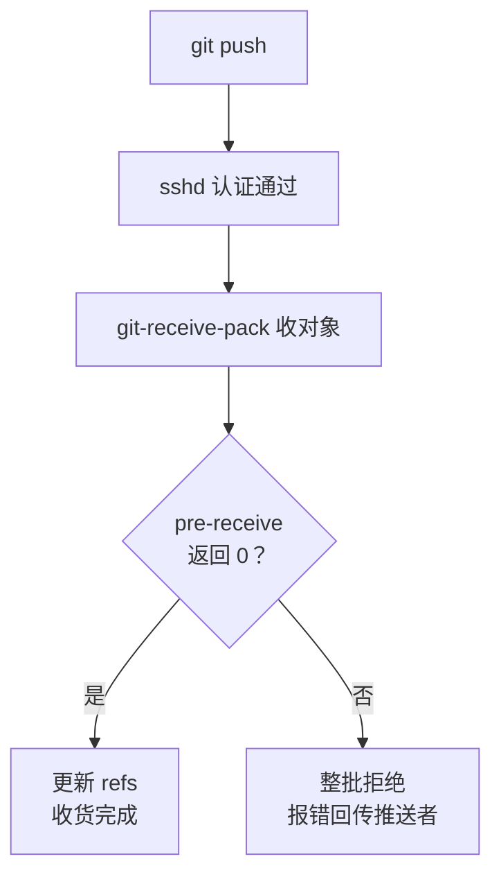

# 第22章：团队工作流与服务端钩子

> [!TIP] Part 4: 协同交响篇（交汇篇）
> 裸仓库解决了「有没有远程」的问题，本章解决「远程怎么管」：选一种团队工作流，用分支保护和服务端钩子把规矩从约定变成强制。这是里程碑 M4 的核心一步。

第21章结尾的裸仓库照单全收——任何人、任何分支、任何提交说明，来者不拒。一个人的时候这是自由，三个人开始这是灾难。云笔记阶段 3 的规模摆在这里：3 个人、12000 次提交、仓库 1.2GB（含图片素材），折算下来平均每个工作日 25 次提交在一条历史线上交织。

本章先看没规矩的仓库长什么样，再给出两条解药：一条管「怎么干活」（工作流），一条管「机器怎么把关」（钩子）。

## 22.1 从单干到团队

先看反例。某天的云笔记仓库，如果没有规矩，一天之内可以发生这些事：

- 阿林和小周同时直推 main，后推的人把先推的改动覆盖一半；
- 某人发现推错了，`git push --force` 强推重写历史——另外两人的本地 main 瞬间「分叉」，pull 下来一片混乱；
- 提交说明是「改了点东西」「aaa」「修 bug」——三个月后排查问题，历史等于白纸；
- 有人把 80MB 的临时设计稿随手提交进去，仓库从 1.2GB 涨到 1.3GB，全组每次 pull 多等 10 秒。

这些事故没有一个是技术难点，全是**流程缺位**：push 权限无约束、分支用途无约定、历史无结构。单干时你的自觉就是流程；三人之后，流程必须独立于任何人的自觉而存在。

把「有规矩」翻译成可执行的四条，就是本章的路线图：改动只进 feature 分支（工作流约定）；main 收到保护，直推被拒（平台强制）；提交说明有格式、大文件进不来（钩子强制）；出事能定位到人和版本（约定+日志）。前两条看 22.2 与 22.3，后两条看 22.4 与 22.5。

## 22.2 两种主流工作流

工作流（Workflow）回答的问题是：分支怎么开、什么时候合、main 保持什么状态。业界主流是两种，先看形状再看名字：

```text
主干开发（Trunk-Based Development）
main    ●──●──●──●──●──●──►
             ││  ││
feature      ●│  ●│    分支只活 2-3 天，随时并回

Git Flow（多长分支）
main     ●──────────●──────►  只放发布点
release     ───●───            发布准备，活数周
develop  ●──●──●──●──●────►    日常集成长线
hotfix      （线上救火专用短分支）
```

| 维度 | 主干开发（Trunk-Based Development） | Git Flow |
|------|-----------------------------------|----------|
| 分支寿命 | 2-3 天，最多一周 | develop 等长分支长期存活 |
| 合并节奏 | 高频小块，每天合 | 按版本周期批量合 |
| 适合团队 | 小团队、持续部署 | 大团队、按版本发版 |
| 发布节奏 | 随时可发，一周多次 | 攒一个 release 再发 |
| 心智负担 | 低，规则一句话说完 | 高，五类分支各司其职 |

主干开发的纪律只有一条：**main 随时处于可发布状态，功能分支短命快合**。Git Flow 用 develop、release、hotfix 多条长分支换来了「多版本并行维护」的能力，代价是每个人都要背一套分支语义，且 PR 的评审压力全堆在 release 节点上。

云笔记为什么选主干开发？看发布节奏就能定：一周发好几次，release 分支等于常年开着、永远在准备——纯负担没有收益。主干开发配上第20章的 PR 流程刚刚好：feature 分支只活两三天，合并即发布（第23章会实现这一点），main 永远能上线。**小团队选工作流的第一标准是心智负担，不是功能上限**——规模涨上去了再升级不迟。

## 22.3 分支保护

工作流写在文档里，约束力为零；写在平台设置里，约束力是百分之百。GitHub 的路径：仓库 Settings → Branches → Add branch protection rule（较新的仓库在 Settings → Rules → Rulesets，能力相同）：

| 保护规则 | 效果 |
|---------|------|
| Require a pull request before merging | 直推 main 直接被平台拒收 |
| Required approvals（设 1） | 至少一名同事批准才能合并 |
| Dismiss stale pull request approvals | 有新推送时旧批准作废，必须重审 |
| Do not allow force pushes | 22.1 那种强推重写历史从此失效 |
| Do not allow deletions | main 删不掉，手滑也救得回来 |

配好之后，第20章那套 PR 流程就从「大家自觉走」变成「不走进不去」。保护前：`git push origin main` 成功，规则名存实亡；保护后：同一条命令得到 `remote: error: GH006: Protected branch update failed`——而 feature 分支推送照常。**把规矩从人脑搬进配置，是协作从侥幸走向可靠的第一杠杆**。

两条配置经验。其一，Include administrators 勾上，否则管理员自己可以绕过保护——规矩对最忙的人失效，等于没立。其二，Dismiss stale approvals 要想清楚再勾：它保证「改过就必须重审」，代价是评审者要回来二刷；三人小团队建议勾上，历史的车轮不该从旧批准上碾过去。另外提醒一句：私有仓库的部分高级规则可能需要付费方案，开源仓库则全部可用——配之前先看自己仓库的提示条。

不过，分支保护是 GitHub 平台的能力，你第21章自建的裸仓库可没有设置页。它靠什么把关？答案是钩子。

## 22.4 服务端钩子 pre-receive

**钩子（Hook）**是 git 在特定时点自动执行的可执行脚本：走到这个时点，git 就去找约定位置的脚本跑一遍，脚本退出码非零则中止动作。第21章解剖裸仓库时，`hooks/` 目录你已经见过——里面躺着一堆 `.sample` 结尾的示例文件。启用方式朴素到不能再朴素：复制一份去掉 `.sample` 后缀，加上可执行权限。

服务端共三个钩子，时机和杀伤范围不同：

| 钩子 | 触发时机 | 输入 | 拒绝后果 |
|------|---------|------|---------|
| pre-receive | 更新 refs 之前 | 每行三列：旧值 新值 引用名 | 退出码非零，整次推送全部拒绝 |
| update | 每个引用更新之前 | 三个命令行参数 $1 $2 $3 | 只拒绝当前这一个引用 |
| post-receive | refs 更新之后 | 与 pre-receive 相同 | 无法拒绝（第23章部署的主角） |

主角是 pre-receive。它运行时 refs 还没更新、对象已进入仓库暂存区，标准输入里每行是一笔待更新的引用。一个细节：pre-receive 从**标准输入**读数据而不是命令行参数，因为一次 push 可能更新多个引用，行数不定；想要「逐引用拒绝、其余照常」的精细控制，用参数版的 update 钩子即可，机制完全相同。

第一个示例：禁止直推 main。存为 `/srv/git/cloudnote.git/hooks/pre-receive`：

```sh
#!/bin/sh
  # pre-receive：禁止直接推送 main，改动必须走 feature 分支 + PR
while read oldrev newrev refname; do
    if [ "$refname" = "refs/heads/main" ]; then
        echo "main 受保护：请推送 feature 分支并发起 Pull Request"
        exit 1
    fi
done
exit 0
```

逐行拆解：

- `while read oldrev newrev refname`：从标准输入逐行读「旧值 新值 引用名」。循环保证每一笔待更新都过检。
- `[ "$refname" = "refs/heads/main" ]`：分支在钩子眼里不是 main，而是全名 refs/heads/main——标签则是 refs/tags/ 开头，认准全名才不会误伤。
- `exit 1`：非零退出码即拒绝。**整批拒绝是 pre-receive 的语义**：哪怕这次 push 只有一个引用违规，全部照拒，不给半推半留的机会。
- `echo` 的文字会原样回传到推送者的终端，等于服务端给客户端递话——写清楚拒绝理由，能省一次「为什么推不上去」的提问。
- 循环走完没人拦路，`exit 0` 放行。

想再拦一种：force push。原理是正常推进时旧值一定是新值的祖先（第10章讲过祖先关系），被改写的历史则不然：

```sh
if ! git merge-base --is-ancestor "$oldrev" "$newrev"; then
    echo "检测到 force push，拒绝"
    exit 1
fi
```

`git merge-base --is-ancestor` 用退出码回答「前者是否为后者的祖先」，一行完成判断。整套逻辑画出来：



> [!NOTE] 钩子运行的身份与位置
> 服务端钩子以「推送者连接用的系统账号」身份运行——本章场景里就是 wang，所以它碰得到 /srv/git/cloudnote.git，也碰得到部署目录。钩子的标准输入与工作目录都有约定：cwd 是裸仓库根目录，git 命令直接可用。这些细节在第23章的 post-receive 里都要用到。

## 22.5 客户端钩子 pre-commit

钩子不只服务端有。客户端钩子住在仓库的 `.git/hooks/` 下，常用的几位：

| 客户端钩子 | 触发时机 | 典型用途 |
|-----------|---------|---------|
| pre-commit | git commit 执行时，提交信息还没写 | 大文件、疑似密钥、格式检查 |
| commit-msg | 提交信息写完之后 | 校验说明是否符合规范 |
| pre-push | git push 执行之前 | 推送前跑一遍快速测试 |

最常用的是 **pre-commit**：`git commit` 执行时、提交信息还没写之前触发。它适合放「本地就能判定的快速检查」——服务端把关全组底线，客户端把关自己的顺手检查。示例：拦截超大文件与疑似密钥。存为 `.git/hooks/pre-commit`：

```sh
#!/bin/sh
  # pre-commit：提交前两道闸门——超大文件与疑似密钥
fail=0

  # 闸门一：暂存区里有没有超过 5MB 的文件
big=$(git diff --cached --name-only | while read -r f; do
    if [ -f "$f" ] && [ "$(wc -c < "$f")" -gt 5242880 ]; then
        echo "$f"
    fi
done)
if [ -n "$big" ]; then
    echo "拒绝提交：以下文件超过 5MB 上限："
    echo "$big"
    fail=1
fi

  # 闸门二：本次新增的行里有没有疑似私钥或硬编码密钥
if git diff --cached -U0 | grep -qE '^\+.*(BEGIN [A-Z ]*PRIVATE KEY|api[_-]?key.{0,4}[=:])'; then
    echo "拒绝提交：新增内容疑似包含密钥"
    fail=1
fi

exit $fail
```

要点：`git diff --cached` 只看暂存区（第3章的暂存区，不是工作区），所以工作区里的临时大文件不碍事；5242880 就是 5MB 的字节数，用数字不用形容词；`-U0` 把 diff 收紧到只看新增行，配 `^\+` 过滤出「这一行是加进去的」；最后一行 `exit $fail` 决定提交放不放行。别忘了激活：

```bash
chmod +x .git/hooks/pre-commit
  # 不可执行的钩子会被 git 静默跳过——这是新手最常踩的哑坑
```

> [!WARNING] 客户端钩子不随 clone 传播
> `.git` 目录不进版本库，clone 下来的仓库里 hooks 是空的——每人都要手动装一遍，漏装就形同虚设。团队共享的标准做法：把钩子存进仓库里的 `.githooks/` 目录，然后每人执行一次 `git config core.hooksPath .githooks`。另外记住它的身份：客户端钩子是君子协定，`git commit --no-verify` 一秒绕过；**要堵死后门，还是得靠 22.4 的服务端钩子**。

## 22.6 实验：写一个 pre-receive 钩子并验证拒绝与放行

综合练习：给第21章的裸仓库装上「提交说明必须规范」的门禁，并验证一拒一放两个结果。

第一步，在服务器上写入钩子 `/srv/git/cloudnote.git/hooks/pre-receive`：

```sh
#!/bin/sh
  # 所有新提交的说明必须以 type: 开头
zero="0000000000000000000000000000000000000000"

while read oldrev newrev refname; do
    [ "$newrev" = "$zero" ] && continue

    if [ "$oldrev" = "$zero" ]; then
        commits=$(git rev-list "$newrev" --not --all)
    else
        commits=$(git rev-list "$oldrev..$newrev")
    fi

    for commit in $commits; do
        subject=$(git log -1 --format=%s "$commit")
        case "$subject" in
            feat:*|feat\(*\)*:*) ;;
            fix:*|fix\(*\)*:*) ;;
            docs:*|docs\(*\)*:*) ;;
            chore:*|chore\(*\)*:*) ;;
            *)
                echo "拒绝：$commit 的说明不规范 —— $subject"
                echo "要求形如：fix: 修复导出乱码"
                exit 1
                ;;
        esac
    done
done
exit 0
```

三处细节：新值全零代表删除分支，直接放行；旧值全零代表新建分支，此时没有可用的区间，改用 `git rev-list "$newrev" --not --all`（列出「现有引用都到不了的新提交」）；`case` 匹配 `type: 描述` 与 `type(范围): 描述` 两种形态。写完激活：

```bash
chmod +x /srv/git/cloudnote.git/hooks/pre-receive
```

反例先行——回本地推一个不合格的提交：

```bash
git commit --allow-empty -m "随手改改"
git push
```

预期输出（钩子的 echo 原样回传）：

```text
remote: 拒绝：a1b2c3d 的说明不规范 —— 随手改改
remote: 要求形如：fix: 修复导出乱码
To wang@203.0.113.10:/srv/git/cloudnote.git
 ! [remote rejected] main -> main (pre-receive hook declined)
```

`! [remote rejected]` 加括号里的 `pre-receive hook declined`，正是第19章说的「服务端拒绝」在客户端眼里的长相。修正提交说明再推：

```bash
git commit --amend -m "fix: 修复导出乱码"
git push
```

这次畅通无阻——提交还没被服务端收下，本地 amend 重写它毫无风险（若是已经推上去的提交，amend 后就要面对 force push 了，那是另一回事）。

最后补两个观察。其一，把两个分支的提交捆在一次 push 里：`git push origin feature/a feature/b`，其中 feature/b 有一个违规提交——结果是**两条分支都被拒**，这就是「整批拒绝」语义的现场演示，也是 pre-receive 与 update 钩子的行为分野。其二，此刻删一条远程分支 `git push origin --delete feature/tmp` 会顺利放行——新值全零走了脚本开头那条 continue，与设计一致。到这里，你的裸仓库已经会拒人、会说话，下一章让它干活。

## 本章小结

- 没规矩的团队仓库四宗罪：互相覆盖、force push 冲突、历史白纸、大文件入库
- 主流工作流两种：主干开发短命分支高频合并，Git Flow 多长分支按版本发版；小团队优先控心智负担
- 分支保护把 PR 流程变成强制：要求 PR、要求批准、禁 force push、禁删除，Include administrators 别漏勾
- 钩子是 git 在特定时点自动执行的脚本，退出码非零即中止；服务端三个钩子按「收货前/中/后」分时机
- pre-receive 从标准输入逐行读「旧值 新值 引用名」，退出非零整批拒绝，echo 文字原样回传客户端
- 客户端 pre-commit 适合本地快速检查；钩子不随 clone 传播，共享靠 core.hooksPath 指向仓库内目录
- 服务端钩子才是门禁，客户端钩子只是君子协定（--no-verify 可绕过）

**下一章预告**：门禁立好了，push 也照常收货——但收完货代码还躺在服务器里，用户看到的还是旧版本。下一章打通最后一公里：post-receive 钩子让 push 即上线，顺便把部署身份收敛到最小权限。

---
