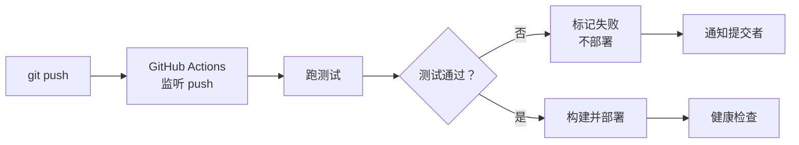

# 第23章：部署衔接：从 push 到上线

> [!TIP] Part 4: 协同交响篇（交汇篇）
> 第22章的钩子守住了门，本章让收进来的货直接上架：post-receive 钩子实现 push 即部署，再用 Deploy Key 把部署身份收敛到最小权限。里程碑 M4 的最后一块砖。

第22章结束时，你的裸仓库已经会拒绝坏提交、会放行好提交——但放行之后呢？代码安静地躺在 /srv/git/cloudnote.git 的 objects 里，用户访问到的还是旧版本。从 push 到上线，中间还差最后一公里。

这一公里恰恰是 SSH 与 Git 两条主线最后的交汇点：服务器是第17章加固过的，登录是第 5、13、14 章配的免密，仓库是第21章造的裸仓库，钩子是第22章学的机制。本章把它们焊成一条自动流水线。

## 23.1 push 之后还差一步

先把现状的痛量化。云笔记的手动发布流程是四步：

```text
git push ──► ssh 上服务器 ──► git pull ──► 重启服务
全部手工、全可出错：忘带钥、pull 撞冲突、敲错服务名
```

| 步骤 | 手工操作 | 典型翻车点 |
|------|---------|-----------|
| 1 | 本地 git push | 改的是本地文件，忘了推 |
| 2 | ssh wang@203.0.113.10 | 换了台电脑没带密钥 |
| 3 | 服务器上 git pull | 撞上遗留的本地改动，冲突 |
| 4 | 重启服务 | 忘了 sudo，或敲错服务名 |

第 3 步值得一讲：服务器上的发布目录如果被谁手动改过（改个配置、调个样式），它和裸仓库历史就脱节了——pull 一执行就是满屏冲突，和第21章警告过的工作仓库脱节是同一个病。手动流程的每一步都在制造这类「人类惊喜」。

这四步每次要 3 分钟。听起来不多？算笔账：按每天 5 次发布算，一天 15 分钟；一周 5 个工作日，75 分钟；一年按 240 个工作日，**整整 60 个小时花在重复敲同样的命令上**——还不算某次手滑多耗半小时排障的日子。平心而论，一天发布一两次时手动流程还能忍，忍不了的是「发布越快、发布越频繁、人工成本越高」这条反向曲线。

解法思路在第22章已经备好：既然 post-receive 钩子在「refs 更新之后」必然运行，那部署动作挂在这里，push 的瞬间就自动执行——**发布从一项任务退化成一个副作用**。

可能有人想问：为什么不干脆用 scp 或 rsync 把文件拷上服务器？因为那就丢掉了 git 部署最值钱的三样东西——确定的版本（部署的是哪个提交一目了然）、完整的回滚能力（第11章的标签）、以及「谁在何时改了什么」的审计线。**git 部署的本质，是部署一个确定的提交**。

## 23.2 post-receive：push 即部署

在服务器上写 `/srv/git/cloudnote.git/hooks/post-receive`：

```sh
#!/bin/sh
  # push 即部署：checkout 到专用发布目录并重启服务
LOG=/var/log/cloudnote-deploy.log
log() {
    echo "[$(date '+%F %T')] $*" >> "$LOG"
}

log "收到推送，开始部署"
git --work-tree=/var/www/cloudnote \
    --git-dir=/srv/git/cloudnote.git \
    checkout -f main

if sudo systemctl restart cloudnote; then
    log "文件已更新，服务已重启"
else
    log "文件已更新，但服务重启失败，需人工检查"
fi
```

逐行拆解：

- `log()` 函数：把每步动作带上时间戳追加进部署日志。出问题时，这份日志就是发布历史——23.5 的回滚全指望它。
- `--git-dir=/srv/git/cloudnote.git`：显式指定仓库。钩子运行时 git 的环境变量已被设成裸仓库自身（第22章提过 cwd 就是仓库根目录），路径一变就容易乱——显式写全是最稳的写法，社区里一半的「钩子不生效」问题都栽在这里。
- `--work-tree=/var/www/cloudnote`：把检出目标指到发布目录。裸仓库自己没有工作区（第21章），这两行等于临时借给它一个。
- `checkout -f main`：把 main 的内容强制铺到发布目录，已存在的文件按仓库版本覆盖。
- `sudo systemctl restart cloudnote`：重启服务。普通用户无权重启系统服务，免密 sudo 的口子开在下一步。
- `if / else`：重启失败只记日志不报异常——post-receive 本就无力回滚（货已收下，refs 已更新），但日志必须留下现场。

进阶一步：post-receive 的标准输入里正是「旧值 新值 引用名」，把部署的提交号记进日志，23.5 的回滚就有了精确坐标：

```sh
while read oldrev newrev refname; do
    log "已部署 $refname -> $newrev"
done
```

服务重启需要权限，用 sudoers 精准放行这一条命令。服务器上执行 `sudo visudo -f /etc/sudoers.d/cloudnote-deploy` 写入：

```text
wang ALL=(root) NOPASSWD: /usr/bin/systemctl restart cloudnote
```

语法是「wang 可以以 root 身份免密执行这一条命令」——只能重启 cloudnote，不能 systemctl 随便玩。**免密 sudo 的口子开多大，取决于路径写多精确**。最后两件杂事——激活钩子，并把发布目录划给推送账号：

```bash
chmod +x /srv/git/cloudnote.git/hooks/post-receive
sudo chown -R wang:wang /var/www/cloudnote
```

目录不归 wang 所有，checkout 就写不进去，这是钩子「不生效」的第二大常见原因。

在本地随便提交一笔然后 push，push 的输出里会多出 `remote:` 开头的行——那就是钩子的标准输出跨着 SSH 回来了：

```text
To wang@203.0.113.10:/srv/git/cloudnote.git
   a1b2c3d..e4f5a6b  main -> main
```

同时部署日志里出现「收到推送，开始部署」到「服务已重启」两行，全程零手工。

> [!WARNING] checkout -f 会无条件覆盖发布目录
> main 里有什么，/var/www/cloudnote 就变成什么，目录里手工改过的东西会被直接抹掉。所以发布目录必须是**专用目录**：不放手工改动、不放上传文件、不放日志。原则一句话——服务器上的这个目录只准 git 写，人不许碰。

## 23.3 Deploy Key：最小权限的部署身份

流水线通了，但安全复盘时你会发现自己刚挖了个坑：部署用的是什么身份？如果按第 13-14 章的常规做法，把你的个人私钥放进部署脚本——那就等于把你「能登录所有服务器、能推所有仓库」的万能钥塞进了自动化链路。CI 机器、脚本文件、日志现场，处处都是它的容身之处。

正解是**部署密钥（Deploy Key）**：一把只服务单个仓库的专用密钥。GitHub 上的路径：仓库 Settings → Deploy keys → Add deploy key，默认只读，勾选 Allow write access 才可写；注意 GitHub 的限制是一把 deploy key 只能绑定一个仓库，想多仓库共用要走机器账号或 token——限制本身就是最小权限的体现。

第21章的自建裸仓库用等价做法：在服务器上建一个专用系统账号 deploy，把部署机的公钥写进它的 authorized_keys，并用第20章讲过的 command= 前缀锁死用途：

```text
command="git-upload-pack '/srv/git/cloudnote.git'",no-pty,no-port-forwarding ssh-ed25519 AAAAC3Nza... cloudnote-deploy
```

这行配置把「部署身份」从人身上彻底解耦：它能干的只有一件事——读这一个仓库。

一个务实的选择：部署机的密钥不设 passphrase（第14章），否则无人值守的自动化会在深夜被密码提示卡死。代价想清楚再选：部署机被攻破时私钥即裸奔——正因为有这个代价，才更要靠本节的最小权限兜底：这把钥本来就只有一个仓库的只读权。

| 维度 | 个人 SSH key | Deploy Key |
|------|-------------|-----------|
| 归属 | 绑定个人账号 | 绑定单个仓库 |
| 权限范围 | 账号内所有可访问仓库 | 默认只读该仓库（可选读写） |
| 人员离职 | 要逐台逐平台清理 | 部署链路完全不受影响 |
| 泄露影响面 | 大：可登你所有服务器 | 小：单个仓库，秒级吊销 |
| 存放位置 | 开发者本机 | 部署机或 CI runner |

**分家的核心逻辑是人货分离**：代码库的读权限是「货」，人是「过客」。阿林哪天离职，删他的个人钥即可，部署流水线照常转；反过来部署机被攻破，损失的也只是这一个仓库的只读权限，你的其他服务器和仓库分毫无损。第22章的最小权限原则，在身份层面的落点就是这里。

## 23.4 更稳的路径：CI/CD

钩子方案十分钟搭好，但它有个先天短板：**没有测试门禁**。post-receive 在收货之后运行——坏代码只要过了 pre-receive 的格式检查，就已经进入仓库并直达线上。更完备的答案是 CI/CD（持续集成/持续部署，Continuous Integration / Continuous Deployment）：推送触发自动化流水线，测试不通过就不部署。

以 GitHub Actions 为例（云笔记的开源组件走这条路），完整链路是：



几个关键件的位置：workflow 文件放在仓库的 `.github/workflows/` 目录，随提交进版本库；执行环境叫 runner（托管平台提供，也可自建）；部署要用的凭证走平台的 secrets 机制加密注入——和第23章 Deploy Key 思想一脉相承，密钥永远不写进 workflow 文件本身。触发器的写法一眼就懂——监听 main 的 push：

```yaml
on:
  push:
    branches: [main]
```

入门概念看站内 [GitHub Actions 完全教程第1章](/github-actions/ch01)；从测试到部署的完整实战，直接对照[第13章：完整实战——Node.js 项目从测试到部署](/github-actions/ch13)搭建，与本节的链路一一对应。

两条路线怎么选：

| 维度 | post-receive 钩子 | CI/CD 平台 |
|------|------------------|-----------|
| 搭建成本 | 十分钟，一个脚本 | 要写 workflow、维护 runner 或用托管 |
| 测试门禁 | 无，push 完即上线 | 测试不过不部署 |
| 审计与通知 | 自己写日志 | 内置留痕、失败通知、环境隔离 |
| 适用场景 | 内网小项目、个人服务 | 团队协作、有质量要求的发布 |

**结论不是二选一，而是按风险选**：云笔记的内部部署走钩子，够用且零依赖；对外服务的发布走 CI，用测试门禁把事故挡在上线之前。个人项目从钩子起步，等出现「坏提交直奔线上」的第一次事故，就是迁移到 CI 的信号。门禁的账也好算：测试平均 90 秒，换来坏提交永远到不了用户眼前——这是全书性价比最高的 90 秒。

## 23.5 回滚预案

自动化让发布变快，也让坏版本上线的速度变快。所以自动部署的另一半是**回滚（Rollback）**：出问题时，把发布目录退回上一个已知的好版本。

回滚的抓手是标签（第11章）。云笔记的约定：每次上线打一个版本标签，v1.8.0、v1.8.1、v1.8.2……出事时在服务器上一条命令退回去：

```bash
git --work-tree=/var/www/cloudnote \
    --git-dir=/srv/git/cloudnote.git \
    checkout -f v1.8.1
sudo systemctl restart cloudnote
```

checkout 的对象从 main 换成标签名，发布目录就铺成 v1.8.1 的内容——和部署用的是同一套机制，没有新东西要学。修好后重新 checkout 回 main 即可前进。

标签命名建议沿用第11章的附注标签与三段式版本号 v主.次.修订，回滚时你才知道 v1.8.1 与 v1.8.0 差在哪。一个必须知道的边界：若发布包含数据库结构变更，回滚文件容易、回滚数据难——那类变更要走「先兼容、后清理」的两段式发布，超出本书范围，但值得先记住这个雷区。

> [!TIP] 回滚预案的两条铁律
> 一，**永远保留上一个可回退版本**：发布日志里记录每次部署的提交号（23.2 的 log 函数就是为这一刻准备的），坏版本发现问题往往在几次发布之后，你得能说出「上一个好的是哪个」。二，回滚是止血不是治病：退回 v1.8.1 的同时就该在仓库里开 issue 复盘 v1.8.2 的问题，否则你会陷入反复横跳。

预案不能只停在纸面。建议每月把回滚完整演一遍：打标签、故意部署一个坏版本、按预案退回、验证服务——五分钟的例行演习，换来事故当晚的肌肉记忆。**预案的可靠性不取决于它写得多好，取决于你上次演练是哪天**。

## 23.6 实验：云笔记 push 自动上线全链路

收官实验：从本地一行修改到 curl 看到新内容，全程不碰服务器。先把服务补齐，在服务器上创建 `/etc/systemd/system/cloudnote.service`：

```ini
[Unit]
Description=cloudnote static site
After=network.target

[Service]
User=wang
ExecStart=/usr/bin/python3 -m http.server 8080 --directory /var/www/cloudnote
Restart=on-failure

[Install]
WantedBy=multi-user.target
```

一个极简静态服务：python 起在 8080 端口，只伺服发布目录。启用并确认基线：

```bash
sudo systemctl daemon-reload
sudo systemctl enable --now cloudnote
curl -s http://203.0.113.10:8080/version.txt
  # 输出: v1.8.2
```

然后在本地制造一次发布：

```bash
cd ~/cloudnote
echo "v1.8.3" > version.txt
git add version.txt
git commit -m "chore: 发布 v1.8.3"
git push
```

push 命令返回的瞬间，部署已经在服务器上完成——push 自己的输出里就能看到这次提交的落点：

```text
To wang@203.0.113.10:/srv/git/cloudnote.git
   a1b2c3d..e4f5a6b  main -> main
```

验证三连：

```bash
ssh wang@203.0.113.10 tail -2 /var/log/cloudnote-deploy.log
  # 输出: [2026-xx-xx 10:xx:xx] 收到推送，开始部署
  #       [2026-xx-xx 10:xx:xx] 文件已更新，服务已重启

curl -s http://203.0.113.10:8080/version.txt
  # 输出: v1.8.3
```

两行日志的时间戳几乎在同一秒——push 到 curl 看到新版本，全程通常不到 10 秒。对照 23.1 的账本：那 60 个小时的一年——**自动化买回的不是 3 分钟，是「发布这件事从待办清单里消失」**。

再做一个小验证巩固理解：故意把 version.txt 改回旧值直接在服务器上编辑，然后再次 push——你会发现手工改动被 checkout -f 覆盖了，23.2 的 WARNING 说的是认真的。至此里程碑 M4 达成：从零搭出的 push 即部署私有 Git 服务，你已经有了。

## 本章小结

- 手动发布四步每天 15 分钟、一年约 60 小时，且每步都是独立故障点，发布越频繁成本越高
- post-receive 在 refs 更新后自动运行，用 --work-tree 把 main checkout 到专用发布目录再重启服务
- 免密 sudo 只放行精确到参数的一条命令，路径越精确口子越小；发布目录归属推送账号
- checkout -f 无条件覆盖发布目录：目录必须专用，人不得在里面留任何手工改动
- Deploy Key 把部署身份收敛到单仓库单权限：人员流动与部署解耦，泄露影响面最小
- CI/CD 在收货前加测试门禁：workflow 随版本库存放，凭证走 secrets 注入
- 钩子快而糙、CI 稳而重，按风险与团队规模选，二者可以按项目并存
- 回滚靠标签：永远保留上一个可回退版本，发布日志记录每次部署的提交号，预案要定期演练

**下一章预告**：全书的最后一步——把 24 章的知识串成一次完整旅行，演练密钥泄露应急，再用一场连环故障测试你的排错功力。

---
