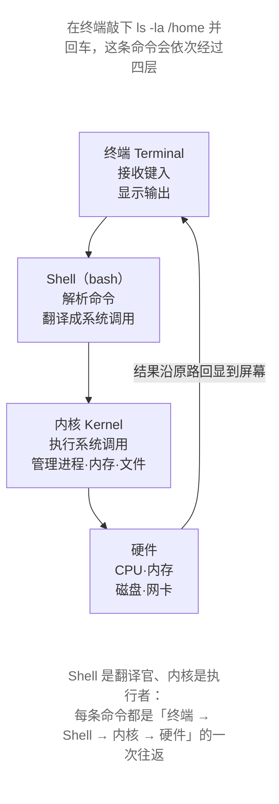
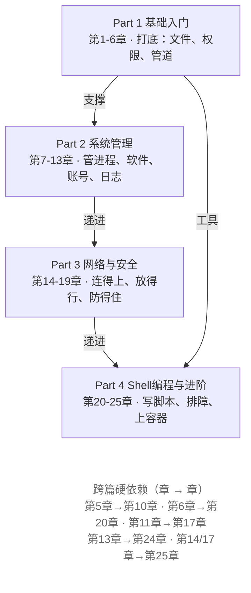
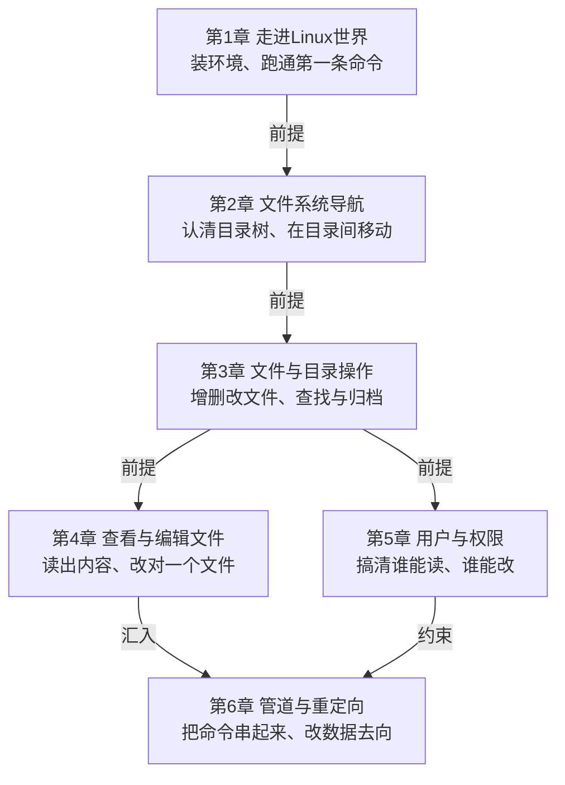
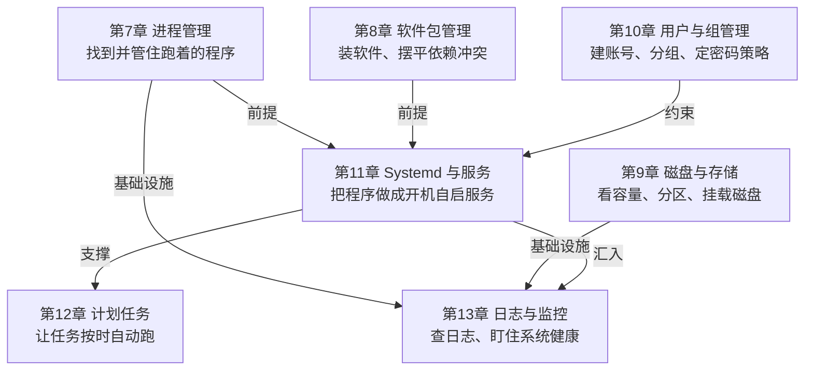
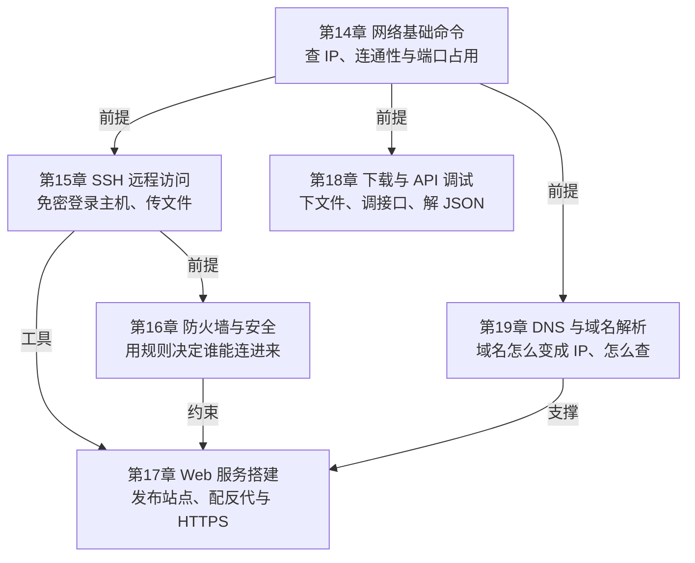
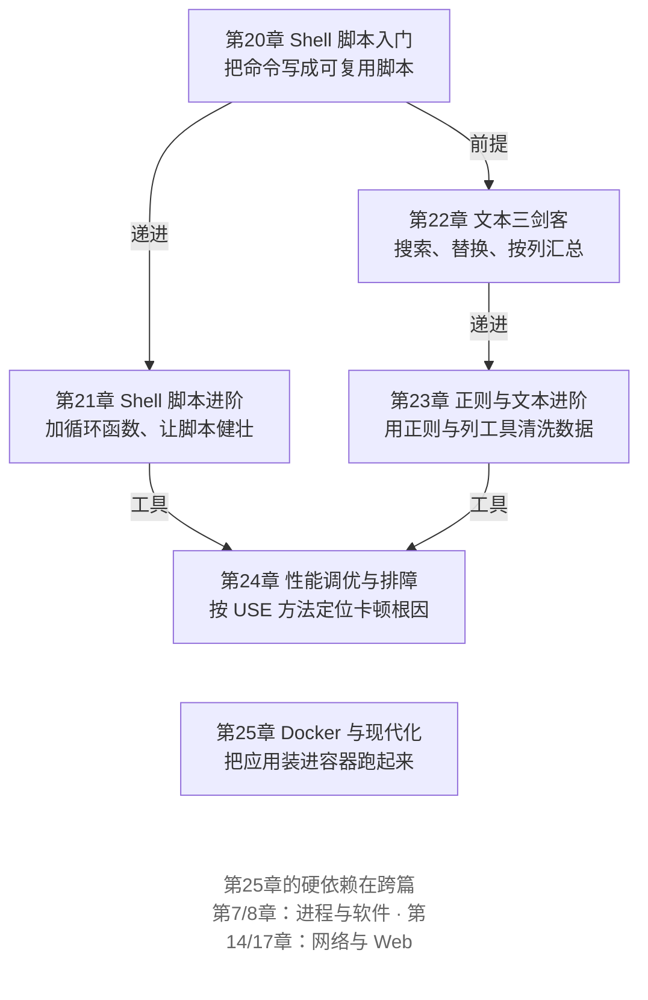

# Linux命令行完全教程

> 从零基础到命令行高手：开发者必备的Linux生存指南

**适用环境**：Ubuntu 22.04/24.04 LTS  
**读者定位**：有编程基础但Linux命令行不熟练的开发者  
**教程目标**：系统掌握Linux命令行，能够独立完成开发环境搭建、服务器运维、自动化脚本等日常工作

---

## 目录

### Part 1：基础入门篇（第1-6章）

- [第1章：走进Linux世界](./ch01.md)
- [第2章：文件系统导航](./ch02.md)
- [第3章：文件与目录操作](./ch03.md)
- [第4章：查看与编辑文件](./ch04.md)
- [第5章：用户与权限](./ch05.md)
- [第6章：管道与重定向](./ch06.md)

### Part 2：系统管理篇（第7-13章）

- [第7章：进程管理](./ch07.md)
- [第8章：软件包管理](./ch08.md)
- [第9章：磁盘与存储](./ch09.md)
- [第10章：用户与组管理](./ch10.md)
- [第11章：Systemd 与服务管理](./ch11.md)
- [第12章：计划任务与自动化](./ch12.md)
- [第13章：系统日志与监控](./ch13.md)

### Part 3：网络与安全篇（第14-19章）

- [第14章：网络基础命令](./ch14.md)
- [第15章：SSH 远程访问](./ch15.md)
- [第16章：防火墙与安全](./ch16.md)
- [第17章：Web 服务搭建](./ch17.md)
- [第18章：下载工具与 API 调试](./ch18.md)
- [第19章：DNS 与域名解析](./ch19.md)

### Part 4：Shell编程与进阶篇（第20-25章）

- [第20章：Shell脚本入门](./ch20.md)
- [第21章：Shell脚本进阶](./ch21.md)
- [第22章：文本处理三剑客——grep、sed、awk](./ch22.md)
- [第23章：高级文本处理与正则表达式](./ch23.md)
- [第24章：性能调优与故障排查](./ch24.md)
- [第25章：Docker容器与Linux现代化](./ch25.md)

---

## 心智模型

全书只有一条运行模型值得背下来：命令怎么从键盘走到硬件、结果又怎么回到屏幕。四个 Part 之间的依赖关系放在下一节。

### 一、核心模型：一条命令的旅程

**图 0-1｜核心模型：一条命令的旅程**（终端接收输入，Shell 翻译成系统调用，内核驱动硬件执行，结果沿回流线返回屏幕）：

- **终端（Terminal）只是窗口**：负责把键盘输入交给 Shell，再把输出画回屏幕——Windows Terminal、GNOME Terminal 都属于这一层。
- **Shell（bash）是翻译官**：解析命令行、展开变量与通配符，然后通过系统调用（system call）请求内核服务。
- **内核（Kernel）是唯一能直接操作硬件的层**：调度进程、分配内存、读写磁盘。
- **「一切皆文件」贯穿各层**：硬盘是 /dev/sda，进程信息在 /proc，你写的代码也是文件——这是全书反复出现的视角。

---

## 全景总览：四个 Part 与 25 章的关系

下面的五张图是目录的可视化版本：箭头表示依赖方向，不是阅读顺序；每个节点第二行写着这一章的目的，每条边上的词是关系类型。

**图 0-2｜四个 Part 的关系**（箭头示依赖方向，灰字列出跨篇的章到章硬依赖）：

四篇的主线是：Part 1 打底，Part 2 接管整机，Part 3 把机器接上网，Part 4 把重复劳动变成脚本与容器。

### Part 1 内部关系（第1-6章）

第 1 章铺好环境与语法；第 2-4 章沿「认路 → 动文件 → 读改内容」推进；第 5 章给所有文件操作加上权限约束；第 6 章把单条命令汇成流水线。

**图 0-3｜Part 1 章节关系**（认路 → 动文件 → 读改内容，权限与数据去向在末端汇合）：

### Part 2 内部关系（第7-13章）

第 7、8、10 章分别提供进程、软件与身份三个前提，第 11 章把它们托管成服务，第 12 章让任务按时执行，第 13 章收拢日志与指标。

**图 0-4｜Part 2 章节关系**（三路前提汇入第 11 章，日志与监控收口）：

### Part 3 内部关系（第14-19章）

第 14 章是全网地基；第 15-16 章解决「怎么进去、谁能进来」，第 19 章解决域名指向，三者共同支撑第 17 章的 Web 服务；第 18 章是随取随用的下载与 API 工具。

**图 0-5｜Part 3 章节关系**（第 14 章筑基，第 15/16/19 章共同支撑第 17 章）：

### Part 4 内部关系（第20-25章）

第 20-21 章从能写脚本到写得健壮，第 22-23 章补上文本处理与正则，第 24 章把这些能力用于排障；第 25 章的硬依赖主要在其他篇。

**图 0-6｜Part 4 章节关系**（脚本与文本工具汇入排障，第 25 章单独标注跨篇依赖）：

这五张图把 25 章串成一张网：每章开头的「图 N-1」都能挂回其中一个节点，学完任意一章，都可以顺着箭头找到它的上游与下游。

---
