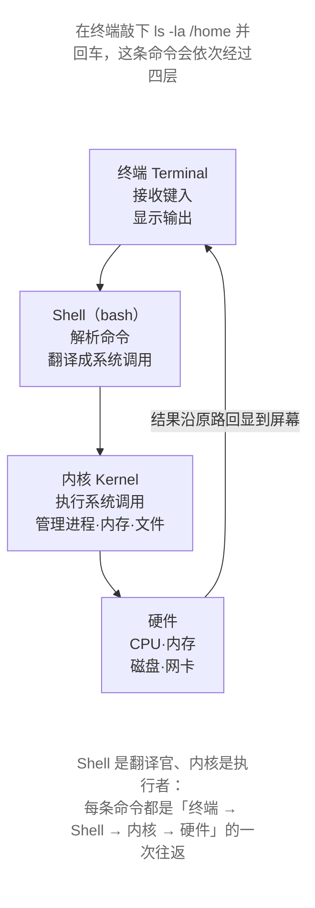
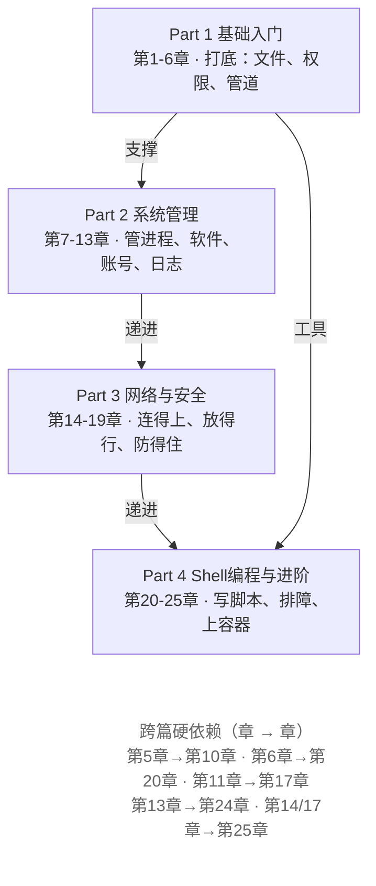
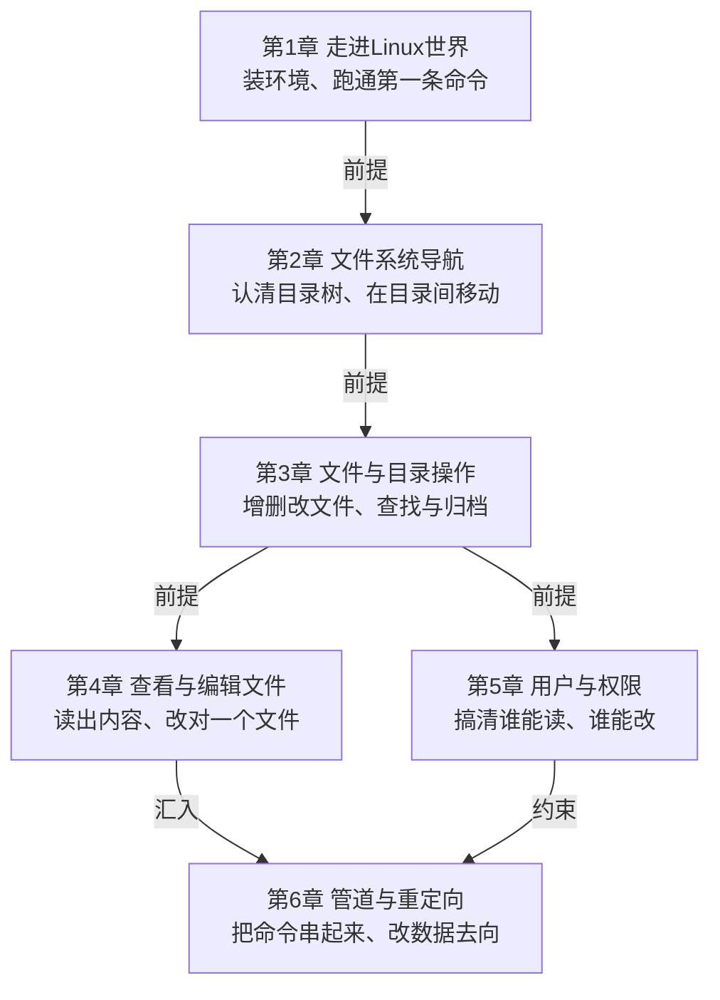
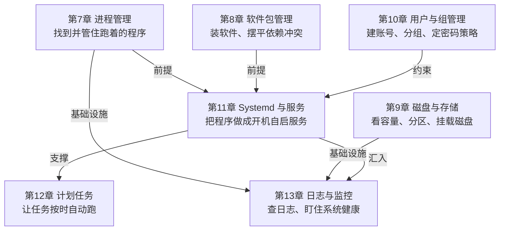
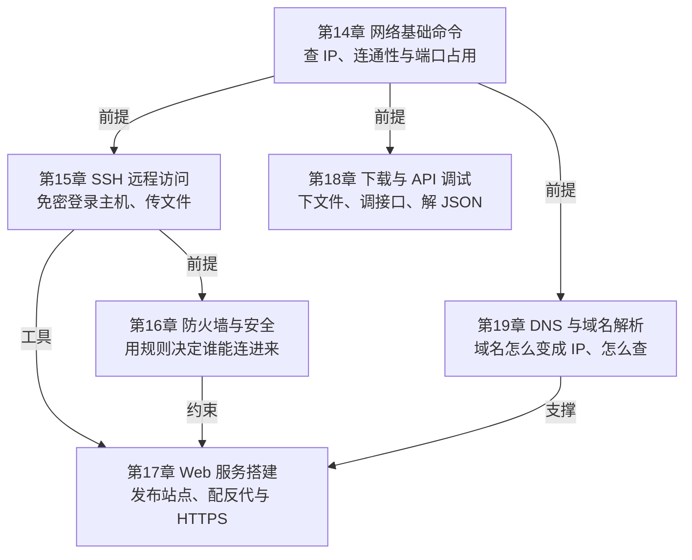
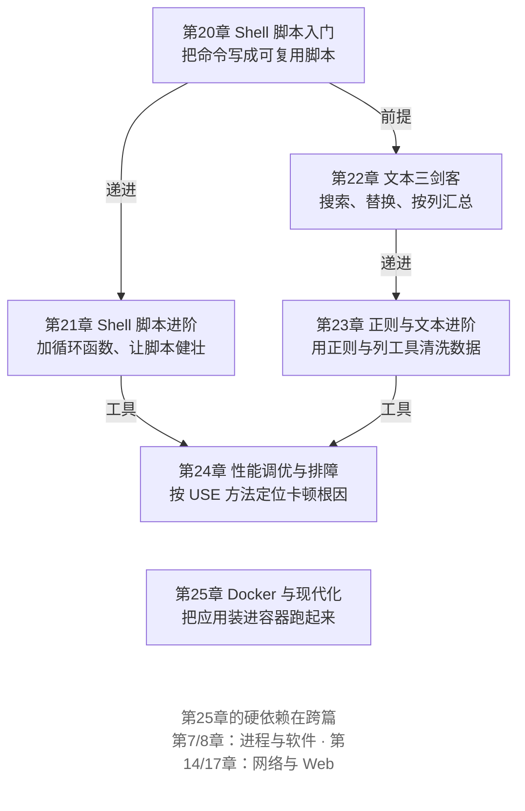

# Linux命令行完全教程

> 从零基础到命令行高手：开发者必备的Linux生存指南

**适用环境**：Ubuntu 22.04/24.04 LTS  
**读者定位**：有编程基础但Linux命令行不熟练的开发者  
**教程目标**：系统掌握Linux命令行，能够独立完成开发环境搭建、服务器运维、自动化脚本等日常工作

---

## 目录

### Part 1：基础入门篇（第1-6章）

- [第1章：走进Linux世界](./ch01.md)
- [第2章：文件系统导航](./ch02.md)
- [第3章：文件与目录操作](./ch03.md)
- [第4章：查看与编辑文件](./ch04.md)
- [第5章：用户与权限](./ch05.md)
- [第6章：管道与重定向](./ch06.md)
- [Part 1 自测](./part1-test.md)

### Part 2：系统管理篇（第7-13章）

- [第7章：进程管理](./ch07.md)
- [第8章：软件包管理](./ch08.md)
- [第9章：磁盘与存储](./ch09.md)
- [第10章：用户与组管理](./ch10.md)
- [第11章：Systemd 与服务管理](./ch11.md)
- [第12章：计划任务与自动化](./ch12.md)
- [第13章：系统日志与监控](./ch13.md)
- [Part 2 自测](./part2-test.md)

### Part 3：网络与安全篇（第14-19章）

- [第14章：网络基础命令](./ch14.md)
- [第15章：SSH 远程访问](./ch15.md)
- [第16章：防火墙与安全](./ch16.md)
- [第17章：Web 服务搭建](./ch17.md)
- [第18章：下载工具与 API 调试](./ch18.md)
- [第19章：DNS 与域名解析](./ch19.md)
- [Part 3 自测](./part3-test.md)

### Part 4：Shell编程与进阶篇（第20-25章）

- [第20章：Shell脚本入门](./ch20.md)
- [第21章：Shell脚本进阶](./ch21.md)
- [第22章：文本处理三剑客——grep、sed、awk](./ch22.md)
- [第23章：高级文本处理与正则表达式](./ch23.md)
- [第24章：性能调优与故障排查](./ch24.md)
- [第25章：Docker容器与Linux现代化](./ch25.md)
- [Part 4 自测](./part4-test.md)
- [全书毕业测试](./final-test.md)

---

## 心智模型

全书只有一条运行模型值得背下来：命令怎么从键盘走到硬件、结果又怎么回到屏幕。四个 Part 之间的依赖关系放在下一节。

### 一、核心模型：一条命令的旅程

**图 0-1｜核心模型：一条命令的旅程**（终端接收输入，Shell 翻译成系统调用，内核驱动硬件执行，结果沿回流线返回屏幕）：

- **终端（Terminal）只是窗口**：负责把键盘输入交给 Shell，再把输出画回屏幕——Windows Terminal、GNOME Terminal 都属于这一层。
- **Shell（bash）是翻译官**：解析命令行、展开变量与通配符，然后通过系统调用（system call）请求内核服务。
- **内核（Kernel）是唯一能直接操作硬件的层**：调度进程、分配内存、读写磁盘。
- **「一切皆文件」贯穿各层**：硬盘是 /dev/sda，进程信息在 /proc，你写的代码也是文件——这是全书反复出现的视角。

---

## 全景总览：四个 Part 与 25 章的关系

下面的五张图是目录的可视化版本：箭头表示依赖方向，不是阅读顺序；每个节点第二行写着这一章的目的，每条边上的词是关系类型。

**图 0-2｜四个 Part 的关系**（箭头示依赖方向，灰字列出跨篇的章到章硬依赖）：

四篇的主线是：Part 1 打底，Part 2 接管整机，Part 3 把机器接上网，Part 4 把重复劳动变成脚本与容器。

### Part 1 内部关系（第1-6章）

第 1 章铺好环境与语法；第 2-4 章沿「认路 → 动文件 → 读改内容」推进；第 5 章给所有文件操作加上权限约束；第 6 章把单条命令汇成流水线。

**图 0-3｜Part 1 章节关系**（认路 → 动文件 → 读改内容，权限与数据去向在末端汇合）：

### Part 2 内部关系（第7-13章）

第 7、8、10 章分别提供进程、软件与身份三个前提，第 11 章把它们托管成服务，第 12 章让任务按时执行，第 13 章收拢日志与指标。

**图 0-4｜Part 2 章节关系**（三路前提汇入第 11 章，日志与监控收口）：

### Part 3 内部关系（第14-19章）

第 14 章是全网地基；第 15-16 章解决「怎么进去、谁能进来」，第 19 章解决域名指向，三者共同支撑第 17 章的 Web 服务；第 18 章是随取随用的下载与 API 工具。

**图 0-5｜Part 3 章节关系**（第 14 章筑基，第 15/16/19 章共同支撑第 17 章）：

### Part 4 内部关系（第20-25章）

第 20-21 章从能写脚本到写得健壮，第 22-23 章补上文本处理与正则，第 24 章把这些能力用于排障；第 25 章的硬依赖主要在其他篇。

**图 0-6｜Part 4 章节关系**（脚本与文本工具汇入排障，第 25 章单独标注跨篇依赖）：

这五张图把 25 章串成一张网：每章开头的「图 N-1」都能挂回其中一个节点，学完任意一章，都可以顺着箭头找到它的上游与下游。

---

## 词链

五张图是依赖网，词链是检索手柄：每一章压缩成一个英文词（都是手册与命令行里的母语词），词按章序连成链，每个词再挂一句核心句。图回答「为什么有这一章」，词链回答「这一章叫什么」——合上书能做的两件事：**顺着链默写 25 个词**；**指着任意一个词，说出它本章的 3 个坑**（答案在各章小结）。

**L1 · 四篇词**：

| 篇 | 词 | 机制句 |
|---|---|---|
| Part 1 | **command line**（命令行） | 一条命令从终端走到硬件再回来；文件系统给地址、权限给许可、管道给去路——后面一切章节都站在这几样上。 |
| Part 2 | **administration**（系统管理） | 从「会用」到「归我管」：进程、软件、磁盘、账号、服务、时间、日志，七件事各有台账。 |
| Part 3 | **network**（网络） | 连得上 → 进得来 → 拦得住 → 开得了门 → 用得上 → 找得到，六关全过才算一台对外的机器。 |
| Part 4 | **automation**（自动化） | 重复劳动交给脚本与三剑客，突发故障交给方法论，环境漂移交给容器。 |

**L2 · 二十五章词链**：

| 章 | 词 | 核心句 |
|---|---|---|
| 01 | **shell**（Shell） | Shell 是用户与内核之间的翻译官——每条命令执行前，它先解析命令行、展开变量与通配符，再以系统调用请求内核。 |
| 02 | **navigation**（导航） | 文件系统是一棵以 / 为根的树，一切定位从「当前所在」起算——绝对路径从根算、相对路径从脚下算。 |
| 03 | **namespace**（名字空间） | 目录树上的名字只是 inode 的引用——同一份数据可有多个名字（硬链）与别名（软链），改名移动动的是名字不是数据。 |
| 04 | **content**（内容） | 名字之下才是内容——读是把字节搬到屏幕，写是改完整体回写，编辑器的「保存」是一次新写不是就地修补。 |
| 05 | **access control**（访问控制） | 每次访问都过一道门——属主/属组/其他 × 读/写/执行，自上而下命中即停，门跟着文件走不跟人走。 |
| 06 | **redirection**（重定向） | 每个进程自带 0/1/2 三根管子，重定向只是换接法——先开后合有顺序，\| 是把 stdout 接进下一条的 stdin。 |
| 07 | **lifecycle**（生命周期） | 进程从 fork 而来、靠信号调度生死——状态可看（ps/top）、优先级可调（nice）、终止分 TERM 与 KILL；父死子不亡成孤儿、死而不收成僵尸。 |
| 08 | **package**（软件包） | 软件不散装下载——从仓库按索引取包、由包管理器解析依赖并整装整卸，动包前先 update 索引。 |
| 09 | **mount**（挂载） | 分区要先挂到目录树某一点才可见——df 看挂载点用量、du 看目录树占用，两者对不上必有蹊跷。 |
| 10 | **account**（账号） | 人以账号入系统、以组分权限——密码是自己的钥匙、sudo 是借来的权力、组是批量门禁名单。 |
| 11 | **service**（服务） | 长活程序由 PID 1 的 systemd 统一托管——unit 描述它、依赖定启动序、enable 只是登记开机、start 才真的跑。 |
| 12 | **schedule**（调度） | 到点任务由守护进程代跑——cron 按「分 时 日 月 周」触发，用的是它自己的环境不是你的登录环境。 |
| 13 | **observability**（可观测性） | 系统的过去在日志里、现在在计数器里——journalctl/dmesg 翻历史，free/vmstat 看当下，合起来才叫看得见。 |
| 14 | **layers**（分层） | 网络是一条分层链路——网卡→IP→网关→外网→DNS→端口→路由→抓包，故障只能从底往上逐层排除，下层不通上层全废。 |
| 15 | **tunnel**（隧道） | SSH 是一条加密隧道——登录是走隧道、scp/rsync 是往里搬货、-L/-R 是把别的端口借道穿过来，信任由密钥与 known_hosts 建立。 |
| 16 | **firewall**（防火墙） | 准入是规则列表自上而下命中即停——默认策略决定没命中的进不进，写规则的人最容易把自己锁在门外。 |
| 17 | **dispatch**（分诊） | Web 服务器是一台总机——按域名挑虚拟主机、按路径挑 location、按 proxy_pass 挑上游，403/502/504 分别断在门牌、上游、等待三段。 |
| 18 | **request**（请求） | 客户端一切皆一次 HTTP 请求——curl 裸写方法与头、wget 负责完整搬回、jq 只管回包里的 JSON。 |
| 19 | **resolution**（解析） | 域名变 IP 走一条缓存链——本地缓存→resolv.conf→DNS→hosts→nsswitch，每环都可能给旧答案，TTL 决定旧多久。 |
| 20 | **script**（脚本） | 脚本就是把会敲的命令写进文件——Shebang 定解释者、执行方式定在哪个 Shell 里跑、引号定变量在哪一步展开。 |
| 21 | **fail-fast**（快速失败） | 脚本默认错了继续——set -euo pipefail 把「错」变「停」，trap 把「停」变「有交代」，边界情况写时就该拒绝。 |
| 22 | **stream**（流） | 三剑客在同一条流上做手术——grep 选行、sed 改行、awk 按字段算，一行一行过不整读内存。 |
| 23 | **regex**（正则） | 正则是一个模式语言——字符类与量词描述「长什么样」，贪婪匹配总是多吃、元字符先转义、方言定语法。 |
| 24 | **bottleneck**（瓶颈） | 排障不是猜——按 USE 方法逐资源问「利用率、饱和度、错误」，CPU/内存/IO/网络依次过，堵点自己浮出来，load 高不等于 CPU 忙。 |
| 25 | **container**（容器） | 容器是同一颗内核上的隔离进程——镜像给只读根文件系统、namespace 给独立视野、cgroup 限用量，「在我机器上能跑」的解法是把环境一起打包。 |

## 学习路径与复习节奏

**两条路线**：

- **顺序路线（默认）**：按目录顺序学。每章读完，合上书做一件事——说出本章手柄词的 3 个坑（参考答案在该章末小结③）。
- **词链路线（复习）**：沿上面的词链跳章——给词，回忆核心句与 3 个坑；卡住的词，才回那一章重读。

**复习节奏**（站点不会替你记账，节奏自己拿捏）：

1. 学完一章：隔天对词说 3 个坑，说不出的回对应小节重读。
2. 学完一个 Part：去该 Part 自测章闭卷作答，全部做完再看答案；错题按「回指小节」重读，隔 1 天重做错题。
3. 隔 7 天：再默一遍该 Part 词链，并把词串成一句话。
4. 四个 Part 全部完成：做全书毕业测试收口；此后每月沿词链抽 5 个词自查一次。

