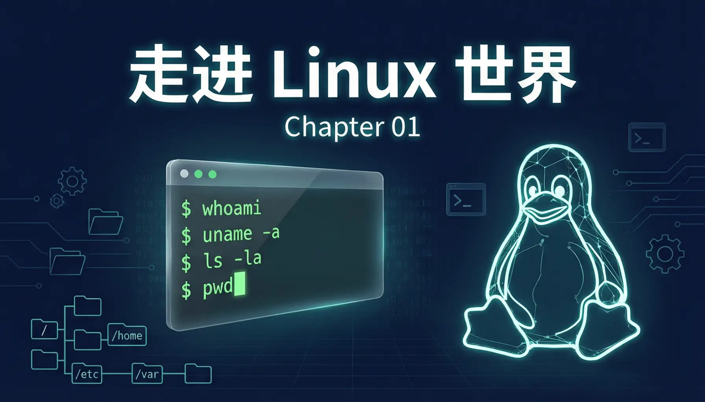
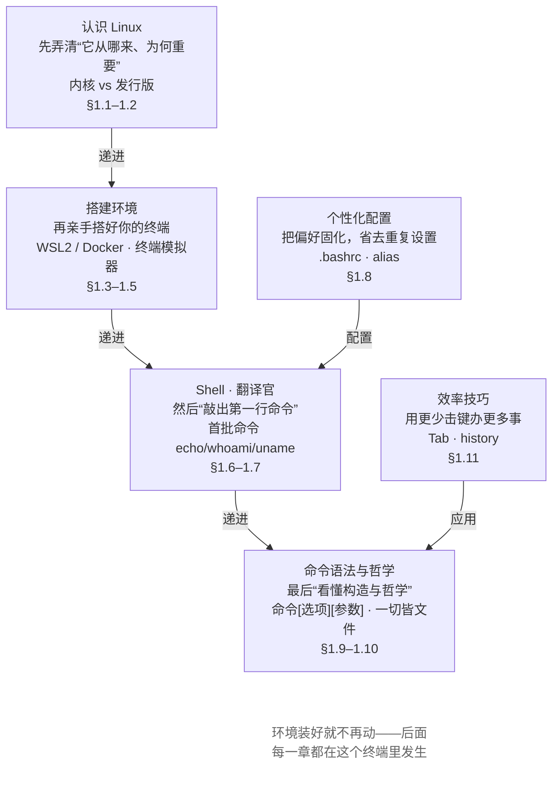
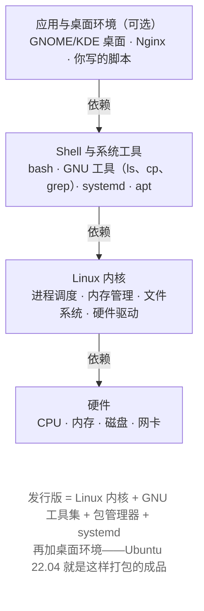

# 第1章：走进Linux世界



> [!TIP] Part 1 · command line（命令行）
> 一条命令从终端走到硬件再回来；文件系统给地址、权限给许可、管道给去路——后面一切章节都站在这几样上。

> "千里之行，始于足下。" ——老子
>
> 学习Linux命令行也是如此。这一部分将带你从零开始，建立起与Linux终端对话的信心。当你读完这六章，你会发现那个黑底白字的终端窗口，不再是令人生畏的深渊，而是一位忠实可靠的工作伙伴。

## 为什么要学Linux命令行？

**本章手柄：shell（Shell）**

Shell 是用户与内核之间的翻译官——每条命令执行前，它先解析命令行、展开变量与通配符，再以系统调用请求内核。本章管起步——认识 Linux、装好终端环境、敲出第一批命令，看懂命令的构造与背后的哲学。

**图 1-1｜本章概念关系图**（节点内第二行为各环节目的，末行为小节号；箭头标注关系类型）：



> [!WARNING] 先猜再读
> 动手前先猜一猜，答案都在本章里：
>
> 1. 在终端里按 `Ctrl+C` 是复制吗？（答案见 1.11）
> 2. `cp file1.txt file2.txt` 跑完屏幕上什么都没有，它到底成功了没有？（答案见 1.11）
> 3. 天天在用的 `cd`，为什么 `man cd` 查不到手册？（答案见 1.10）

路线的第一站是“认识 Linux”。下面先从它的前世今生与四层结构说起：

## 1.1 Linux简史：从一个人的课余项目到改变世界的操作系统

让我们把时间线拉回到1969年。

```
1969  Unix诞生（贝尔实验室，Ken Thompson & Dennis Ritchie）
      ├── 就像操作系统的"始祖鸟"，几乎所有现代操作系统的思想都从这里萌芽
1977  BSD发布（加州大学伯克利分校）
      ├── Unix的第一个"分支版本"，就像Git的第一个fork
1987  Minix发布（Andrew Tanenbaum教授）
      ├── 教学用的小型Unix，Linus的启蒙老师
1991  Linux 0.01发布（Linus Torvalds，芬兰赫尔辛基大学）
      ├── "我只是在做一个个人爱好，不会像GNU那样大而专业"
      ├── （Linus的这句谦虚之言，堪比"我只是随便写写"）
1993  Debian发布
      ├── 最早的社区驱动发行版之一
2004  Ubuntu发布（Canonical公司）
      ├── "Linux for human beings"——让普通人也能用Linux
2011  Chromebook问世
2014  Docker 1.0发布——容器化革命
2022  Linux 6.0内核发布
2024  Ubuntu 24.04 LTS发布
```

**关键概念：发行版（Distribution）**

Linux严格来说只是一个**内核（Kernel）**——它负责管理CPU、内存、磁盘等硬件资源。而我们通常说的"Linux操作系统"，其实是一个完整的**发行版**，它包含：

- **Linux内核**：引擎，负责底层硬件交互
- **GNU工具集**：`ls`、`cp`、`grep`等基本命令（所以也有人称之为GNU/Linux）
- **包管理器**：`apt`（Debian/Ubuntu）、`yum`/`dnf`（RedHat/CentOS）
- **桌面环境**（可选）：GNOME、KDE、XFCE等
- **初始化系统**：`systemd`（现代标准）

把这些组件按层次摆起来，就是 Linux 的四层结构：

**图 1-2｜Linux 系统分层**（自上而下应用、Shell 与系统工具、内核、硬件；箭头表示上层依赖下层，内核是唯一直接操作硬件的一层）：



**主流Linux发行版对比：**

| 发行版 | 包管理器 | 目标用户 | 特点 |
| -------- | ---------- | ---------- | ------ |
| **Ubuntu** | apt | 桌面用户/开发者 | 社区活跃，文档丰富，LTS版本5年支持 |
| **Debian** | apt | 服务器/高级用户 | 稳定至上，软件版本略旧 |
| **Fedora** | dnf | 开发者/技术爱好者 | 最新软件，Red Hat的上游 |
| **CentOS Stream** | dnf | 服务器 | RHEL的滚动预览版 |
| **Arch Linux** | pacman | 高级用户 | 滚动更新，高度可定制 |
| **Linux Mint** | apt | 新手/从Windows迁移 | 界面友好，开箱即用 |

**Linux内核版本号解读：**

```bash
uname -r
# 输出: 5.15.0-91-generic
#       │  │  │  │   │
#       │  │  │  │   └── 架构标识（generic=通用）
#       │  │  │  └────── ABI编号（应用二进制接口版本）
#       │  │  └───────── 补丁版本（bug修复）
#       │  └──────────── 次版本（偶数=稳定，奇数=开发——旧规则）
#       └─────────────── 主版本（重大更新）

# 从 Linux 3.0 开始，Linus 放弃了"主版本号不能太大"的原则
# 现在主版本号就是简单的递增：3.x → 4.x → 5.x → 6.x
```

**开源许可证简述：**

```
Linux 内核采用 GPLv2 许可证：
├── 你可以自由使用、修改、分发
├── 如果你修改并分发了内核，必须公开你的修改
├── 你不能把Linux变成闭源商业产品
└── 这就是为什么Linux能持续发展30多年——社区的信任基石
```

## 1.2 为什么开发者必须掌握命令行？

你可能会问："都有图形界面了，为什么还要学命令行？"

好问题！让我用几个场景来回答：

**场景1：远程服务器运维**

```bash
# 你的网站宕机了，凌晨3点。
# 服务器上可没有桌面环境给你点鼠标。
# 你只能通过SSH连接，用命令行排查问题：
ssh user@yourserver.com
tail -f /var/log/nginx/error.log
systemctl restart nginx
```

**场景2：批量操作**

```bash
# 老板说：把这10000张图片的分辨率都改成50%
# 图形界面？你要点10000次。
# 命令行？一行搞定：
find ./images -name "*.jpg" -exec convert {} -resize 50% {} \;
```

**场景3：自动化部署**

```bash
# CI/CD流水线里每一步都是命令行
# 没有人在GitHub Actions里用鼠标点来点去
git checkout main
npm install
npm run build
npm run deploy
```

**场景4：排障效率**

```bash
# 磁盘满了？一行命令找到大文件
du -sh /* | sort -rh | head -20

# 端口被谁占了？
lsof -i :8080

# 系统负载高？
top -c
```

命令行不是图形界面的"过时替代品"，而是开发者手中的**精密手术刀**——精准、高效、可重复、可自动化。

## 1.3 安装Linux：选择你的入口

作为开发者，你有多种方式进入Linux世界。让我帮你分析每种方式的优劣：

| 方式 | 优点 | 缺点 | 推荐指数 |
| ------ | ------ | ------ | ---------- |
| WSL2 | 零风险，与Windows完美共存 | 部分系统功能受限 | ★★★★★ |
| 原生安装（双系统） | 完整体验，性能最好 | 有数据风险，需要重启切换 | ★★★★ |
| Docker容器 | 轻量级，秒级启动 | 不是完整的OS环境 | ★★★★ |
| 云服务器（VPS） | 最接近真实生产环境 | 需要网络，有费用 | ★★★★ |
| 虚拟机（VirtualBox） | 隔离安全 | 性能较差，资源开销大 | ★★★ |

## 1.4 WSL2 安装全流程（Windows用户首选）

WSL2（Windows Subsystem for Linux 2）是目前Windows开发者使用Linux的最佳方案。它运行在轻量级虚拟机中，启动快、资源占用小，而且能与Windows无缝交互。

### 第一步：检查系统要求

```bash
# WSL2 需要 Windows 10 (Build 1903+) 或 Windows 11
# 在 PowerShell 中运行以下命令查看版本：
winver
```

### 第二步：一键安装

```powershell
# 以管理员身份打开 PowerShell，运行：
wsl --install

# 这条命令会自动完成以下工作：
# 1. 启用 "适用于 Linux 的 Windows 子系统" 功能
# 2. 启用 "虚拟机平台" 功能
# 3. 下载并安装 WSL2 Linux 内核
# 4. 默认安装 Ubuntu 发行版
# 5. 设置为 WSL2 版本

# 安装完成后需要重启电脑！
```

### 第三步：首次启动配置

```bash
# 重启后，Ubuntu会自动启动并要求你设置用户名和密码
# 请设置一个你记得住的密码（Linux下输入密码不显示，别慌）

# 验证安装：
wsl --list --verbose
# 输出类似：
#   NAME      STATE           VERSION
# * Ubuntu    Running         2

# 确认是 VERSION 2（WSL2），不是 1
```

### 第四步：基础配置

```bash
# 更新系统软件包（安装完第一件事，就像新手机先更新系统）
sudo apt update && sudo apt upgrade -y

# 安装常用开发工具
sudo apt install -y build-essential git curl wget vim tree htop

# build-essential: GCC编译器等开发工具集
# git: 版本控制
# curl/wget: 下载工具
# vim: 强大的文本编辑器
# tree: 以树形结构显示目录
# htop: 增强版系统监控
```

### 第五步：配置 Windows Terminal（强烈推荐）

```bash
# Windows Terminal 是微软官方推出的现代终端模拟器
# 在 Microsoft Store 搜索 "Windows Terminal" 安装

# 安装后打开 Windows Terminal，它会自动检测到 WSL2 的 Ubuntu
# 在设置中将 Ubuntu 设为默认配置文件

# 推荐配置项：
# - 默认配置文件：Ubuntu
# - 字体大小：14
# - 配色方案：One Half Dark（护眼）
# - 启用亚克力效果（半透明磨砂玻璃效果）
```

### WSL2 与 Windows 互操作

```bash
# 从 WSL2 访问 Windows 文件系统
# Windows 的 C 盘挂载在 /mnt/c/
ls /mnt/c/Users/你的用户名/Desktop

# 从 WSL2 打开 Windows 程序
code .              # 用 Windows 的 VS Code 打开当前目录
explorer.exe .      # 用 Windows 资源管理器打开当前目录
notepad.exe file.txt # 用记事本打开文件

# 从 Windows PowerShell 进入 WSL2
wsl                 # 进入默认发行版
wsl -d Ubuntu       # 进入指定发行版

# 在 WSL2 中使用 Windows 的命令（偶尔有用）
cmd.exe /c "dir"    # 调用 Windows 的 cmd
powershell.exe -Command "Get-Process"
```

### WSL2 进阶配置

```bash
# 配置 WSL2 资源限制（防止吃光Windows内存）
# 在 Windows 用户目录下创建 .wslconfig 文件
# C:\Users\你的用户名\.wslconfig
# 内容：
# [wsl2]
# memory=4GB           # 限制WSL最大使用4GB内存
# processors=2         # 限制使用2个CPU核心
# swap=2GB             # 交换空间2GB
# localhostForwarding=true  # localhost端口转发

# 管理WSL发行版
wsl --list --verbose      # 查看所有发行版
wsl --set-default Ubuntu  # 设置默认发行版
wsl --shutdown            # 关闭所有WSL实例
wsl -t Ubuntu             # 终止指定发行版

# 安装其他发行版
wsl --list --online       # 查看可用发行版
wsl --install -d Debian   # 安装Debian
wsl --install -d Ubuntu-24.04  # 安装特定版本

# WSL2 网络注意事项
# WSL2 每次重启后IP会变化
# 在WSL中查看IP：
hostname -I
# 在Windows中访问WSL的服务：
# 可以直接用 localhost（WSL2会自动转发端口）
# 例如WSL中启动的Web服务器在localhost:8080可以直接在Windows浏览器访问
```

**Docker 作为 Linux 环境**

```bash
# Docker 提供轻量级的Linux环境
# 安装Docker后，可以秒级启动一个Ubuntu容器

# 快速启动Ubuntu容器
docker run -it ubuntu:22.04 /bin/bash
# -i 交互式
# -t 分配终端
# 你会立即进入一个Ubuntu环境！

# 在Docker中练习Linux命令
# 退出容器：exit 或 Ctrl+D

# 挂载本地目录到容器
docker run -it -v $(pwd):/workspace ubuntu:22.04 /bin/bash
# 容器中的 /workspace 就是你本地当前目录

# 适合：快速测试命令、练习、临时环境
# 不适合：需要systemd的服务管理（Docker容器默认不运行systemd）
```

**云服务器快速入门**

```bash
# 如果你有云服务器（阿里云/腾讯云/AWS等）
# 通常通过SSH连接：
ssh username@server_ip

# 首次登录后的标准操作：
# 1. 更新系统
sudo apt update && sudo apt upgrade -y

# 2. 创建普通用户（不要用root日常操作；adduser/usermod 细讲见第5、10章）
sudo adduser developer
sudo usermod -aG sudo developer

# 3. 配置SSH密钥登录（更安全）
# 在本地机器上：
ssh-keygen -t ed25519
ssh-copy-id developer@server_ip

# 4. 配置防火墙
sudo ufw allow OpenSSH
sudo ufw allow 80/tcp
sudo ufw allow 443/tcp
sudo ufw enable

# 5. 禁用root SSH登录
# 编辑 /etc/ssh/sshd_config
# PermitRootLogin no
# sudo systemctl restart sshd
```

## 1.5 终端模拟器选择

终端模拟器就是你与Shell对话的"窗口"。选一个好用的终端，就像选一把舒适的椅子——你会在上面坐很久。

**Windows 用户：**

- **Windows Terminal**（首选）：微软出品，支持标签页、GPU加速、自定义主题
- **ConEmu**：老牌终端，功能强大但界面略复古

**macOS 用户：**

- **iTerm2**（首选）：分屏、搜索、自动补全，功能极其丰富
- **内置 Terminal.app**：够用，但功能有限

**Linux 用户：**

- **GNOME Terminal**：Ubuntu默认终端，简洁好用
- **Alacritty**：GPU加速，极速体验（但需要配置文件驱动）
- **Kitty**：功能丰富，支持图片显示

## 1.6 第一个命令：Hello, Linux

终于到了激动人心的环节！打开你的终端，让我们来敲下第一批命令：

从本节起，每个命令都先给一行**通用命令格式**再进示例。这套记号和 `man` 手册、`--help` 输出完全一致，学会一次，往后查任何命令都能读懂：方括号 `[ ]` 里的部分**可省略**；`...` 表示前一项**可重复**；`|` 表示竖线两侧**二选一**；大写单词（如 `OPTION`、`STRING`）是**占位符**，实际使用时换成具体内容。

本节一口气认识 6 个命令。它们回答三类不同的问题，先按问题分组列出通用格式，再用一张表区分彼此：

**输出文本**——让终端替你说话：

- `echo [OPTION]... [STRING]...` —— 打印文字、变量值或计算结果

**我与机器的身份**——一个问「我是谁」，一个问「这台机器叫什么」：

- `whoami [OPTION]...` —— 当前用户名
- `hostname [OPTION]...` —— 主机名

**系统与时间**——版本、时刻与运行时长：

- `uname [OPTION]...` —— 内核名称、版本与架构
- `date [OPTION]... [+FORMAT]` —— 当前日期时间
- `uptime [OPTIONS]` —— 运行时长与负载

| 想知道 | 用哪个 | 区分点 |
| ------ | ------ | ------ |
| 我现在的用户名 | `whoami` | 回答「我是谁」：只输出当前用户的名字，排查权限问题时先问它 |
| 这台机器叫什么 | `hostname` | 回答「这是哪台机器」：输出主机名，`-I` 还能拿到 IP 地址 |
| 这是什么系统 | `uname` | 回答「机器的底细」：`-r` 看内核版本、`-m` 看架构——前两个给名字，它给版本与架构 |

```bash
# 输出文本
# echo - 让终端"说话"
echo "Hello, Linux!"
# 输出: Hello, Linux!

# echo 还可以做简单的计算（配合 $(( )) ）
echo $((6 * 7))
# 输出: 42（宇宙终极答案！）

# 输出环境变量
echo $HOME
# 输出: /home/yourusername

echo $SHELL
# 输出: /bin/bash（你当前使用的Shell）

# 使用 -e 参数启用转义字符
echo -e "第一行\n第二行\n第三行"
# 输出三行文字

echo -e "使用\t制表符\t对齐"
# 输出: 使用  制表符  对齐
```

```bash
# 我与机器的身份
# whoami - 我是谁？（不是哲学问题，是技术问题）
whoami
# 输出: yourusername

# 这个命令在排查权限问题时特别有用
# "Permission denied" 的时候先问问自己：我现在是谁？

# hostname - 这台机器叫什么名字
hostname
# 输出: my-laptop

# 查看IP地址（hostname -I 大写字母I）
hostname -I
# 输出: 192.168.1.100
```

```bash
# 系统与时间
# uname - 系统信息
uname
# 输出: Linux

uname -a
# 输出: Linux myhost 5.15.0-91-generic #101-Ubuntu SMP ... x86_64 GNU/Linux
# -a 显示所有信息（all）

uname -r
# 输出: 5.15.0-91-generic（内核版本号）

uname -m
# 输出: x86_64（系统架构，64位）

# date - 现在几点？
date
# 输出: Wed Jan 15 14:30:00 CST 2025

# 格式化输出日期
date "+%Y-%m-%d"
# 输出: 2025-01-15

date "+%H:%M:%S"
# 输出: 14:30:00

# 适合用在备份文件名中
echo "backup_$(date +%Y%m%d_%H%M%S).tar.gz"
# 输出: backup_20250115_143000.tar.gz

# uptime - 系统运行了多久
uptime
# 输出: 14:30:00 up 5 days, 3:22, 2 users, load average: 0.52, 0.38, 0.29
# 解读：
# - 14:30:00：当前时间
# - up 5 days, 3:22：已运行5天3小时22分钟
# - 2 users：当前登录用户数
# - load average: 过去1分钟、5分钟、15分钟的平均负载
```

```bash
# 组合使用：创建系统信息小报告
echo "=== 系统信息报告 ==="
echo "用户：$(whoami)"
echo "主机：$(hostname)"
echo "系统：$(uname -r)"
echo "时间：$(date '+%Y-%m-%d %H:%M:%S')"
echo "运行：$(uptime -p)"
# -p 参数让 uptime 以更人性化的方式输出
# 输出: up 5 days, 3 hours, 22 minutes
```

## 1.7 Shell的概念：命令的翻译官

当你按下回车键，是谁在理解你输入的命令？答案是 **Shell**。

Shell就像一个翻译官——你把命令用人类可读的方式写出来，Shell把它翻译成系统调用（system call）告诉内核去执行。

```
用户输入命令 → Shell解析 → 内核执行 → 返回结果
   ↑                                        |
   └────────── 显示给用户 ←─────────────────┘
```

**主流Shell对比：**

| Shell | 路径 | 特点 | 适用场景 |
| ------- | ------ | ------ | ---------- |
| **bash** | /bin/bash | 最广泛使用，兼容性好，文档丰富 | 服务器、脚本、通用 |
| **zsh** | /bin/zsh | macOS默认，插件生态丰富（oh-my-zsh） | 开发桌面 |
| **fish** | /usr/bin/fish | 开箱即用的智能提示，语法更友好 | 追求体验的开发者 |

```bash
# 查看系统安装了哪些Shell
cat /etc/shells
# 输出:
# /bin/sh
# /bin/bash
# /usr/bin/bash
# /bin/zsh
# ...

# 查看你当前使用的Shell
echo $SHELL
# 输出: /bin/bash

# 查看当前正在运行的Shell（更准确）
echo $0
# 输出: bash

# 查看bash版本
bash --version
# 输出: GNU bash, version 5.1.16(1)-release ...
```

**切换到其他Shell：**

```bash
# 安装zsh
sudo apt install -y zsh

# 切换默认Shell为zsh
chsh -s /bin/zsh

# 切换回bash
chsh -s /bin/bash

# 安装fish
sudo apt install -y fish

# 切换到fish
chsh -s /usr/bin/fish

# 注意：切换后需要重新登录才生效
```

**oh-my-zsh（如果选择zsh）：**

```bash
# oh-my-zsh 是 zsh 的配置框架，提供主题和插件
sh -c "$(curl -fsSL https://raw.githubusercontent.com/ohmyzsh/ohmyzsh/master/tools/install.sh)"

# 推荐插件：编辑 ~/.zshrc
plugins=(git zsh-autosuggestions zsh-syntax-highlighting)

# 推荐主题：
# ZSH_THEME="agnoster"    # 漂亮的信息展示
# ZSH_THEME="powerlevel10k/powerlevel10k"  # 高度可定制
```

## 1.8 ~/.bashrc 配置文件入门

`.bashrc`是bash的"个性配置文件"——每次打开新的终端窗口，bash都会读取这个文件来配置你的环境。

```bash
# .bashrc 位于你的家目录下
# ~ 是家目录的简写，等同于 /home/你的用户名
ls -la ~/.bashrc
# -rw-r--r-- 1 user user 3771 Jan 15 10:00 /home/user/.bashrc

# 查看当前 .bashrc 的内容（不用理解每一行）
cat ~/.bashrc

# 编辑 .bashrc（使用nano编辑器，适合新手）
nano ~/.bashrc
```

**.bashrc 中你可以添加的内容：**

```bash
# 添加自定义别名（alias）—— 给你的命令取个"小名"
# 在 ~/.bashrc 末尾添加：

# 常用别名
alias ll='ls -la'           # ll 代替 ls -la
alias la='ls -A'            # la 显示所有文件（包括隐藏的）
alias ..='cd ..'            # .. 直接回退一层目录
alias ...='cd ../..'        # ... 回退两层
alias cls='clear'           # cls 清屏（Windows习惯）
alias h='history'           # h 查看历史命令

# Git别名
alias gs='git status'
alias gp='git pull'
alias gc='git commit'

# 开发相关
alias py='python3'
alias dc='docker compose'
alias tf='terraform'

# 添加完成后，让配置立即生效：
source ~/.bashrc

# source 命令让bash重新读取配置文件
# 等同于: . ~/.bashrc（点号也是source的意思）
```

```bash
# 自定义PS1提示符（让你的终端更有个性）
# PS1 控制命令行提示符的显示格式

# 默认提示符通常长这样：
# user@hostname:~$

# 在 ~/.bashrc 中添加：
# 显示Git分支的提示符
parse_git_branch() {
    git branch 2>/dev/null | grep '\*' | sed 's/* //'
}

PS1='\[\033[01;32m\]\u@\h\[\033[00m\]:\[\033[01;34m\]\w\[\033[33m\]$( parse_git_branch)\[\033[00m\]\$ '

# 效果：user@host:~/projects/myapp (main)$ 
# 绿色用户名，蓝色路径，黄色Git分支

# 别忘了 source 让它生效
source ~/.bashrc
```

```bash
# 配置环境变量
# 在 ~/.bashrc 末尾添加：

# 设置默认编辑器为vim
export EDITOR=vim

# 设置语言环境
export LANG=en_US.UTF-8

# 添加自定义路径到 PATH
# PATH 是系统搜索可执行文件的目录列表
export PATH="$HOME/.local/bin:$HOME/go/bin:$PATH"

# 查看当前的PATH
echo $PATH
# 输出类似：/home/user/.local/bin:/usr/local/sbin:/usr/local/bin:/usr/sbin:/usr/bin:...

# PATH中的目录用冒号 : 分隔
# 系统会按从左到右的顺序搜索可执行文件
```

```bash
# ~/.bashrc 与 ~/.profile 与 ~/.bash_profile 的区别
#
# ~/.bashrc        每次打开新的bash终端都会读取（交互式非登录shell）
# ~/.profile       登录时读取（登录shell），会source ~/.bashrc
# ~/.bash_profile  bash登录时读取（优先于.profile）
#
# 推荐做法：
# - 把环境变量（export）放在 ~/.profile
# - 把别名、提示符、函数放在 ~/.bashrc
# - 在 ~/.profile 中添加：
#   if [ -f ~/.bashrc ]; then . ~/.bashrc; fi
#
# 登录/非登录 Shell 的完整加载顺序与全局配置（/etc/profile.d）见 10.8

# 查看当前所有的环境变量
env
# 或者
printenv

# 常用环境变量
echo $HOME          # 家目录
echo $USER          # 当前用户名
echo $PWD           # 当前工作目录
echo $OLDPWD        # 上一次的工作目录
echo $PATH          # 可执行文件搜索路径
echo $SHELL         # 当前Shell
echo $TERM          # 终端类型（通常是 xterm-256color）
echo $LANG          # 语言/区域设置
echo $EDITOR        # 默认编辑器
echo $RANDOM        # 随机数（每次读取都不同）
echo $?             # 上一个命令的退出状态（0=成功，非0=失败）

# $? 最小示例：成功输出 0，失败输出非 0
ls /existing_dir
echo $?              # 输出: 0（成功）
# 完整退出状态码表（0-255，含 128+N = 被信号 N 终止）详见第 20 章 20.5 节

# 自定义函数（加到 ~/.bashrc）
# 快速创建项目目录并进入
mkcd() {
    mkdir -p "$1" && cd "$1"
}
# 使用: mkcd my-new-project

# 快速搜索文件内容
fsearch() {
    grep -rn "$1" --include="*.$2" .
}
# 使用: fsearch "TODO" "py"  搜索所有.py文件中的TODO

# 提取并解压（万能解压函数）
extract() {
    if [ -f "$1" ]; then
        case "$1" in
            *.tar.bz2) tar xjf "$1" ;;
            *.tar.gz)  tar xzf "$1" ;;
            *.tar.xz)  tar xJf "$1" ;;
            *.bz2)     bunzip2 "$1" ;;
            *.gz)      gunzip "$1" ;;
            *.tar)     tar xf "$1" ;;
            *.tbz2)    tar xjf "$1" ;;
            *.tgz)     tar xzf "$1" ;;
            *.zip)     unzip "$1" ;;
            *.Z)       uncompress "$1" ;;
            *.7z)      7z x "$1" ;;
            *)         echo "'$1' 无法识别的文件格式" ;;
        esac
    else
        echo "'$1' 不是有效的文件"
    fi
}
# 使用: extract archive.tar.gz
```

```bash
# 终端颜色代码（用于自定义提示符等）
# 格式：\033[代码m  或  \e[代码m
#
# 前景色（文字颜色）：
# 30=黑色 31=红色 32=绿色 33=黄色
# 34=蓝色 35=紫色 36=青色 37=白色
#
# 背景色：
# 40=黑色 41=红色 42=绿色 43=黄色
# 44=蓝色 45=紫色 46=青色 47=白色
#
# 样式：
# 0=重置 1=粗体 2=暗淡 4=下划线 5=闪烁 7=反转

# 在终端中测试颜色
echo -e "\033[31m红色文字\033[0m"
echo -e "\033[1;32m粗体绿色文字\033[0m"
echo -e "\033[4;34m蓝色下划线\033[0m"
echo -e "\033[1;33;41m粗体黄色文字红色背景\033[0m"

# 在脚本中使用颜色
RED='\033[0;31m'
GREEN='\033[0;32m'
YELLOW='\033[1;33m'
NC='\033[0m'  # No Color

echo -e "${GREEN}成功！${NC}"
echo -e "${RED}失败！${NC}"
echo -e "${YELLOW}警告！${NC}"
```

## 1.9 命令的基本结构

在开始下一章之前，让我们理解Linux命令的通用结构：

```
命令 [选项] [参数]
command [options] [arguments]
```

这正是 1.6 通用命令格式记号的骨架——方括号里的选项与参数都可省略，实际命令由「命令名 + 选项 + 参数」拼装而成。

```bash
# 例1：ls 命令
ls -la /home
# │  │   │
# │  │   └── 参数（操作的目标）
# │  └────── 选项（修改命令行为）
# └───────── 命令（做什么）

# 例2：cp 命令
cp -r /source /destination
# │  │  │       │
# │  │  │       └── 参数2（目标位置）
# │  │  └────────── 参数1（源位置）
# │  └───────────── 选项（-r 递归复制）
# └──────────────── 命令（复制）
```

**选项的两种风格：**

```bash
# 短选项：一个减号 + 单个字母
ls -l       # long format
ls -a       # all files
ls -la      # 短选项可以合并！等同于 ls -l -a

# 长选项：两个减号 + 完整单词
ls --all          # 等同于 -a
ls --human-readable # 等同于 -h
ls --color=auto   # 长选项用 = 连接参数

# 小技巧：长选项可以用Tab键自动补全
# 输入 ls --hu 然后按 Tab，会自动补全为 ls --human-readable
```

**合并短选项的陷阱：带参数的选项会“吞掉”其后的字母**

短选项可以合并，但有一条通用规则（POSIX/getopt 约定，绝大多数命令都遵守）：

> 短选项连写时，任何**带参数**的选项都会把同一词内它后面的所有字符当作自己的参数；只有当它位于词尾时，参数才来自下一个词（空格分隔）。

这条规则是 `gcc -ofoo`、`head -n5`、`awk -F,` 这类“选项与参数连写”写法能工作的原因——代价是，你把一个本想当选项的字母放在带参选项后面，它就会被当成参数。经典事故：

```bash
# 事故1：tar 的经典陷阱（静默出错，最危险）
tar -cvfJ backup.tar.xz dir/
# f 吞掉了同词内的 J → 生成一个叫 J 的未压缩归档，xz 压缩没生效
# 且 backup.tar.xz 被当作“要归档的成员”去找，报 Cannot stat

tar -cJvf backup.tar.xz dir/        # 正确：带参的 f 放在词尾
tar -c -v -J -f backup.tar.xz dir/  # 正确：分开写最不容易踩坑

# 事故2：head 的经典陷阱（报错出错，还算幸运）
head -cn5 file        # c 吞掉 n5 → 报错 invalid number of bytes: 'n5'
head -c5 file         # 正确：c 在词尾，5 是它的参数
```

**心法：连写短选项时，带参数的选项要么放在组合末尾，要么单独写。** 查 `man` 时留意哪些选项带参数（选项后面标注了参数的），这类选项合并时必须放词尾。

两类命令不受此规则影响：不用短选项体系的命令（如 `dd if=... of=...`、`find . -name ...`、`ps aux`、`java -version`，没有“簇”的概念），以及 tar 无横线老式写法（`tar cvf x.tar dir/`，参数按位置顺序分配）。

**获取帮助：**

```bash
# 方法1：man 手册（最详细，但英文为主）
man ls
# 在man页面中：
# q        - 退出
# /keyword - 搜索关键词
# n        - 下一个搜索结果
# Space    - 下一页
# b        - 上一页

# 方法2：--help 选项（快速摘要）
ls --help

# 方法3：tldr（社区贡献的实用示例，强烈推荐）
# 安装 tldr
sudo apt install tldr

# 使用 tldr
tldr ls
# 输出实用的命令示例，比man简洁得多

# 方法4：type 命令查看命令类型
type ls
# 输出: ls is aliased to `ls --color=auto'

type cd
# 输出: cd is a shell builtin

type /bin/ls
# 输出: /bin/ls is /bin/ls
```

## 1.10 Linux哲学：理解命令背后的思想

Linux命令行不仅仅是工具，它背后有一套深刻的设计哲学。理解这些哲学，你会更好地理解为什么命令是这样设计的。

**Unix/Linux设计哲学：**

```
1. 一切皆文件
   ├── 普通文件是文件
   ├── 目录是文件（内容是文件名列表）
   ├── 设备是文件（/dev/sda 是硬盘）
   ├── 进程信息是文件（/proc/1234/status）
   └── 甚至网络连接也是文件（socket）

2. 每个程序只做一件事，并把它做好
   ├── ls 只负责列出文件
   ├── grep 只负责搜索文本
   ├── sort 只负责排序
   └── 需要复杂功能？用管道组合它们！

3. 文本是通用的接口
   ├── 配置文件是纯文本（人类可读）
   ├── 命令输出是纯文本（可被管道处理）
   ├── 日志是纯文本（可被grep搜索）
   └── 这使得不同工具可以无缝组合

4. 尽早做原型
   ├── 先用命令行手动完成
   ├── 确认流程后再写成脚本
   └── 脚本再封装成工具

5. 没有消息就是好消息
   ├── 命令成功执行通常不输出任何内容
   ├── cp file1 file2 成功后没有"复制完成！"
   ├── 只有出错了才会看到输出
   └── 这使得管道组合更干净

6. 小即是美
   ├── 小文件比大文件好
   ├── 小程序比大程序好
   ├── 简单胜于复杂
   └── 这就是为什么ls有几十个选项而不是做成GUI
```

**Linux命令的分类：**

```bash
# 1. Shell内建命令（builtin）
# 这些命令是Shell的一部分，执行快
type cd       # cd is a shell builtin
type echo     # echo is a shell builtin
type alias    # alias is a shell builtin
type export   # export is a shell builtin

# 2. 外部命令（二进制程序）
# 这些命令是独立的程序文件
type ls       # ls is /usr/bin/ls
type grep     # grep is /usr/bin/grep
type python3  # python3 is /usr/bin/python3

# 3. Shell函数
# 你在 .bashrc 中定义的函数
type mkcd     # mkcd is a function (如果你定义了的话)

# 4. 别名（alias）
# 你在 .bashrc 中定义的简写
type ll       # ll is aliased to `ls -la'

# 为什么理解分类很重要？
# Shell内建命令不能用 man 查看手册（用 help 代替）
help cd       # 查看cd的帮助
help echo     # 查看echo的帮助
```

**一个开发者的典型Linux工作流：**

```bash
# 场景：你接到任务，要在服务器上部署一个Web应用

# 第1步：连接到服务器
ssh developer@myserver.com

# 第2步：了解服务器环境
uname -a                    # 什么系统？
df -h                       # 磁盘空间够吗？
free -h                     # 内存够吗？
cat /etc/os-release         # 什么发行版？

# 第3步：安装依赖
sudo apt update
sudo apt install -y nginx nodejs npm

# 第4步：克隆项目
cd /var/www
sudo git clone https://github.com/user/myapp.git
sudo chown -R developer:developer myapp

# 第5步：构建项目
cd myapp
npm install
npm run build

# 第6步：配置Web服务器
sudo cp nginx.conf /etc/nginx/sites-available/myapp
sudo ln -s /etc/nginx/sites-available/myapp /etc/nginx/sites-enabled/
sudo nginx -t               # 测试配置是否正确
sudo systemctl restart nginx

# 第7步：验证
curl -I http://localhost    # 检查HTTP响应
tail -f /var/log/nginx/error.log  # 监控错误日志

# 第8步：设置自动启动
sudo systemctl enable nginx

# 这就是命令行的力量——从连接到部署完成，全靠键盘！
```

这个工作流里的 ssh、df/free、apt、systemctl、curl、tail，会在[第 15 章](./ch15.md)、[第 9 章](./ch09.md)、[第 8 章](./ch08.md)、[第 11 章](./ch11.md)、[第 18 章](./ch18.md)、[第 13 章](./ch13.md) 逐一详谈——词链上它们都有各自的手柄。

## 1.11 实用技巧与避坑指南

**技巧1：善用 Tab 键补全**

```bash
# Tab键是命令行中最有用的按键！
# 输入命令或路径的一部分，然后按Tab，系统会自动补全

# 示例：
# 输入：ls /ho 然后按Tab
# 自动补全为：ls /home/

# 输入：sudo apt in 然后按Tab
# 自动补全为：sudo apt install

# 如果按两次Tab，会列出所有可能的补全选项
# 输入：ls / 然后按两次Tab
# 会列出根目录下所有的目录和文件
```

**技巧2：历史命令（history）**

```bash
# 查看历史命令
history
# 输出最近执行过的命令，带编号

# 搜索历史命令（Ctrl+R）
# 按 Ctrl+R 然后输入关键词，会反向搜索历史命令
# 按 Ctrl+R 继续向前搜索
# 按 Enter 执行找到的命令

# 执行历史命令
!42       # 执行第42号命令
!!        # 重复上一条命令
!ls       # 重复最近一条以ls开头的命令
!$        # 上一条命令的最后一个参数
!*        # 上一条命令的所有参数

# 常见场景：忘记加sudo
apt install nginx
# Permission denied...
sudo !!
# 等同于：sudo apt install nginx

# 清除历史命令
history -c
```

**技巧3：Ctrl 快捷键全家桶**

```bash
# Ctrl+C  - 终止当前命令（不是复制！）
# Ctrl+Z  - 暂停当前命令（放到后台）
# Ctrl+D  - 退出终端（等同于输入 exit）
# Ctrl+L  - 清屏（等同于 clear 命令）
# Ctrl+A  - 光标跳到行首
# Ctrl+E  - 光标跳到行尾
# Ctrl+U  - 删除光标前到行首的内容
# Ctrl+K  - 删除光标后到行尾的内容
# Ctrl+W  - 删除光标前的一个单词
# Alt+F   - 光标向前跳一个单词
# Alt+B   - 光标向后跳一个单词
```

**避坑指南：**

```bash
# 坑1：Linux区分大小写！
# Desktop 和 desktop 是两个不同的目录
# README.md 和 readme.md 是两个不同的文件

# 坑2：路径中的空格
# 如果路径包含空格，必须用引号包裹或转义
cd "My Documents"
cd My\ Documents

# 坑3：Linux的路径分隔符是正斜杠 /
# 不是Windows的反斜杠 \
cd /home/user/Desktop    # 正确
# cd \home\user\Desktop  # 错误！

# 坑4：命令执行后没有输出 不等于 失败
# Linux哲学："没有消息就是好消息"（No news is good news）
cp file1.txt file2.txt
# 执行成功后没有任何输出，这不是bug

# 坑5：Ctrl+C 不是复制！
# 在终端中，Ctrl+C 是发送中断信号（SIGINT）
# 复制通常是 Ctrl+Shift+C（GNOME Terminal）
# 粘贴通常是 Ctrl+Shift+V（GNOME Terminal）
# Windows Terminal 中可以用 Ctrl+C/V（需要配置）
```

## 1.12 动手练习：初识Linux命令行

**练习1：探索你的系统**

```bash
# 1. 我是谁？这台机器是什么？
whoami
hostname
uname -a
echo $SHELL

# 2. 系统资源概览
df -h                    # 磁盘空间
free -h                  # 内存使用
uptime                   # 运行时间和负载
cat /proc/cpuinfo | grep "model name" | head -1  # CPU型号

# 3. 看看你的家目录里有什么
ls -la ~
# 观察隐藏文件（以.开头的）

# 4. 探索系统目录
ls /etc/*.conf 2>/dev/null | head -10   # 配置文件
ls /usr/bin/ | head -20                  # 可用命令
ls /var/log/                              # 日志文件

# 5. 日期与时间
date
date "+%Y年%m月%d日 %H时%M分%S秒"
echo "今天是 $(date +%A)"

# 6. 换一组命令，把系统信息存档成带日期戳的文件
# 第一条用 > 创建文件，其后用 >> 逐行追加——与 1.6 的屏幕演示不同，这次落到文件里
echo "=== 系统档案 $(date +%Y%m%d) ===" > ~/sysinfo.txt
echo "架构: $(uname -m)" >> ~/sysinfo.txt
echo "Shell: $SHELL" >> ~/sysinfo.txt
echo "磁盘: $(df -h / | tail -1)" >> ~/sysinfo.txt
cat ~/sysinfo.txt
rm ~/sysinfo.txt
```

**练习2：配置你的开发环境**

```bash
# 1. 安装常用工具
sudo apt update
sudo apt install -y git curl wget tree htop tmux

# 2. 配置Git
git config --global user.name "Your Name"
git config --global user.email "your@email.com"
git config --global init.defaultBranch main
git config --global core.editor vim

# 3. 配置别名（编辑 ~/.bashrc）
nano ~/.bashrc
# 在文件末尾添加：
# alias ll='ls -lah'
# alias gs='git status'
# alias ..='cd ..'
# alias ...='cd ../..'

# 4. 让配置生效
source ~/.bashrc

# 5. 验证配置
ll                    # 别名生效了吗？
git config --list     # Git配置对了吗？
```

**练习3：命令行快捷键训练**

```bash
# 在终端中练习以下操作：

# 1. 输入一长行命令，然后用快捷键编辑
echo "This is a very long command that I want to edit quickly"
# Ctrl+A 跳到行首
# Ctrl+E 跳到行尾
# Ctrl+W 删除前一个单词
# Ctrl+U 删除到行首
# Ctrl+K 删除到行尾

# 2. 历史命令搜索
# 先执行几个命令
ls /var/log
df -h
uname -a
# 然后按 Ctrl+R，输入 "df"，搜索包含df的历史命令
# 按 Enter 执行找到的命令

# 3. Tab 补全练习
# 输入：ls /ho 然后按Tab
# 输入：sudo apt in 然后按Tab
# 输入：git ch 然后按Tab
```

## 本章小结

**① 核心句**：Shell 是用户与内核之间的翻译官——每条命令执行前，它先解析命令行、展开变量与通配符，再以系统调用请求内核。

**② 边界句**：Shell 只管「翻译与请求」；内核怎么执行归内核，终端怎么画屏归终端。

**③ 可推导条目**：
- 内置命令不走 PATH，外部命令按 PATH 逐目录找。
- 引号与通配符在 Shell 层就展开，时机早于命令执行。
- `./x.sh`、`bash x.sh`、`source x.sh` 三种执行方式环境不同。

> **词链互测**：读到[第 2 章 navigation](./ch02.md#本章小结)后回来——合上书说出 navigation 的 3 个坑，再顺手检查本章③是否说得全。

**下一章预告**：shell 翻译完命令，命令作用的对象在哪、怎么走过去——下一章的手柄是 **navigation**（导航）。
