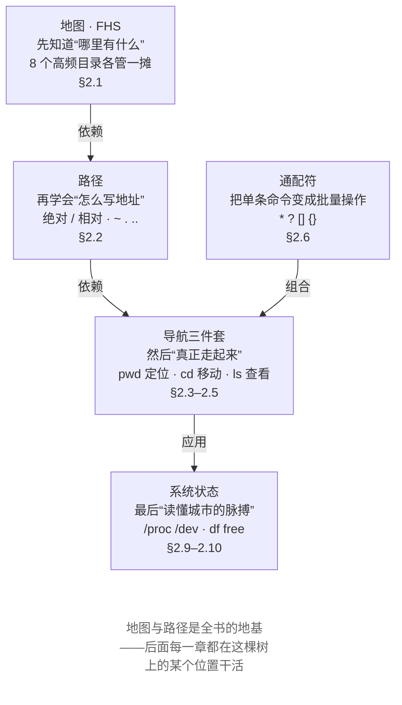
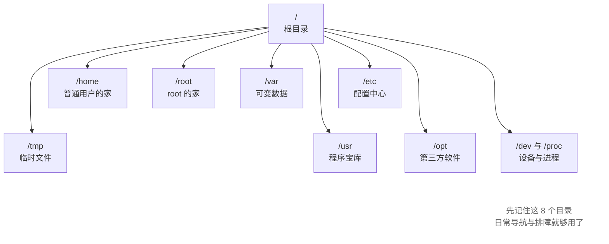

# 第2章：文件系统导航

> [!TIP] Part 1 · command line（命令行）
> 一条命令从终端走到硬件再回来；文件系统给地址、权限给许可、管道给去路——后面一切章节都站在这几样上。

## 为什么要学文件系统导航？

**本章手柄：navigation（导航）**

文件系统是一棵以 / 为根的树，一切定位从「当前所在」起算——绝对路径从根算、相对路径从脚下算。本章管找路——拿到文件系统这张地图，知道配置、日志、家目录都在哪、怎么走过去（环境没装好先回看 1.3–1.5）。

**图 2-1｜本章概念关系图**（节点内第二行为各环节目的，末行为小节号；箭头标注关系类型）：




关系图的起点是"地图"。下面这张城市地图，就是本章要带你认清的第一件事：

**图 2-2｜Linux 城市地图**（四大街区围绕中心广场 /，先看整体布局，再对照下表逐区细逛）：

<svg viewBox="0 0 400 310" xmlns="http://www.w3.org/2000/svg" font-family="system-ui, sans-serif">
  <rect x="0" y="0" width="400" height="310" fill="#ffffff"/>
  <rect x="0" y="148" width="400" height="14" fill="#e6e6e6"/>
  <rect x="193" y="0" width="14" height="286" fill="#e6e6e6"/>

  <rect x="14" y="24" width="158" height="100" rx="8" fill="#f0f7ff" stroke="#4a90d9"/>
  <text x="26" y="56" font-size="13" font-weight="bold" fill="#333">政府机构 /etc</text>
  <text x="26" y="78" font-size="12" fill="#555">市政大厅：全城规章</text>
  <text x="26" y="96" font-size="12" fill="#555">改章程、查配置</text>
  <polygon points="144,100 170,100 157,88" fill="#fff" stroke="#4a90d9"/>
  <rect x="146" y="100" width="22" height="20" fill="#fff" stroke="#4a90d9"/>
  <line x1="152" y1="105" x2="152" y2="115" stroke="#4a90d9" stroke-width="2.5"/>
  <line x1="161" y1="105" x2="161" y2="115" stroke="#4a90d9" stroke-width="2.5"/>

  <rect x="228" y="24" width="158" height="100" rx="8" fill="#f0f7ff" stroke="#4a90d9"/>
  <text x="240" y="56" font-size="13" font-weight="bold" fill="#333">商业区 /usr</text>
  <text x="240" y="78" font-size="12" fill="#555">购物中心：程序与库</text>
  <text x="240" y="96" font-size="12" fill="#555">绝大多数开在这里</text>
  <rect x="340" y="94" width="14" height="26" fill="#fff" stroke="#4a90d9"/>
  <rect x="358" y="86" width="14" height="34" fill="#fff" stroke="#4a90d9"/>
  <rect x="374" y="100" width="10" height="20" fill="#fff" stroke="#4a90d9"/>
  <line x1="340" y1="120" x2="384" y2="120" stroke="#999"/>

  <rect x="14" y="186" width="158" height="100" rx="8" fill="#f0f7ff" stroke="#4a90d9"/>
  <text x="26" y="218" font-size="13" font-weight="bold" fill="#333">居民区 /home</text>
  <text x="26" y="240" font-size="12" fill="#555">公寓区：每户一套</text>
  <text x="26" y="258" font-size="12" fill="#555">装修随你便</text>
  <polygon points="126,254 148,254 137,240" fill="#fff" stroke="#4a90d9"/>
  <rect x="128" y="254" width="18" height="18" fill="#fff" stroke="#4a90d9"/>
  <rect x="134" y="264" width="6" height="8" fill="#4a90d9"/>
  <polygon points="148,254 168,254 158,242" fill="#fff" stroke="#4a90d9"/>
  <rect x="150" y="254" width="16" height="18" fill="#fff" stroke="#4a90d9"/>
  <line x1="124" y1="272" x2="170" y2="272" stroke="#999"/>

  <rect x="228" y="186" width="158" height="100" rx="8" fill="#f0f7ff" stroke="#4a90d9"/>
  <text x="240" y="218" font-size="13" font-weight="bold" fill="#333">工业仓库区 /var</text>
  <text x="240" y="240" font-size="12" fill="#555">仓库：日志、缓存、邮件</text>
  <text x="240" y="258" font-size="12" fill="#555">货物昼夜吞吐</text>
  <polygon points="342,252 364,252 353,240" fill="#fff" stroke="#4a90d9"/>
  <rect x="344" y="252" width="18" height="16" fill="#fff" stroke="#4a90d9"/>
  <rect x="350" y="260" width="7" height="8" fill="#4a90d9"/>
  <polygon points="366,256 382,256 374,246" fill="#fff" stroke="#4a90d9"/>
  <rect x="367" y="256" width="14" height="12" fill="#fff" stroke="#4a90d9"/>
  <line x1="340" y1="268" x2="384" y2="268" stroke="#999"/>

  <circle cx="200" cy="155" r="27" fill="#f0f7ff" stroke="#4a90d9" stroke-width="1.5"/>
  <text x="200" y="152" text-anchor="middle" font-size="15" font-weight="bold" fill="#333">/</text>
  <text x="200" y="169" text-anchor="middle" font-size="12" fill="#555">中心广场</text>

  <text x="200" y="304" text-anchor="middle" font-size="12" fill="#666">所有路径都从中心广场 / 出发；先认清四个区，其余街区见下表</text>
</svg>

好消息是：这是一座规划得极其严谨的城市。几十年前，"城市规划师"们就制定了FHS（Filesystem Hierarchy Standard，文件系统层次标准），为每个区划定了职能边界。无论你走到Ubuntu、CentOS还是Arch的地界，地图都是同一张——学一次，处处通用。先来看这张"城市分区图"：

| 城市地标 | 对应目录 | 城市角色 |
| -------- | -------- | -------- |
| 中心广场 | `/` | 全城唯一的原点，所有路牌（路径）都从这里开始数 |
| 公共服务网点 | `/bin`、`/sbin` | 消防局、邮局、路灯处——人人都用得上的基本工具 |
| 市政大厅 | `/etc` | 全城的规章制度（配置文件）都存档于此，改章程就来这里 |
| 居民区 | `/home` | 每位居民一套公寓（`/home/alice`），室内装修完全随你 |
| 市长官邸 | `/root` | 市长（root）的家，不与民同乐，门禁森严 |
| 工业仓库区 | `/var` | 货物进出不停——日志、缓存、邮件、网站数据都在这里吞吐 |
| 路边临时摊位 | `/tmp` | 随摆随收，"城管"（系统重启）一来就清场，贵重物品别放这儿 |
| 商业区 | `/usr` | 全城最大的购物中心，绝大多数"店铺"（程序与库）都开在这里 |
| 独栋旗舰店 | `/opt` | 大品牌自建整栋楼（Chrome、VS Code），一家一栋互不打扰 |
| 水电网管线 | `/lib` | 商店营业离不开水电，程序运行离不开共享库 |
| 港口与接线总机 | `/dev` | 一切外来设备（磁盘、键盘、U盘）都从这里接入城市 |
| 指挥中心大屏 | `/proc`、`/sys` | 内核实时绘制，显示这座城市此刻的呼吸与脉搏 |
| 城门 | `/boot` | 每天开门营业前必经之地——内核与引导程序驻守于此 |
| 客运站 | `/mnt`、`/media` | 外来访客（U盘、移动硬盘、光盘）的临时落脚点 |
| 调度室白板 | `/run` | 记录"今天谁在营业"（PID等运行时数据），下班（关机）即擦除 |

进城之前，还有两条"交通规则"值得提前知道：

1. **所有路牌都从中心广场（`/`）出发**——Linux没有C盘、D盘，全城只有一个"零公里"原点。Windows那种"多座卫星城各自为政"的格局，在这里不存在。
2. **住哪儿取决于你怎么来的**——包管理器（`apt`、`yum`）安装的软件住商业区（`/usr`），手动编译安装的软件应落户`/usr/local`或独栋旗舰店（`/opt`）。各行其道，日后管理才不乱。

> [!TIP] 记忆分层：先记骨架，其余会查就行
> 本章知识分两层：**必记层**是8个高频目录、路径写法、`cd`/`ls`核心用法和4个通配符，要靠练习形成肌肉记忆；**查阅层**是CDPATH、目录栈、`/proc`细节和各种低频选项，忘了很正常，用到时翻[第 0 章 · 词链](./ch00.md#词链)顺着手柄词回章即可。别试图一次记住所有内容——那正是"看完就忘"的根源。

> [!NOTE] 带着问题读
> 读完本章，你应该能不看正文回答下面四个问题。读的时候留意答案在哪里，读完后用本章小结的③检验：
> 1. 配置文件、系统日志、普通用户的家目录，分别住在哪个目录？
> 2. 从 `/home/alice/projects/webapp` 出发，`../..` 是哪里？
> 3. 怎么一条命令找出目录里最大的文件？
> 4. `*` 和 `{}` 有什么本质区别？

> [!WARNING] 先猜再读
> 动手前先猜一猜，答案都在本章里：
>
> 1. `ls *` 能列出隐藏文件 `.bashrc` 吗？（答案见 2.11）
> 2. `/root` 和 `/` 是同一个目录吗？（答案见 2.1）
> 3. 多数人以为内存够不够要看 `free -h` 里的 `free`，其实该看哪一列？（答案见 2.10）

## 2.1 Linux文件系统层次标准（FHS）

Linux的文件系统就像一棵巨大的目录树，根节点是 `/`（根目录），所有的文件和目录都从根开始生长。

```
/（根目录，root，万物之源）
├── bin     -> 基本命令（binary）：ls, cp, mv 等
├── sbin    -> 系统管理命令（system binary）：fdisk, iptables 等
├── etc     -> 配置文件（et cetera）：系统和服务的配置
├── home    -> 普通用户的家目录
│   ├── alice/
│   └── bob/
├── root    -> root用户的家目录（注意不是 /）
├── var     -> 可变数据（variable）：日志、缓存、邮件
│   ├── log/     -> 系统日志
│   ├── cache/   -> 缓存文件
│   └── www/     -> 网站文件（常见位置）
├── tmp     -> 临时文件（temporary）：重启后可能被清空
├── usr     -> 用户程序（Unix System Resources）
│   ├── bin/     -> 用户命令
│   ├── lib/     -> 共享库
│   └── local/   -> 本地安装的软件
├── opt     -> 可选软件包（optional）：第三方大型软件
├── lib     -> 系统库文件（library）
├── dev     -> 设备文件（device）：磁盘、终端等
├── proc    -> 进程信息（process）：虚拟文件系统
├── sys     -> 系统信息：硬件和内核信息
├── boot    -> 启动文件：内核和引导加载程序
├── mnt     -> 临时挂载点（mount）
├── media   -> 可移动介质挂载点：U盘、光驱
├── srv     -> 服务数据（service）：FTP、Web等
└── run     -> 运行时数据：PID文件等
```

如果觉得这棵树太长，先记住下面这张精简地图：

**图 2-3｜FHS 根目录地图**（/ 是唯一的根，其下 8 个高频目录各标一个职责词）：



**重点目录详解：**

```bash
# /home - 你的"家"（居民区的公寓）
# 每个普通用户都有自己的家目录
# 你的文件、项目、配置都在这里
ls /home/
# 输出: alice  bob  charlie

# /etc - 系统的"市政大厅"（配置中心）
# 几乎所有的系统级配置文件都在这里
# /etc/passwd   -> 用户信息
# /etc/shadow   -> 用户密码（加密的）
# /etc/hosts    -> 本地DNS映射
# /etc/hostname -> 主机名
# /etc/fstab    -> 磁盘挂载配置
# /etc/apt/     -> APT包管理器配置
# /etc/nginx/   -> Nginx配置
# /etc/ssh/     -> SSH配置

# /var - 不断变化的"工业仓库区"
# /var/log - 系统日志（排查问题的第一站，全城的"监控录像带"）
ls /var/log/
# auth.log    -> 认证日志（谁登录了，谁sudo了）
# syslog      -> 系统日志
# kern.log    -> 内核日志
# nginx/      -> Nginx日志

# /tmp - 临时文件的"路边摊"（重启即清场）
# 系统和应用程序的临时文件
# 重启后通常会被清空！不要放重要文件

# /usr - 用户程序的"购物中心"（城市商业区）
# /usr/bin  - 用户命令
# /usr/lib  - 库文件
# /usr/local - 手动安装的软件

# /opt - 第三方大型软件的"独栋旗舰店"
# Google Chrome、VS Code 等大型软件通常安装在这里
ls /opt/
```

## 2.2 路径：文件的"地址"

每个文件在Linux中都有唯一的"地址"，就像邮寄包裹需要写清地址一样。路径有两种写法：

**绝对路径：从根目录开始的完整地址**

```bash
# 绝对路径总是以 / 开头
# 无论你在哪里，绝对路径指向的位置永远不变
ls /home/alice/projects/webapp/index.html
ls /etc/nginx/nginx.conf
ls /var/log/syslog
```

**相对路径：从当前位置开始的地址**

```bash
# 相对路径不以 / 开头，相对于你当前的位置
# 假设你现在在 /home/alice 目录

ls projects/webapp/index.html      # 相对于当前位置
ls ./projects/webapp/index.html    # ./ 表示当前目录（通常可省略）
ls ../bob/documents/               # ../ 表示上级目录
```

**特殊路径符号：**

```bash
# ~   家目录（等同于 /home/你的用户名）
# .   当前目录
# ..  上级目录（父目录）
# -   上一次所在的目录（cd专用）

# 举例：假设当前在 /home/alice/projects
~           # -> /home/alice
~/Desktop   # -> /home/alice/Desktop
.           # -> /home/alice/projects
..          # -> /home/alice
../..       # -> /home
../../..    # -> /（根目录）
```

## 2.3 pwd：我在哪里？

`pwd`（Print Working Directory）打印你当前所在的目录路径。当你迷失在文件系统的深处时，`pwd`就是你的GPS。

从本节起，每个命令都先给一行**通用命令格式**再进示例——记号约定见[第 1 章 1.6 节 · 通用命令格式](./ch01.md)：方括号 `[ ]` 里的部分可省略，`...` 表示前一项可重复，`|` 表示竖线两侧二选一，大写单词是占位符，实际使用时换成具体内容。

**命令格式**：`pwd [-LP]`

```bash
# 查看当前目录
pwd
# 输出: /home/alice

# 进入一个目录后再查看
cd /var/log
pwd
# 输出: /var/log

# 如果当前目录是软链接，显示真实路径
pwd -P
# -P（Physical）解析所有的符号链接
# 比如你在 /var/www -> /srv/www 的软链接中
# pwd   显示 /var/www
# pwd -P 显示 /srv/www
```

## 2.4 cd 命令全家福：在目录间瞬移

`cd`（Change Directory）是你在文件系统中移动的方式——它就像是文件系统中的"传送门"。

**命令格式**：`cd [-L|-P] [DIR]`

注意 `cd` 是 shell 内建命令，在 man 手册里没有独立条目——查它的用法要用 `help cd`。本章稍后的 pushd、popd、dirs 也是内建命令，同样适用。

```bash
# 基本用法：进入指定目录
cd /var/log
cd /home/alice/projects

# 使用绝对路径
cd /etc/nginx          # 跳到配置文件目录

# 使用相对路径（假设当前在 /home/alice）
cd projects/webapp     # 进入子目录
cd ../bob              # 跳到兄弟目录
```

```bash
# cd ~ 或 cd（不带参数）—— 回家
cd ~
# 等同于直接输入 cd
cd
# 无论你在哪里，都会回到你的家目录

# 也可以去别人的"家"（如果有权限）
cd ~bob                # 进入bob的家目录
# 等同于 cd /home/bob
```

```bash
# cd - —— 回到上一次所在的目录
# 就像浏览器的"后退"按钮

# 场景：在两个目录之间反复切换
cd /etc/nginx           # 先去配置目录
cd /var/log             # 再去日志目录
cd -                    # 回到 /etc/nginx
cd -                    # 又回到 /var/log
# 来回切换，效率极高！
```

```bash
# cd .. —— 回到上级目录
cd ..                   # 上一层
cd ../..                # 上两层
cd ../../..             # 上三层

# 实用组合：进入兄弟目录
# 假设当前在 /home/alice/projects/webapp
cd ../api               # -> /home/alice/projects/api
# 先退到 projects/，再进入 api/
```

```bash
# cd / —— 回到根目录
cd /
# 无论你在哪里，直接回到根
```

**CDPATH：给cd装上加速器**

```bash
# CDPATH 类似于 PATH，但用于 cd 命令
# 设置后，cd 会自动在 CDPATH 列出的目录中搜索目标

# 在 ~/.bashrc 中添加：
export CDPATH=".:~:/home/alice/projects:/var/www"

# 设置后：
cd webapp
# 如果当前目录没有 webapp，会自动搜索 ~/projects/webapp

cd logs
# 如果 /var/www 下有 logs 目录，会自动跳转

source ~/.bashrc  # 让配置生效
```

## 2.5 ls 命令深度解析：看清目录里的一切

`ls`（List）是你查看目录内容的"眼睛"，也是Linux中使用频率最高的命令之一。

**命令格式**：`ls [OPTION]... [FILE]...`

```bash
# 基本用法：列出当前目录内容
ls
# 输出: Desktop  Documents  Downloads  projects

# 列出指定目录
ls /var/log
# 输出: alternatives.log  apt  auth.log  boot.log ...
```

```bash
# ls -l —— 长格式（long format），信息最丰富
ls -l
# 输出示例：
# -rw-r--r-- 1 alice alice  2048 Jan 15 10:30 report.txt
# drwxr-xr-x 2 alice alice  4096 Jan 14 15:00 projects
# lrwxrwxrwx 1 alice alice    11 Jan 13 09:00 link -> /etc/passwd
#
# 逐字段解读（以第一行为例）：
# -rw-r--r--  权限（10个字符）
#   第1位：文件类型（- 普通文件，d 目录，l 链接）
#   第2-4位：所有者权限（rw- = 读写无执行）
#   第5-7位：所属组权限（r-- = 只读）
#   第8-10位：其他用户权限（r-- = 只读）
# 1            硬链接数
# alice        所有者
# alice        所属组
# 2048         文件大小（字节）
# Jan 15 10:30 修改时间
# report.txt   文件名
```

```bash
# ls -a —— 显示所有文件（包括隐藏文件）
ls -a
# 输出: .  ..  .bashrc  .ssh  .gitconfig  Desktop  Documents
#
# 在Linux中，以 . 开头的文件/目录是"隐藏"的
# .bashrc, .ssh, .gitconfig 等都是配置文件
# . 代表当前目录，.. 代表上级目录

ls -la
# 合并 -l 和 -a，最常用的组合！
```

```bash
# ls -h —— 人类可读的文件大小（human readable）
ls -lh
# 文件大小会以 K、M、G 显示，而不是纯字节数
# 对比：
ls -l
# -rw-r--r-- 1 alice alice 1048576 Jan 15 report.pdf
ls -lh
# -rw-r--r-- 1 alice alice 1.0M Jan 15 report.pdf     （一目了然！）
```

```bash
# ls -t —— 按修改时间排序（最新的在前）
ls -lt
# 查看最近修改了哪些文件
ls -lt | head -10
# 只看最近修改的10个文件
# （管道 | 与 head 分别在第6章、第4章正式讲解，这里先感受效果）

# ls -r —— 反转排序（配合其他排序使用）
ls -ltr
# 按时间排序但反转（最新的在最后）
# 这样最新文件在最下面，不会被截断看不到

# ls -S —— 按文件大小排序（最大的在前）
ls -lhS
# 查看目录中最大的文件

# ls -lR —— 递归列出子目录（Recursive）
ls -lR projects/
# 列出 projects 及其所有子目录的内容
```

```bash
# ls 的其他实用选项
ls -ld /var/log
# -d 只显示目录本身的信息，不显示目录内容

ls -li
# -i 显示 inode 编号（每个文件的唯一标识符）

ls --sort=extension
# 按文件扩展名排序（等同于 -X）

ls -lh --color=auto
# 用颜色区分不同类型的文件
# 蓝色=目录，绿色=可执行文件，红色=压缩文件
# 青色=链接，红色背景=错误的链接

# 设置别名（推荐加到 .bashrc）
alias ll='ls -lh --color=auto'
alias la='ls -la --color=auto'
alias lt='ls -lt --color=auto'
```

```bash
# 实用组合技
# 查看当前目录有多少个文件（不含隐藏文件）
ls -l | wc -l

# 查看某个目录的磁盘占用
ls -lhS /var/log | head -5   # 日志目录中最大的5个文件
```

## 2.6 通配符：批量匹配的魔法

通配符（Glob）让你用一个模式匹配多个文件名，就像正则表达式的"轻量版"。

```bash
# * —— 匹配任意数量的任意字符（包括零个）
ls *.txt          # 所有 .txt 文件
ls report*        # 以 report 开头的所有文件
ls *2024*         # 文件名中包含 2024 的所有文件
ls /home/*/Desktop # 所有用户的 Desktop 目录

# ? —— 匹配单个任意字符
ls file?.txt      # file1.txt, fileA.txt 匹配，file12.txt 不匹配
ls ???.txt        # 文件名正好3个字符的 .txt 文件

# [] —— 匹配方括号中的任意一个字符
ls file[123].txt       # file1.txt, file2.txt, file3.txt
ls file[a-z].txt       # filea.txt 到 filez.txt
ls file[!0-9].txt      # 文件名不是数字的
ls [A-Z]*              # 以大写字母开头的文件

# {} —— 花括号展开（Brace Expansion）
echo file{1,2,3}.txt
# 输出: file1.txt file2.txt file3.txt

echo {1..10}
# 输出: 1 2 3 4 5 6 7 8 9 10

echo file_{01..05}.txt
# 输出: file_01.txt file_02.txt ... file_05.txt

# 批量创建目录
mkdir -p project/{src,tests,docs,config}

# 备份文件
cp config.{yml,yml.bak}
# 等同于: cp config.yml config.yml.bak

# 只看目录（不看文件）
ls -ld */

# 只看特定类型的文件
ls -lh *.py
ls -lh *.{js,ts,jsx,tsx}   # 多种扩展名
```

## 2.7 路径补全与 Tab 键技巧

```bash
# Tab键可能是命令行中最被低估的按键
# 文件/目录补全
cd /home/al[Tab]           # 自动补全为 cd /home/alice/

# 命令补全
git ch[Tab]                # 自动补全为 git checkout

# 变量补全
echo $HO[Tab]              # 自动补全为 echo $HOME

# 按两次Tab：列出所有可能的补全选项
ls /u[Tab][Tab]
# 显示: usr/  udev/  ...
```

## 2.8 tree 命令：目录结构的可视化

`tree` 把目录画成一棵树，层级关系一目了然——相当于 `ls` 的"上帝视角"版。

**命令格式**：`tree [OPTIONS] [DIRECTORY]...`

```bash
# 安装tree
sudo apt install tree

# 基本用法
tree
# .
# ├── src
# │   ├── main.py
# │   └── utils.py
# ├── tests
# └── README.md

# 常用选项
tree -L 2          # 限制深度为2层
tree -a            # 显示隐藏文件
tree -d            # 只显示目录
tree -h            # 显示文件大小
tree -I "*.pyc"    # 排除匹配的文件
tree --dirsfirst   # 目录排在文件前面
tree -C            # 用颜色区分

# 实用组合
tree -L 2 -a --dirsfirst -C
```

## 2.9 虚拟文件系统：/proc、/dev、/sys

Linux中有几个特殊的"虚拟"文件系统——它们不在磁盘上，而是由内核动态生成的。延续城市的比喻：`/proc`和`/sys`是这座城市的"指挥中心大屏"，`/dev`则是"港口与接线总机"——大屏画面由内核实时绘制，断电即消失、重启重画；港口则负责让一切外来设备接入城市。理解它们对于系统管理和排障非常重要。

**/proc —— 进程信息的宝库**

```bash
# /proc 把进程信息暴露为文件
# 每个进程都有一个以PID命名的目录

# 查看当前shell进程的信息
echo $$                    # 当前shell的PID
ls /proc/$$/
# 你会看到很多文件和目录

# 查看进程的详细信息
cat /proc/$$/status        # 进程状态摘要
cat /proc/$$/cmdline       # 启动命令
cat /proc/$$/environ       # 环境变量（用tr '\0' '\n'格式化）
cat /proc/$$/fd/           # 打开的文件描述符

# 系统级信息
cat /proc/cpuinfo          # CPU信息
# processor : 0
# model name : Intel(R) Core(TM) i7-10700K
# cpu MHz : 3800.000

cat /proc/meminfo          # 内存信息
# MemTotal:       16384000 kB
# MemFree:         8192000 kB
# MemAvailable:   12288000 kB

cat /proc/version          # 内核版本（等同于 uname -a）
cat /proc/filesystems      # 支持的文件系统
cat /proc/mounts           # 当前挂载点
cat /proc/loadavg          # 系统负载（等同于 uptime 的负载部分）
cat /proc/uptime           # 系统运行时间（秒）
cat /proc/net/tcp          # 当前TCP连接

# 实用：查看特定进程的详细信息
# 找到nginx进程的PID
pgrep nginx
# 查看其信息
cat /proc/$(pgrep -f nginx | head -1)/status
```

**/dev —— 设备文件**

```bash
# /dev 包含所有硬件设备的文件表示
ls /dev/

# 重要设备文件：
ls -la /dev/sda            # 第一块SATA/SCSI硬盘
ls -la /dev/sda1           # 第一块硬盘的第一个分区
ls -la /dev/nvme0n1        # NVMe固态硬盘
ls -la /dev/tty            # 当前终端
ls -la /dev/null           # "黑洞"——写入的数据全部丢弃
ls -la /dev/zero           # 无限输出零字节
ls -la /dev/urandom        # 随机数据源

# /dev/null 的实用场景
command > /dev/null        # 丢弃标准输出
command 2>/dev/null        # 丢弃错误输出
command > /dev/null 2>&1   # 丢弃所有输出

# /dev/urandom 的实用场景
# 生成随机字符串
head -c 32 /dev/urandom | base64
# 生成随机密码
tr -dc 'A-Za-z0-9!@#$' < /dev/urandom | head -c 20; echo
```

**/sys —— 系统硬件信息**

```bash
# /sys 提供内核层面的硬件信息
cat /sys/class/dmi/id/product_name    # 产品名称/型号
cat /sys/class/net/*/address          # 网卡MAC地址
ls /sys/class/net/                    # 网络接口列表
cat /sys/block/sda/size              # 磁盘大小（扇区数）

# 查看电池信息（笔记本）
cat /sys/class/power_supply/BAT0/capacity  # 电池百分比
cat /sys/class/power_supply/BAT0/status    # 充电状态
```

## 2.10 查看系统资源

本节一口气认识 5 个"读系统状态"的命令。它们回答三类资源问题，先按资源分组列出通用格式（记号约定见 2.3），再用一张表区分彼此：

**磁盘与分区**——还剩多少空间、盘是怎么分的：

- `df [OPTION]... [FILE]...` —— 已挂载文件系统的磁盘空间
- `lsblk [OPTIONS] [DEVICE]...` —— 块设备（磁盘与分区树）

**内存与 CPU**——机器的计算资源：

- `free [OPTIONS]` —— 内存使用
- `lscpu [OPTIONS]` —— CPU 信息

**网络**——接口与路由：

- `ip [OPTIONS] OBJECT COMMAND` —— 网络接口与路由；`OBJECT` 是操作对象（如 `addr`、`route`、`link`），`COMMAND` 是动作（如 `show`）

| 想知道 | 用哪个 | 区分点 |
| ------ | ------ | ------ |
| 磁盘还剩多少空间 | `df` | 看**已挂载文件系统**的总量、已用、剩余（Disk Free），排查"磁盘满了"从它开始 |
| 有哪些盘、怎么分的区 | `lsblk` | 看**块设备树**：整盘、分区、挂载点的层级——只答结构，不给空间余量；`df` 问空间，`lsblk` 问结构 |
| 内存还够不够 | `free` | 看 `available` 列而不是 `free` 列（缓存也算可用） |
| CPU 几核什么型号 | `lscpu` | 架构、核数、线程数、型号一次看清 |
| 网卡 IP、路由怎么走 | `ip` | `ip addr show` 查 IP，`ip route show` 查路由 |

磁盘这组还有一对近邻：`df` 看文件系统层面还剩多少空间，`du` 看目录内容各占多少——两者配合排查磁盘问题的分工见[第 3 章 3.10 节](./ch03.md)。

```bash
# 磁盘与分区
# df —— 磁盘空间使用（Disk Free）
df -h
# Filesystem      Size  Used Avail Use% Mounted on
# /dev/sda1       100G   45G   55G  45% /
# tmpfs           7.8G  1.2M  7.8G   1% /dev/shm

df -h /home          # 只看特定挂载点
df -i                # 查看inode使用情况
df -h --type=ext4    # 只看特定文件系统类型

# lsblk —— 块设备（磁盘）信息
lsblk
# NAME   MAJ:MIN RM   SIZE RO TYPE MOUNTPOINT
# sda      8:0    0 465.8G  0 disk 
# ├─sda1   8:1    0   512M  0 part /boot/efi
# └─sda2   8:2    0 465.3G  0 part /

# 内存与 CPU
# free —— 内存使用
free -h
#               total        used        free      shared  buff/cache   available
# Mem:           15Gi       5.2Gi       3.1Gi       512Mi       7.2Gi        10Gi
# Swap:         2.0Gi          0B       2.0Gi

# 关键：看 available 而不是 free！
# Linux会用空闲内存做文件缓存（buff/cache）
# available = 真正可用的内存（free + 可回收的cache）

# lscpu —— CPU信息
lscpu
# Architecture:        x86_64
# CPU(s):              8
# Thread(s) per core:  2
# Core(s) per socket:  4
# Model name:          Intel(R) Core(TM) i7-10700K

# 网络
# ip —— 网络接口信息
ip addr show            # 查看所有网络接口的IP
ip route show           # 查看路由表
ip link show            # 查看网络接口状态
```

## 2.11 实用技巧与避坑指南

**技巧1：pushd 和 popd 管理目录栈**

**命令格式**：`pushd [-n] [+N | -N | DIR]`、`popd [-n] [+N | -N]`、`dirs [-clpv] [+N] [-N]`

```bash
pushd /var/log          # 把当前目录压栈，并跳转到 /var/log
pushd /etc/nginx        # 再把当前目录压栈，并跳转到 /etc/nginx

dirs -v                 # 查看目录栈
# 0  /etc/nginx
# 1  /var/log
# 2  /home/alice

popd                    # 弹出栈顶，回到 /var/log
popd                    # 再弹出，回到 /home/alice
```

**技巧2：用 alias 定义常用跳转**

```bash
# 在 ~/.bashrc 中添加：
alias cdp='cd ~/projects'
alias cdw='cd /var/www'
alias cdl='cd /var/log'
alias cdc='cd ~/.config'
source ~/.bashrc
```

**避坑指南：**

```bash
# 坑1：目录名中的特殊字符
cd "my project (final)"
cd my\ project\ \(final\)

# 坑2：通配符不匹配隐藏文件
ls *       # 不会匹配 .bashrc
ls .[!.]*  # 匹配隐藏文件（排除.和..）

# 坑3：ls -la 中的 . 和 .. 也算条目
# 统计文件数量时需要减去
```

## 2.12 动手练习：文件系统导航挑战

练习只给任务、不给命令——先自己回忆怎么写，再点开参考答案对照。只有搭建练习环境的命令直接给出。卡住不是坏事，那正是需要复习的信号。

**练习1：基础导航**

依次完成以下任务：

1. 查看自己当前在哪个目录
2. 跳到根目录，列出那里的一切（含隐藏条目）
3. 进入系统日志目录，按大小找出最大的 5 个文件
4. 从日志目录出发，只用相对路径回到根目录，再用最短的命令回家
5. 进入日志目录，然后用最快的方式在"家"和"日志目录"之间来回切换两次

<details>
<summary>点击查看答案</summary>

```bash
pwd                            # 1. 我在哪
cd / && ls -la                 # 2. 到根目录，看全部
cd /var/log && ls -lhS | head -5   # 3. 最大的5个文件
cd ../.. && cd                 # 4. /var/log -> /var -> /，然后回家
cd /var/log                    # 5. 先建立"家 <-> 日志"的切换关系
cd -                           # 回到家
cd -                           # 回到日志目录
```

注意第 5 题：`cd -` 回的是"上一次所在的目录"。第 4 题结束时你从 `/` 回到家，直接 `cd -` 会回到 `/` 而不是日志目录——所以先 `cd /var/log`，让"上一次"变成家，切换关系才成立。

</details>

**练习2：目录结构搭建与穿梭**

环境搭建（直接执行）：

```bash
mkdir -p ~/linux_practice/{documents,code/{python,javascript},data}
```

任务：

1. 用树形图查看刚建的结构，限制 2 层深度
2. 从家目录出发，用相对路径进入 code/python
3. 不经过家目录，直接跳到兄弟目录 documents
4. 用目录栈从 documents 去 python 再返回，途中查看栈内容
5. 回到家目录，删除整个练习目录

<details>
<summary>点击查看答案</summary>

```bash
tree -L 2 ~/linux_practice        # 1
cd linux_practice/code/python     # 2（从家出发的相对路径）
cd ../../documents                # 3（python -> code -> linux_practice -> documents）
pushd ../code/python              # 4（documents -> python，压栈）
dirs -v                           # 查看目录栈
popd                              # 弹回 documents
cd ~ && rm -rf ~/linux_practice   # 5
```

</details>

**练习3：通配符实战**

环境搭建（直接执行）：

```bash
mkdir ~/practice && cd ~/practice
touch report_{2023,2024}.pdf notes.txt todo.txt data.csv chapter{1,2,3}.md image_{01,02,03}.jpg
```

任务：

1. 只列出 PDF 文件
2. 只列出第 1、2 章的 markdown（用字符集合，不用花括号展开）
3. 只列出两位数字编号的图片
4. 一条命令同时列出 markdown 和文本文件
5. 按修改时间排序查看全部文件，让最新的显示在最下面
6. 回到家目录，删除练习目录

<details>
<summary>点击查看答案</summary>

```bash
ls *.pdf                    # 1
ls chapter[1-2].md          # 2
ls image_??.jpg             # 3
ls *.{md,txt}               # 4
ls -ltr                     # 5（-r 反转，最新的在最后）
cd ~ && rm -rf ~/practice   # 6
```

</details>

**练习4：预测输出**

环境搭建（直接执行）：

```bash
mkdir ~/predict && cd ~/predict
touch report_2023.pdf report_2024.pdf notes.txt chapter1.md image_01.jpg image_02.jpg .hidden
```

先写出你的答案，再点开对照：

1. `ls *.pdf` 输出什么？
2. `ls *` 输出什么？包含 `.hidden` 吗？为什么？
3. `ls image_??.jpg` 输出什么？如果目录里还有 image_100.jpg，它会匹配吗？
4. `echo chapter{1..3}.md` 输出什么？chapter2.md、chapter3.md 需要存在吗？
5. 执行 `cd /var/log` 后再执行 `cd -`，你在哪个目录？

<details>
<summary>点击查看答案</summary>

1. `report_2023.pdf report_2024.pdf`
2. `chapter1.md image_01.jpg image_02.jpg notes.txt report_2023.pdf report_2024.pdf`——不含 `.hidden`，通配符默认不匹配以 `.` 开头的隐藏文件
3. `image_01.jpg image_02.jpg`；image_100.jpg 不匹配，`?` 只匹配单个字符
4. `chapter1.md chapter2.md chapter3.md`；不需要存在，`{}` 是展开不是匹配，不管文件在不在都会生成字符串
5. `~/predict`——`cd -` 回到上一次所在的目录

```bash
cd ~ && rm -rf ~/predict   # 清理
```

</details>

## 本章小结

**① 核心句**：文件系统是一棵以 / 为根的树，一切定位从「当前所在」起算——绝对路径从根算、相对路径从脚下算。

**② 边界句**：只管「在哪、怎么走」；内容归 04，门禁归 05。

**③ 可推导条目**：
- 相对路径随 cd 漂移。
- 隐藏文件要点 -a 才可见。
- 通配符不匹配时原样传给命令——展开的是 Shell 不是命令。

> **词链互测**：合上书说出[第 1 章 shell 的 3 个坑](./ch01.md#本章小结)；再自查：`cd` 是内置还是外部命令？它为什么不需要 PATH。

**下一章预告**：认了路，路上摆着的东西就该动手了——下一章的手柄是 **namespace**（名字空间）。
