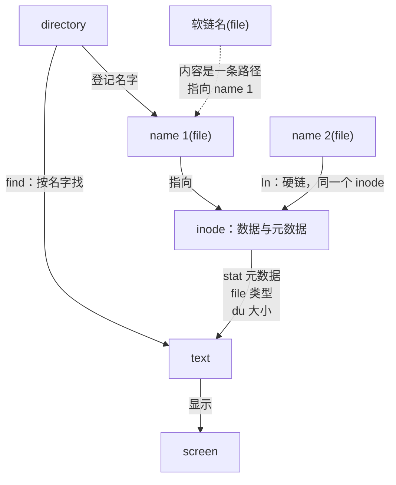

# 第3章：文件与目录操作

> [!TIP] Part 1 · command line（命令行）
> 一条命令从终端走到硬件再回来；文件系统给地址、权限给许可、管道给去路——后面一切章节都站在这几样上。

## 为什么要学文件与目录操作？

目录树上的名字只是 inode 的引用——同一份数据可有多个名字（硬链）与别名（软链），改名移动动的是名字不是数据。本章管对象级增删改——创建、复制、移动、删除、链接文件与目录，全程不打开文件内容（先修见 2.3–2.6）。

**图 3-1｜本章名字与数据模型**（节点为实体——目录树 directory、名字、软链名、inode（数据与元数据）、产物 text、目的地 screen；边为工具操作，实线 = 引用与读取，虚线 = 软链存的是路径——指向名字而不是数据；cp / mv / rm 对源与目标的结局见 3.5 节）：



<p class="figure-note">名字与数据分开算账——删名字、改名都不动数据，最后一个名字走了数据才释放</p>

> [!WARNING] 先猜再读
> 动手前先猜一猜，答案都在本章里：
>
> 1. `cp -r` 复制整个目录，连权限和属主也一起复制吗？（答案见 3.3）
> 2. `rm` 删掉的文件，能像 Windows 那样从回收站找回来吗？（答案见 3.5）
> 3. 建软链接时，指向路径写相对的还是绝对的更不容易"断链"？（答案见 3.13）

一切从"创建"开始——下面先学怎么造出文件和目录：

## 3.1 touch：创建文件与修改时间戳

**命令格式**：`touch [OPTION]... FILE...`

```bash
# 创建一个空文件
touch hello.txt
# 如果文件不存在，创建一个空文件
# 如果文件已存在，更新时间戳（不改变内容）

# 同时创建多个文件
touch file1.txt file2.txt file3.py

# 使用花括号批量创建
touch test_{1..5}.py
# 创建: test_1.py test_2.py ... test_5.py

# 创建带日期格式的日志文件
touch "backup_$(date +%Y%m%d).log"
# 创建: backup_20250115.log

# 设置特定时间戳
touch -t 202401011200.00 report.txt
# 格式: [[CC]YY]MMDDhhmm[.ss]

# 只修改访问时间
touch -a report.txt

# 只修改修改时间
touch -m report.txt

# 参考另一个文件的时间戳
touch -r reference.txt target.txt
```

## 3.2 mkdir：创建目录

**命令格式**：`mkdir [OPTION]... DIRECTORY...`

```bash
# 创建单个目录
mkdir myproject

# 创建多个目录
mkdir src tests docs

# mkdir -p —— 递归创建嵌套目录（最常用！）
mkdir -p project/src/components/buttons
# 即使 project、src、components 都不存在，也会一路创建

# 创建典型的项目结构
mkdir -p myapp/{src/{components,hooks,utils,styles},public/{images,fonts},tests}

# 验证
tree myapp
# myapp
# ├── public
# │   ├── fonts
# │   └── images
# ├── src
# │   ├── components
# │   ├── hooks
# │   ├── styles
# │   └── utils
# └── tests

# -p 如果目录已存在不会报错（幂等操作）
mkdir -p myproject
# 静默成功

# 设置目录权限
mkdir -m 755 public_dir
mkdir -m 700 private_dir
```

## 3.3 cp：复制文件与目录

**命令格式**：`cp [OPTION]... SOURCE... DEST`

```bash
# 复制文件
cp source.txt destination.txt

# 复制到目录中（保持原名）
cp report.txt /home/alice/documents/

# 复制并重命名
cp report.txt /home/alice/documents/monthly_report.txt

# cp -r —— 递归复制目录
cp -r project/ project_backup/

# cp -a —— 归档复制（最忠实的复制，备份首选）
cp -a project/ project_backup/
# -a = -dR --preserve=all
# 保留所有属性：权限、时间戳、所有者、符号链接

# cp -i —— 交互式复制（覆盖前询问）
cp -i important.txt /destination/

# cp -u —— 只复制更新的文件（增量备份）
cp -u source/ /destination/

# cp -v —— 显示复制过程
cp -rv project/ backup/

# cp --backup —— 自动备份已存在的文件
cp --backup=numbered new_config.yml /etc/app/

# 复制并保留目录结构
cp --parents src/components/Button.tsx /backup/
```

## 3.4 mv：移动与重命名

**命令格式**：`mv [OPTION]... SOURCE... DEST`

```bash
# 重命名文件
mv old_name.txt new_name.txt

# 移动文件到另一个目录
mv report.txt /home/alice/documents/

# 移动并重命名
mv report.txt /home/alice/documents/monthly_report.txt

# mv -i —— 覆盖前询问
mv -i file.txt /destination/

# mv -n —— 不覆盖已存在的文件
mv -n new_file.txt /destination/

# mv -v —— 显示移动过程
mv -v *.txt /archive/
```

```bash
# 批量重命名技巧

# 方法1：for 循环
for f in *.txt; do mv "$f" "backup_$f"; done
for f in *.txt; do mv "$f" "${f%.txt}.md"; done

# 方法2：rename 命令
sudo apt install rename
rename 's/\.jpeg$/.jpg/' *.jpeg        # 修改扩展名
rename 's/ /_/g' *                      # 空格变下划线
rename 'y/A-Z/a-z/' *                   # 转小写
rename -n 's/old/new/' *.txt            # 测试（不执行）
```

## 3.5 rm：删除——Linux中最危险的命令

`rm`（Remove）没有回收站，没有撤销，删了就没了。就像你在代码中执行 `DROP TABLE` 一样。

**命令格式**：`rm [OPTION]... [FILE]...`

```bash
# 删除单个文件
rm file.txt

# rm -i —— 每个文件删除前确认
rm -i *.txt

# rm -r —— 递归删除目录及其内容
rm -r old_project/

# rm -f —— 强制删除，不询问
rm -f nonexistent.txt

# rm -rf —— 核弹级删除（慎用！！！）
rm -rf old_project/

# 安全方案1：trash-cli（推荐）
sudo apt install trash-cli
trash file.txt          # 移到回收站
trash-list              # 查看回收站
trash-restore           # 从回收站恢复
trash-empty             # 清空回收站
alias rm='trash'

# 安全方案2：rm -i 作为默认
alias rm='rm -i'

# 安全方案3：删除前先 ls 确认
ls *.log    # 先看看会删哪些
rm *.log    # 确认后再删

# 绕过别名真正删除
\rm -rf temp/
```

```bash
# 删除目录的其他方式
rmdir empty_dir/    # 只能删除空目录
rm -d dir_name      # 删除空目录（等同于 rmdir）
```

cp、mv、rm 三者对源与目标的结局完全不同，对比一下就一目了然：

| 命令 | 源变成什么 | 目标变成什么 | 能不能撤销 |
| --- | --- | --- | --- |
| cp | 原文件仍留在原处 | 同分区内复制出的是独立副本，源与副本并存、互不影响 | 能，删掉副本即可撤销 |
| mv | 源不再出现在原处 | 同一个文件换了位置，同分区内移动约等于瞬间改名 | 能，移回去即可 |
| rm | 源被删除 | 不留任何副本——没有回收站 | 不能，唯一不可逆的就是 rm：删前先 ls 预览，或用 rm -i 加一道确认 |

## 3.6 ln：链接——文件的快捷方式

**命令格式**：`ln [OPTION]... TARGET LINK_NAME`

```
┌─────────────────────────────────────────────────────┐
│                  inode 原理图                         │
│                                                       │
│  文件名A ──┐                                          │
│            ├──> inode #12345 ──> 实际数据块            │
│  硬链接B ──┘    (文件元信息)     (磁盘上的内容)        │
│                                                       │
│  软链接C ──> inode #67890 ──> "/path/to/A"            │
│               (不同的inode)    (指向路径的字符串)      │
│                                                       │
│  硬链接 = 同一本书的两个书签（指向同一页内容）         │
│  软链接 = 一张纸条写着"书在XX位置"（指向路径）         │
└─────────────────────────────────────────────────────┘
```

```bash
# 创建硬链接
ln source.txt hardlink.txt
# 删除 source.txt 后，hardlink.txt 仍然可用
ls -li source.txt hardlink.txt   # inode 编号相同

# 创建软链接（最常用）
ln -s source.txt softlink.txt
ln -s /var/www/html ~/webroot     # 指向目录
ln -s /opt/node/v20 /opt/node/current

# 切换版本（强制覆盖软链接）
ln -sf /opt/node/v22 /opt/node/current

# 查看链接指向
readlink /opt/node/current        # -> /opt/node/v22
readlink -f /opt/node/current     # 解析所有层级到真实路径
```

## 3.7 find 命令基础

**命令格式**：`find [-H] [-L] [-P] [-D debugopts] [-Olevel] [starting-point...] [expression]`

```bash
# 按名称搜索
find /home -name "config.yml"        # 区分大小写
find /home -iname "config.yml"       # 不区分大小写
find /home -name "*.py"              # 通配符

# 按类型搜索
find /home -type f -name "*.txt"     # 普通文件
find /home -type d -name "src"       # 目录
find /home -type l                   # 符号链接

# 按大小搜索
find /home -size +100M               # 大于 100MB
find /home -size -1k                 # 小于 1KB
find / -size +1G                     # 大于 1GB

# 按时间搜索
find /home -mtime -7                 # 最近7天修改过
find /home -mtime +30                # 30天前修改
find /home -mmin -60                 # 最近60分钟修改

# -exec：对搜索结果执行命令
find /tmp -name "*.tmp" -exec rm {} \;
find /home -name "*.log" -exec ls -lh {} +
find /tmp -name "*.tmp" -ok rm {} \;   # 更安全（先确认）
find /var/log -name "*.log" -size +50M -exec gzip {} \;   # gzip 详见 3.11
```

## 3.8 file 命令：识别文件类型

**命令格式**：`file [OPTION]... [FILE]...`

```bash
file report.pdf
# report.pdf: PDF document, version 1.7

file photo.jpg
# photo.jpg: JPEG image data

file /bin/ls
# /bin/ls: ELF 64-bit LSB pie executable, x86-64

# 识别"假文件"
echo "hello" > fake.jpg
file fake.jpg    # ASCII text（虽然扩展名是.jpg）

file -b report.pdf     # 只显示类型，不显示文件名
file -i report.pdf     # 显示 MIME 类型
file -i *              # 当前目录所有文件的MIME类型
```

## 3.9 stat：文件的X光片

**命令格式**：`stat [OPTION]... FILE...`

```bash
stat report.txt
#   File: report.txt
#   Size: 2048     Blocks: 8    IO Block: 4096   regular file
# Device: 801h     Inode: 1234567   Links: 1
# Access: (0644/-rw-r--r--)  Uid: (1000/alice)  Gid: (1000/alice)
# Access: 2025-01-15 10:30:00  （访问时间 atime）
# Modify: 2025-01-15 10:30:00  （修改时间 mtime）
# Change: 2025-01-15 10:30:00  （变更时间 ctime）

# 格式化输出
stat -c "%n: %s bytes, perm %a, owner %U" report.txt
# %n=文件名 %s=大小 %a=权限(八进制) %U=所有者
```

## 3.10 du 命令：查看磁盘使用情况

`du`（Disk Usage）用于查看文件和目录占用的磁盘空间，就像给你的文件做"体检"——看看谁吃掉了你的磁盘（与 `df` 的分工见[第 2 章 2.10 节](./ch02.md)）。

**命令格式**：`du [OPTION]... [FILE]...`

```bash
# 查看当前目录的总大小
du -sh .
# -s 只显示总计（summary）
# -h 人类可读（human readable）
# 输出: 2.3G    .

# 查看指定目录的大小
du -sh /var/log
du -sh /home/alice/projects/*

# 查看当前目录下每个子目录的大小
du -sh */
# 输出类似：
# 1.2G    node_modules/
# 450M    src/
# 23M     docs/
# 8.0K    tests/

# 按大小排序，找出最大的
du -sh */ | sort -rh | head -10
# 最大的10个目录

# 限制深度
du -h --max-depth=1 /home
# 只显示第一层子目录的大小

du -h --max-depth=2 /var/log
# 显示两层深度

# 排除特定目录
du -sh --exclude="node_modules" .
du -sh --exclude="*.log" /var/log

# 找出大于1GB的目录
du -sh /* 2>/dev/null | sort -rh | head -20
# 根目录下各目录的大小，取前20
```

```bash
# 实用场景：磁盘空间不足时的排查
# 第一步：总体情况
df -h
# 看看哪个分区满了

# 第二步：找到大户
du -sh /* 2>/dev/null | sort -rh | head -10

# 第三步：深入最大的目录
du -sh /var/* | sort -rh | head -10

# 第四步：找到大文件
find /var -type f -size +100M -exec ls -lh {} \;

# 第五步：清理
# 清理APT缓存
sudo apt clean
# 清理旧内核
sudo apt autoremove
# 清理旧日志
sudo journalctl --vacuum-time=7d
# 清理Docker（如果使用Docker）
docker system prune -a
```

## 3.11 压缩与归档：tar、gzip、zip

在Linux上打包和压缩文件是日常工作中的常见需求——部署代码、备份数据、传输文件都需要它。

**命令格式**：`tar [OPTION]... [FILE]...`

```bash
# tar —— 归档工具（Tape Archive）
# tar 本身只做"打包"（把多个文件合成一个），不做压缩
# 通常配合压缩工具一起使用

# 创建归档（不压缩）
tar -cf archive.tar file1.txt file2.txt dir/
# -c 创建（create）
# -f 指定文件名（file）

# 解压归档
tar -xf archive.tar
# -x 解压（extract）

# 查看归档内容（不解压）
tar -tf archive.tar
# -t 列出（list）

# tar + gzip = .tar.gz（最常用的压缩格式）
tar -czf archive.tar.gz file1.txt dir/
# -z 使用gzip压缩

# 解压 .tar.gz
tar -xzf archive.tar.gz
# 解压到指定目录
tar -xzf archive.tar.gz -C /destination/
# -C 指定解压目录

# tar + bzip2 = .tar.bz2（压缩率更高，速度更慢）
tar -cjf archive.tar.bz2 dir/
tar -xjf archive.tar.bz2

# tar + xz = .tar.xz（最高压缩率）
tar -cJf archive.tar.xz dir/
tar -xJf archive.tar.xz

# 实用选项
tar -cvf archive.tar dir/
# -v 显示过程（verbose）
# 'dir/file1.txt'
# 'dir/file2.txt'

tar -czf backup_$(date +%Y%m%d).tar.gz /home/alice/projects
# 带日期戳的备份

tar -czf archive.tar.gz --exclude="node_modules" --exclude=".git" project/
# 排除特定目录
```

**经典陷阱：`f` 必须放在组合选项的最后**

`f` 是带参数的选项。按短选项合并的通用规则（见[第 1 章 1.9 节 · 命令的基本结构](./ch01.md)），同一词内它后面的所有字符都会被它当作参数吞掉：

```bash
tar -cvfJ backup.tar.xz dir/      # 错！f 吞掉 J → 归档名变成 "J"
tar -cvfz backup.tar.gz dir/      # 错！同款经典事故 → 生成一个叫 z 的文件

# 实际效果（以 -cvfJ 为例）：
# 1. 生成一个名为 J 的未压缩归档，xz 压缩完全没生效
# 2. backup.tar.xz 被当作“要归档的成员”去找，报 Cannot stat 错误

# 正确写法：带参数的 f 放在词尾，其余字母顺序随意
tar -cJvf backup.tar.xz dir/      # J 正常解析
tar -cvJf backup.tar.xz dir/      # 同样正确

# 或者分开写，最不容易踩坑
tar -c -v -J -f backup.tar.xz dir/
```

**命令格式**：`gzip [OPTION]... [FILE]...`、`zip [OPTION]... ARCHIVE [FILE]...`

```bash
# gzip / gunzip —— 单文件压缩
gzip file.txt           # 压缩为 file.txt.gz（原文件被删除）
gunzip file.txt.gz      # 解压为 file.txt

gzip -k file.txt        # -k 保留原文件（keep）
gzip -l file.txt.gz     # 查看压缩信息
gzip -d file.txt.gz     # -d 等同于 gunzip

# zip / unzip —— 跨平台压缩格式
zip archive.zip file1.txt file2.txt    # 压缩指定文件
zip -r archive.zip project/             # -r 递归压缩目录
unzip archive.zip                       # 解压
unzip archive.zip -d /destination/      # 解压到指定目录
unzip -l archive.zip                    # 列出内容（不解压）

# 加密zip
zip -e secret.zip file.txt              # 会提示输入密码
unzip secret.zip                        # 需要密码才能解压
```

```bash
# 常见压缩格式对比
# ┌─────────────────────────────────────────────────────────┐
# │ 格式        扩展名        压缩率    速度    跨平台      │
# │ gzip        .gz           中等      快      是          │
# │ bzip2       .bz2          较高      中      是          │
# │ xz          .xz           最高      慢      是          │
# │ zip         .zip          中等      快      是（最佳）  │
# │ 7z          .7z           最高      慢      部分        │
# │ zstd        .zst          较高      极快    较新        │
# └─────────────────────────────────────────────────────────┘
```

命令级怎么选，一句话记住：打包整个目录用 `tar + gzip`（`.tar.gz`，保留目录结构，备份首选）；只压单个文件用 `gzip`；发给 Windows 用户或跨平台分发用 `zip`（对方开箱即解）。

## 3.12 实战场景：开发者的日常文件操作

```bash
# 场景1：初始化新项目
mkdir -p ~/projects/myapp && cd ~/projects/myapp
mkdir -p src/{components,pages,utils,hooks} public/{images,fonts} tests
touch src/index.js src/App.js src/components/Header.jsx
touch public/index.html public/favicon.ico
touch .env .gitignore package.json README.md
echo "node_modules/\n.env\ndist/" > .gitignore
tree -L 2

# 场景2：备份当前工作
tar -czf "backup_$(date +%Y%m%d_%H%M).tar.gz" \
    --exclude="node_modules" \
    --exclude=".git" \
    --exclude="dist" \
    -C ~/projects myapp/

# 场景3：比较两个版本的文件
diff -r project_v1/ project_v2/ | head -50
# 递归比较两个目录的差异

# 场景4：批量处理文件
# 找出所有超过100行的Python文件
find . -name "*.py" -exec wc -l {} \; | awk '$1 > 100'

# 场景5：安全删除策略
# 1. 先看看要删什么
find /tmp -name "*.tmp" -mtime +7 -ls
# 2. 确认后再删
find /tmp -name "*.tmp" -mtime +7 -delete

# 场景6：文件搜索技巧
# 按内容搜索（grep）
grep -rn "TODO" --include="*.py" .
# -r 递归搜索
# -n 显示行号
# --include 只搜索特定类型

# 按文件名搜索（find）
find . -name "*.conf" -o -name "*.cfg"
# 搜索 .conf 或 .cfg 文件

# 按修改时间搜索
find . -newer reference_file.txt
# 比参考文件更新的文件
```

## 3.13 实用技巧与避坑指南

```bash
# 安全删除最佳实践
sudo apt install trash-cli && alias rm='trash'   # 回收站
alias rm='rm -i'                                   # 交互式
ls *.log && rm *.log                               # 先预览再删

# 快速创建项目模板
create_node_project() {
    mkdir -p "$1"/{src/{routes,controllers,models},tests,config,public}
    cd "$1"
    touch src/index.js src/app.js config/default.json .gitignore
    echo "Created project: $1"
    tree -L 2
}

# 安全清理临时文件
find /tmp -type f -mtime +7 -delete
find /home -type d -empty -delete

# 避坑：cp -r 不保留权限，用 cp -a
# 避坑：mv 跨文件系统时会先复制再删除（较慢）
# 避坑：软链接建议用绝对路径创建
```

## 3.14 动手练习：文件与目录操作

**练习1：项目结构搭建**

```bash
# 创建一个完整的Web项目结构
mkdir -p ~/webapp/{src/{components,pages,styles,utils},public/{images,fonts},tests,config}

# 创建初始文件
touch ~/webapp/src/index.js ~/webapp/src/App.js
touch ~/webapp/src/components/{Header,Footer,Sidebar}.jsx
touch ~/webapp/src/pages/{Home,About,Contact}.jsx
touch ~/webapp/src/styles/main.css ~/webapp/src/styles/variables.css
touch ~/webapp/public/index.html ~/webapp/public/favicon.ico
touch ~/webapp/tests/App.test.js ~/webapp/tests/setup.js
touch ~/webapp/.env.example ~/webapp/.gitignore ~/webapp/package.json

# 验证结构
tree ~/webapp -L 3

# 创建软链接：让nginx指向项目
ln -s ~/webapp/public ~/public_link
ls -la ~/public_link

# 清理
rm ~/public_link
rm -rf ~/webapp
```

**练习2：文件搜索与处理**

```bash
# 1. 创建测试环境
mkdir -p ~/find_practice/{dir1,dir2,dir3}
touch ~/find_practice/dir1/{file1.txt,file2.py,file3.log}
touch ~/find_practice/dir2/{data.csv,config.yml,app.py}
touch ~/find_practice/dir3/{backup.tar.gz,readme.md,test.py}
echo "important content" > ~/find_practice/dir1/file1.txt
echo "more content" > ~/find_practice/dir2/data.csv

# 2. 使用find搜索
find ~/find_practice -name "*.py"              # 找所有Python文件
find ~/find_practice -name "*.txt" -type f     # 找文本文件
find ~/find_practice -empty                    # 找空文件
find ~/find_practice -name "*.py" -exec wc -l {} \;  # 统计行数

# 3. 使用file识别类型
file ~/find_practice/dir1/*
file ~/find_practice/dir2/*

# 4. 使用stat查看元信息
stat ~/find_practice/dir1/file1.txt

# 5. 复制并比较
cp -a ~/find_practice ~/find_practice_backup
diff -r ~/find_practice ~/find_practice_backup  # 应该无差异

# 6. 清理
rm -rf ~/find_practice ~/find_practice_backup
```

**练习3：安全删除实践**

```bash
# 1. 创建待删除文件
mkdir ~/delete_practice && cd ~/delete_practice
touch {keep,delete}_{1,2,3}.txt

# 2. 安全删除（先预览再操作）
ls delete_*          # 预览
rm -i delete_*       # 逐个确认

# 3. 用find按条件清理：这次的对象是空文件（-empty）
echo "要保留的笔记" > keep_1.txt    # 写入内容后，它就不再是空文件
find . -empty -ls                  # 先看看哪些还是空文件
find . -empty -delete              # 确认后删除——keep_1.txt 因有内容而幸免

# 4. 清理
cd ~ && rm -rf ~/delete_practice
```

**练习4：跨章复习——导航 + 文件操作（复习第2章）**

下面的任务混用本章的文件操作和[第2章](./ch02.md)的导航、通配符，只给任务不给命令。导航卡住了，就回[第2章 · 本章小结](./ch02.md#本章小结)把 navigation 的 3 个坑默说一遍——隔了一章再回忆，正是对抗遗忘的最好时机。

环境搭建（直接执行）：

```bash
mkdir -p ~/review/{logs,backup,src}
touch ~/review/logs/app_{01,02,03}.log ~/review/src/main.py ~/review/src/utils.py
cd ~/review
```

任务：

1. 用相对路径进入 logs 目录，按大小降序列出里面的日志文件（第2章）
2. 把整个 logs 目录复制到 backup 里，保留属性（本章）
3. 用最快的方式回到上一个目录（第2章），再用一条命令验证副本与原目录无差异（本章）
4. 找出 review 下所有 .py 文件，并识别它们的真实文件类型（本章）
5. 先用通配符预览 review 的内容（第2章），再回到家目录删除整个 review 目录（本章）

<details>
<summary>点击查看答案</summary>

```bash
cd logs && ls -lhS                      # 1（从 ~/review 出发的相对路径）
cp -a ~/review/logs ~/review/backup/    # 2
cd -                                    # 3（回到 ~/review）
diff -r logs backup/logs                # 3 验证，应无输出
find ~/review -name "*.py"              # 4
file ~/review/src/*.py                  # 4
ls ~/review/*                           # 5 预览
cd ~ && rm -rf ~/review                 # 5
```

</details>

## 本章小结

- **核心句**：目录树上的名字只是 inode 的引用——同一份数据可有多个名字（硬链）与别名（软链），改名移动动的是名字不是数据。
- **边界句**：只管「名字↔数据」的对应；字节内容归 04，谁能动归 05。
- **坑 1**：硬链不能跨文件系统、不能指目录。
- **坑 2**：软链目标被删即悬空。
- **坑 3**：mv 跨分区实为复制+删除、cp 默认不保属性要 -a。
- **回访**：学到[第 4 章 查看与编辑文件](./ch04.md#本章小结)回来——说出这一章的 3 个坑，顺带回看本章的坑：名字和数据到底谁动了谁。
- **再回访**：学到[第 25 章 Docker 与现代化](./ch25.md#本章小结)再回来一次——看看容器里的 namespace 和本章文件系统的名字空间是不是同一件事。

**下一章预告**：名字只是引用，名字底下才是真正读写的数据——下一章讲**内容**（content）。
