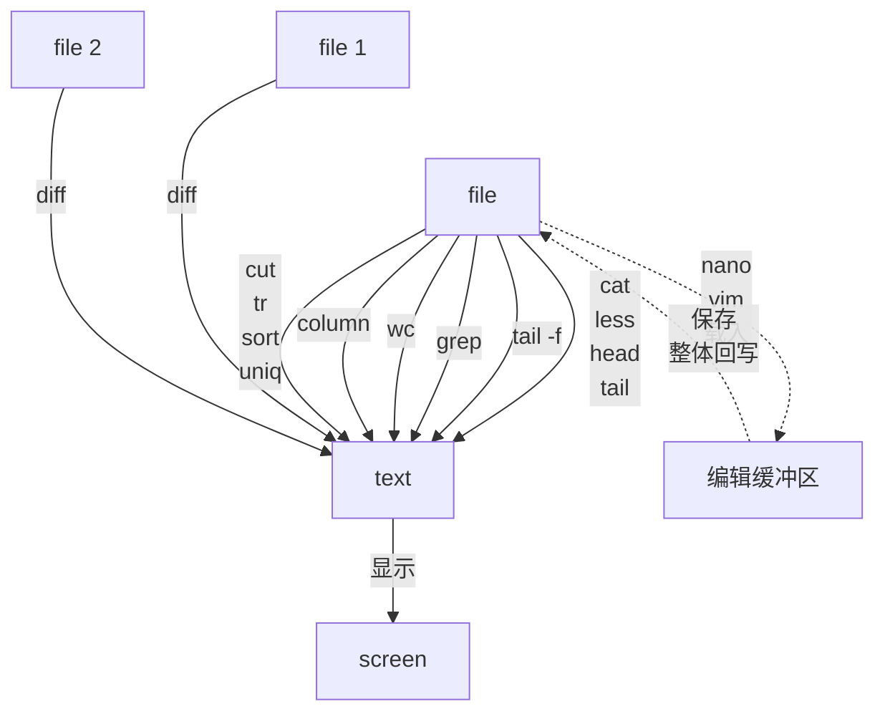

# 第4章：查看与编辑文件

> [!TIP] Part 1 · command line（命令行）
> 一条命令从终端走到硬件再回来；文件系统给地址、权限给许可、管道给去路——后面一切章节都站在这几样上。

## 为什么要学查看与编辑文件？

**本章手柄：content（内容）**

名字之下才是内容——读是把字节搬到屏幕，写是改完整体回写，编辑器的「保存」是一次新写不是就地修补。本章管内容级读写——cat/less 看内容、head/tail 截片段、diff 比差异，nano/vim 动手改。

**图 4-1｜本章内容读写模型**（节点为实体——源 file、产物 text、目的地 screen、编辑缓冲区；边为工具操作，实线 = 读出/加工，虚线 = 编辑的两步——nano/vim 把整份文件载入缓冲区，保存时整份新写回 file；diff 比对的是两份文件，故拆 file 1 / file 2）：



<p class="figure-note">读出来、比出来、改出来的都是文本——各工具的通用接口</p>

> [!WARNING] 先猜再读
> 动手前先猜一猜，答案都在本章里：
>
> 1. `uniq` 能去掉文件里所有重复的行吗？（答案见 4.6）
> 2. `tail -f` 追日志时碰上日志轮转，还能继续追到新内容吗？（答案见 4.3）
> 3. vim 里改完才发现文件是只读的，只能放弃重开吗？（答案见 4.8）

一切从“查看”开始——下面先学怎么把文件内容读出来：

## 4.1 cat：查看与拼接文件

`cat`（Concatenate）把文件内容一股脑地倒出来。

**命令格式**：`cat [OPTION]... [FILE]...`

```bash
# 查看文件内容
cat /etc/hostname
# 输出: my-laptop

cat /etc/shells
# 输出所有可用的shell

# 显示行号
cat -n /etc/hosts

# 压缩连续空行
cat -s messy_file.txt

# 拼接多个文件
cat file1.txt file2.txt file3.txt
cat file1.txt file2.txt > combined.txt

# 配合 here document 快速创建文件
cat > newfile.txt << EOF
这是第一行
这是第二行
这是第三行
EOF

# 追加内容
cat >> logfile.txt << EOF
[$(date)] 新的日志条目
EOF

# cat 拼接的逆操作：split 把大文件切开
split -l 1000 bigfile.txt chunk_     # 按行数切，每 1000 行一个 chunk_XX
split -b 10M bigfile.tar.gz chunk_   # 按大小切
cat chunk_* > bigfile_restored       # 再用 cat 拼回去
```

## 4.2 less：分页浏览

**命令格式**：`less [OPTIONS] [FILE]...`

```bash
# 选 cat 还是 less 的经验界线：约 100 行以内 cat 一屏读完更直接，再大交给 less 翻页
# 基本用法
less /var/log/syslog

# 快捷键：
# q          退出
# Space / f  下一页
# b          上一页
# g          跳到文件开头
# G          跳到文件末尾
# 50g        跳到第50行
# /keyword   向下搜索
# ?keyword   向上搜索
# n / N      下一个/上一个搜索结果
# v          用编辑器打开当前文件

# 常用选项
less -N /var/log/syslog     # 显示行号
less -S long_file.txt        # 不自动换行
less -I /var/log/syslog      # 搜索忽略大小写

# 管道方式使用
ps aux | less
docker logs mycontainer | less
```

## 4.3 head 和 tail

**命令格式**：`head [OPTION]... [FILE]...`、`tail [OPTION]... [FILE]...`

```bash
# head - 查看文件开头（默认前10行）
head /var/log/syslog
head -20 /var/log/syslog
head -n 5 config.yml
head -c 100 binary_file     # 前100字节

# tail - 查看文件末尾（默认后10行）
tail /var/log/syslog
tail -20 /var/log/syslog
tail -n 5 config.yml

# tail -f —— 实时追踪（排查问题神器！）
tail -f /var/log/nginx/access.log
tail -f /var/log/syslog | grep "ERROR"   # grep 详见 4.6
tail -50f /var/log/syslog       # 最后50行+实时追踪

# tail -F —— 更强大（跟踪文件名，支持日志轮转）
tail -F /var/log/app.log
# 坑：tail -f 追的是文件描述符，轮转后旧文件被改名就跟丢了；
# -F 按文件名重新打开，轮转后能继续追到新内容

# 组合技
head -30 file.txt | tail -11     # 查看第20-30行
tail -n +6 file.txt              # 跳过前5行
head -n -3 file.txt              # 去掉最后3行
```

## 4.4 wc：统计文件信息

**命令格式**：`wc [OPTION]... [FILE]...`

```bash
wc report.txt          # 行数 单词数 字节数 文件名
wc -l report.txt       # 只显示行数
wc -w report.txt       # 只显示单词数
wc -c report.txt       # 只显示字节数

# 实用组合
find . -name "*.py" | wc -l           # Python文件数量
wc -l src/*.py                         # 每个文件的行数
wc -l *.py | sort -rn | head -5       # sort 详见 4.6，行数最多的5个文件
wc -l /etc/passwd                      # 系统用户数量
```

## 4.5 diff：比较文件差异

**命令格式**：`diff [OPTION]... FILES`

```bash
# 基本用法
diff file1.txt file2.txt

# diff -u —— 统一格式（类似 Git diff）
diff -u file1.txt file2.txt

diff -i file1.txt file2.txt     # 忽略大小写
diff -w file1.txt file2.txt     # 忽略空白差异
diff -q file1.txt file2.txt     # 只报告是否不同
diff -r dir1/ dir2/             # 递归比较目录

# colordiff（推荐安装）
sudo apt install colordiff
colordiff file1.txt file2.txt   # 彩色输出
alias diff='colordiff'

# diff + patch
diff -u original.txt modified.txt > fix.patch
patch original.txt < fix.patch   # patch：把补丁应用到原文件（本书不展开）
```

## 4.6 文本处理基础工具

在命令行中处理文本是开发者的日常。本节一口气认识 6 个工具，它们各自回答一类问题，先按问题分组列出通用格式（记号约定见[第 1 章 1.6 节 · 通用命令格式](./ch01.md)），再用一张表辨析最容易混淆的 sort 与 uniq：

**提取列**——从分隔文本中抽出想要的字段：

- `cut [OPTION]... [FILE]...` —— 按字段或字符位置提取

**转换字符**——逐字符替换、删除、压缩：

- `tr [OPTION]... SET1 [SET2]` —— 只认字符，不认字段

**排序**——让相同的行挨在一起：

- `sort [OPTION]... [FILE]...` —— 支持字典序、数字、指定列等排序方式

**去重统计**——数一数每种值出现几次：

- `uniq [OPTION]... [INPUT [OUTPUT]]` —— 去相邻重复、计数、筛选

**搜索**——把匹配的行挑出来：

- `grep [OPTION]... PATTERNS [FILE]...` —— 按模式过滤行（[第 22 章](./ch22.md)详细讲）

**表格化**——把参差的列排整齐：

- `column [OPTIONS] [FILE]...` —— 对齐成表格

| 近邻命令 | 差别 | 怎么选 |
| -------- | ---- | ------ |
| `sort -u` / `uniq` | `sort -u` ≈ `sort \| uniq`：排序的顺手全量去重；`uniq` 单独用只去**相邻**重复，不相邻的重复行原样保留 | 全量去重先 `sort` 再 `uniq`（或直接 `sort -u`）；`uniq` 的主场在 `-c` 计数、`-d`/`-u` 筛选，通常跟在 `sort` 后面 |

**cut：按列提取**

**命令格式**：`cut [OPTION]... [FILE]...`

```bash
# 从 /etc/passwd 中提取用户名（第1列）
cut -d: -f1 /etc/passwd
# -d:  用冒号作为分隔符
# -f1  提取第1个字段

# 提取用户名和shell（第1列和第7列）
cut -d: -f1,7 /etc/passwd

# 按字符位置提取（不需要分隔符）
echo "Hello World" | cut -c1-5
# 输出: Hello

# 提取日期中的年月日
echo "2025-01-15" | cut -d'-' -f1,2
# 输出: 2025-01
```

**tr：字符转换与替换**

**命令格式**：`tr [OPTION]... SET1 [SET2]`

```bash
# 大小写转换
echo "Hello World" | tr 'a-z' 'A-Z'
# 输出: HELLO WORLD

echo "HELLO" | tr 'A-Z' 'a-z'
# 输出: hello

# 替换字符
echo "hello world" | tr ' ' '_'
# 输出: hello_world

# 删除字符
echo "hello123world" | tr -d '0-9'
# 输出: helloworld

# 压缩重复字符
echo "hello    world" | tr -s ' '
# 输出: hello world（多个空格变为一个）

# 实用：将路径分隔符替换
echo "/home/alice/projects/webapp" | tr '/' '\n'
# 输出:
# (空行)
# home
# alice
# projects
# webapp
```

**sort：排序**

**命令格式**：`sort [OPTION]... [FILE]...`

```bash
# 基本排序（字典序）
echo -e "banana\napple\ncherry" | sort
# apple
# banana
# cherry

# 数字排序
echo -e "10\n2\n30\n1" | sort -n
# 1
# 2
# 10
# 30

# 逆序（从大到小）
echo -e "10\n2\n30\n1" | sort -rn
# 30
# 10
# 2
# 1

# 按特定列排序
# 假设文件内容为：name age city
sort -k2 -n data.txt       # 按第2列数字排序
sort -k3 -r data.txt       # 按第3列逆序排序

# 排序并去重
sort -u file.txt           # -u = unique

# 人类可读的大小排序
du -sh */ | sort -rh       # -h 理解 K/M/G 单位

# 按月份排序（适用于日志）
sort -M months.txt         # 理解 Jan, Feb, Mar...

# 稳定排序（保持相等元素的原始顺序）
sort -s -k1 file.txt
```

**uniq：去重与统计**

**命令格式**：`uniq [OPTION]... [INPUT [OUTPUT]]`

```bash
# 注意：uniq 只去除相邻的重复行！
# 所以通常先 sort 再 uniq

echo -e "a\nb\na\nc\nb" | uniq
# a
# b
# a       ← 没有被去掉（因为不相邻）
# c
# b

# 正确做法：先排序
echo -e "a\nb\na\nc\nb" | sort | uniq
# a
# b
# c

# uniq -c 统计出现次数
echo -e "a\nb\na\nc\nb\na" | sort | uniq -c
#   3 a
#   2 b
#   1 c

# 只显示重复的行（出现超过1次）
echo -e "a\nb\na\nc\nb\na" | sort | uniq -d
# a
# b

# 只显示不重复的行（只出现1次）
echo -e "a\nb\na\nc\nb\na" | sort | uniq -u
# c

# 经典组合：统计频率并排序
cat names.txt | sort | uniq -c | sort -rn | head -10
# 找出出现最多的10个名字
```

**column：格式化表格输出**

**命令格式**：`column [OPTIONS] [FILE]...`

```bash
# 将分隔符格式化为对齐的表格
echo -e "name,age,city\nAlice,30,Beijing\nBob,25,Shanghai" | column -t -s','
# name   age  city
# Alice  30   Beijing
# Bob    25   Shanghai

# 将文件内容排成多列
ls /usr/bin | column
# 多列对齐显示
```

**grep：文本搜索（基础篇，第22章详细讲）**

**命令格式**：`grep [OPTION]... PATTERNS [FILE]...`

```bash
# 在文件中搜索关键词
grep "error" /var/log/syslog

# 递归搜索目录
grep -r "TODO" ~/projects/
# -r 递归搜索所有文件

# 显示行号
grep -n "error" file.txt
# 42:connection error occurred

# 忽略大小写
grep -i "error" file.txt

# 反向搜索（排除）
grep -v "debug" file.txt
# 显示所有不包含 "debug" 的行

# 只统计匹配的行数
grep -c "error" file.txt

# 搜索多个模式
grep -E "error|warning|critical" file.txt
# -E 启用扩展正则表达式

# 只显示匹配的部分
grep -o "[0-9]\{3\}\.[0-9]\{3\}\.[0-9]\{3\}\.[0-9]\{3\}" access.log
# 只提取IP地址

# 上下文显示
grep -B2 -A2 "error" file.txt
# -B2 显示匹配行前2行
# -A2 显示匹配行后2行
# -C2 前后各2行

# 常用组合
grep -rn "function" --include="*.js" .
# 递归搜索所有.js文件中的 "function"，显示行号

grep -rni "fixme\|todo\|hack" --include="*.py" .
# 搜索代码中的待办标记（忽略大小写）
```

## 4.7 nano 编辑器入门

**命令格式**：`nano [OPTIONS] [+LINE] [FILE]`

```bash
nano filename.txt              # 打开文件
nano +42 filename.txt          # 打开并跳到第42行

# 常用快捷键：
# Ctrl+O   保存
# Ctrl+X   退出
# Ctrl+R   插入文件
# Ctrl+W   搜索
# Ctrl+\   搜索并替换
# Ctrl+_   跳到指定行
# Ctrl+K   剪切整行
# Ctrl+U   粘贴
# Alt+\    跳到文件开头
# Alt+/    跳到文件末尾

# 配置文件 ~/.nanorc
# set linenumbers
# set autoindent
# set tabsize 4
# set tabstospaces
# include "/usr/share/nano/*.nanorc"
```

## 4.8 vim 编辑器入门

**命令格式**：`vim [OPTIONS] [FILE]...`

**vim 三种模式：**

```
普通模式（Normal）── i ──> 插入模式（Insert）
       │                        │
       │（:）                   │（Esc）
       v                        │
命令模式（Command）<────────────┘
```

```bash
sudo apt install vim
vim filename.txt
vim +42 filename.txt     # 打开并跳到第42行

# 普通模式操作：
# h/j/k/l    左/下/上/右移动
# w / b      下一个/上一个单词
# 0 / $      行首 / 行尾
# gg / G     文件开头 / 末尾
# 42G        跳到第42行
# dd         删除整行
# yy         复制整行
# p          粘贴
# u          撤销
# Ctrl+r     重做
# /keyword   搜索

# 进入插入模式：
# i  光标前插入
# a  光标后插入
# o  下方新建行
# O  上方新建行
# Esc 回到普通模式

# 命令模式（按 : 进入）：
# :w       保存
# :q       退出
# :wq      保存退出
# :q!      强制退出不保存
# :%s/old/new/g   全文替换
# :sp      水平分屏
# :vs      垂直分屏
```

```bash
# ~/.vimrc 基础配置
# set number              " 显示行号
# set relativenumber      " 相对行号
# set cursorline          " 高亮当前行
# set hlsearch            " 高亮搜索结果
# set incsearch           " 实时搜索
# set ignorecase          " 忽略大小写
# set tabstop=4           " Tab宽度
# set expandtab           " Tab转空格
# set autoindent          " 自动缩进
```

**vim 可视模式（Visual Mode）：**

```bash
# 可视模式让你用类似鼠标选择的方式操作文本
# 三种可视模式：
# v          字符级可视模式
# V          行级可视模式
# Ctrl+v     块级可视模式（列选择，超实用！）

# 可视模式操作流程：
# 1. 按 v/V/Ctrl+v 进入可视模式
# 2. 用 h/j/k/l/w/b 扩展选区
# 3. 执行操作：d删除, y复制, c修改, >/<缩进

# 块级可视模式（Ctrl+v）经典用法：批量注释
# Ctrl+v → jjjjj（选6行）→ I → 输入 "// " → Esc
# 所有选中行前面都会加上 "// "

# 取消注释：
# Ctrl+v → 选中每行开头的 "// " → d
# 一次性删除所有注释符号

# 实用文本对象操作（在普通模式下）：
# ciw     修改光标所在的单词（change inner word）
# ci"     修改引号内的内容
# ci(     修改括号内的内容
# di"     删除引号内内容（保留引号）
# di{     删除大括号内内容
# yi(     复制括号内内容
# vit     选中HTML标签内内容
# vat     选中HTML标签及其内容
```

**vim 宏（Macro）—— 录制并重复操作：**

```bash
# 宏是vim的杀手级功能——录制操作序列然后无限重复

# 录制宏：
# qa     开始录制到寄存器a
# (执行你的编辑操作)
# q      停止录制

# 播放宏：
# @a     播放寄存器a的宏
# 10@a   播放10次
# @@     重复上一次宏

# 示例：给每行添加前缀
# 1. qa → I（行首插入）→ 输入前缀 → Esc → j → q
# 2. 99@a 对剩余99行重复

# 示例：将列表项转为代码
# 假设每行是: item_name
# 目标：var item_name = require('item_name');
# qa → I → 输入 "var " → Esc → A → 输入 " = require('" → Esc
# → 0 → w → y$ → A → 输入 "');" → Esc → j → q
```

**vim 寄存器（Register）—— 26个剪贴板：**

```bash
# vim有26个命名寄存器（a-z）
"ayy     复制当前行到寄存器a
"byy     复制当前行到寄存器b
"ap      粘贴寄存器a
"bp      粘贴寄存器b

# 查看寄存器
:reg

# 特殊寄存器：
# "*  系统剪贴板（与Ctrl+C/V互通）
# "+  系统剪贴板
# "_  黑洞寄存器（丢弃）
# "0  最近一次yank

# 复制到系统剪贴板
"+yy    复制到剪贴板
"+p     从剪贴板粘贴

# 在 ~/.vimrc 中自动使用系统剪贴板
set clipboard=unnamedplus
```

**vim 标记（Mark）—— 文件中的书签：**

```bash
ma       在当前位置设置标记a
`a       跳转到标记a（精确位置）
'a       跳转到标记a（行首）
``       跳回上一次跳转前的位置
`.       跳转到最后修改的位置
:marks   查看所有标记
```

```bash
# 避坑：vim 里改完才发现文件只读——不用放弃重开
# :w !sudo tee %
# 借 sudo tee 把缓冲区内容写回当前文件（% 即当前文件名）
# 写入成功后 :q! 退出即可
```

## 4.9 编辑器选择建议

| 场景 | 推荐工具 | 理由 |
| ------ | ---------- | ------ |
| 快速修改配置 | nano | 零学习成本 |
| 服务器编辑 | vim | 几乎必装 |
| 开发项目 | VS Code Remote | 图形化+插件 |
| 阅读代码库 | less / vim | 搜索快、跳转方便 |

## 本章小结

**① 核心句**：名字之下才是内容——读是把字节搬到屏幕，写是改完整体回写，编辑器的「保存」是一次新写不是就地修补。

**② 边界句**：只管字节本身；名字归 03，权限归 05。

**③ 可推导条目**：
- `>` 先截断再写。
- tail -f 追的是文件描述符不是名字，logrotate 后要 -F。
- 大文件先分页别 cat 刷屏。

> **词链互测**（回访）：学到[第 6 章 redirection](./ch06.md#本章小结)回来——说出 redirection 的 3 个坑；自查「写是整体回写」与「`>` 先截断」是不是同一件事。

**下一章预告**：改内容时撞上 Permission denied——是谁在拦？下一章的手柄是 **access control**（访问控制）。
