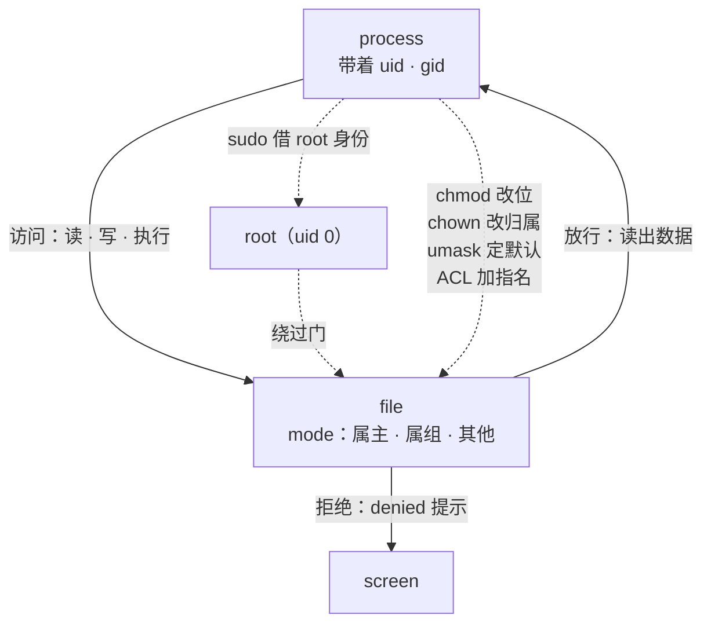

# 第5章：用户与权限

> [!TIP] Part 1 · command line（命令行）
> 一条命令从终端走到硬件再回来；文件系统给地址、权限给许可、管道给去路——后面一切章节都站在这几样上。

## 为什么要学用户与权限？

每次访问都过一道门——属主/属组/其他 × 读/写/执行，自上而下命中即停，门跟着文件走不跟人走。本章管身份与门禁——用户与组是谁、rwx 权限谁能碰什么，出问题先查这两层（先修见 2.5 的 `ls -l` 字段解读）。

**图 5-1｜本章访问控制模型**（节点为实体——主体 process 与 root、客体 file 及其 mode 门、目的地 screen；边为操作，实线 = 一次访问的判定与结果，虚线 = 改接——sudo 借 root 身份，chmod / chown / umask / ACL 改门；属主、属组、其他三组自上而下命中即停）：



<p class="figure-note">门跟着文件走不跟人走——denied 时先查文件的门牌，再查你的身份</p>

> [!WARNING] 先猜再读
> 动手前先猜一猜，答案都在本章里：
>
> 1. 目录的 `x` 权限是干什么用的？没有它还能 `cd` 进去吗？（答案见 5.5）
> 2. 多数人以为新建文件的默认权限是 666，其实中间还隔着一道 `umask`——644 是怎么算出来的？（答案见 5.8）
> 3. 用 `sudo` 创建的文件，属主是谁？该怎么修回来？（答案见 5.7）

两条线都从“人”开始——先弄清 Linux 里有哪些用户、你又是谁：

## 5.1 Linux 用户模型

Linux 的权限判断只认数字：用户有 UID，组有 GID，用户名和组名只是 `/etc/passwd`、`/etc/group` 里的别名（字段含义见 10.1）。每个用户有一个主组，还能加入多个附加组——`id` 输出里的 `gid` 是主组，`groups` 列出全部组。多数发行版按 UID 把账户分成三类：

```
┌──────────────────────────────────────────────────────┐
│  root（超级用户，UID=0）                             │
│  ├── 不受权限检查限制，可以做任何事                  │
│  ├── 危险！不建议日常使用                            │
│  └── 相当于最高权限                                  │
│                                                      │
│  普通用户（UID >= 1000）                             │
│  ├── 日常使用的账户                                  │
│  ├── 只能操作自己的文件                              │
│  └── 可以通过 sudo 临时获得管理员权限                │
│                                                      │
│  系统用户（UID 1-999）                               │
│  ├── 为服务/进程创建（www-data, mysql 等）           │
│  └── 通常不能登录                                    │
└──────────────────────────────────────────────────────┘
```

## 5.2 查看用户信息

本节一口气认识 5 个查看用户信息的命令。它们回答两类不同的问题，先按问题分组列出通用格式（记号约定见 1.6），再用一张表区分彼此：

**查某个用户的身份**——视角是一个用户：

- `whoami [OPTION]...` —— 当前用户名
- `id [OPTION]... [USER]...` —— UID、GID 与所属组
- `groups [OPTION]... [USERNAME]...` —— 用户所属的组

**查整台机器的在线会话**——视角是整台机器：

- `who [OPTION]... [FILE | ARG1 ARG2]` —— 当前登录用户
- `w [OPTION]... [USER]` —— 登录用户及活动（更详细）

| 想知道 | 用哪个 | 区分点 |
| ------ | ------ | ------ |
| 我现在的用户名 | `whoami` | 最小答案：只输出有效用户的名字，sudo/su 之后用来确认「我现在到底是谁」 |
| 我（或某人）的完整身份 | `id` | `whoami` 只要名字；`id` 给 UID、主组、附属组——内核权限判断只认数字，排查权限用它，`id bob` 还能查别人 |
| 某用户在哪些组 | `groups` | `id` 的组专项：`groups alice` ≈ `id -Gn alice`，确认是否在 docker、sudo 等组里最快 |
| 谁登录了这台机器 | `who` | 登录者、终端、来源与登录时间 |
| 谁登录了 + 正在干什么 | `w` | `w` = who + what：比 `who` 多每人正在运行的命令与空闲时间 |

这 5 个命令都回答不了“系统里一共有哪些用户”——想知道就得读账号档案：`cat /etc/passwd` 列出全部，`awk -F: '$3 >= 1000 && $3 != 65534' /etc/passwd` 只列普通用户（排除 UID 65534 的 `nobody`；七个字段的含义见[第 10 章 10.1 节 · /etc/passwd 字段](./ch10.md)）。

```bash
# 查某个用户的身份
whoami                    # 当前用户名
id                        # 当前用户UID、GID、所属组
id bob                    # 其他用户的信息
id root                   # uid=0(root) gid=0(root)
groups alice              # 用户所属的组

# 查整台机器的在线会话
who                       # 当前登录用户
w                         # 登录用户及活动（更详细）
```

## 5.3 sudo 的原理与用法

**命令格式**：`sudo [OPTION]... COMMAND`

sudo 的机制：以 root（或 `-u` 指定的用户）身份执行一条命令，验证的是你自己的密码而非 root 的——root 密码不必共享，且每次使用都记入审计日志（查记录见 5.13）。

```bash
# 基本用法
sudo apt update            # 以管理员权限执行（输入自己的密码）
sudo -i                    # 以root身份打开shell
sudo -u bob ls /home/bob/  # 以bob身份执行命令

# 实用命令
sudo -l                    # 查看你被允许的sudo命令
sudo -k                    # 清除密码缓存
sudo !!                    # 用sudo重复上一条命令
```

允许谁在哪台机器上以谁的身份执行哪些命令，写在 sudoers 文件里——配置它属于账号运维，用 visudo 编辑的完整方法见 10.7。

## 5.4 用户管理最小集

用户的完整生命周期（创建/删除的选型、修改的深选项、密码策略、组的改名删除）由[第 10 章](./ch10.md)专讲，登录审计的深度用法在[第 13 章 13.4 节](./ch13.md)。本节只取跑通本章权限实验（5.11–5.14）并做一次登录自查所需的最小集，按任务列出通用格式（记号约定见 1.6）：

**准备实验主体**：

- `adduser [OPTION]... USER` —— 交互式创建用户（自动建家目录、引导设密码）
- `groupadd [OPTION]... NEWGROUP` —— 创建组
- `usermod -aG GROUP USER` —— 把用户加入组（`-a` 不能漏，丢了会清掉原有附加组，见 10.3）

**密码与审计**：

- `passwd [OPTION]... [LOGIN]` —— 修改账户密码（过期/锁定策略见 10.5）
- `last [OPTION]... [USER]...` —— 查看登录记录（深入用法见 13.4）
- `lastb [OPTION]... [USER]...` —— 查看失败的登录

```bash
# 准备权限实验的主体（5.11 场景 3 会用到）
sudo adduser alice                  # 交互式创建
sudo groupadd developers            # 创建组
sudo usermod -aG developers alice   # 把 alice 加进 developers（需重新登录生效）

# 密码
passwd                              # 修改自己的密码
sudo passwd alice                   # root 修改他人密码

# 审计登录
last                                # 查看登录记录
sudo lastb                          # 查看失败的登录
```

`adduser` 是 Debian/Ubuntu 的友好封装，RHEL 系通常没有它，要用 `useradd`（两者差异见 10.2）。创建与删除用户的完整选型（`deluser` 与 `userdel` 的差别）集中在 10.4；`usermod` 其余常用选项见 10.3，组的改名与删除见 10.6。

## 5.5 文件权限详解：rwx

```
-rwxr-xr-x 1 alice developers 4096 Jan 15 10:30 script.sh
││││││││││ │     │
││││││││││ │     └── 所属组
││││││││││ └──────── 所有者
│││││││││└── 其他用户-执行
││││││││└─── 其他用户-写
│││││││└──── 其他用户-读
││││││└───── 所属组-执行
│││││└────── 所属组-写
││││└─────── 所属组-读
│││└──────── 所有者-执行
││└───────── 所有者-写
│└────────── 所有者-读
└─────────── 文件类型（- 文件，d 目录，l 链接）
```

把这串字符按「1 + 3 + 3 + 3」拆开画成图：

**图 5-2｜-rwxr-xr-x 权限位拆解**（10 个字符分成 4 组，每组折算成一位八进制数，755 就是这么来的）：

<svg viewBox="0 0 400 412" xmlns="http://www.w3.org/2000/svg" font-family="system-ui, sans-serif">
  <rect x="0" y="0" width="400" height="412" fill="#ffffff"/>
  <rect x="40" y="30" width="32" height="42" fill="#fafafa" stroke="#999"/>
  <text x="56" y="57" text-anchor="middle" font-size="15" font-weight="bold" fill="#555">-</text>
  <rect x="72" y="30" width="32" height="42" fill="#f0f7ff" stroke="#4a90d9"/>
  <text x="88" y="57" text-anchor="middle" font-size="15" font-weight="bold" fill="#333">r</text>
  <rect x="104" y="30" width="32" height="42" fill="#f0f7ff" stroke="#4a90d9"/>
  <text x="120" y="57" text-anchor="middle" font-size="15" font-weight="bold" fill="#333">w</text>
  <rect x="136" y="30" width="32" height="42" fill="#f0f7ff" stroke="#4a90d9"/>
  <text x="152" y="57" text-anchor="middle" font-size="15" font-weight="bold" fill="#333">x</text>
  <rect x="168" y="30" width="32" height="42" fill="#fafafa" stroke="#4a90d9"/>
  <text x="184" y="57" text-anchor="middle" font-size="15" font-weight="bold" fill="#333">r</text>
  <rect x="200" y="30" width="32" height="42" fill="#fafafa" stroke="#4a90d9"/>
  <text x="216" y="57" text-anchor="middle" font-size="15" font-weight="bold" fill="#333">-</text>
  <rect x="232" y="30" width="32" height="42" fill="#fafafa" stroke="#4a90d9"/>
  <text x="248" y="57" text-anchor="middle" font-size="15" font-weight="bold" fill="#333">x</text>
  <rect x="264" y="30" width="32" height="42" fill="#fafafa" stroke="#999"/>
  <text x="280" y="57" text-anchor="middle" font-size="15" font-weight="bold" fill="#333">r</text>
  <rect x="296" y="30" width="32" height="42" fill="#fafafa" stroke="#999"/>
  <text x="312" y="57" text-anchor="middle" font-size="15" font-weight="bold" fill="#333">-</text>
  <rect x="328" y="30" width="32" height="42" fill="#fafafa" stroke="#999"/>
  <text x="344" y="57" text-anchor="middle" font-size="15" font-weight="bold" fill="#333">x</text>
  <path d="M40 76 L40 82 L72 82 L72 76" fill="none" stroke="#999"/>
  <text x="56" y="100" text-anchor="middle" font-size="12" fill="#333">类型</text>
  <path d="M72 76 L72 82 L168 82 L168 76" fill="none" stroke="#4a90d9"/>
  <text x="120" y="100" text-anchor="middle" font-size="12" fill="#333">属主 u</text>
  <text x="120" y="128" text-anchor="middle" font-size="20" font-weight="bold" fill="#4a90d9">7</text>
  <text x="120" y="146" text-anchor="middle" font-size="12" fill="#555">4+2+1</text>
  <path d="M168 76 L168 82 L264 82 L264 76" fill="none" stroke="#4a90d9"/>
  <text x="216" y="100" text-anchor="middle" font-size="12" fill="#333">属组 g</text>
  <text x="216" y="128" text-anchor="middle" font-size="20" font-weight="bold" fill="#4a90d9">5</text>
  <text x="216" y="146" text-anchor="middle" font-size="12" fill="#555">4+0+1</text>
  <path d="M264 76 L264 82 L360 82 L360 76" fill="none" stroke="#999"/>
  <text x="312" y="100" text-anchor="middle" font-size="12" fill="#333">其他 o</text>
  <text x="312" y="128" text-anchor="middle" font-size="20" font-weight="bold" fill="#4a90d9">5</text>
  <text x="312" y="146" text-anchor="middle" font-size="12" fill="#555">4+0+1</text>
  <text x="40" y="176" font-size="12" fill="#555">第 1 位是类型：- 普通文件（d 目录、l 链接）</text>
  <text x="40" y="198" font-size="12" fill="#555">属主 alice：rwx 全部权限 = 7</text>
  <text x="40" y="220" font-size="12" fill="#555">属组 developers：r-x 读+执行 = 5</text>
  <text x="40" y="242" font-size="12" fill="#555">其他人：r-x 读+执行 = 5</text>
  <rect x="40" y="260" width="320" height="48" rx="8" fill="#fafafa" stroke="#999"/>
  <text x="200" y="282" text-anchor="middle" font-size="13" font-weight="bold" fill="#333">755 = rwxr-xr-x</text>
  <text x="200" y="300" text-anchor="middle" font-size="12" fill="#555">每位八进制数折算回一组 rwx（7=rwx，5=r-x）</text>
  <text x="200" y="328" text-anchor="middle" font-size="12" fill="#555">同理：644 = rw-r--r--（普通文件）</text>
  <text x="200" y="348" text-anchor="middle" font-size="12" fill="#555">600 = rw-------（SSH 私钥）</text>
  <text x="200" y="376" text-anchor="middle" font-size="12" fill="#666">r=4、w=2、x=1，每组三个数相加得一位八进制</text>
  <text x="200" y="394" text-anchor="middle" font-size="12" fill="#666">——755、644、600 由此而来</text>
</svg>

| 权限 | 字母 | 数字 | 对文件 | 对目录 |
| ------ | ------ | ------ | -------- | -------- |
| 读 | r | 4 | 查看内容 | 列出内容（ls） |
| 写 | w | 2 | 修改内容 | 创建/删除文件 |
| 执行 | x | 1 | 运行程序 | 进入目录（cd） |

**权限怎么判定**：内核对一次访问只做一轮匹配——先看你是不是属主，是就只用属主三位；否则看属组，只要你的任一所属组命中文件属组，就用组三位；都不匹配才用其他三位。命中即停，不叠加：属主权限比组少时，属主也拿不到组的那份。root 基本绕过这套检查（执行文件仍需至少一个 `x` 位），所以排查时不能只想“我在不在组里”。

**常见权限组合：**

| 数字 | 符号 | 常用场景 |
| ------ | ------ | ---------- |
| 755 | rwxr-xr-x | 脚本、目录 |
| 644 | rw-r--r-- | 普通文件 |
| 700 | rwx------ | 私密目录 |
| 600 | rw------- | SSH密钥、私密配置 |
| 777 | rwxrwxrwx | 不推荐！ |

## 5.6 chmod：修改权限

**命令格式**：`chmod [OPTION]... MODE[,MODE]... FILE...`

```bash
# 数字法
chmod 755 script.sh        # 所有者rwx，组r-x，其他r-x
chmod 644 config.yml       # 所有者rw-，组r--，其他r--
chmod 600 ~/.ssh/id_rsa    # SSH私钥必须是600！
chmod -R 755 project/      # 递归修改（普通文件也会带 x，Web 场景见 5.11 场景1）
chmod -R a+X project/      # 只给目录和已有 x 的文件补执行位

# 符号法
chmod u+x script.sh        # 给所有者加执行权限
chmod a+x script.sh        # 给所有人加执行权限（= chmod +x）
chmod o-w file.txt         # 移除其他人的写权限
chmod u=rwx,g=rx,o=rx script.sh  # 组合（= 755）
chmod -R g+w project/      # 递归

# 实用示例
chmod +x deploy.sh         # 让脚本可执行
chmod 700 ~/.ssh           # SSH密钥安全权限（UNPROTECTED PRIVATE KEY 警告的完整修复见 5.11 场景2）
chmod 600 ~/.ssh/id_rsa
```

## 5.7 chown 和 chgrp

**命令格式**：`chown [OPTION]... [OWNER][:[GROUP]] FILE...`、`chgrp [OPTION]... GROUP FILE...`

```bash
# chown：改所有者，可捎带改组
sudo chown alice file.txt              # 只改所有者
sudo chown alice:developers file.txt   # 同时改所有者和组
sudo chown :developers file.txt        # 只改组（等价于 chgrp）
sudo chown -R www-data:www-data /var/www/html   # 递归

# chgrp：只改组
sudo chgrp developers project/         # 修改组
sudo chgrp -R developers project/      # 递归

# 常见场景：修复sudo创建的文件
sudo touch /home/alice/newfile.txt     # 属于root!
sudo chown alice:alice /home/alice/newfile.txt   # 修复
```

两者的分工：`chown` 能改属主、同时改组（`alice:developers`）、也能只改组（`:developers`）；`chgrp` 只改组。重叠点是 `chown :developers file` ≈ `chgrp developers file`——只想动组时用 `chgrp`，意图更明确，也不会误碰属主。

权限边界：改属主需要 root（或 `CAP_CHOWN`）；普通用户只能把自己的文件改到自己所属的组，`chgrp` 同理。

## 5.8 umask：默认权限掩码

**命令格式**：`umask [-p] [-S] [MODE]`

注意 `umask` 是 shell 内建命令，`man umask` 找不到独立条目——查用法要用 `help umask`。

新建文件时内核只给一个“基数”：目录 777、文件 666（文件默认永远不带执行位）。umask 是一张“要抹掉的位”的掩码：掩码里为 1 的位从基数中清除，为 0 的位保留。常见掩码恰好可以用“基数减掩码”速算，所以常被简化成减法；但遇到奇数位会算错（`umask 033` 时文件实际是 644，`666-033=633` 是错的），拿不准就以实际创建结果为准。

```bash
umask                  # 查看当前值，通常 0022
umask -S               # 符号显示：u=rwx,g=rx,o=rx
umask -p               # 输出可复用命令：umask 0022

# 用实际结果验证（默认 022 时）
mkdir demo && touch demo/f
ls -ld demo demo/f
# drwxr-xr-x ... demo      ← 777 抹掉 022 的组/其他写位
# -rw-r--r-- ... demo/f    ← 666 抹掉 022 的组/其他写位

umask 077              # 只对当前 shell 及之后的子进程生效
mkdir private && touch private/key
ls -ld private private/key
# drwx------、-rw-------（目录 700、文件 600）

umask 022              # 恢复默认
```

| umask | 新建目录 | 新建文件 | 适用场景 |
| ----- | -------- | -------- | -------- |
| 022 | 755 | 644 | 系统默认：其他用户可读、不可写 |
| 002 | 775 | 664 | 团队协作：同组可写 |
| 027 | 750 | 640 | 组内可读，其他人完全隔离 |
| 077 | 700 | 600 | 私密数据、密钥 |

**作用范围与例外：**

- 只影响**之后新建**的文件/目录；已有文件不变，`chmod` 也不受 umask 约束。
- 不会跨会话保存：设置只在当前 shell 及其子进程有效，新开终端恢复启动文件里的值。
- 显式指定权限时以指定值为准：`mkdir -m 700`、`cp -p`、`rsync -a`；而 `cp` 不带 `-p` 时，新文件仍按源权限经 umask 过滤。
- 永久生效写进 shell 启动文件：bash 交互式非登录 shell 读 `~/.bashrc`，登录 shell 读 `~/.profile`；系统级默认值通常在 `/etc/profile` 或 PAM 读取的 `/etc/login.defs`（不同发行版位置略有差异）。写入前先 `grep umask` 确认没有旧条目，避免重复叠加。

## 5.9 特殊权限：SUID、SGID、Sticky Bit

普通的 rwx 管“能不能读、写、进入”，三位特殊权限管“以谁的身份执行”“新文件归哪个组”“谁能删文件”。它们占八进制权限最高位，数值分别是 4、2、1（即 4000、2000、1000）：

| 特殊位 | 数值 | 加在 | 作用 |
| ------ | ---- | ---- | ---- |
| SUID | 4000 | 可执行文件 | 运行时以文件所有者身份执行（如 `passwd`）|
| SGID | 2000 | 文件 / 目录 | 文件：以文件属组身份执行；目录：新建文件继承目录属组，新建子目录还继承 SGID 位 |
| Sticky | 1000 | 目录 | 目录内只有文件属主、目录属主或 root 能删除/重命名文件（如 `/tmp`）|

**数字法**：把特殊位的数字加在三位普通权限前面。

```bash
sudo chmod 4755 /path/to/program   # SUID + rwxr-xr-x

sudo mkdir -p /shared/project      # developers 组在 5.4 创建
sudo chgrp developers /shared/project
sudo chmod 2770 /shared/project    # SGID + rwxrwx---（完整实战见 5.11 场景3）

sudo mkdir -p /shared/public
sudo chmod 1777 /shared/public     # Sticky + rwxrwxrwx
```

**符号法**：`u+s` 设 SUID、`g+s` 设 SGID、`+t` 设 Sticky；把 `+` 换成 `-` 就是取消。

```bash
sudo chmod u+s /path/to/program    # 设 SUID
sudo chmod g+s /shared/project     # 设 SGID
sudo chmod +t /shared/public       # 设 Sticky

sudo chmod u-s /path/to/program    # 取消 SUID；g-s、-t 同理
```

验证时看执行位上的字母：

```bash
ls -l /usr/bin/passwd     # -rwsr-xr-x   属主 x 位是 s → SUID
ls -ld /shared/project    # drwxrws---   组 x 位是 s → SGID
ls -ld /tmp               # drwxrwxrwt   其他人 x 位是 t → Sticky
```

**s/S 与 t/T 怎么读**：特殊位借执行位显示。原来有 `x` 就显示小写 `s`/`t`；原来是 `-` 就显示大写 `S`/`T`，表示“特殊位设了，但缺执行权限”，这时 SUID/SGID 通常起不到作用——例如 `-rwSr--r--` 有 SUID 但属主不可执行。

**避坑与边界：**

- SUID 只对二进制程序有效，写在 shell 脚本上会被内核忽略。
- 目录上的 SUID 在 Linux 中没有意义，目录常用的是 SGID 与 Sticky。
- SUID root 是提权攻击的常见目标：来历不明的 SUID 文件要排查（审计命令见 5.12）；非特权用户改写文件时，系统会自动清掉 SUID/SGID 位。
- Sticky 只限制删除/重命名别人的文件，不限制读取；能否在目录里创建文件仍由目录的 `w` 决定。

## 5.10 ACL：高级权限控制

**命令格式**：`getfacl [OPTION]... FILE...`、`setfacl [OPTION]... [ACL_SPEC] FILE...`

ACL 在传统三组之外追加“某个用户/某个组”的条目。判定顺序细化为：属主 → 命名用户 → 组（属组与命名组，匹配多个时取并集）→ 其他，命中即停；扩展 ACL 还有一个 mask 条目，限制命名用户、命名组和属组条目的有效权限。

```bash
sudo apt install acl

# 查看ACL
getfacl file.txt

# 给特定用户加权限
setfacl -m u:bob:rw file.txt

# 给特定组加权限
setfacl -m g:developers:rx project/

# 删除特定用户的ACL
setfacl -x u:bob file.txt

# 清除所有ACL
setfacl -b file.txt

# 递归设置
setfacl -R -m u:bob:rx project/

# 设置默认ACL（新文件自动继承）
setfacl -d -m u:bob:rx project/

# ls -l 中有 + 号表示有ACL
ls -l file.txt
# -rw-rw-r--+ 1 alice alice ... file.txt
```

`ls -l` 末尾的 `+` 表示存在 ACL。`setfacl -m` 会自动重算 mask；而 `chmod` 改 group 位时改的是 mask（`ls -l` 的组三位显示的正是 mask），不会删除 ACL 条目——“明明给了权限却不生效”时，先 `getfacl` 看 `#effective`。

## 5.11 实战场景：权限问题诊断与修复

**场景1：Web服务器403错误**

```bash
# 问题：Nginx返回403 Forbidden
ls -la /var/www/html/
# -rw------- 1 alice alice ... index.html  ← 只有alice能读

# 修复：
sudo chown -R www-data:www-data /var/www/html
sudo find /var/www/html -type d -exec chmod 755 {} \;
sudo find /var/www/html -type f -exec chmod 644 {} \;
```

**场景2：SSH密钥权限错误**

```bash
# 问题：WARNING: UNPROTECTED PRIVATE KEY FILE!
# 修复：
chmod 700 ~/.ssh
chmod 600 ~/.ssh/id_rsa
chmod 644 ~/.ssh/id_rsa.pub
chmod 600 ~/.ssh/authorized_keys
chmod 600 ~/.ssh/config
```

**场景3：团队共享目录（SGID实战）**

```bash
# 创建开发团队共享目录
sudo groupadd developers          # 5.4 已建过；报 already exists 可忽略
sudo adduser bob                  # 5.4 只建了 alice，这里补 bob（已存在可跳过）
sudo usermod -aG developers alice
sudo usermod -aG developers bob

sudo mkdir -p /shared/project
sudo chgrp developers /shared/project
sudo chmod 2770 /shared/project
# 2770 = SGID + rwxrwx---
# 新创建的文件自动属于developers组

ls -ld /shared/project
# drwxrws--- 2 root developers ... /shared/project

# 验证继承：alice 在该目录新建的文件，属组自动是 developers
sudo -u alice touch /shared/project/a.txt
ls -l /shared/project/a.txt
# -rw-r--r-- 1 alice developers ... /shared/project/a.txt
```

**场景4：保护敏感配置文件**

```bash
# 配置文件只有管理员能改，应用能读
sudo chown admin:myapp /etc/myapp/config.yml
sudo chmod 640 /etc/myapp/config.yml
# 640 = 管理员读写，应用组读，其他无权限
# admin 为管理员账户、myapp 为应用组，按实际环境替换
```

## 5.12 安全最佳实践

安全加固不是背一串命令，而是按攻击面逐个收紧：能提权的入口（特殊位、sudo）、能被写入的系统文件、能被远程登录的账号。下面按“先查、再判断、后处置”的顺序展开。

**1. 特殊位：找出可能提权的程序**

```bash
# 全盘找 SUID/SGID 文件；2>/dev/null 忽略无权限目录的报错
find / -perm /6000 -type f 2>/dev/null

# 先限定软件目录可加快速度
find /usr /opt -perm /6000 -type f 2>/dev/null
```

`passwd`、`sudo`、`mount` 等系统程序的 SUID 是正常设计；需要警惕的是**属主为 root、来源不明的 SUID 程序**。用 `ls -l` 看属主，用 `dpkg -S /path`（RHEL 系用 `rpm -qf /path`）确认它属于哪个软件包；确认不了来源再隔离分析，不要直接删除——删掉系统包里的 SUID 程序可能让登录、挂载等功能失效。原理与 `s/S` 读法见 5.9。

**2. 系统目录：确认普通用户能不能写**

```bash
# 以普通用户运行：列出你能写入的 /etc、/usr 文件
find /etc /usr -writable -type f 2>/dev/null

# 全局可写目录：排除带 sticky 位的正常目录（如 /tmp）
find / -xdev -type d -perm -0002 ! -perm -1000 2>/dev/null
```

普通用户不应能修改系统文件；第一条命令默认应无输出，有输出就逐个确认是否真的需要。第二条里 `-xdev` 表示不跨文件系统，`-perm -0002` 是“其他人可写”，`! -perm -1000` 排除 Sticky 目录。`/tmp`、`/var/tmp` 这类 1777 目录是正常的——Sticky 保证只能删自己的文件（见 5.9）；没有 `t` 位的全局可写目录才是风险。

**3. 关键文件：用校验和发现改动**

```bash
# 生成基线；存放在受保护的位置，不要和目标文件放同一个目录
sha256sum /etc/ssh/sshd_config > ~/sshd.baseline

# 之后校验：OK 表示未变，FAILED 列出被改动的文件
sha256sum -c ~/sshd.baseline
```

校验和只回答“和基线是否一致”。基线本身若被篡改就失去意义，所以要放在攻击者不易同步修改的位置（另一台机器、只读介质）。它适合关键且不频繁变动的配置文件，不适合日志、缓存这类持续写入的文件。

**4. 账号与提权面：能少给就少给**

- 应用不用 root 运行：为每个服务建专用用户（www-data、mysql 就是这种思路）。
- 需要提权时用 `sudo` 执行单条命令；`sudo -i` 常驻 root shell 只用于确实需要连续管理操作的场景。
- 共享目录用 SGID + 组权限（5.9），单人临时授权用 ACL（5.10），不要用 `chmod 777` 图省事。
- 用 `umask` 收紧新文件默认权限（5.8）：个人数据 077，团队协作 002/027。
- 远程入口：`PermitRootLogin no`、只允许密钥认证；完整加固与“改配置前保留一条连接”的注意事项见[第 15 章 15.10 节](./ch15.md)。

**发现异常后的处置顺序**：先确认文件归属和是否在软件包清单里 → 备份现场 → 再调整权限或隔离程序 → 最后复查日志。不要看到 SUID 就批量删，也不要为了先恢复服务直接 `chmod 777`。

## 5.13 实用技巧与避坑指南

`Permission denied` 不是单一错误，而是“某一层检查没过”。按“身份 → 文件 → 组 → 路径 → 特殊限制”的顺序查，比反复试权限快得多。

**第 1 步：确认当前身份**

```bash
whoami && id
# sudo 前后各看一次：这条命令实际以谁的身份运行
```

自己执行没问题、服务执行却失败，往往就是身份不同：服务以 `www-data` 等专用用户运行，而不是你。组变更（`usermod -aG`）只对之后的新会话生效，当前 shell 要重新登录（或 `newgrp`），服务要重启。

**第 2 步：看文件本身的权限和归属**

```bash
ls -l filename
getfacl filename        # ls -l 末尾有 + 时必看
```

先看三组 rwx 和属主/属组，再看 ACL。ACL 的 mask 会把命名用户/组的权限“截短”，`getfacl` 的 `#effective` 才是实际生效值（见 5.10）。

**第 3 步：确认你在不在属组**

```bash
groups
id -Gn
```

不在组里就补组（`sudo usermod -aG 组 用户`，见 5.4），然后重新登录；不要为了绕过组限制去改 `o`（其他用户）权限。

**第 4 步：检查路径上每一级目录的 x**

```bash
namei -l /var/www/html/index.html
# namei 属于 util-linux，多数发行版自带；从 / 开始逐级列出权限
# 任何一级目录缺 x，后面的文件就访问不到
```

文件本身是 644 也读不了，常见原因就是某一级父目录缺执行位——目录的 `x` 是“穿过”它的门票（见 5.5）。

**第 5 步：权限看着都对，还是拒绝**

| 现象 | 常见原因 | 处理方向 |
| ---- | -------- | -------- |
| 读/写被拒 | 属主/组/其他位不对，或 ACL mask 截断 | `chown`/`chmod`，或按 5.10 调 ACL |
| 执行被拒 | 文件缺 `x`，或文件系统以 `noexec` 挂载 | 补 `x`；用 `findmnt` 确认挂载选项 |
| `cd` 被拒 | 路径中某级目录缺 `x` | `namei -l` 逐级补 `x` |
| 删除/改名被拒 | 目录缺 `w`/`x`，或 Sticky 限制（5.9） | 改目录权限或换属主，不要 `777` |
| 创建文件被拒 | 目录缺 `w`/`x` | 同上 |
| 权限全对仍拒绝 | 只读挂载、SELinux/AppArmor、不可变属性 | 查挂载与安全模块（Nginx 例子见[第 17 章 17.16 节](./ch17.md)） |

**修复时守住三条原则**

1. 先改归属，再改权限：文件本来就该属于 `www-data`，就 `chown`，而不是给所有人开 `rwx`。
2. 目录和文件分开设：目录需要 `x` 才能进入，普通文件通常不需要执行位；用 `find ... -type d/-type f` 分别处理，别 `chmod -R 777`。
3. 用目标身份验证：`sudo -u www-data test -r /var/www/html/index.html` 能直接告诉你服务用户读不读得到，比看 `ls` 更接近真实。

**常见修复示例**

```bash
# 改归属（Web 场景完整版见 5.11 场景1）
sudo chown -R www-data:www-data /var/www/html

# 收紧敏感位置
chmod 700 ~                                    # 确认没有服务需要穿过家目录
chmod 700 ~/.ssh && chmod 600 ~/.ssh/id_rsa    # SSH 密钥
chmod +x script.sh                             # 脚本

# 目录/文件分开批量设置
find project/ -type d -exec chmod 755 {} \;
find project/ -type f -exec chmod 644 {} \;

# 审计 sudo 使用记录（Debian/Ubuntu；RHEL 系看 /var/log/secure）
sudo grep sudo /var/log/auth.log
```

**高频坑**

| 坑 | 现象 | 正确做法 |
| ---- | ---- | -------- |
| 用 sudo 创建了文件 | 文件属 root，自己改不了 | 用 `chown` 改回自己（5.7、5.11） |
| cp 复制后特殊位/属主变了 | SUID/SGID 丢失、属主变成你 | 目录用 `cp -a`；单文件也可 `cp -p` |
| `chmod -R 755` | 普通文件也被加上执行位 | 目录/文件分开设，或 `chmod -R a+X` |
| 加了组仍没权限 | 当前会话没加载新组 | 重新登录；服务重启 |
| 给了 ACL 仍不生效 | mask 把权限截断 | `getfacl` 看 `#effective` |
| 只改文件权限 | 能读却进不去、删不掉 | 同时检查父目录的 `x` 与目录的 `w` |

## 5.14 动手练习：用户与权限

**练习1：理解权限数字**

```bash
# 快速测试：创建文件并观察默认权限
touch ~/perm_test.txt
ls -la ~/perm_test.txt
# 观察默认权限（通常是644）

# 用数字法修改权限
chmod 755 ~/perm_test.txt     # rwxr-xr-x
ls -la ~/perm_test.txt

chmod 600 ~/perm_test.txt     # rw-------
ls -la ~/perm_test.txt

chmod 000 ~/perm_test.txt     # 无任何权限
ls -la ~/perm_test.txt
cat ~/perm_test.txt           # Permission denied!

chmod 644 ~/perm_test.txt     # 恢复

# 用符号法修改
chmod u+x ~/perm_test.txt     # 给所有者加执行权限
chmod g+w ~/perm_test.txt     # 给组加写权限
chmod o-r ~/perm_test.txt     # 移除其他人的读权限
ls -la ~/perm_test.txt

rm ~/perm_test.txt
```

**练习2：目录权限探索**

```bash
# 1. 创建测试目录
mkdir ~/perm_dir
touch ~/perm_dir/secret.txt
echo "top secret" > ~/perm_dir/secret.txt

# 2. 测试目录权限
chmod 000 ~/perm_dir
cd ~/perm_dir          # Permission denied!
ls ~/perm_dir          # Permission denied!

chmod 100 ~/perm_dir   # 只有执行权限（可以cd进入）
cd ~/perm_dir          # 成功！
ls                     # Permission denied!（没有r权限不能ls）

chmod 400 ~/perm_dir   # 只有读权限
ls ~/perm_dir          # 可以列出文件
cd ~/perm_dir          # Permission denied!（没有x不能cd）

chmod 700 ~/perm_dir   # 恢复正常
cd ~/perm_dir          # 成功

# 3. 清理
cd ~
rm -rf ~/perm_dir
```

**练习3：sudo 实践**

```bash
# 1. 用sudo创建文件（观察所有权）
sudo touch ~/root_file.txt
ls -la ~/root_file.txt
# -rw-r--r-- 1 root root ... ~/root_file.txt
# 文件属于root！

# 2. 尝试编辑（应该失败）
echo "hello" > ~/root_file.txt
# Permission denied!

# 3. 修复所有权
sudo chown $(whoami):$(whoami) ~/root_file.txt
ls -la ~/root_file.txt

# 4. 现在可以编辑了
echo "hello" > ~/root_file.txt
cat ~/root_file.txt

# 5. 清理
rm ~/root_file.txt
```

**练习4：权限计算速查**

```bash
# 不看表，自己计算权限数字
# rwx = 4+2+1 = 7
# rw- = 4+2+0 = 6
# r-x = 4+0+1 = 5
# r-- = 4+0+0 = 4
# --x = 0+0+1 = 1
# --- = 0+0+0 = 0

# 练习：这些权限的数字表示是什么？
# rw-rw-r-- = ?    答案：664
# rwxr-x--- = ?    答案：750
# rw------- = ?    答案：600
# r-xr-xr-x = ?    答案：555

# 创建测试对象后验证你的答案
touch ~/test_file && mkdir ~/test_dir
chmod 664 ~/test_file; ls -la ~/test_file
chmod 750 ~/test_dir; ls -ld ~/test_dir

# 清理
rm ~/test_file && rmdir ~/test_dir
```

**练习5：umask 与特殊权限**

```bash
# umask 决定新建对象的默认权限
umask 077
touch ~/secret.txt && mkdir ~/secret_dir
ls -ld ~/secret.txt ~/secret_dir
# -rw-------（600）、drwx------（700）
umask 022                              # 恢复

# SGID / Sticky 在 ls -l 里的样子
mkdir ~/shared_test
chmod 2770 ~/shared_test
ls -ld ~/shared_test                   # drwxrws---（组位 s）
chmod +t ~/shared_test
ls -ld ~/shared_test                   # drwxrws--T（其他无 x，显示大写 T）
chmod -t ~/shared_test                 # 取消 Sticky

# 清理
rmdir ~/shared_test ~/secret_dir && rm ~/secret.txt
```

**练习6：跨章复习——文件操作 + 权限（复习第3章）**

下面的任务混用本章的权限操作和[第3章](./ch03.md)的文件操作，只给任务不给命令。隔了两章再回忆文件操作，忘了很正常——查一下、做出来，就记住了。

环境搭建（直接执行）：

```bash
mkdir -p ~/perm_review/scripts
touch ~/perm_review/scripts/deploy.sh ~/perm_review/notes.txt
```

任务：

1. 在 scripts 目录里创建指向 notes.txt 的软链接，链接目标用相对路径（第3章）
2. 让 deploy.sh 只有所有者能执行，用一条命令验证权限位（本章）
3. 把整个 perm_review 目录复制为 perm_review_bak，属性和权限都要保留（第3章）
4. 对比原目录与副本的权限是否一致（本章）
5. 回到家目录，清理两个目录

<details>
<summary>点击查看答案</summary>

```bash
ln -s ../notes.txt ~/perm_review/scripts/notes_link   # 1
chmod 700 ~/perm_review/scripts/deploy.sh             # 2（rwx------）
ls -l ~/perm_review/scripts/deploy.sh                 # 2 验证
cp -a ~/perm_review ~/perm_review_bak                 # 3
ls -lR ~/perm_review ~/perm_review_bak                # 4 对比两份输出的权限位
cd ~ && rm -rf ~/perm_review ~/perm_review_bak        # 5
```

任务 1 特意用相对目标：软链接存的是目标字符串，相对目标以链接所在目录为基准解析——整棵目录一起搬家时仍能解析，绝对路径反而会断。3.13 的「建议绝对路径」针对的是散落在各处的单条链接，两种写法各有适用场景。

</details>

## 本章小结

- **核心句**：每次访问都过一道门——属主/属组/其他 × 读/写/执行，自上而下命中即停，门跟着文件走不跟人走。
- **边界句**：管静态权限位；身份怎么建归 10，网络准入归 16。
- **坑 1**：目录的 x=进入、w=增删条目、r=列名。
- **坑 2**：root 绕过 DAC，chmod 000 拦不住它。
- **坑 3**：umask 决定新建文件的默认门，SUID/SGID/sticky 各有用途。
- **回访**：学到[第 10 章 用户与组管理](./ch10.md#本章小结)回来——说出这一章的 3 个坑；想想「发钥匙的人」和「门本身」差在哪。
- **再回访**：学到[第 16 章 防火墙与安全](./ch16.md#本章小结)再回来——说出这一章的 3 个坑；对比两道门：门跟着文件走 vs 门守着端口。

**下一章预告**：门禁放行的是单条命令，数据要去哪、给谁还没定——下一章讲**重定向**（redirection）。
