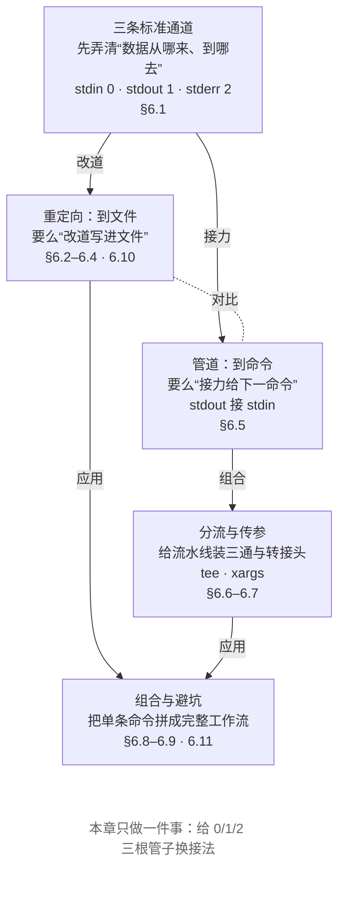
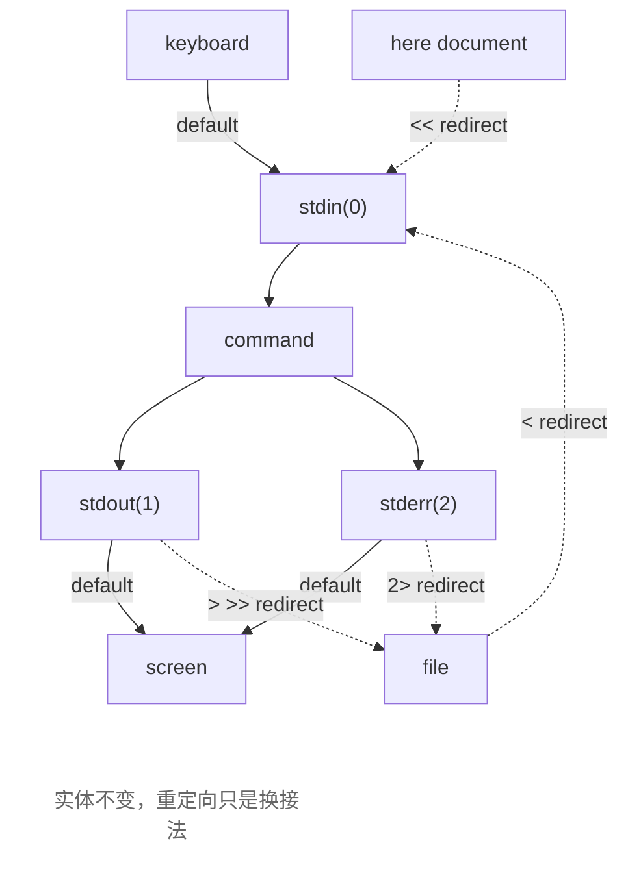
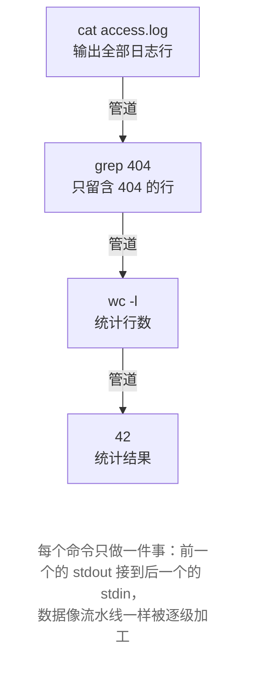

# 第6章：管道与重定向

> [!TIP] Part 1 · command line（命令行）
> 一条命令从终端走到硬件再回来；文件系统给地址、权限给许可、管道给去路——后面一切章节都站在这几样上。

## 为什么要学管道与重定向？

**本章手柄：redirection（重定向）**

每个进程自带 0/1/2 三根管子，重定向只是换接法——先开后合有顺序，| 是把 stdout 接进下一条的 stdin。本章管连接术——把输出接进文件（重定向）或接给下一条命令（管道），单条命令从此变成流水线。

**图 6-1｜本章概念关系图**（节点内第二行为各环节目的，末行为小节号；箭头标注关系类型，虚线表示对比）：



> [!WARNING] 先猜再读
> 动手前先猜一猜，答案都在本章里：
>
> 1. `cat file.txt | sort > file.txt` 执行完，file.txt 里还剩什么？（答案见 6.9）
> 2. 管道默认只接走 stdout——`command | grep "error"` 想连错误输出一起过滤，缺了哪一段？（答案见 6.10）
> 3. `sudo echo "..." >> /etc/hosts` 为什么照样写不进去？（答案见 6.6）

流水线的起点是三条标准通道——先弄清数据默认从哪来、到哪去：

## 6.1 标准输入/输出/错误与文件描述符

在Linux中，每个程序运行时都有三个默认的"通道"：

```
┌──────────────────────────────────────────────────────┐
│                 三个标准通道                           │
│                                                        │
│  标准输入  (stdin)   文件描述符 0   键盘/文件 → 程序   │
│  标准输出  (stdout)  文件描述符 1   程序 → 终端屏幕    │
│  标准错误  (stderr)  文件描述符 2   程序 → 终端屏幕    │
│                                                        │
│  就像水管系统：                                        │
│  stdin  = 进水管（数据从哪里来）                       │
│  stdout = 出水管（正常结果去哪里）                     │
│  stderr = 报警管（错误信息去哪里）                     │
│                                                        │
│  重定向就是改变这些管道的连接方向                       │
└──────────────────────────────────────────────────────┘
```

三条通道怎么接、怎么改，画成一张图最好记：

**图 6-2｜重定向数据流**（实线为默认接法，虚线为改接并标注改接符号——实体不变，换的只是连线）：



```bash
# 理解 stdout 和 stderr 的区别
ls existing_file.txt nonexistent_file.txt
# 输出：
# ls: cannot access 'nonexistent_file.txt': No such file or directory  ← stderr
# existing_file.txt                                                     ← stdout

# 它们虽然都显示在屏幕上，但走的是不同的通道
# 这就是为什么你可以重定向 stdout 但 stderr 仍然显示在屏幕上
```

## 6.2 输出重定向：> 和 >>

```bash
# > —— 覆盖写入（将stdout写入文件）
echo "Hello World" > greeting.txt
# greeting.txt 的内容变为 "Hello World"
# 如果文件已存在，会被完全覆盖！

ls -la > filelist.txt
# 把 ls 的输出保存到文件

date > timestamp.txt
# 把当前日期时间写入文件

# 注意：> 会清空原文件！
echo "first" > file.txt
echo "second" > file.txt
cat file.txt
# 输出: second （first 被覆盖了）
```

```bash
# >> —— 追加写入（在文件末尾添加）
echo "第一行" >> log.txt
echo "第二行" >> log.txt
cat log.txt
# 输出:
# 第一行
# 第二行

# 实用场景：追加日志
echo "[$(date)] 部署完成" >> deploy.log
echo "[$(date)] 用户登录: $(whoami)" >> access.log

# 循环追加
for i in {1..5}; do echo "Line $i" >> lines.txt; done
cat lines.txt
# Line 1
# Line 2
# Line 3
# Line 4
# Line 5
```

```bash
# 实用示例

# 保存命令输出到文件
ps aux > processes.txt
df -h > disk_usage.txt
uname -a > system_info.txt

# 生成报告
echo "=== 系统报告 $(date) ===" > report.txt
echo "主机名: $(hostname)" >> report.txt
echo "运行时间: $(uptime -p)" >> report.txt
echo "磁盘使用:" >> report.txt
df -h >> report.txt

cat report.txt
# === 系统报告 Wed Jan 15 10:30:00 CST 2025 ===
# 主机名: my-laptop
# 运行时间: up 5 days, 3 hours
# 磁盘使用:
# Filesystem      Size  Used Avail Use% Mounted on
# /dev/sda1       100G   45G   55G  45% /

# 清空文件（创建一个空文件）
> empty_file.txt
# 等同于 cat /dev/null > empty_file.txt

# 将多个命令的输出保存到同一文件
{ echo "Header"; date; echo "---"; } > output.txt
```

## 6.3 错误重定向

```bash
# 2> —— 重定向stderr（错误信息）
ls nonexistent_file 2> errors.log
# 错误信息写入 errors.log，屏幕不显示

# 2>> —— 追加stderr
find / -name "config.yml" 2>> errors.log
# 搜索过程中大量权限错误，都追加到 errors.log

# 实用：丢弃错误信息
find / -name "config.yml" 2>/dev/null
# /dev/null 是"黑洞"，所有写入它的数据都会消失
# 这样只显示找到的文件，不显示权限错误

# &> —— 同时重定向 stdout 和 stderr
command &> all_output.txt
# 等同于 command > all_output.txt 2>&1

# 实用场景：编译时保存所有输出
make &> build.log
# 成功信息和错误信息都保存到 build.log

command >> all_output.txt 2>&1
# 追加模式，同时捕获 stdout 和 stderr
```

```bash
# 分别重定向 stdout 和 stderr
command > output.txt 2> errors.txt
# 正常输出到 output.txt
# 错误输出到 errors.txt

# 实用示例
find /home -name "*.py" > found_files.txt 2> errors.txt
# found_files.txt：找到的文件列表
# errors.txt：权限错误等信息

# 在脚本中处理错误
if command > /dev/null 2>&1; then
    echo "命令执行成功"
else
    echo "命令执行失败"
fi
```

## 6.4 输入重定向：< 和 Here Document

```bash
# < —— 从文件读取输入（而不是键盘）
wc -l < file.txt
# wc 从 file.txt 读取内容，而不是从键盘

# 等价于
cat file.txt | wc -l
# 但 < 更高效（少了一个进程）

# sort 从文件读取
sort < unsorted.txt > sorted.txt

# diff 比较两个文件
diff <(command1) <(command2)
# 进程替换：将命令输出当作文件传给 diff
```

```bash
# Here Document（<<）—— 多行输入
# 格式：command << DELIMITER
# 多行内容
# DELIMITER

# 给命令提供多行输入
cat << EOF
第一行
第二行
第三行
EOF
# 输出三行文字

# 创建文件
cat << EOF > config.yml
server:
  port: 8080
  host: localhost
database:
  name: myapp
  user: admin
EOF

# 追加到文件
cat << EOF >> /etc/hosts
192.168.1.100 myserver
192.168.1.101 mydb
EOF

# 使用变量（注意：EOF不加引号时变量会被展开）
cat << EOF
当前用户: $(whoami)
当前目录: $(pwd)
当前时间: $(date)
EOF

# 不展开变量（EOF加引号）
cat << 'EOF'
$HOME 不会被展开
$(whoami) 也不会被展开
EOF
```

```bash
# Here String（<<<）—— 单行输入
# 格式：command <<< "string"

# 将字符串作为stdin传给命令
wc -w <<< "hello world foo bar"
# 输出: 4

# 实用场景
grep "error" <<< "this is an error message"
# 输出: this is an error message

bc <<< "scale=2; 100/3"
# 输出: 33.33（用bc做计算器）
```

## 6.5 管道 |：命令之间的数据快递

管道是Linux命令行最强大的特性——它将一个命令的stdout直接连接到另一个命令的stdin，形成数据处理流水线（组合思想见[第 1 章 1.10 节](./ch01.md)）。

```
命令1 | 命令2 | 命令3 | ...
  │       │       │
  │       │       └── 接收命令2的输出，处理后输出
  │       └────────── 接收命令1的输出，处理后传给命令3
  └────────────────── 产生初始数据
```

落到具体例子上，数据是这样流的：

**图 6-3｜管道流水线**（三个命令串联加工 access.log，数据自上而下流动，最终得到一个统计数字）：



```bash
# 基础管道示例
ls -la | grep ".txt"
# ls 的输出 → grep 过滤包含 .txt 的行

ps aux | grep nginx
# 查找 nginx 进程

cat /etc/passwd | sort
# 排序用户列表

# 多层管道（流水线）
cat access.log | grep "404" | wc -l
# 统计404错误的次数

# 解读：
# cat access.log       → 输出所有日志行
# | grep "404"         → 只保留包含 404 的行
# | wc -l              → 计算行数
```

```bash
# 实用管道组合

# 查看最大的10个文件
du -sh /var/log/* | sort -rh | head -10
# du -sh      → 计算每个文件/目录的大小
# sort -rh    → 按大小反向排序（最大在前）
# head -10    → 取前10个

# 统计系统中每种shell的用户数量
cat /etc/passwd | cut -d: -f7 | sort | uniq -c | sort -rn
# cut -d: -f7 → 提取第7列（shell路径）
# sort        → 排序（为uniq做准备）
# uniq -c     → 去重并计数
# sort -rn    → 按数量降序排列

# 查看端口占用
netstat -tlnp | grep :80
# 或者
ss -tlnp | grep :80

# 查看磁盘使用概况
df -h | grep "^/dev"
# 只显示真实的磁盘分区

# 找到占用内存最多的进程
ps aux --sort=-%mem | head -11
# 按内存使用降序排列，显示前10个（加标题行共11行）
```

```bash
# 更复杂的管道示例

# 统计Web服务器日志中出现最多的IP地址
awk '{print $1}' /var/log/nginx/access.log | sort | uniq -c | sort -rn | head -20
# awk '{print $1}'  → 提取第1列（IP地址）
# sort              → 排序
# uniq -c           → 计数
# sort -rn          → 按数量降序
# head -20          → 取前20

# 查找并杀死特定进程
ps aux | grep "node" | grep -v grep | awk '{print $2}' | xargs kill
# ps aux                → 列出所有进程
# grep "node"           → 筛选node进程
# grep -v grep          → 排除grep自身
# awk '{print $2}'      → 提取PID
# xargs kill            → 杀死这些进程（xargs 详见 6.7）

# 更好的方式：
pkill -f "node"         # 直接按名称杀进程（pkill 详见第7章）

# 生成系统摘要
echo "=== 系统摘要 ===" && \
echo "日期: $(date)" && \
echo "主机: $(hostname)" && \
echo "用户数: $(who | wc -l)" && \
echo "进程数: $(ps aux | wc -l)" && \
echo "磁盘: $(df -h / | tail -1 | awk '{print $5}') 已使用"
```

```bash
# 管道中的错误处理

# 默认情况下，管道中的错误会被忽略
cat nonexistent.txt | wc -l
# wc 输出 0，但你不知道是因为文件为空还是不存在

# 使用 PIPESTATUS 检查每个命令的退出状态
cat nonexistent.txt | wc -l
echo ${PIPESTATUS[0]}    # cat 的退出状态（非0表示失败）
echo ${PIPESTATUS[1]}    # wc 的退出状态

# 在脚本中启用管道错误检测
set -o pipefail
# 启用后，管道中任何一个命令失败，整个管道的退出状态就是非0
```

## 6.6 tee 命令：分流输出

`tee` 就像一个"T型管接头"——它把数据流分成两路，一路输出到屏幕，一路写入文件。

**命令格式**：`tee [OPTION]... [FILE]...`

```bash
# 基本用法：同时输出到屏幕和文件
echo "Hello" | tee output.txt
# 屏幕上显示 "Hello"
# 同时写入 output.txt

# 为什么不直接用 > ？
# 因为 > 会吞掉输出（不显示在屏幕上）
# tee 让你既能看到输出，又能保存它

# 实用场景：编译时既看进度又保存日志
make | tee build.log
# 屏幕上实时显示编译进度
# 同时保存完整日志到 build.log

# 管道中间保存中间结果
cat access.log | grep "ERROR" | tee errors.txt | wc -l
# 1. 过滤ERROR行
# 2. tee 保存过滤结果到 errors.txt
# 3. 继续传递到 wc 统计行数
```

```bash
# tee -a —— 追加模式
echo "新日志" | tee -a app.log
# 追加到文件，不覆盖

# 写入多个文件
echo "广播消息" | tee file1.txt file2.txt file3.txt
# 同时写入三个文件

# 配合sudo写入需要权限的文件
echo "127.0.0.1 myapp.local" | sudo tee -a /etc/hosts
# 普通用户无法直接写 /etc/hosts
# 但通过 sudo tee 可以

# 这比以下方式更安全：
# sudo sh -c 'echo "127.0.0.1 myapp.local" >> /etc/hosts'
```

## 6.7 xargs：参数传递利器

`xargs` 解决了一个常见问题：有些命令不接受管道输入（stdin），只接受命令行参数（选项与参数的构造见[第 1 章 1.9 节](./ch01.md)）。`xargs` 把stdin转换成命令行参数。

**命令格式**：`xargs [OPTIONS] [COMMAND [INITIAL-ARGS]]`

```bash
# 基本用法
echo "file1.txt file2.txt file3.txt" | xargs ls -la
# 等价于: ls -la file1.txt file2.txt file3.txt

# 对比：直接管道不行
echo "file1.txt" | ls -la
# ls -la 不读取stdin，所以管道无效

echo "file1.txt" | xargs ls -la
# xargs 把stdin变成 ls -la 的参数
```

```bash
# xargs 配合 find（最经典的组合）

# 删除所有 .tmp 文件
find /tmp -name "*.tmp" | xargs rm

# 比 find -exec 更高效（xargs 把多个文件合并为一次命令调用）
find /home -name "*.pyc" | xargs rm

# 统计所有 Python 文件的行数
find . -name "*.py" | xargs wc -l

# 给所有 .sh 文件加执行权限
find . -name "*.sh" | xargs chmod +x

# 搜索所有 .js 文件中包含 "TODO" 的行
find . -name "*.js" | xargs grep "TODO"
```

```bash
# xargs 的常用选项

# -I 指定替换标记（每行一个参数）
find . -name "*.txt" | xargs -I {} cp {} /backup/
# {} 会被替换为每个找到的文件
# 等价于: cp file1.txt /backup/ ; cp file2.txt /backup/ ; ...

# 实用：批量重命名
find . -name "*.jpeg" | xargs -I {} mv {} {}.jpg
# file1.jpeg -> file1.jpeg.jpg

# -n 每次传递的参数个数
echo "a b c d e" | xargs -n 2 echo
# 输出:
# a b
# c d
# e

# -0 处理包含空格的文件名（配合 find -print0）
find . -name "*.log" -print0 | xargs -0 rm
# -print0 用空字符（\0）分隔文件名
# -0 让 xargs 用空字符作为分隔符
# 这样即使文件名有空格也不会出问题

# -P 并行执行
find . -name "*.jpg" | xargs -P 4 -I {} convert {} -resize 50% {}
# 4个进程并行处理图片缩放
```

## 6.8 命令组合实例：实战案例

**案例1：统计日志中出现最多的IP地址**

```bash
# Nginx访问日志分析
cat /var/log/nginx/access.log | \
    awk '{print $1}' | \        # 提取IP地址（第1列）
    sort | \                    # 排序
    uniq -c | \                 # 去重并计数
    sort -rn | \                # 按数量降序
    head -10                    # 取前10名

# 输出示例：
#  1542 192.168.1.100
#   823 10.0.0.50
#   654 172.16.0.1
#   ...
```

**案例2：批量重命名文件**

```bash
# 将所有 .JPEG 改为 .jpg
find . -name "*.JPEG" | while read file; do
    mv "$file" "${file%.JPEG}.jpg"
done

# 使用 rename 更简洁
rename 's/\.JPEG$/.jpg/' *.JPEG

# 给所有文件加前缀
ls *.txt | xargs -I {} mv {} "backup_{}"

# 将空格替换为下划线
find . -name "* *" | while read file; do
    mv "$file" "${file// /_}"
done
```

**案例3：查找并分析大文件**

```bash
# 找出 /var/log 下大于10MB的文件，按大小排序
find /var/log -type f -size +10M -exec ls -lh {} \; | \
    sort -k5 -rh

# 找出占用磁盘空间最多的10个目录
du -sh /var/log/*/ | sort -rh | head -10

# 清理30天前的旧日志
find /var/log -name "*.log" -mtime +30 -exec gzip {} \;
```

**案例4：系统健康检查报告**

```bash
# 生成系统健康报告
{
    echo "===== 系统健康报告 ====="
    echo "生成时间: $(date '+%Y-%m-%d %H:%M:%S')"
    echo ""
    echo "--- 系统信息 ---"
    echo "主机名: $(hostname)"
    echo "内核: $(uname -r)"
    echo "运行时间: $(uptime -p)"
    echo ""
    echo "--- 磁盘使用 ---"
    df -h | grep "^/dev"
    echo ""
    echo "--- 内存使用 ---"
    free -h
    echo ""
    echo "--- 负载情况 ---"
    uptime
    echo ""
    echo "--- 最耗CPU的进程 ---"
    ps aux --sort=-%cpu | head -6
    echo ""
    echo "--- 最耗内存的进程 ---"
    ps aux --sort=-%mem | head -6
    echo ""
    echo "===== 报告结束 ====="
} > system_report.txt

cat system_report.txt
```

**案例5：批量处理文件**

```bash
# 将所有 PNG 图片压缩（假设已安装 pngquant）
find ./images -name "*.png" -print0 | xargs -0 -P 4 pngquant --force --ext .png

# 批量替换文件中的文本
find . -name "*.conf" -exec sed -i 's/old_server/new_server/g' {} +

# 查找所有空文件并删除
find . -type f -empty -delete

# 统计项目中各种文件的数量
find . -type f | sed 's/.*\.//' | sort | uniq -c | sort -rn | head -20
```

**案例6：日志分析实战**

```bash
# 分析Nginx访问日志，统计HTTP状态码分布
awk '{print $9}' /var/log/nginx/access.log | \
    sort | uniq -c | sort -rn
# 输出示例：
#  15234 200
#   1523 304
#    823 404
#     45 500

# 找出访问最频繁的URL（前20）
awk '{print $7}' /var/log/nginx/access.log | \
    sort | uniq -c | sort -rn | head -20

# 分析每小时的访问量分布
awk '{print $4}' /var/log/nginx/access.log | \
    cut -d: -f2 | sort | uniq -c
# 输出每小时访问次数
#   342 00
#   215 01
#   178 02
#   ...

# 找出返回5xx错误的请求
grep -E " [5][0-9]{2} " /var/log/nginx/access.log | \
    awk '{print $7, $9}' | sort | uniq -c | sort -rn | head -10

# 统计来自不同国家的访问（需要GeoIP数据）
# 简化版：按IP前缀分组
awk '{print $1}' /var/log/nginx/access.log | \
    cut -d. -f1-2 | sort | uniq -c | sort -rn | head -20
```

**案例7：系统监控命令组合**

```bash
# 实时监控CPU使用最高的进程
watch -n 2 'ps aux --sort=-%cpu | head -10'
# watch 每2秒刷新一次

# 监控磁盘I/O
iostat -x 1 5
# 每秒显示一次，共5次

# 查看网络连接状态分布
ss -tan | awk 'NR>1 {print $1}' | sort | uniq -c | sort -rn
# 输出：
#  125 ESTAB
#   23 TIME-WAIT
#    5 LISTEN

# 查看每个端口的连接数
ss -tan | awk 'NR>1 {print $5}' | cut -d: -f2 | \
    sort | uniq -c | sort -rn | head -10
```

**案例8：数据处理管道**

```bash
# 从CSV文件中提取特定列并统计
# 假设 data.csv 格式: name,age,city,salary
cat data.csv | \
    tail -n +2 | \              # 跳过标题行
    cut -d',' -f3 | \           # 提取city列
    sort | \                    # 排序
    uniq -c | \                 # 计数
    sort -rn                    # 按数量降序

# 将JSON数据格式化并提取字段
cat users.json | python3 -m json.tool | grep '"name"'
# 或者用jq（更专业的JSON处理工具）
sudo apt install jq
cat users.json | jq '.[].name'

# 计算文件校验和并保存
find . -name "*.py" -exec md5sum {} \; > checksums.md5
# 验证
md5sum -c checksums.md5
```

**案例9：开发工作流自动化**

```bash
# 一键清理Node.js项目中的临时文件
find . -name "node_modules" -type d -prune -exec rm -rf {} + 2>/dev/null
find . -name ".DS_Store" -delete 2>/dev/null
find . -name "*.log" -not -path "./node_modules/*" -delete

# 统计项目代码行数（按语言）
echo "=== 代码行数统计 ==="
find . -name "*.js" -not -path "*/node_modules/*" | xargs wc -l | tail -1 | awk '{print "JavaScript:", $1, "行"}'
find . -name "*.py" | xargs wc -l | tail -1 | awk '{print "Python:", $1, "行"}'
find . -name "*.css" | xargs wc -l | tail -1 | awk '{print "CSS:", $1, "行"}'
find . -name "*.html" | xargs wc -l | tail -1 | awk '{print "HTML:", $1, "行"}'

# Git统计：每个作者的提交数
git shortlog -sn --all | head -10

# 找出最近修改的文件
find . -type f -mmin -30 -not -path "./.git/*" | sort

# 检查端口是否被占用
ss -tlnp | grep ":8080" || echo "端口8080可用"
```

**案例10：文本转换与格式化**

```bash
# 将文件从Windows换行符(\r\n)转换为Unix(\n)
sed -i 's/\r$//' file.txt
# 或者使用 dos2unix
sudo apt install dos2unix
dos2unix file.txt

# 将Markdown转换为HTML（需要pandoc）
sudo apt install pandoc
pandoc input.md -o output.html

# 将CSV转换为表格格式
column -t -s',' data.csv

# 对文件中的数字求和
cat numbers.txt | paste -sd+ | bc
# numbers.txt 每行一个数字
# paste -sd+ 将所有数字用+连接
# bc 计算结果

# 将多行合并为一行（用逗号分隔）
cat list.txt | paste -sd','
# 或者
cat list.txt | tr '\n' ',' | sed 's/,$/\n/'

# 生成随机密码
openssl rand -base64 32
# 或者
tr -dc 'A-Za-z0-9' < /dev/urandom | head -c 20; echo
```

## 6.9 实用技巧与避坑指南

**技巧1：管道调试**

```bash
# 在管道中间插入 tee 来调试
cat data.txt | sort | tee sorted.txt | uniq | tee unique.txt | wc -l
# 每一步的中间结果都保存了，方便排查

# 使用 pv 查看管道中的流量（需要安装）
sudo apt install pv
cat bigfile.txt | pv | grep "pattern" | wc -l
# 显示进度条： 1.2GiB 0:00:05 [ 245MiB/s]
```

**技巧2：命令组合符**

```bash
# ; —— 顺序执行（无论成功失败）
command1 ; command2 ; command3
# 三条命令依次执行，互不影响

# && —— 逻辑与（前一个成功才执行后一个）
mkdir project && cd project && touch README.md
# 只有 mkdir 成功才会 cd，只有 cd 成功才会 touch

# || —— 逻辑或（前一个失败才执行后一个）
command1 || command2
# command1 失败时执行 command2

# 实用示例
cd /some/dir && ls -la || echo "目录不存在"

# 组合使用
make && echo "编译成功" || echo "编译失败"

# 在脚本中
mkdir -p /backup && \
cp -a /data/* /backup/ && \
echo "备份成功" >> /var/log/backup.log || \
echo "备份失败！" >> /var/log/backup.log
```

**技巧3：进程替换**

```bash
# <(command) —— 将命令输出当作文件
diff <(ls dir1/) <(ls dir2/)
# 比较两个目录的内容

# 比较两个命令的输出
diff <(sort file1.txt) <(sort file2.txt)

# >(command) —— 将命令输入当作文件
tee >(grep "ERROR" > errors.txt) >(grep "WARN" > warnings.txt) < app.log
# 同时过滤ERROR和WARN到不同文件
```

**避坑指南：**

```bash
# 坑1：管道中的子shell
# 管道中的命令在子shell中运行，变量修改不会反映到当前shell
echo "hello" | read var
echo $var    # 空的！read在子shell中执行

# 解决方法：使用 Here String
read var <<< "hello"
echo $var    # hello

# 坑2：> 会立即清空文件
# 如果你在读取文件的同时用 > 写入同一个文件
cat file.txt | sort > file.txt
# file.txt 会变成空的！因为 > 先执行（清空文件），cat 才读

# 解决方法：使用临时文件或 sponge
cat file.txt | sort | sponge file.txt
# sponge（来自 moreutils）会等所有输入处理完再写入

# 坑3：grep -v grep 的麻烦
ps aux | grep nginx | grep -v grep
# 更好的方式：
ps aux | grep "[n]ginx"
# [] 让 grep 的模式不匹配自身

# 坑4：xargs 处理特殊文件名
# 文件名含空格等特殊字符时，xargs 默认按空白拆参数，一个文件名会被误拆成几个，rm 就会删错对象
find . -name "*.log" -print0 | xargs -0 rm
# -print0 与 -0 的写法和机制见 6.7

# 坑5：管道和 sudo
# 管道中只有 sudo 后面的命令以root运行
cat /etc/shadow | sudo grep root    # 错误！cat没有权限
sudo cat /etc/shadow | grep root    # 正确
sudo grep root /etc/shadow          # 更好（不需要管道）
```

## 6.10 进阶重定向技巧

```bash
# 文件描述符操作
# 交换stdout和stderr
command 3>&1 1>&2 2>&3
# 3>&1  将fd3指向stdout
# 1>&2  将stdout指向stderr
# 2>&3  将stderr指向fd3（原来的stdout）

# 将stdout和stderr分别写入不同文件
command 1>output.log 2>error.log

# 将stderr也通过管道传递
command 2>&1 | grep "error"
# 2>&1 将stderr合并到stdout，然后一起通过管道

# 在脚本中重定向整个代码块的输出
{
    echo "Step 1..."
    command1
    echo "Step 2..."
    command2
} > full_output.log 2>&1

# exec重定向（改变当前shell的默认文件描述符）
exec 3> output.log     # 打开fd3指向文件
echo "hello" >&3       # 写入fd3
exec 3>&-              # 关闭fd3

# 实用的日志记录函数
log() {
    echo "[$(date '+%Y-%m-%d %H:%M:%S')] $*" | tee -a app.log
}
log "Starting deployment..."
log "Deployment complete!"
```

## 6.11 常用管道模式总结

```bash
# 模式1：过滤 + 计数
command | grep "pattern" | wc -l
# "有多少行包含pattern？"

# 模式2：提取 + 排序 + 去重计数
command | awk '{print $N}' | sort | uniq -c | sort -rn
# "第N列的值出现频率如何？"

# 模式3：查找 + 操作
find . -name "*.ext" -print0 | xargs -0 command
# "对所有.ext文件执行command"

# 模式4：监控 + 过滤
tail -f logfile | grep --line-buffered "pattern"
# "实时监控包含pattern的日志"
# --line-buffered 确保实时输出（不被缓冲）

# 模式5：生成 + 格式化 + 保存
command | column -t | tee report.txt
# "将输出格式化为表格并保存"

# 模式6：并行处理
cat urls.txt | xargs -P 4 -I {} curl -O {}
# "4个并发下载URL列表中的文件"

# 模式7：条件执行
command1 && command2 || command3
# "成功则执行2，失败则执行3"

# 模式8：数据聚合
find . -name "*.log" -exec cat {} + | sort | uniq -c | sort -rn
# "合并所有日志文件，统计每行出现次数"
```

## 6.12 动手练习：管道与重定向

**练习1：重定向基础**

```bash
# 1. 输出重定向
echo "Hello Linux" > ~/test_output.txt
echo "Second line" >> ~/test_output.txt
cat ~/test_output.txt

# 2. 保存命令输出
ls -la /etc > ~/etc_listing.txt
wc -l ~/etc_listing.txt

# 3. 错误重定向
ls /nonexistent 2> ~/errors.txt
cat ~/errors.txt

# 4. 丢弃错误
find / -name "*.conf" 2>/dev/null | head -10
# 只看到找到的文件，没有权限错误

# 5. 全部重定向
make 2>&1 | tee ~/build.log   # 假设有个Makefile

# 6. 清理
rm ~/test_output.txt ~/errors.txt ~/etc_listing.txt 2>/dev/null
```

**练习2：Here Document**

```bash
# 1. 创建配置文件
cat > ~/myapp.conf << EOF
# MyApp Configuration
server_port=8080
db_host=localhost
db_name=production
log_level=info
EOF

# 2. 验证
cat ~/myapp.conf

# 3. 追加内容
cat >> ~/myapp.conf << EOF
cache_enabled=true
cache_ttl=3600
EOF

# 4. 使用变量
NAME="Alice"
cat << EOF
Hello, $NAME!
Your home directory is: $HOME
Current date: $(date)
EOF

# 5. 不展开变量（引号包裹EOF）
cat << 'EOF'
$HOME 不会被展开
$(whoami) 也不会
EOF

# 6. Here String
wc -w <<< "Hello World, how are you today?"
grep "error" <<< "This is an error message"

# 7. 清理
rm ~/myapp.conf
```

**练习3：管道实战**

```bash
# 1. 基础管道
# 列出所有正在运行的bash进程
ps aux | grep bash | grep -v grep

# 2. 统计 /etc 下有多少个 .conf 文件
ls /etc/*.conf 2>/dev/null | wc -l

# 3. 找出系统中最大的5个目录
du -sh /var/* 2>/dev/null | sort -rh | head -5

# 4. 分析 /etc/passwd
# 统计可登录用户的 shell 分布（先滤掉 shell 为 nologin/false 的系统账户）
grep -vE '(nologin|false)$' /etc/passwd | cut -d: -f7 | sort | uniq -c | sort -rn
# 比 6.5 的例子多一步 grep -v：系统账户不参与统计，看的是真正能登录的人用什么 shell

# 5. 找出当前用户创建的所有文件
find ~ -user $(whoami) -type f 2>/dev/null | wc -l

# 6. 综合练习：系统摘要
echo "系统摘要 $(date)"
echo "用户: $(whoami)"
echo "主机: $(hostname)"
echo "进程数: $(ps aux | wc -l)"
echo "登录用户: $(who | wc -l)"
echo "磁盘: $(df -h / | tail -1 | awk '{print $3 "/" $2 " (" $5 ")"}')"
```

**练习4：tee 和 xargs 实战**

```bash
# 1. tee：保存中间结果
# 找出所有 .txt 文件，保存列表并统计数量
find /etc -name "*.txt" 2>/dev/null | tee ~/txt_files.txt | wc -l
cat ~/txt_files.txt
rm ~/txt_files.txt

# 2. tee：用sudo写入系统文件
echo "127.0.0.1 myapp.local" | sudo tee -a /etc/hosts
# （谨慎操作，记得事后清理）

# 3. xargs：批量操作
# 创建多个文件
echo "a.txt b.txt c.txt d.txt" | xargs touch
ls *.txt
rm *.txt

# 4. xargs + find：查找并处理
find /tmp -name "*.tmp" -print0 | xargs -0 ls -la 2>/dev/null

# 5. xargs 并行执行（模拟）
echo "task1 task2 task3 task4" | tr ' ' '\n' | \
    xargs -P 2 -I {} echo "处理: {} 完成"
```

**练习5：综合挑战——日志分析**

```bash
# 创建一个模拟日志文件
cat > ~/access.log << 'EOF'
192.168.1.100 - - [15/Jan/2025:10:30:00] "GET /index.html" 200 1024
192.168.1.101 - - [15/Jan/2025:10:30:01] "GET /about.html" 200 2048
192.168.1.100 - - [15/Jan/2025:10:30:02] "POST /api/login" 200 512
10.0.0.50 - - [15/Jan/2025:10:30:03] "GET /admin" 403 256
192.168.1.102 - - [15/Jan/2025:10:30:04] "GET /missing.html" 404 128
192.168.1.100 - - [15/Jan/2025:10:30:05] "GET /style.css" 200 4096
192.168.1.101 - - [15/Jan/2025:10:30:06] "GET /api/data" 500 64
10.0.0.50 - - [15/Jan/2025:10:30:07] "GET /index.html" 200 1024
192.168.1.100 - - [15/Jan/2025:10:30:08] "GET /about.html" 200 2048
192.168.1.103 - - [15/Jan/2025:10:30:09] "GET /contact" 301 0
EOF

# 分析任务：
# 1. 统计每个IP的访问次数
awk '{print $1}' ~/access.log | sort | uniq -c | sort -rn

# 2. 统计HTTP状态码分布
awk '{print $9}' ~/access.log | sort | uniq -c | sort -rn

# 3. 找出访问量最大的URL
awk '{print $7}' ~/access.log | sort | uniq -c | sort -rn

# 4. 找出404错误
grep " 404 " ~/access.log

# 5. 找出非200的请求
grep -v " 200 " ~/access.log

# 6. 统计总请求数
wc -l ~/access.log

# 清理
rm ~/access.log
```

## 本章小结

**① 核心句**：每个进程自带 0/1/2 三根管子，重定向只是换接法——先开后合有顺序，| 是把 stdout 接进下一条的 stdin。

**② 边界句**：管数据去路；命令内部逻辑归脚本（20），性能归 24。

**③ 可推导条目**：
- `2>&1` 必须写在 `>file` 之后。
- `sudo cmd > file` 的文件由你的 Shell 打开、权限以你为准。
- 管道中段失败要看 PIPESTATUS/pipefail。

> **词链互测**（回访）：学到[第 20 章 script](./ch20.md#本章小结)回来——说出 script 的 3 个坑；想想 `2>&1`/PIPESTATUS 挪进脚本后为什么更容易翻车。
>
> 学到[第 24 章 bottleneck](./ch24.md#本章小结)再回来——说出 bottleneck 的 3 个坑；看看「水管」的意象接到了哪一步。

**下一章预告**：Part 1 的六个词都拿到了——先去 [Part 1 自测](./part1-test.md) 闭卷验收，再进 Part 2。

## 一个彩蛋：你的第一个 Shell 脚本

作为 Part 1 和 Part 2 之间的桥梁，这里给你一个预告性质的小脚本。
你现在可能看不懂每一行，但试着读懂大意：

```bash
#!/bin/bash
# system-report.sh — 生成一份系统健康报告
# 这个脚本综合运用了 Part 1 学到的很多知识！

REPORT_FILE="$HOME/system-report-$(date +%Y%m%d).txt"

echo "===== 系统健康报告 =====" > "$REPORT_FILE"
echo "生成时间: $(date)" >> "$REPORT_FILE"
echo "主机名: $(hostname)" >> "$REPORT_FILE"
echo "" >> "$REPORT_FILE"

# 磁盘使用情况（复习：df + grep + awk）
echo "--- 磁盘使用 ---" >> "$REPORT_FILE"
df -h | grep '^/dev' >> "$REPORT_FILE"
echo "" >> "$REPORT_FILE"

# 内存使用（复习：free）
echo "--- 内存使用 ---" >> "$REPORT_FILE"
free -h >> "$REPORT_FILE"
echo "" >> "$REPORT_FILE"

# 最耗资源的进程（复习：ps + sort + head）
echo "--- Top 5 CPU 进程 ---" >> "$REPORT_FILE"
ps aux --sort=-%cpu | head -6 >> "$REPORT_FILE"

echo "" >> "$REPORT_FILE"
echo "报告已保存到: $REPORT_FILE"
echo "Done! ✅"
```

这个脚本用到了：

- **重定向** `>` 和 `>>`（第 6 章）
- **命令替换** `$()` （第 1 章提到的 echo 进阶）
- **管道** `|`（第 6 章）
- **ps、df、free** 等系统命令（第 2 章 + Part 2 深入）

如果你能大致理解这个脚本在做什么，说明你已经准备好进入 Part 2 了！

---

> **Part 1 完**
>
> 感谢阅读《Linux 命令行完全教程 · 基础入门篇》。
> 命令行是一把钥匙——掌握它，你就打开了 Linux 世界的大门。
> Part 2 见！

---
