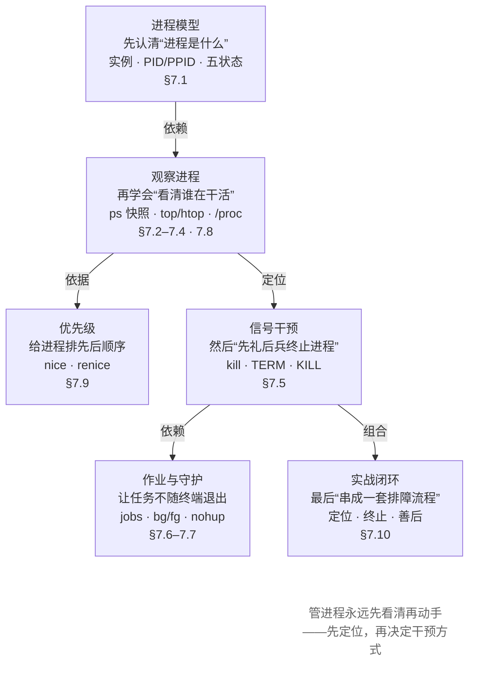
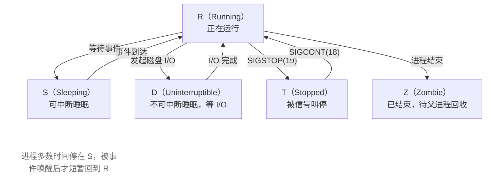
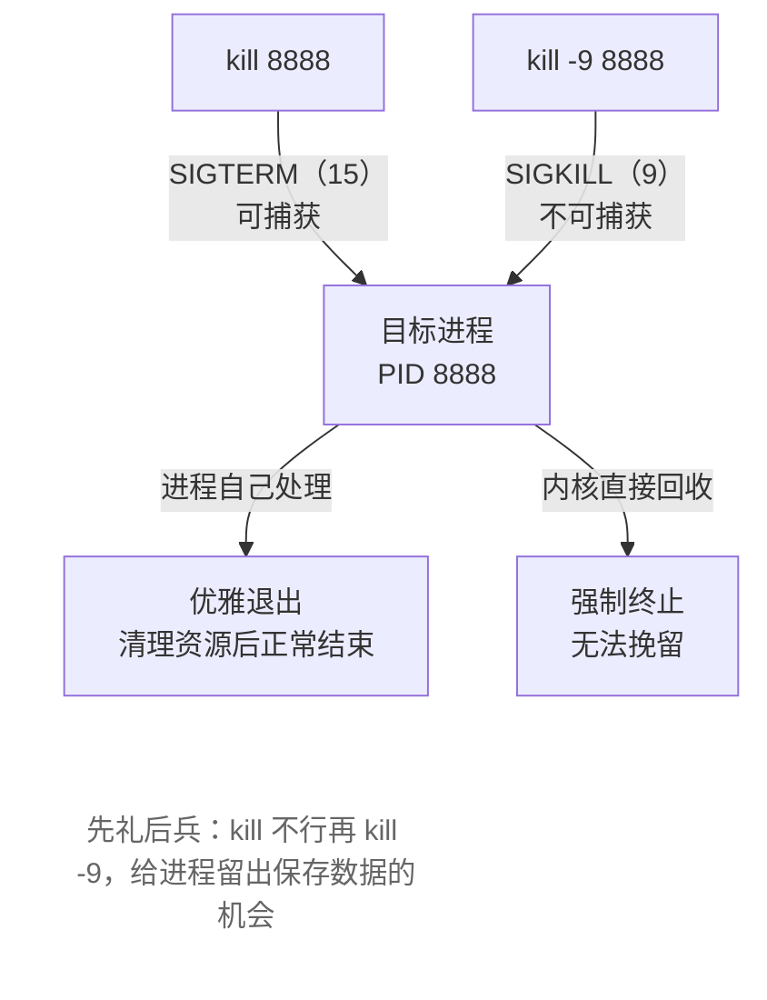

# 第7章 进程管理

> [!TIP] Part 2 · administration（系统管理）
> 从「会用」到「归我管」：进程、软件、磁盘、账号、服务、时间、日志，七件事各有台账。

## 为什么要学进程管理？

**本章手柄：lifecycle（生命周期）**

进程从 fork 而来、靠信号调度生死——状态可看（ps/top）、优先级可调（nice）、终止分 TERM 与 KILL；父死子不亡成孤儿、死而不收成僵尸。本章管进程——找到它（ps/top）、管住它（信号、前后台）、放它后台长跑（nohup）。

**图 7-1｜本章概念关系图**（节点内第二行为各环节目的，末行为小节号；箭头标注关系类型）：



> [!WARNING] 先猜再读
> 动手前先猜一猜，答案都在本章里：
>
> 1. `kill -0 1234` 会把 PID 1234 的进程杀掉吗？（答案见 7.5）
> 2. nice 值范围是 -20 到 19，数值越大优先级越高吗？（答案见 7.9）
> 3. 退出终端时，用 & 放到后台的任务还在跑吗？（答案见 7.7）

关系图的起点是"进程模型"。下面先弄清进程到底是什么、PID 与状态怎么回事：

## 7.1 进程的基本概念

### 7.1.1 什么是进程？

进程就是**正在运行的程序实例**。同一个程序可以运行多个实例，就像同一个函数可以被多次调用一样——每次调用都是一个独立的"栈帧"。

- **程序（Program）**：磁盘上的可执行文件（静态的，像简历）
- **进程（Process）**：程序被加载到内存中运行的实例（动态的，像正在上班的员工）

### 7.1.2 PID 与 PPID

- **PID（Process ID）**：进程的唯一标识符，类似于员工的工号。系统启动后，PID 从 1 开始递增。
- **PPID（Parent Process ID）**：父进程的 PID。每个进程都是由另一个进程创建的（`fork()`），就像员工是被 HR 招聘进来的。

```bash
# 查看当前 shell 的 PID
echo $$
# 输出类似：12345

# 查看当前 shell 的父进程 PID
echo $PPID
# 输出类似：12340
```

特殊进程：

- **PID 1**：systemd（init 进程），所有进程的"祖先"，相当于公司创始人
- **PID 2**：kthreadd，内核线程的"HR 经理"

### 7.1.3 进程状态

进程也有自己的"工作状态"，可以通过 `ps` 命令的 `STAT` 列查看：

| 状态码 | 含义 | 类比 |
| -------- | ------ | ------ |
| **R** (Running) | 正在运行或在运行队列中等待 | 正在敲键盘的员工 |
| **S** (Sleeping) | 可中断睡眠，等待某个事件 | 等外卖的员工 |
| **D** (Uninterruptible sleep) | 不可中断睡眠，通常在等待 I/O | 在打印机旁等文件的员工 |
| **Z** (Zombie) | 僵尸进程，已结束但父进程还没回收 | 已离职但工位还没清理 |
| **T** (Stopped) | 被停止（收到 SIGSTOP 信号） | 被叫去开会的员工 |

附加状态标记：

- `s`：会话首进程（session leader）
- `l`：多线程（multi-threaded）
- `+`：前台进程组
- `<`：高优先级
- `N`：低优先级（nice 值大于 0）

**图 7-2｜进程五大状态的流转**（R 与四个状态进出互为往返：出边是进入动作，回边是切回条件；ps 的 STAT 列显示的就是这些状态码）：



如图 7-2，多数进程平时停在 S 等事件，被信号或 I/O 唤醒后才短暂回到 R。

## 7.2 ps 命令详解——进程的"人事档案查询系统"

`ps`（Process Status）是查看进程状态的最基本命令。

**命令格式**：`ps [options]`

### 7.2.1 基础用法

```bash
# 最简单的 ps——只显示当前终端的进程
ps
# 输出示例：
#   PID TTY          TIME CMD
# 12345 pts/0    00:00:00 bash
# 12400 pts/0    00:00:00 ps

# BSD 风格：ps aux（最常用，没有之一）
ps aux
# a = 显示所有用户的进程
# u = 以用户友好的格式显示
# x = 显示没有控制终端的进程

# System V 风格：ps -ef
ps -ef
# -e = 显示所有进程
# -f = 完整格式（包含 PPID、UID 等）
```

### 7.2.2 ps aux 输出详解

```bash
ps aux
# 输出列含义：
# USER       PID  %CPU  %MEM    VSZ   RSS TTY      STAT START   TIME COMMAND
# root         1   0.0   0.1  16952  8476 ?        Ss   Jan01   0:05 /sbin/init
# www       1234   2.5   1.2 540288 49152 ?        Sl   10:00   0:30 nginx: worker
# alice     5678   0.0   0.3  21504  5120 pts/0    Ss   11:00   0:00 bash
```

| 列名 | 含义 |
| ------ | ------ |
| USER | 进程所属用户 |
| PID | 进程 ID |
| %CPU | CPU 使用率 |
| %MEM | 内存使用率 |
| VSZ | 虚拟内存大小（KB） |
| RSS | 实际占用内存大小（KB）——这才是真实"体重" |
| TTY | 控制终端（`?` 表示没有终端，如守护进程） |
| STAT | 进程状态 |
| START | 启动时间 |
| TIME | 累计 CPU 时间 |
| COMMAND | 命令名称 |

### 7.2.3 以树状图显示进程关系

```bash
# 显示进程树（父子关系一目了然）
ps --forest -eo pid,ppid,cmd

# 示例输出：
#   PID  PPID CMD
#     1     0 /sbin/init
#   500     1  \_ /usr/lib/systemd/systemd --user
#   501   500  |   \_ bash
#   800   501  |       \_ vim notes.txt
#   900     1  \_ /usr/sbin/sshd -D
#   901   900      \_ sshd: alice [priv]
```

### 7.2.4 自定义输出格式

```bash
# 使用 -o 自定义输出列
ps -eo pid,ppid,user,%cpu,%mem,stat,start,cmd

# 只看特定列
ps -eo pid,user,cmd --sort=-%cpu | head -20
# --sort=-%cpu 表示按 CPU 使用率降序排列（- 表示降序）

# 只看 PID 和命令
ps -eo pid,cmd

# 看某个用户的所有进程
ps -u www-data

# 查找特定进程
ps aux | grep nginx
# 小技巧：用 [n]ginx 避免 grep 自身出现在结果中
ps aux | grep [n]ginx
```

### 7.2.5 排序与筛选

```bash
# 按内存使用降序排列，取前 10
ps aux --sort=-%mem | head -11

# 按 CPU 使用降序排列
ps aux --sort=-%cpu | head -11

# 按启动时间排列（最老的在前）
ps -eo pid,lstart,cmd --sort=start_time

# 查看所有僵尸进程
ps aux | awk '$8 ~ /Z/ {print}'

# 查看所有 root 用户的进程
ps -U root -u root

# 查看运行时间最长的进程
ps -eo pid,etime,cmd --sort=etime
```

## 7.3 top 实时监控——进程的"任务管理器"

`top` 是 Linux 自带的实时监控工具，就像 Windows 的任务管理器，但更极客。

**命令格式**：`top [OPTIONS]`

### 7.3.1 启动和基本界面

```bash
# 启动 top
top

# 界面分为两部分：
# 上半部分：系统概览（CPU、内存、负载）
# 下半部分：进程列表
```

上半部分概览：

```
top - 14:30:00 up 30 days,  2:15,  1 user,  load average: 0.50, 0.65, 0.70
Tasks: 200 total,   1 running, 199 sleeping,   0 stopped,   0 zombie
%Cpu(s):  5.2 us,  2.1 sy,  0.0 ni, 92.0 id,  0.5 wa,  0.0 hi,  0.2 si,  0.0 st
MiB Mem :  16384.0 total,   4096.0 free,   8192.0 used,   4096.0 buff/cache
MiB Swap:   2048.0 total,   2048.0 free,      0.0 used.   7000.0 avail Mem
```

- **load average**：1分钟、5分钟、15分钟的平均负载（如果大于 CPU 核心数就该担心了，详见[第 13 章 13.7 节 · load average 与健康线](./ch13.md)）
- **us**：用户进程占用 CPU 百分比
- **sy**：系统（内核）占用 CPU 百分比
- **id**：空闲 CPU 百分比
- **wa**：等待 I/O 的 CPU 百分比（如果这个高，说明磁盘是瓶颈）
- **buff/cache**：被内核用来做缓存的内存

### 7.3.2 top 快捷键

在 top 运行时，按以下键可以改变显示和行为：

| 快捷键 | 功能 |
| -------- | ------ |
| `P` | 按 CPU 使用率排序（默认） |
| `M` | 按内存使用率排序 |
| `T` | 按累计时间排序 |
| `N` | 按 PID 排序 |
| `c` | 切换显示完整命令行 / 仅命令名 |
| `t` | 切换显示任务摘要区域 |
| `m` | 切换显示内存摘要区域 |
| `k` | 杀死一个进程（输入 PID） |
| `r` | 修改进程优先级（renice） |
| `f` | 选择显示的列 |
| `o` | 调整列的顺序 |
| `1` | 显示每个 CPU 核心的使用率 |
| `u` | 按用户过滤 |
| `d` | 修改刷新间隔（秒） |
| `q` | 退出 |
| `h` | 帮助 |

### 7.3.3 top 的常用命令行参数

```bash
# 指定刷新间隔为 2 秒
top -d 2

# 以批处理模式输出（适合脚本和管道）
top -b -n 1 | head -20
# -b = batch mode
# -n 1 = 只输出一次

# 只监控特定用户的进程
top -u www-data

# 以安全模式运行（禁用交互式命令）
top -s

# 监控特定 PID
top -p 1234,5678
```

## 7.4 htop 进阶——top 的"精装版"

`htop` 是 `top` 的增强版，提供彩色界面、鼠标支持、更直观的操作。如果说 `top` 是命令行界的 Notepad，那 `htop` 就是 VS Code。

**命令格式**：`htop [OPTIONS]`

### 7.4.1 安装 htop

```bash
# Ubuntu/Debian 安装
sudo apt update && sudo apt install -y htop

# 启动 htop
htop
```

### 7.4.2 htop 界面说明

htop 界面从上到下分为三个区域：

**1. 顶部状态区**

```
  1  [|||           5.2%]     Tasks: 200, 100 thr; 1 running
  2  [||             3.1%]     Load average: 0.50 0.65 0.70
  Mem[||||||||||    8192M/16384M]    Uptime: 30 days, 02:15:00
  Swp[               0M/2048M]
```

- 每个 CPU 核心用一条进度条显示
- 颜色含义：
  - **蓝色**：低优先级进程（nice > 0）
  - **绿色**：普通优先级进程（nice = 0）
  - **红色**：高优先级进程（nice < 0）
  - **橙色**：内核线程时间

**2. 底部快捷键提示**

```
 F1 Help  F2 Setup  F3 Search  F4 Filter  F5 Tree  F6 SortBy  F9 Kill  F10 Quit
```

### 7.4.3 htop 常用操作

```bash
# 按 F5 切换到树状视图（进程父子关系）
# 按 F3 搜索进程名
# 按 F4 过滤（只显示匹配的进程）
# 按 F6 选择排序列
# 按 F9 杀死选中的进程
# 按 \ 折叠所有进程树
# 按空格 标记进程（可以批量操作）

# 命令行参数
# 以树状视图启动
htop --tree

# 延迟启动（1 秒刷新一次）
htop --delay 1

# 只显示特定用户的进程
htop -u www-data
```

## 7.5 信号机制——给进程发"通知"

在 Linux 中，进程间通信的一种基本方式是**信号（Signal）**。你可以把信号理解为给进程发通知——"嘿，你该收工了"、"嘿，重新读一下配置文件"。

### 7.5.1 常用信号列表

```bash
# 查看所有信号
kill -l
```

| 信号 | 编号 | 含义 | 能否捕获 | 类比 |
| ------ | ------ | ------ | ---------- | ------ |
| **SIGTERM** | 15 | 请求终止（礼貌地请走） | 能 | "请在月底前办完离职" |
| **SIGKILL** | 9 | 强制终止（直接拔电源） | 不能 | "保安，把他架出去" |
| **SIGHUP** | 1 | 挂断信号 / 重新加载配置 | 能 | "老板说换个工位" |
| **SIGINT** | 2 | 中断信号（Ctrl+C） | 能 | "用户点了取消按钮" |
| **SIGSTOP** | 19 | 暂停进程 | 不能 | "所有人停下，开会！" |
| **SIGCONT** | 18 | 恢复进程 | 不能 | "好了，会开完了，继续干活" |

### 7.5.2 kill 命令

**命令格式**：`kill [-SIGNAL] PID...`

注意 `kill` 是 shell 内建命令——`/usr/bin/kill` 是同名的另一个程序，man kill 查到的是后者；内建命令的用法要用 `help kill` 查（[第 1 章 1.10 节 · 内建/外部命令分类](./ch01.md)）。本章稍后的 jobs、bg、fg、disown 也是内建命令，同样适用。

```bash
# 发送 SIGTERM（默认，礼貌退出）
kill 1234

# 发送 SIGKILL（强制杀死）
kill -9 1234
# 或者
kill -SIGKILL 1234

# 发送 SIGHUP（让进程重新加载配置）
kill -HUP 1234
# 典型场景：让 nginx 重新加载配置
sudo kill -HUP $(cat /var/run/nginx.pid)

# 一次杀死多个进程
kill 1234 5678 9012

# 发送 SIGSTOP 暂停进程
kill -STOP 1234

# 发送 SIGCONT 恢复进程
kill -CONT 1234

# 确认进程是否存在（信号 0 不会杀死进程，只检查权限）
kill -0 1234
echo $?
# 0 = 进程存在且有权限发送信号
# 1 = 进程不存在或无权限
```

**图 7-3｜kill 的两段式终止流程**（两条命令发出不同信号，目标进程走向两种结局）：



如图 7-3，SIGTERM 可以被进程优雅处理，SIGKILL 则完全没有商量余地。

### 7.5.3 killall 和 pkill——按名称杀进程

**命令格式**：`killall [OPTIONS] NAME...`、`pkill [OPTIONS] PATTERN`

```bash
# killall：杀死所有匹配名称的进程
killall nginx
# 杀死所有名为 nginx 的进程

killall -9 python3
# 强制杀死所有 python3 进程

killall -u www-data
# 杀死 www-data 用户的所有进程

# pkill：更灵活，支持正则表达式匹配
pkill -f "python.*server.py"
# -f 表示匹配完整命令行（不仅仅是进程名）

pkill -u www-data
# 杀死 www-data 用户的所有进程

pkill -SIGUSR1 myapp
# 发送自定义信号
```

两者的分工：`killall` 按精确进程名杀，名字必须完整相等；`pkill` 支持模式匹配，加 `-f` 还能匹配完整命令行。日常优先 `pkill`，需要精确名匹配（怕模式误伤相近名字的进程）时才用 `killall`。

## 7.6 前台与后台——进程调度的"任务队列"

在 Linux 终端中，同一时间只有一个进程在前台运行（接受键盘输入），但你可以把进程放到后台，实现"多任务"。

本节要用到三个作业控制的命令，先把通用格式列在一起：

- `jobs [-lnprs] [JOBSPEC...]` —— 查看当前 shell 的后台作业
- `bg [JOBSPEC...]` —— 将暂停的作业放到后台继续运行
- `fg [JOBSPEC]` —— 将后台作业调到前台

### 7.6.1 基础操作

```bash
# 在前台运行（默认）
sleep 300
# 此时终端被占用，你必须等它完成

# 在后台运行：在命令后加 &
sleep 300 &
# 输出：[1] 12345
# [1] = 作业号
# 12345 = PID

# 查看当前 shell 的后台作业
jobs
# 输出示例：
# [1]-  Running    sleep 300 &
# [2]+  Stopped    vim notes.txt
```

### 7.6.2 前后台切换

```bash
# 暂停当前前台进程（发送 SIGSTOP）
# 快捷键：Ctrl+Z

# 将暂停的作业放到后台继续运行
bg %1

# 将后台作业调到前台
fg %1

# 终止后台作业
kill %1

# 查看所有作业（带 PID）
jobs -l
```

### 7.6.3 Ctrl+C vs Ctrl+Z vs Ctrl+D

| 快捷键 | 信号 | 效果 |
|--------|------|------|
| Ctrl+C | SIGINT | 终止前台进程 |
| Ctrl+Z | SIGTSTP | 暂停前台进程 |
| Ctrl+D | EOF | 关闭标准输入/退出 shell |

## 7.7 nohup 与 disown——让进程"永生"

当你退出终端时，所有前台和后台进程都会收到 SIGHUP 信号并终止。如果你希望进程在终端关闭后继续运行，就需要 `nohup` 或 `disown`。

**命令格式**：`nohup [OPTION]... COMMAND [ARG]...`、`disown [-h] [-ar] [JOBSPEC... | PID...]`

```bash
# nohup = No Hang Up，让进程忽略 SIGHUP 信号
nohup ./my-script.sh &

# 自定义输出文件
nohup ./my-script.sh > my-output.log 2>&1 &

# 实际例子：后台运行一个 Python 脚本
nohup python3 backup.py > /var/log/backup.log 2>&1 &

# disown 用于已经运行的后台作业
sleep 3600 &
# [1] 12345

# 将它从 shell 的作业列表中移除
disown %1

# 移除所有后台作业
disown -a
```

两者的分工：`nohup` 在启动时挡 SIGHUP，适合启动前就知道命令要长期运行的场景；`disown` 把已经运行的后台作业移出作业表，shell 退出时不再向它发 SIGHUP。选择规则一句话：启动前知道要用 `nohup`，忘了加才用 `disown` 补救。

## 7.8 /proc 文件系统探秘

`/proc` 是 Linux 内核提供的一个"虚拟文件系统"（[第 2 章 2.9 节 · /proc /dev /sys](./ch02.md)），它把内核运行时的信息映射成文件。

```bash
# 查看进程的命令行参数
cat /proc/1/cmdline | tr '\0' ' '

# 查看进程的环境变量
cat /proc/1/environ | tr '\0' '\n'

# 查看进程的可执行文件路径
ls -l /proc/1/exe

# 查看进程的工作目录
ls -l /proc/1/cwd

# 查看进程打开的文件描述符
ls -l /proc/1/fd/

# 查看进程的内存映射
cat /proc/1/maps | head -10

# 查看进程的状态摘要
cat /proc/1/status

# 查看系统整体信息
cat /proc/cpuinfo    # CPU 信息
cat /proc/meminfo    # 内存信息
cat /proc/loadavg    # 负载平均值
cat /proc/version    # 内核版本
cat /proc/mounts     # 已挂载的文件系统
cat /proc/uptime     # 系统运行时间（秒）
```

## 7.9 进程优先级——nice 与 renice

Linux 中的进程优先级范围从 **-20**（最高优先级，VIP 通道）到 **19**（最低优先级，排队最后）。默认值是 **0**。

**命令格式**：`nice [OPTION]... [COMMAND [ARG]...]`、`renice [-n] PRIORITY [[-p] PID...] [[-u] USER...]`

```bash
# 查看进程的 nice 值
ps -eo pid,ni,cmd | head -20

# 以指定 nice 值启动进程
nice -n 10 ./my-script.sh

# 以高优先级运行（需要 root 权限）
sudo nice -n -5 ./important-task.sh

# 修改已运行进程的优先级
renice -n 5 -p 1234

# 降低某用户所有进程的优先级
sudo renice -n 10 -u www-data

# 实际场景：编译时降低优先级，不影响日常使用
nice -n 19 make -j$(nproc)

# 实际场景：提高数据库进程优先级
sudo renice -n -10 -p $(pgrep mysqld)
```

## 7.10 实战：监控并管理一个失控的进程

### 场景：Java 应用吃掉了 95% 的 CPU

```bash
# 第一步：找到"罪魁祸首"
ps aux --sort=-%cpu | head -5

# 第二步：确认进程信息
cat /proc/8888/cmdline | tr '\0' ' '
ps -eo pid,etime,cmd | grep 8888
ls /proc/8888/fd/ | wc -l

# 第三步：优雅终止（先 SIGTERM）
kill 8888

# 等待几秒
sleep 5
ps -p 8888

# 最后手段：强制杀死（SIGKILL）
kill -9 8888

# 第四步：后续处理
dmesg | grep -i "killed process"
sudo systemctl restart myapp
```

## 本章小结

**① 核心句**：进程从 fork 而来、靠信号调度生死——状态可看（ps/top）、优先级可调（nice）、终止分 TERM 与 KILL；父死子不亡成孤儿、死而不收成僵尸。

**② 边界句**：管单进程生死；被谁托管归 11，资源根因归 24。

**③ 可推导条目**：
- kill -9 不给清理机会。
- 僵尸 kill 不掉、只能让父进程收尸。
- SIGTERM 可被拦截，所以「杀了没死」。

> **词链互测**（回访）：学到[第 11 章 service](./ch11.md#本章小结)回来——说出 service 的 3 个坑；想想孤儿进程这回归谁收。

**下一章预告**：看见了谁在跑，也看见了缺什么工具——下一章的手柄是 **package**（软件包）。
