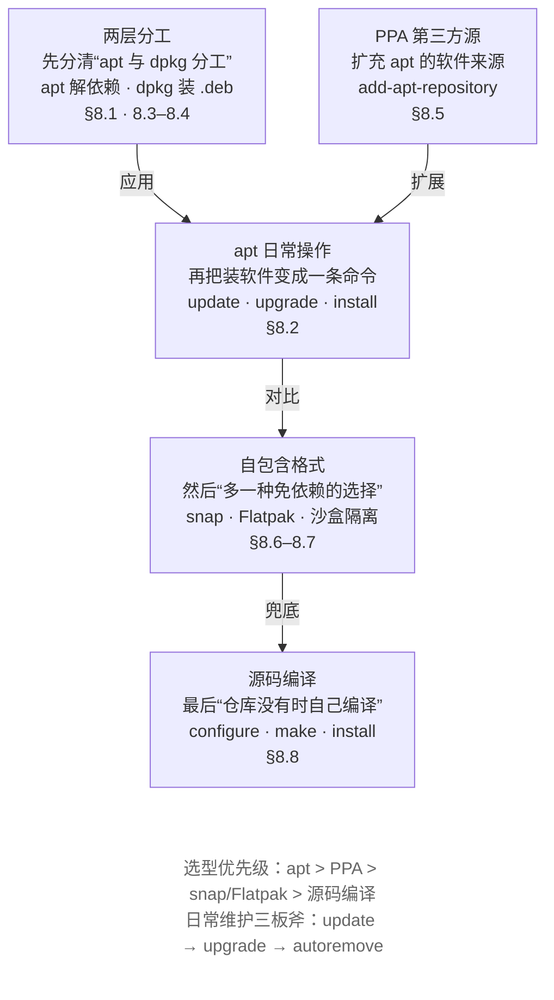
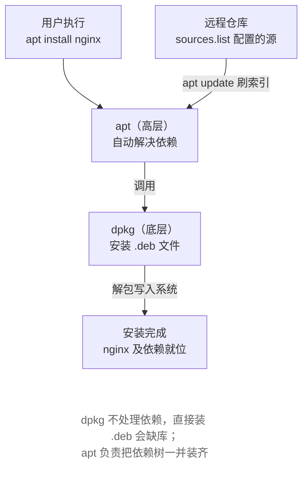
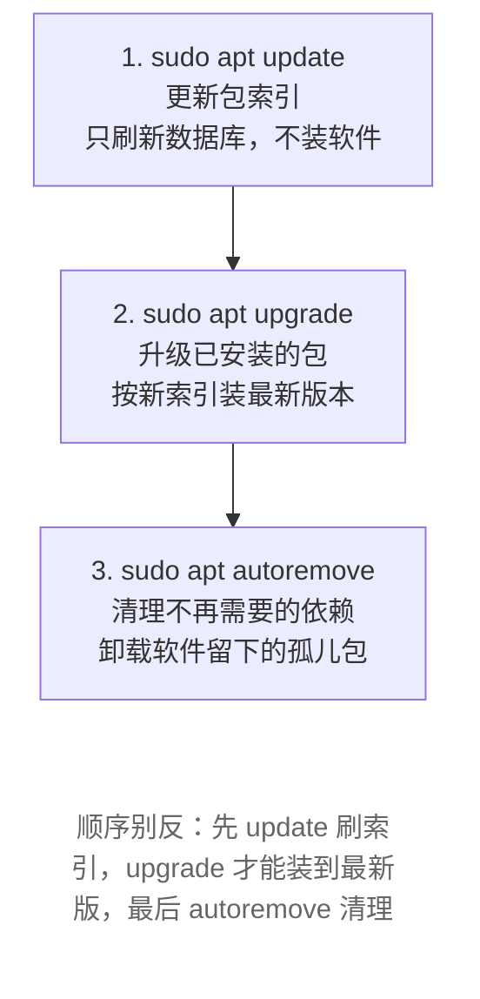

# 第8章 软件包管理

## 为什么要学包管理？

本章管装软件——apt/dpkg/snap/flatpak 各管一摊，装、卸、升级、解决依赖都有正路。

**图 8-1｜本章概念关系图**（节点内第二行为各环节目的，末行为小节号；箭头标注关系类型）：



> [!WARNING] 先猜再读
> 动手前先猜一猜，答案都在本章里：
>
> 1. `sudo apt update` 会顺手把系统软件升级到最新版吗？（答案见 8.2）
> 2. `sudo dpkg -i xxx.deb` 装到一半报依赖缺失，下一步怎么补救？（答案见 8.4）
> 3. `sudo apt install ./chrome.deb` 里的 `./` 前缀能省掉吗？（答案见 8.4）

关系图的起点是"两层分工"。下面先看清 apt 与 dpkg 各管什么、一条安装命令背后发生了什么：

## 8.1 Debian 包管理系统概览

Debian/Ubuntu 生态有两层包管理工具：

- **dpkg**：底层包管理工具，只负责安装、卸载 `.deb` 文件，不处理依赖关系。就像手动安装 npm 包——你得自己确保依赖都在。
- **apt**：高层包管理工具，自动从远程仓库下载包并解决依赖关系。就像 `npm install`——帮你把依赖树搞定。

**图 8-2｜apt 与 dpkg 的两层分工**（一条 `apt install nginx` 背后的完整链路：apt 解依赖，dpkg 落地安装）：



如图 8-2，一条 apt install 背后是「apt 解依赖、dpkg 落地安装」的两层分工。

## 8.2 apt 命令全家福

**命令格式**：`apt [options] COMMAND`

### 8.2.1 基础操作

```bash
# 更新包索引（同步远程仓库的最新信息）
sudo apt update
# 这不会安装任何东西，只是更新"有哪些包可用"的数据库

# 升级所有已安装的包
sudo apt upgrade

# 升级所有包（必要时可移除包解决依赖冲突）
sudo apt full-upgrade

# 安装一个包
sudo apt install nginx

# 安装多个包
sudo apt install nginx curl git

# 安装特定版本
sudo apt install nginx=1.18.0-0ubuntu1.4

# 卸载一个包（保留配置文件）
sudo apt remove nginx

# 卸载一个包（连配置文件一起删掉）
sudo apt purge nginx

# 自动删除不再需要的依赖包
sudo apt autoremove
```

基础操作里两组近邻命令最容易混，用一张表辨析：

| 近邻命令 | 差别 | 怎么选 |
| -------- | ---- | ------ |
| `update` / `upgrade` / `full-upgrade` | `update` 只刷新包索引，不安装任何东西；`upgrade` 按新索引升级已安装的包；`full-upgrade` 还允许移除包来解决依赖冲突 | 日常维护用前两条（先 `update` 再 `upgrade`）；`upgrade` 因依赖冲突升不动时才用 `full-upgrade`——它会移除包，先看清提示再确认 |
| `remove` / `purge` / `autoremove` | `remove` 卸载包但保留配置文件；`purge` 连配置文件一起删；`autoremove` 清理卸载后不再被需要的孤儿依赖 | 重装还想沿用配置用 `remove`，彻底清除用 `purge`；卸载软件后顺手 `autoremove` 清尾巴 |

### 8.2.2 搜索与信息查看

```bash
# 搜索包名
apt search web server

# 查看包的详细信息
apt show nginx

# 查看包的依赖关系
apt depends nginx

# 查看哪些包依赖于某个包
apt rdepends nginx

# 列出已安装的包
apt list --installed

# 列出可升级的包
apt list --upgradable

# 查看包的可用版本
apt policy nginx
```

### 8.2.3 apt 高级技巧

```bash
# 模拟安装（不真正安装）
sudo apt install --dry-run nginx

# 不安装推荐的包（最小安装）
sudo apt install --no-install-recommends nginx

# 锁定包版本（防止被升级）
sudo apt-mark hold nginx

# 解除锁定
sudo apt-mark unhold nginx

# 查看被锁定的包
apt-mark showhold

# 清理下载的包缓存
sudo apt clean
sudo apt autoclean
```

### 8.2.4 apt pinning（包固定策略）

```bash
# 创建 pinning 配置
sudo tee /etc/apt/preferences.d/nginx-pin <<'EOF'
Package: nginx
Pin: release a=jammy-security
Pin-Priority: 900
EOF

# Pin-Priority 含义：
# > 1000：即使降级也要安装这个版本
# 990：优先安装  500：正常  100：低优先级  < 0：永远不安装
```

## 8.3 dpkg 底层操作

**命令格式**：`dpkg [OPTION]... COMMAND`

```bash
# 查看系统中所有已安装的包
dpkg -l | head -20

# 搜索已安装的包
dpkg -l | grep nginx

# 查看某个包的详细信息
dpkg -s nginx

# 列出一个包安装的所有文件
dpkg -L nginx

# 查看某个文件属于哪个包
dpkg -S /etc/nginx/nginx.conf

# 安装一个 .deb 文件
sudo dpkg -i package.deb

# 修复依赖问题
sudo apt install -f

# 重新配置一个已安装的包
sudo dpkg-reconfigure tzdata

# 配置所有未配置完成的包
sudo dpkg --configure -a
```

## 8.4 .deb 包手动安装与依赖解决

```bash
# 第一步：安装
sudo dpkg -i google-chrome-stable_current_amd64.deb

# 第二步：修复依赖
sudo apt install -f

# 更好的做法：一步到位（apt 直接处理 .deb 文件）
sudo apt install ./google-chrome-stable_current_amd64.deb
# 注意：必须用 ./ 前缀指定本地文件路径
```

## 8.5 PPA（Personal Package Archive）

**命令格式**：`add-apt-repository [OPTIONS] [LINE]`

```bash
# 安装工具
sudo apt install software-properties-common

# 添加一个 PPA
sudo add-apt-repository ppa:ondrej/php

# 安装 PPA 中的包
sudo apt install php8.3

# 查看已添加的 PPA
ls /etc/apt/sources.list.d/

# 删除一个 PPA
sudo add-apt-repository --remove ppa:ondrej/php

# 或使用 ppa-purge（更安全，会降级回官方版本）
sudo apt install ppa-purge
sudo ppa-purge ppa:ondrej/php
```

## 8.6 snap 包管理

**命令格式**：`snap [OPTIONS] COMMAND`

```bash
# 安装 snap 包
sudo snap install vscode --classic
sudo snap install firefox

# 查看已安装的 snap 包
snap list

# 搜索 snap 包
snap find editor

# 查看 snap 包信息
snap info vscode

# 更新 snap 包
sudo snap refresh vscode

# 回滚到上一个版本
sudo snap revert vscode

# 卸载 snap 包
sudo snap remove vscode
```

## 8.7 Flatpak 简介

**命令格式**：`flatpak [OPTIONS] COMMAND`

```bash
# 安装 Flatpak
sudo apt install flatpak

# 添加 Flathub 仓库
flatpak remote-add --if-not-exists flathub https://flathub.org/repo/flathub.flatpakrepo

# 搜索应用
flatpak search gimp

# 安装应用
flatpak install flathub org.gimp.GIMP

# 运行应用
flatpak run org.gimp.GIMP

# 列出已安装的应用
flatpak list

# 更新应用
flatpak update

# 卸载应用
flatpak uninstall org.gimp.GIMP
```

## 8.8 源码编译安装

```bash
# 安装编译工具链
sudo apt install build-essential

# 下载源码
wget https://example.com/software-1.0.tar.gz
tar -xzf software-1.0.tar.gz
cd software-1.0

# 配置（检查依赖、生成 Makefile）
./configure --prefix=/usr/local

# 编译（多核加速）
make -j$(nproc)

# 安装
sudo make install

# 更新动态链接库缓存
sudo ldconfig

# 卸载
sudo make uninstall
```

## 8.9 安装方式对比表

| 特性 | apt | snap | flatpak | 源码编译 |
| ------ | ----- | ------ | --------- | ---------- |
| 依赖处理 | 自动 | 自包含 | 自包含 | 手动 |
| 更新管理 | apt upgrade | 自动更新 | flatpak update | 手动重新编译 |
| 系统隔离 | 否 | 部分 | 完全 | 否 |
| 包大小 | 小 | 大 | 大 | N/A |
| 安全沙盒 | 否 | 是 | 是 | 否 |
| 自定义编译 | 否 | 否 | 否 | 是 |
| 适用场景 | 系统工具、服务 | 桌面应用 | 桌面应用 | 特殊需求 |
| 推荐度 | 首选 | 备选 | 备选 | 最后手段 |

## 本章小结

包管理优先级：apt > PPA > snap/flatpak > 源码编译。

**图 8-3｜日常维护三板斧的先后顺序**（三条命令按 1→2→3 执行，各自的职责标注在框内）：



如图 8-3，这三条命令的先后顺序就是每天维护的标准动作。

```bash
# 日常维护三板斧
sudo apt update              # 1. 更新索引
sudo apt upgrade             # 2. 升级软件
sudo apt autoremove          # 3. 清理孤儿包
```

## 本章自测

合上正文，先自己回答，再点开答案对照。答不上来的题，回到对应小节重读——主动回忆一遍，比从头重读十遍记得牢。

**1. dpkg 和 apt 的分工是什么？为什么直接 `dpkg -i` 装 .deb 可能出问题？**

<details>
<summary>点击查看答案</summary>

dpkg 是底层工具，只负责安装、卸载 `.deb` 文件，不处理依赖关系；apt 是高层工具，自动从远程仓库下载包并解决依赖。直接 `dpkg -i` 时如果依赖缺失就会出问题，需要再执行 `sudo apt install -f` 修复依赖。

</details>

**2. `sudo apt update` 会升级系统里的软件吗？它和 `apt upgrade` 的区别是什么？**

<details>
<summary>点击查看答案</summary>

不会。update 只更新"有哪些包可用"的索引数据库，不安装任何东西；upgrade 才按新索引升级已安装的包。所以顺序必须是先 update 刷索引、再 upgrade 升级。

</details>

**3. `apt remove`、`apt purge`、`apt autoremove` 三者分别删什么？**

<details>
<summary>点击查看答案</summary>

remove 卸载包但保留配置文件；purge 连配置文件一起删掉；autoremove 自动删除不再需要的依赖包——卸载软件后留下的孤儿包。

</details>

**4. 安装 nginx 前想先看它的依赖列表，再模拟一遍安装过程（不真正安装），写出这两条命令。**

<details>
<summary>点击查看答案</summary>

```bash
apt depends nginx
sudo apt install --dry-run nginx
```

`apt show nginx` 可看包的详细信息；`--dry-run` 只模拟、不落地。

</details>

**5. 为了防止 nginx 被 apt upgrade 顺带升级，写出锁定版本的命令；如何查看当前被锁定的包、如何解锁？**

<details>
<summary>点击查看答案</summary>

```bash
sudo apt-mark hold nginx     # 锁定
apt-mark showhold            # 查看被锁定的包
sudo apt-mark unhold nginx   # 解锁
```

</details>

**6. `dpkg -S` 和 `dpkg -L` 的方向正好相反，分别是什么？写出"查 /etc/nginx/nginx.conf 属于哪个包"的命令。**

<details>
<summary>点击查看答案</summary>

`-L` 列出一个包安装的所有文件（包 → 文件）；`-S` 查某个文件属于哪个包（文件 → 包）。

```bash
dpkg -S /etc/nginx/nginx.conf
```

</details>

**7. 手动安装 google-chrome 的 .deb 包，两步法怎么写？一步法呢？为什么一步法必须加 `./` 前缀？**

<details>
<summary>点击查看答案</summary>

两步法：先 `sudo dpkg -i google-chrome-stable_current_amd64.deb`，再 `sudo apt install -f` 修复依赖。一步法：

```bash
sudo apt install ./google-chrome-stable_current_amd64.deb
```

必须用 `./` 前缀指定本地文件路径，否则 apt 会把它当成仓库里的包名去搜索。

</details>

**8. PPA 是什么？写出添加 ppa:ondrej/php 的命令。移除 PPA 时，ppa-purge 比 `add-apt-repository --remove` 安全在哪？**

<details>
<summary>点击查看答案</summary>

PPA（Personal Package Archive）是个人维护的第三方软件源。

```bash
sudo add-apt-repository ppa:ondrej/php
```

`--remove` 只删除源，已从 PPA 安装的包还留在系统里；`ppa-purge` 会把这些包降级回官方版本，更安全。

</details>

**9. snap 和 Flatpak 与 apt 相比，在依赖处理、系统隔离、包大小上有什么不同？**

<details>
<summary>点击查看答案</summary>

apt 自动处理依赖、无系统隔离、包小；snap/Flatpak 依赖自包含、有安全沙盒隔离、包更大。所以 apt 适合系统工具与服务，snap/Flatpak 更适合桌面应用。

</details>

**10. 源码编译安装的主要步骤是什么？`./configure --prefix=/usr/local` 指定了什么？`make -j$(nproc)` 里的 `$(nproc)` 起什么作用？**

<details>
<summary>点击查看答案</summary>

configure（检查依赖、生成 Makefile）→ make（编译）→ `sudo make install`（安装）→ `sudo ldconfig`（更新动态链接库缓存）。`--prefix` 指定安装位置；`$(nproc)` 取 CPU 核心数，`-j` 按核心数并行编译加速。

</details>

**11. 各种安装方式的选型优先级是什么？什么情况下才轮到源码编译？**

<details>
<summary>点击查看答案</summary>

apt > PPA > snap/flatpak > 源码编译。源码编译是最后手段：需要自定义编译选项、仓库里找不到的特殊需求时才用——它的依赖要手动处理，更新要手动重新编译。

</details>

**12. 预测结果：刚装好的系统直接运行 `sudo apt upgrade`（没有先 update），能顺利升到最新版吗？日常维护三板斧的正确顺序是什么？**

<details>
<summary>点击查看答案</summary>

不能保证——索引还是旧的（甚至为空），upgrade 只能按旧索引升级，可能无包可升或升不到最新版。正确顺序：`sudo apt update`（刷索引）→ `sudo apt upgrade`（升级）→ `sudo apt autoremove`（清理孤儿依赖）。

</details>

## 本章命令速查表

| 命令 | 用途 | 常用示例 |
| ------ | ------ | ---------- |
| `apt update` | 更新包索引 | `sudo apt update` |
| `apt upgrade` | 升级所有包 | `sudo apt upgrade` |
| `apt install` | 安装软件包 | `sudo apt install nginx` |
| `apt remove` | 卸载软件包 | `sudo apt remove nginx` |
| `apt purge` | 卸载包和配置 | `sudo apt purge nginx` |
| `apt autoremove` | 清理孤儿依赖 | `sudo apt autoremove` |
| `apt search` | 搜索软件包 | `apt search web server` |
| `apt show` | 查看包信息 | `apt show nginx` |
| `apt-mark hold` | 锁定包版本 | `sudo apt-mark hold nginx` |
| `dpkg -i` | 安装 .deb 包 | `sudo dpkg -i pkg.deb` |
| `dpkg -l` | 列出已安装包 | `dpkg -l \| grep nginx` |
| `dpkg -L` | 查看包文件列表 | `dpkg -L nginx` |
| `dpkg -S` | 查找文件所属包 | `dpkg -S /usr/bin/nginx` |

---
