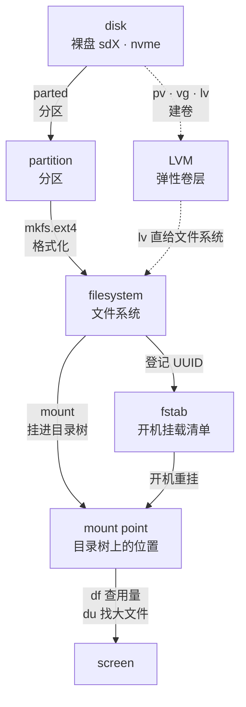

# 第9章 磁盘与存储

> [!TIP] Part 2 · administration（系统管理）
> 从「会用」到「归我管」：进程、软件、磁盘、账号、服务、时间、日志，七件事各有台账。

## 为什么要学磁盘管理？

分区要先挂到目录树某一点才可见——df 看挂载点用量、du 看目录树占用，两者对不上必有蹊跷。本章管磁盘——从设备命名到分区、格式化、挂载，让一块新盘真正可用。

**图 9-1｜本章挂载模型**（节点为实体——源 disk 裸盘、产物 partition 与 filesystem、接入点 mount point（目录树上的位置）、台账 fstab、替代路 LVM、目的地 screen；边为操作，实线 = 一块盘变成可用空间的主路——分区、格式化、挂载，虚线 = 改接——LVM 建卷绕过固定分区，lv 直接交给文件系统）：



<p class="figure-note">盘不是接上就能用——认盘、分区、格式化、挂到目录树，少一步都看不见</p>

> [!WARNING] 先猜再读
> 动手前先猜一猜，答案都在本章里：
>
> 1. `df -h` 显示磁盘只用了一半，创建文件却报 "No space left on device"——可能吗？（答案见 9.3）
> 2. `mount` 挂载成功后重启系统，挂载还在吗？（答案见 9.7、9.8）
> 3. /etc/fstab 里写设备名 /dev/sdb1 还是 UUID 更稳妥？改 fstab 前要先做什么？（答案见 9.8）

带着这张图进入正文，从认盘开始，把每一簇逐个展开：

## 9.1 磁盘设备命名

| 设备类型 | 命名格式 | 示例 |
| ---------- | ---------- | ------ |
| SATA/SCSI/USB 磁盘 | /dev/sdX | /dev/sda, /dev/sdb |
| NVMe 固态硬盘 | /dev/nvmeXnY | /dev/nvme0n1 |
| 虚拟磁盘 | /dev/vdX | /dev/vda（云服务器常见） |
| 分区 | 在设备名后加数字 | /dev/sda1, /dev/nvme0n1p1 |

```bash
# 查看所有磁盘设备
ls /dev/sd* /dev/nvme* /dev/vd* 2>/dev/null
```

## 9.2 lsblk——块设备树

**命令格式**：`lsblk [OPTIONS] [DEVICE]...`

```bash
# 基本用法
lsblk

# 显示文件系统和 UUID
lsblk -f

# 以列表格式输出
lsblk -l

# 只看磁盘（不看分区）
lsblk -d

# 显示完整路径
lsblk -p

# 组合使用
lsblk -fp
```

lsblk 把「整盘 → 分区」画成一棵树，一眼看清哪个盘还没分区：

```text
NAME   MAJ:MIN RM  SIZE RO TYPE MOUNTPOINT
sda      8:0    0   20G  0 disk
├─sda1   8:1    0    1G  0 part [SWAP]
└─sda2   8:2    0   19G  0 part /
sdb      8:16   0   20G  0 disk
```

sda 已就位（sda1 是交换分区、sda2 挂载在 `/`），sdb 还是裸盘——一块盘要走到挂载才算能用。

## 9.3 df——磁盘使用情况

**命令格式**：`df [OPTION]... [FILE]...`

```bash
# 人类可读格式（最常用）
df -h

# 显示 inode 使用情况
df -i
# inode 用尽 = 即使有磁盘空间也无法创建新文件！

# 排除不关心的文件系统
df -h -x tmpfs -x devtmpfs -x squashfs

# 找出使用率超过 80% 的分区
df -h | awk 'NR==1 || +$5 > 80'
```

## 9.4 du——目录大小

**命令格式**：`du [OPTION]... [FILE]...`

```bash
# 查看当前目录大小
du -sh .

# 查看目录下每个子目录的大小
du -h --max-depth=1 /var/ | sort -h

# 包含文件，按大小排序
du -ah /var/log/ | sort -rh | head -20

# 排除某些目录
du -sh --exclude=node_modules /home/alice/project/

# 磁盘空间不足时的排查流程
df -h                                    # 1. 看整体
sudo du -h --max-depth=1 / | sort -h    # 2. 找大目录
sudo lsof +L1                            # 3. 找已删除但仍占用的文件
```

## 9.5 fdisk 与 parted——分区管理

**命令格式**：`fdisk [OPTIONS] DEVICE`、`fdisk -l [DEVICE]...`、`parted [OPTIONS] [DEVICE]`

```bash
# 查看磁盘分区信息
sudo fdisk -l

# 交互式分区管理
sudo fdisk /dev/sdb
# m=帮助 p=打印分区表 n=新建 d=删除 t=改类型 w=写入退出 q=不保存退出

# parted（支持 GPT 分区表）
sudo apt install parted
sudo parted /dev/sdb
# (parted) print
# (parted) mklabel gpt
# (parted) mkpart primary ext4 0% 100%
# (parted) quit
```

两者的分工：`fdisk` 是交互式工具——进入后靠菜单一步步操作（m 帮助、n 新建、w 写入），传统 MBR 分区场景最常用；`parted` 支持 GPT 分区表与大容量磁盘，且命令可以直接跟在命令行后逐条执行（如 `parted /dev/vdb mklabel gpt`），适合写进脚本。新盘建 GPT 分区表用 `parted`（9.10 实战即用它），只想看分区信息则 `sudo fdisk -l` 更顺手。

## 9.6 mkfs——创建文件系统

**命令格式**：`mkfs.ext4 [OPTIONS] DEVICE`、`mkfs.xfs [OPTIONS] DEVICE`

```bash
# 创建 ext4 文件系统
sudo mkfs.ext4 /dev/sdb1

# 创建 xfs 文件系统
sudo mkfs.xfs /dev/sdb1

# 创建带标签的文件系统
sudo mkfs.ext4 -L DATA /dev/sdb1

# 查看文件系统的 UUID
sudo blkid
```

## 9.7 mount/umount——挂载与卸载

**命令格式**：`mount [OPTIONS] DEVICE MOUNTPOINT`、`umount [OPTIONS] MOUNTPOINT`

```bash
# 查看所有已挂载的文件系统
findmnt
findmnt -t ext4

# 手动挂载一个设备
sudo mount /dev/sdb1 /mnt/data

# 以只读方式挂载
sudo mount -o ro /dev/sdb1 /mnt/data

# 挂载 ISO 文件
sudo mount -o loop ubuntu.iso /mnt/iso

# 卸载
sudo umount /mnt/data

# 如果设备正忙，延迟卸载
sudo umount -l /mnt/data
```

## 9.8 /etc/fstab——自动挂载配置

```bash
# 查看当前的 fstab
cat /etc/fstab
# 字段：设备  挂载点  类型  选项  dump  pass

# 添加新磁盘的自动挂载
sudo blkid /dev/sdb1                              # 获取 UUID
sudo mkdir -p /mnt/data                           # 创建挂载点
sudo cp /etc/fstab /etc/fstab.bak                 # 先备份！
sudo tee -a /etc/fstab <<'EOF'
UUID=a1b2c3d4-...  /mnt/data  ext4  defaults  0  2
EOF
sudo mount -a                                     # 测试（不用重启）
df -h /mnt/data                                   # 验证
```

> **避坑指南**：编辑 fstab 时一定要先备份！`mount -a` 先测试再重启。

## 9.9 LVM 逻辑卷管理简介

本节一口气认识 5 个 LVM 命令。它们分属两个阶段，先按阶段分组列出通用格式（记号约定见[第 1 章 1.6 节](./ch01.md)），再辨析扩容那一组：

**搭建三层结构**——从裸盘拼出可挂载的逻辑卷：

- `pvcreate [OPTIONS] DEVICE...` —— 创建物理卷
- `vgcreate [OPTIONS] VG_NAME DEVICE...` —— 创建卷组
- `lvcreate [OPTIONS] VG_NAME` —— 创建逻辑卷

**在线扩容**——服务不停、挂载不卸：

- `lvextend [OPTIONS] LV_PATH` —— 扩大逻辑卷（块设备）
- `resize2fs [OPTIONS] DEVICE` —— 撑大其上的文件系统

扩容这一组的辨析：`lvextend` 只把逻辑卷这个块设备变大，上面的文件系统并不知道多出了空间；`resize2fs` 才把新空间撑进文件系统。在线扩容两步都要做，缺一步 `df -h` 里看到的容量都不会变（df 的读法见[第 2 章 2.10 节 · 查看系统资源](./ch02.md)）。

```bash
# 安装 LVM 工具
sudo apt install lvm2

# 创建物理卷
sudo pvcreate /dev/sdb1 /dev/sdc1

# 创建卷组
sudo vgcreate datavg /dev/sdb1 /dev/sdc1

# 创建逻辑卷（10GB）
sudo lvcreate -L 10G -n mydata datavg

# 格式化并挂载
sudo mkfs.ext4 /dev/datavg/mydata
sudo mount /dev/datavg/mydata /mnt/data

# 扩展逻辑卷（在线扩展，不需要卸载！）
sudo lvextend -L +5G /dev/datavg/mydata
sudo resize2fs /dev/datavg/mydata
```

## 9.10 实战：给虚拟机添加并挂载新磁盘

下面六个命令按「确认新盘 → 分区 → 格式化 → 挂载 → 写 fstab 自动挂载 → 设权限」的顺序走完全程（fstab 改前先备份，`mount -a` 验证通过再重启）：

```bash
# 1. 确认新磁盘
lsblk

# 2. 创建分区
sudo parted /dev/vdb mklabel gpt
sudo parted /dev/vdb mkpart primary ext4 0% 100%

# 3. 创建文件系统
sudo mkfs.ext4 /dev/vdb1

# 4. 创建挂载点并挂载
sudo mkdir -p /mnt/data
sudo mount /dev/vdb1 /mnt/data

# 5. 设置自动挂载
UUID=$(sudo blkid -s UUID -o value /dev/vdb1)
echo "UUID=$UUID  /mnt/data  ext4  defaults  0  2" | sudo tee -a /etc/fstab
sudo mount -a && echo "fstab OK!"

# 6. 设置权限
sudo chmod 755 /mnt/data
```

## 本章小结

- **核心句**：分区要先挂到目录树某一点才可见——df 看挂载点用量、du 看目录树占用，两者对不上必有蹊跷。
- **边界句**：管块设备↔目录树的接入；分区怎么切、LVM 内部是前置步骤不在词内。
- **坑 1**：忘了挂载=数据「消失」。
- **坑 2**：df/du 差异两来源（挂载遮盖、文件已删仍被进程占用）。
- **坑 3**：umount busy 是有人占着用 lsof/fuser 找，fstab 写错要 nofail。
- **回访**：学到[第 13 章 日志与监控](./ch13.md#本章小结)回来——说出这一章的 3 个坑；df/du 的差异在日志与计数器里怎么现形。

**下一章预告**：磁盘安顿好，人也该安顿了——下一章讲**账号**（account）。
