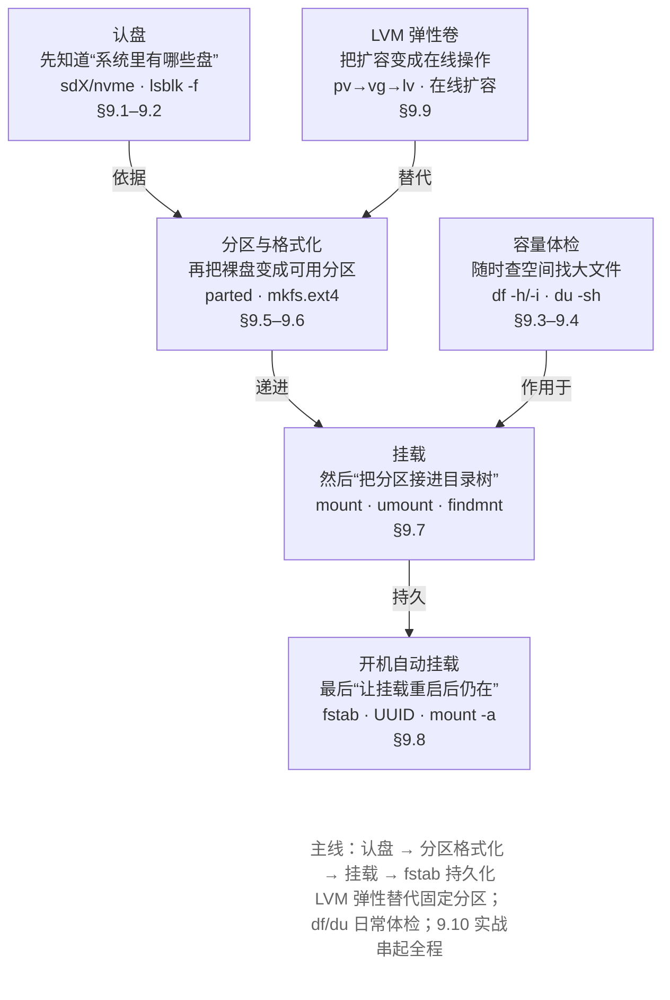
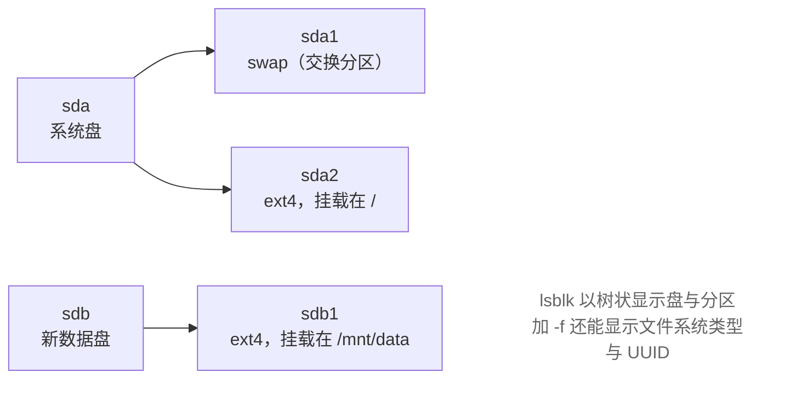
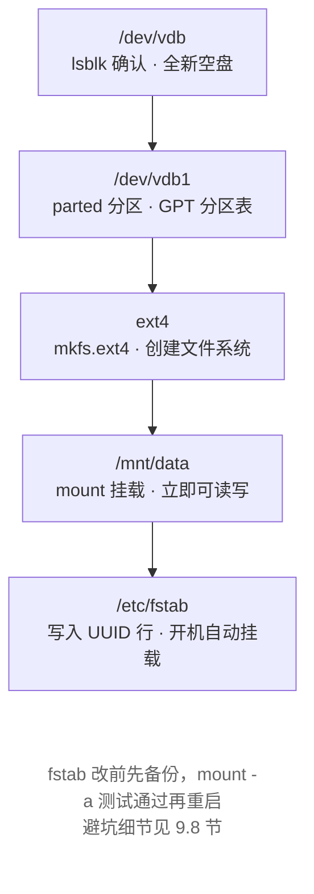

# 第9章 磁盘与存储

## 为什么要学磁盘管理？

本章管磁盘——从设备命名到分区、格式化、挂载，让一块新盘真正可用。

**图 9-1｜本章概念关系图**（节点内第二行为各环节目的，末行为小节号；箭头标注关系类型）：



> [!WARNING] 先猜再读
> 动手前先猜一猜，答案都在本章里：
>
> 1. `df -h` 显示磁盘只用了一半，创建文件却报 "No space left on device"——可能吗？（答案见 9.3）
> 2. `mount` 挂载成功后重启系统，挂载还在吗？（答案见 9.7、9.8）
> 3. /etc/fstab 里写设备名 /dev/sdb1 还是 UUID 更稳妥？改 fstab 前要先做什么？（答案见 9.8）

带着这张图进入正文，从认盘开始，把每一簇逐个展开：

## 9.1 磁盘设备命名

| 设备类型 | 命名格式 | 示例 |
| ---------- | ---------- | ------ |
| SATA/SCSI/USB 磁盘 | /dev/sdX | /dev/sda, /dev/sdb |
| NVMe 固态硬盘 | /dev/nvmeXnY | /dev/nvme0n1 |
| 虚拟磁盘 | /dev/vdX | /dev/vda（云服务器常见） |
| 分区 | 在设备名后加数字 | /dev/sda1, /dev/nvme0n1p1 |

```bash
# 查看所有磁盘设备
ls /dev/sd* /dev/nvme* /dev/vd* 2>/dev/null
```

## 9.2 lsblk——块设备树

**命令格式**：`lsblk [OPTIONS] [DEVICE]...`

```bash
# 基本用法
lsblk

# 显示文件系统和 UUID
lsblk -f

# 以列表格式输出
lsblk -l

# 只看磁盘（不看分区）
lsblk -d

# 显示完整路径
lsblk -p

# 组合使用
lsblk -fp
```

**图 9-2｜lsblk 的树状视图**（整盘与分区呈父子关系，分区框内标注文件系统与挂载点；sdb 为第 9.10 节要初始化的新盘）：



如图 9-2，lsblk 把「整盘 → 分区」画成一棵树，一眼看清哪个盘还没分区。

## 9.3 df——磁盘使用情况

**命令格式**：`df [OPTION]... [FILE]...`

```bash
# 人类可读格式（最常用）
df -h

# 显示 inode 使用情况
df -i
# inode 用尽 = 即使有磁盘空间也无法创建新文件！

# 排除不关心的文件系统
df -h -x tmpfs -x devtmpfs -x squashfs

# 找出使用率超过 80% 的分区
df -h | awk 'NR==1 || +$5 > 80'
```

## 9.4 du——目录大小

**命令格式**：`du [OPTION]... [FILE]...`

```bash
# 查看当前目录大小
du -sh .

# 查看目录下每个子目录的大小
du -h --max-depth=1 /var/ | sort -h

# 包含文件，按大小排序
du -ah /var/log/ | sort -rh | head -20

# 排除某些目录
du -sh --exclude=node_modules /home/alice/project/

# 磁盘空间不足时的排查流程
df -h                                    # 1. 看整体
sudo du -h --max-depth=1 / | sort -h    # 2. 找大目录
sudo lsof +L1                            # 3. 找已删除但仍占用的文件
```

## 9.5 fdisk 与 parted——分区管理

**命令格式**：`fdisk [OPTIONS] DEVICE`、`fdisk -l [DEVICE]...`、`parted [OPTIONS] [DEVICE]`

```bash
# 查看磁盘分区信息
sudo fdisk -l

# 交互式分区管理
sudo fdisk /dev/sdb
# m=帮助 p=打印分区表 n=新建 d=删除 t=改类型 w=写入退出 q=不保存退出

# parted（支持 GPT 分区表）
sudo apt install parted
sudo parted /dev/sdb
# (parted) print
# (parted) mklabel gpt
# (parted) mkpart primary ext4 0% 100%
# (parted) quit
```

两者的分工：`fdisk` 是交互式工具——进入后靠菜单一步步操作（m 帮助、n 新建、w 写入），传统 MBR 分区场景最常用；`parted` 支持 GPT 分区表与大容量磁盘，且命令可以直接跟在命令行后逐条执行（如 `parted /dev/vdb mklabel gpt`），适合写进脚本。新盘建 GPT 分区表用 `parted`（9.10 实战即用它），只想看分区信息则 `sudo fdisk -l` 更顺手。

## 9.6 mkfs——创建文件系统

**命令格式**：`mkfs.ext4 [OPTIONS] DEVICE`、`mkfs.xfs [OPTIONS] DEVICE`

```bash
# 创建 ext4 文件系统
sudo mkfs.ext4 /dev/sdb1

# 创建 xfs 文件系统
sudo mkfs.xfs /dev/sdb1

# 创建带标签的文件系统
sudo mkfs.ext4 -L DATA /dev/sdb1

# 查看文件系统的 UUID
sudo blkid
```

## 9.7 mount/umount——挂载与卸载

**命令格式**：`mount [OPTIONS] DEVICE MOUNTPOINT`、`umount [OPTIONS] MOUNTPOINT`

```bash
# 查看所有已挂载的文件系统
findmnt
findmnt -t ext4

# 手动挂载一个设备
sudo mount /dev/sdb1 /mnt/data

# 以只读方式挂载
sudo mount -o ro /dev/sdb1 /mnt/data

# 挂载 ISO 文件
sudo mount -o loop ubuntu.iso /mnt/iso

# 卸载
sudo umount /mnt/data

# 如果设备正忙，延迟卸载
sudo umount -l /mnt/data
```

## 9.8 /etc/fstab——自动挂载配置

```bash
# 查看当前的 fstab
cat /etc/fstab
# 字段：设备  挂载点  类型  选项  dump  pass

# 添加新磁盘的自动挂载
sudo blkid /dev/sdb1                              # 获取 UUID
sudo mkdir -p /mnt/data                           # 创建挂载点
sudo cp /etc/fstab /etc/fstab.bak                 # 先备份！
sudo tee -a /etc/fstab <<'EOF'
UUID=a1b2c3d4-...  /mnt/data  ext4  defaults  0  2
EOF
sudo mount -a                                     # 测试（不用重启）
df -h /mnt/data                                   # 验证
```

> **避坑指南**：编辑 fstab 时一定要先备份！`mount -a` 先测试再重启。

## 9.9 LVM 逻辑卷管理简介

本节一口气认识 5 个 LVM 命令。它们分属两个阶段，先按阶段分组列出通用格式（记号约定见 1.6），再辨析扩容那一组：

**搭建三层结构**——从裸盘拼出可挂载的逻辑卷：

- `pvcreate [OPTIONS] DEVICE...` —— 创建物理卷
- `vgcreate [OPTIONS] VG_NAME DEVICE...` —— 创建卷组
- `lvcreate [OPTIONS] VG_NAME` —— 创建逻辑卷

**在线扩容**——服务不停、挂载不卸：

- `lvextend [OPTIONS] LV_PATH` —— 扩大逻辑卷（块设备）
- `resize2fs [OPTIONS] DEVICE` —— 撑大其上的文件系统

扩容这一组的辨析：`lvextend` 只把逻辑卷这个块设备变大，上面的文件系统并不知道多出了空间；`resize2fs` 才把新空间撑进文件系统。在线扩容两步都要做，缺一步 `df -h` 里看到的容量都不会变。

```bash
# 安装 LVM 工具
sudo apt install lvm2

# 创建物理卷
sudo pvcreate /dev/sdb1 /dev/sdc1

# 创建卷组
sudo vgcreate datavg /dev/sdb1 /dev/sdc1

# 创建逻辑卷（10GB）
sudo lvcreate -L 10G -n mydata datavg

# 格式化并挂载
sudo mkfs.ext4 /dev/datavg/mydata
sudo mount /dev/datavg/mydata /mnt/data

# 扩展逻辑卷（在线扩展，不需要卸载！）
sudo lvextend -L +5G /dev/datavg/mydata
sudo resize2fs /dev/datavg/mydata
```

## 9.10 实战：给虚拟机添加并挂载新磁盘

**图 9-3｜新盘从分区到自动挂载的四步链路**（对应本节实战命令：parted 分区 → mkfs.ext4 格式化 → mount 挂载 → 写入 fstab）：



下面六个命令正是沿着图 9-3 这条链路走完的。

```bash
# 1. 确认新磁盘
lsblk

# 2. 创建分区
sudo parted /dev/vdb mklabel gpt
sudo parted /dev/vdb mkpart primary ext4 0% 100%

# 3. 创建文件系统
sudo mkfs.ext4 /dev/vdb1

# 4. 创建挂载点并挂载
sudo mkdir -p /mnt/data
sudo mount /dev/vdb1 /mnt/data

# 5. 设置自动挂载
UUID=$(sudo blkid -s UUID -o value /dev/vdb1)
echo "UUID=$UUID  /mnt/data  ext4  defaults  0  2" | sudo tee -a /etc/fstab
sudo mount -a && echo "fstab OK!"

# 6. 设置权限
sudo chmod 755 /mnt/data
```

## 本章小结

核心命令：`lsblk` 看结构、`df` 看使用、`du` 找大文件。记住：

- **fstab 改之前一定先备份**
- **UUID 比设备名更可靠**

## 本章自测

合上正文，先自己回答，再点开答案对照。答不上来的题，回到对应小节重读——主动回忆一遍，比从头重读十遍记得牢。

**1. SATA 磁盘、NVMe 固态硬盘、云服务器虚拟磁盘的设备名各是什么格式？/dev/nvme0n1 的第一个分区叫什么？**

<details>
<summary>点击查看答案</summary>

依次是 `/dev/sdX`（如 sda、sdb）、`/dev/nvmeXnY`（如 nvme0n1）、`/dev/vdX`（如 vda）。NVMe 的第一个分区是 `/dev/nvme0n1p1`——分区号前多一个 p；SATA 盘则直接加数字，如 sda1。见 9.1 节。

</details>

**2. 写出命令：以树状查看块设备，并显示文件系统类型与 UUID。**

<details>
<summary>点击查看答案</summary>

```bash
lsblk -f
```

`-f` 会多出 FSTYPE、UUID、挂载点等列；只想看整盘不看分区用 `lsblk -d`。见 9.2 节。

</details>

**3. 预测：df -h 显示某分区 Use% 只有 50%，创建新文件却报 "No space left on device"。可能是什么原因？用哪条命令验证？**

<details>
<summary>点击查看答案</summary>

inode 用尽。每个文件至少占用一个 inode，海量小文件可能先把 inode 耗光——此时磁盘空间还有剩余，也无法再创建新文件。用 `df -i` 验证，看 IUse% 是否到了 100%。见 9.3 节。

</details>

**4. 写出命令：只查看当前目录的总大小，人类可读格式。**

<details>
<summary>点击查看答案</summary>

```bash
du -sh .
```

`-s` 只显示总计（summary），`-h` 以 K/M/G 显示。见 9.4 节。

</details>

**5. 写出命令：列出 /var 下第一层各目录的大小，按从小到大排序。**

<details>
<summary>点击查看答案</summary>

```bash
du -h --max-depth=1 /var/ | sort -h
```

`--max-depth=1` 限制只看一层，`sort -h` 按人类可读的大小排序。普通用户执行时部分目录会报 Permission denied，像书中排查流程那样加 `sudo` 可得到完整结果。见 9.4 节。

</details>

**6. df 说分区快满了，du 却找不到大文件——常见原因是什么？用哪条命令排查？**

<details>
<summary>点击查看答案</summary>

文件已被 rm 删除，但仍有进程握着它的文件句柄，空间没有真正释放：du 按目录统计看不到已删除的文件名，df 却仍把这块空间算作已用。用 `sudo lsof +L1` 找出「已删除但仍被打开」的文件，让对应进程关闭文件或重启它，空间才会释放。见 9.4 节排查流程第三步。

</details>

**7. 怎么查看当前所有已挂载的文件系统？卸载 /mnt/data 时提示设备正忙，书中给出什么办法？**

<details>
<summary>点击查看答案</summary>

用 `findmnt` 查看（`findmnt -t ext4` 可按类型过滤）。设备正忙时可以 `sudo umount -l /mnt/data` 延迟卸载（lazy）：先把挂载点从目录树摘掉，等引用释放后再真正清理。见 9.7 节。

</details>

**8. fdisk 与 parted 各有什么定位？给新盘建 GPT 分区表该用哪个工具、哪两条子命令？**

<details>
<summary>点击查看答案</summary>

fdisk 用于查看分区信息（`sudo fdisk -l`）和交互式分区管理；parted 支持 GPT 分区表，书中给新盘分区用它：`mklabel gpt` 建 GPT 分区表，`mkpart primary ext4 0% 100%` 划出一个占满全盘的分区。见 9.5 节。

</details>

**9. /etc/fstab 一行有哪六个字段？为什么写 UUID 比写 /dev/sdb1 更可靠？**

<details>
<summary>点击查看答案</summary>

六个字段依次是：设备、挂载点、类型、选项、dump、pass。设备名可能随识别顺序漂移——增删磁盘后 sdb 可能变成 sdc；UUID 是格式化时写进文件系统的唯一标识，不随设备名变化，所以更可靠。见 9.8 节。

</details>

**10. 编辑 fstab 前后必须做哪两件事？为什么？**

<details>
<summary>点击查看答案</summary>

改之前先备份：`sudo cp /etc/fstab /etc/fstab.bak`；改之后先 `sudo mount -a` 测试，确认无报错再重启。fstab 写错可能导致系统起不来，备份加预测试是保命两件套。见 9.8 节避坑指南。

</details>

**11. LVM 的三层结构从底到顶是什么？在线扩容一个逻辑卷需要哪两条命令？**

<details>
<summary>点击查看答案</summary>

PV 物理卷 → VG 卷组 → LV 逻辑卷（对应 pvcreate → vgcreate → lvcreate）。扩容两步：`sudo lvextend -L +5G /dev/datavg/mydata` 扩大逻辑卷，再 `sudo resize2fs /dev/datavg/mydata` 撑大文件系统——在线完成，不需要卸载。见 9.9 节。

</details>

**12. 把新盘上架的步骤排序：写入 fstab、mkfs.ext4 格式化、lsblk 确认新盘、mount 挂载、parted 分区。**

<details>
<summary>点击查看答案</summary>

lsblk 确认新盘 → parted 分区 → mkfs.ext4 格式化 → mount 挂载 → 写入 fstab（再用 `mount -a` 验证）。这正是图 9-3 的链路，9.10 节实战完整走了一遍。见 9.10 节。

</details>

## 本章命令速查表

| 命令 | 用途 | 常用示例 |
| ------ | ------ | ---------- |
| `lsblk` | 查看块设备树 | `lsblk`, `lsblk -f` |
| `df` | 查看磁盘使用 | `df -h`, `df -i` |
| `du` | 查看目录大小 | `du -sh dir`, `du -h -d 1 .` |
| `mount` | 挂载文件系统 | `sudo mount /dev/sdb1 /mnt` |
| `umount` | 卸载文件系统 | `sudo umount /mnt` |
| `fdisk` | 分区管理 | `sudo fdisk -l` |
| `parted` | GPT 分区管理 | `sudo parted /dev/sdb` |
| `mkfs` | 创建文件系统 | `sudo mkfs.ext4 /dev/sdb1` |
| `blkid` | 查看设备 UUID | `sudo blkid` |
| `findmnt` | 查看挂载信息 | `findmnt -t ext4` |

---
