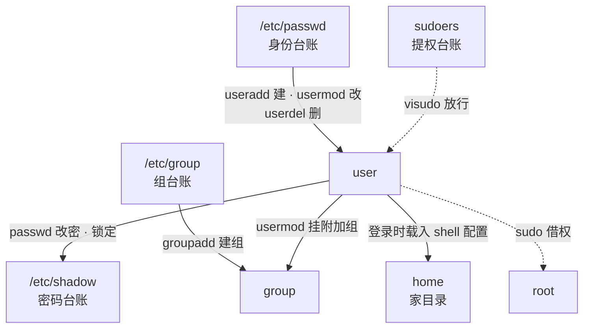

# 第10章 用户与组管理

> [!TIP] Part 2 · administration（系统管理）
> 从「会用」到「归我管」：进程、软件、磁盘、账号、服务、时间、日志，七件事各有台账。

## 为什么要学用户管理？

人以账号入系统、以组分权限——密码是自己的钥匙、sudo 是借来的权力、组是批量门禁名单。本章管用户全生命周期——从 adduser 到 userdel，建账号、改属性、管组、控 sudo。用「公司组织架构」类比：用户 = 员工（每人一个账号），组 = 部门（一组人共享某些权限），root = CEO（拥有所有权限），UID 0 就是 root 的"身份证号码"。

**图 10-1｜本章账号模型**（节点为实体——四本台账 /etc/passwd、/etc/shadow、/etc/group、sudoers，主体 user、组 group、家 home、root；边为工具操作，实线 = 台账上的日常增删改——建号改号、改密、建组挂组，虚线 = 借权——sudo 过 sudoers 借 root）：



<p class="figure-note">命令只是手续——passwd、shadow、group 三个台账文件才是事实</p>

> [!WARNING] 先猜再读
> 动手前先猜一猜，答案都在本章里：
>
> 1. `sudo usermod -G docker alice`（漏了 -a）执行后，alice 原有的附加组会怎样？（答案见 10.3）
> 2. 删除一个还在登录的用户 bob，只跑 `sudo userdel -r bob` 行得通吗？（答案见 10.4）
> 3. 想让 alice 下次登录时必须改密码，passwd 该加哪个选项？（答案见 10.5）

带着这张图进入正文，从用户信息文件开始，把每一簇逐个展开：

## 10.1 用户信息文件

本节讲解三个账号文件的同时，也认识几个查看用户与组的命令，先把通用格式列在一起（记号约定见 1.6）：

- `id [OPTIONS] [USER]` —— 查看用户的 UID、GID 与所属组
- `whoami [OPTIONS]` —— 显示当前用户名
- `groups [OPTIONS] [USER]` —— 查看用户所属的组

三者的分工与选型见[第 5 章 5.2 节 · 查看用户信息](./ch05.md)的辨析表，这里只列格式、不再重复建表。

### /etc/passwd

```bash
# 查看用户信息文件
cat /etc/passwd
# 格式：用户名:密码占位:UID:GID:GECOS:家目录:Shell

# 查看所有普通用户
awk -F: '$3 >= 1000 {print $1, $3, $6, $7}' /etc/passwd

# 查看某个用户的信息
getent passwd alice
id alice
whoami
```

**图 10-2｜/etc/passwd 一行的七个字段**（展开图 10-1 的 /etc/passwd 身份台账：以第 10.9 节创建的 alice 为例，冒号分隔，每格下沿标注字段名）：

<svg viewBox="0 0 400 420" xmlns="http://www.w3.org/2000/svg" font-family="system-ui, sans-serif">
  <rect x="0" y="0" width="400" height="420" fill="#ffffff"/>
  <text x="22" y="30" font-size="13" fill="#333">getent passwd alice 的输出，七个字段用冒号分隔：</text>

  <rect x="30" y="44" width="140" height="36" rx="6" fill="#f0f7ff" stroke="#4a90d9"/>
  <text x="100" y="67" text-anchor="middle" font-size="12" font-weight="bold" fill="#333">alice</text>
  <text x="184" y="67" text-anchor="middle" font-size="14" fill="#999">:</text>
  <text x="198" y="67" font-size="12" fill="#666">用户名</text>

  <rect x="30" y="90" width="140" height="36" rx="6" fill="#f0f7ff" stroke="#4a90d9"/>
  <text x="100" y="113" text-anchor="middle" font-size="12" font-weight="bold" fill="#333">x</text>
  <text x="184" y="113" text-anchor="middle" font-size="14" fill="#999">:</text>
  <text x="198" y="113" font-size="12" fill="#666">密码占位</text>

  <rect x="30" y="136" width="140" height="36" rx="6" fill="#f0f7ff" stroke="#4a90d9"/>
  <text x="100" y="159" text-anchor="middle" font-size="12" font-weight="bold" fill="#333">1001</text>
  <text x="184" y="159" text-anchor="middle" font-size="14" fill="#999">:</text>
  <text x="198" y="159" font-size="12" fill="#666">UID</text>

  <rect x="30" y="182" width="140" height="36" rx="6" fill="#f0f7ff" stroke="#4a90d9"/>
  <text x="100" y="205" text-anchor="middle" font-size="12" font-weight="bold" fill="#333">1001</text>
  <text x="184" y="205" text-anchor="middle" font-size="14" fill="#999">:</text>
  <text x="198" y="205" font-size="12" fill="#666">GID</text>

  <rect x="30" y="228" width="140" height="36" rx="6" fill="#f0f7ff" stroke="#4a90d9"/>
  <text x="100" y="251" text-anchor="middle" font-size="12" font-weight="bold" fill="#333">Alice Wang</text>
  <text x="184" y="251" text-anchor="middle" font-size="14" fill="#999">:</text>
  <text x="198" y="251" font-size="12" fill="#666">GECOS 描述</text>

  <rect x="30" y="274" width="140" height="36" rx="6" fill="#f0f7ff" stroke="#4a90d9"/>
  <text x="100" y="297" text-anchor="middle" font-size="12" font-weight="bold" fill="#333">/home/alice</text>
  <text x="184" y="297" text-anchor="middle" font-size="14" fill="#999">:</text>
  <text x="198" y="297" font-size="12" fill="#666">家目录</text>

  <rect x="30" y="320" width="140" height="36" rx="6" fill="#f0f7ff" stroke="#4a90d9"/>
  <text x="100" y="343" text-anchor="middle" font-size="12" font-weight="bold" fill="#333">/bin/bash</text>
  <text x="198" y="343" font-size="12" fill="#666">Shell</text>

  <text x="200" y="384" text-anchor="middle" font-size="12" fill="#666">UID ≥ 1000 为普通用户（本节 awk 筛选）；</text>
  <text x="200" y="404" text-anchor="middle" font-size="12" fill="#666">真正的密码哈希在 /etc/shadow。</text>
</svg>

如图 10-2，冒号把一行切成七段，每段各有含义。

### /etc/shadow

```bash
# 查看密码信息（需要 root 权限）
sudo cat /etc/shadow | head -5
# 格式：用户名:密码哈希:最后修改天数:最小间隔:最大间隔:警告期:不活跃期:过期日期
# $6$ = SHA-512，* 或 ! = 账号被锁定
```

### /etc/group

```bash
# 查看组信息
cat /etc/group
# 格式：组名:密码:GID:成员列表

# 查看某个用户属于哪些组
groups alice

# 查看某个组有哪些成员
getent group docker
```

## 10.2 adduser 与 useradd——创建用户

创建用户有两条路，先分清再选：

| 命令 | 特点 | 怎么选 |
| ---- | ---- | ------ |
| `adduser [OPTIONS] USER` | 交互式向导：自动建家目录、设密码、引导填信息 | 手动建日常用户用它 |
| `useradd [OPTIONS] LOGIN` | 底层命令：默认不建家目录、不设密码，行为全靠选项指定 | 写脚本或建系统用户（`-r`）用它 |

**命令格式**：`adduser [OPTIONS] USER`、`useradd [OPTIONS] LOGIN`

```bash
# 交互式创建日常用户（5.4 的 alice 就是这么建的）
sudo adduser bob

# 用 useradd 一步到位（适合脚本）
sudo useradd -m -s /bin/bash -G sudo,docker -c "Bob Johnson" bob
# -m 创建家目录  -s 设置Shell  -G 附加组  -c 描述

# 创建系统用户（不能登录）
sudo useradd -r -s /usr/sbin/nologin myservice

# 设置密码
sudo passwd bob    # passwd 详见 10.5

# 查看创建结果
id bob
```

上面 `useradd -m -s /bin/bash -G sudo,docker -c "Bob Johnson" bob` 跑完后，bob 的家目录是 `/home/bob`（-m 创建），主组 `bob` 由 useradd 自动创建、有且只有一个；-G 挂上的 sudo 与 docker 是附加组，可以挂多个——组就是一份批量门禁名单，附加组决定了 bob 能不能用 sudo、能不能跑 docker。

## 10.3 usermod——修改用户属性

把用户加进组的基础用法（`usermod -aG`）已在[第 5 章 5.4 节 · 用户管理最小集](./ch05.md)出现；本节补全 `usermod` 的其余常用选项。

**命令格式**：`usermod [OPTIONS] USER`

```bash
# 将用户加入组（-aG 是最常用的选项组合！）
sudo usermod -aG docker alice
# -a = append，一定要用！否则替换掉所有附加组

# 修改用户的默认 Shell
sudo usermod -s /bin/zsh alice

# 锁定用户账号（与 passwd -l 等效，辨析见 10.5）
sudo usermod -L bob

# 解锁用户账号
sudo usermod -U bob

# 设置账号过期日期
sudo usermod -e 2025-12-31 tempuser
```

## 10.4 userdel 与 deluser——删除用户

**命令格式**：`userdel [OPTIONS] USER`、`deluser [OPTIONS] USER`

```bash
# 删除用户及其家目录
sudo userdel -r bob

# 删除前先终止用户进程（killall 见 7.5.3）
sudo killall -u bob
sudo userdel -r bob

# Debian 系的 deluser 是 adduser 的配套前端
sudo deluser bob                  # 只删账号，保留家目录
sudo deluser --remove-home bob    # 连家目录一起删
```

两者都能删用户，差别在出身与默认行为：`userdel` 是各发行版通用的底层命令，默认保留家目录，`-r` 连家目录一起删；`deluser` 是 Debian 系 adduser 的配套前端，同样默认保留家目录，删家目录要显式加 `--remove-home`。手动管理两者皆可，脚本里更常见 `userdel`。

## 10.5 passwd——密码策略与锁定

改密码的基础用法（自己改、root 替别人改）见 5.4；本节聚焦 root 侧的密码策略。

**命令格式**：`passwd [OPTIONS] [USER]`

```bash
# 强制用户下次登录时修改密码
sudo passwd -e alice

# 锁定密码（禁止密码登录）
sudo passwd -l alice

# 设置密码过期策略
sudo passwd -n 7 -x 90 -w 7 alice
```

锁定与过期的近邻辨析：10.3 的 `usermod -L/-U` 与本节的 `passwd -l/-u` 机制相同——都是在 shadow 的密码哈希前加上/去掉 `!`，只锁密码认证（SSH 密钥登录不受影响），日常用哪个都行；`usermod -e 日期` 则是账号级过期，到期后任何方式都无法登录，别与本节的密码时效（`-n/-x/-w`，强制定期换密码）混为一谈。

## 10.6 组管理

本节一口气认识 3 个组管理命令，先把通用格式列在一起（记号约定见 1.6）：

- `groupadd [OPTIONS] GROUP` —— 创建组
- `groupmod [OPTIONS] GROUP` —— 修改组名
- `groupdel [OPTIONS] GROUP` —— 删除组

创建组与把用户加进组的基础用法见 5.4；本节补全组自身的改名、删除与临时切换。

```bash
# 修改组名
sudo groupmod -n engineering developers

# 删除组
sudo groupdel devops

# 临时切换组
newgrp developers

# 查看组的所有成员
getent group developers
```

## 10.7 su 与 sudo——切换用户

sudo 的日常用法（`-u`、`-l`、密码缓存）见[第 5 章 5.3 节 · sudo 的原理与用法](./ch05.md)；本节补上 su，以及 sudoers 的授权配置。

**命令格式**：`su [OPTIONS] [-] [USER]`、`sudo [OPTIONS] COMMAND`

```bash
# 切换到 root（输入 root 的密码，得到完整会话）
su -

# 切换到指定用户（输入 alice 的密码）
su - alice

# 以 root 身份执行单条命令（输入自己的密码）
sudo ls -la /root

# 以指定用户身份执行单条命令
sudo -u alice ls -la /home/alice

# 需要 root 的完整登录环境时
sudo -i
```

授权规则写在 sudoers 文件里，编辑它永远用 visudo——保存前会做语法检查，sudoers 写错会让所有人无法提权，visudo 能拦住这种错误：

```bash
sudo visudo
# 配置格式：user HOST=(run_as) command
# alice ALL=(ALL:ALL) ALL              # 需要密码
# bob ALL=(ALL:ALL) NOPASSWD: ALL      # 不需要密码
# charlie ALL=(ALL) /usr/bin/apt       # 只能执行apt
# %developers ALL=(ALL) ALL            # % 前缀表示组
```

两者的分工：`su` 是整段会话的身份切换——输入对方（通常是 root）的密码，切换成对方身份并获得完整会话（`su - alice` 连家目录与 Shell 配置一起换）；`sudo` 是单条命令的授权——输入自己的密码，以指定身份执行一条命令，且每次使用都记入审计日志（[第 13 章 13.1 节 · auth.log 里查 sudo 使用](./ch13.md)）。日常管理优先 `sudo`：不必共享 root 密码、能按命令细分授权（见 visudo 配置）、每个动作有迹可循；需要完整切换环境时（如以某用户的身份调试它的 Shell 配置）才用 `su`。

## 10.8 用户环境

环境变量放 profile、别名放 bashrc 的入门区别见[第 1 章 1.8 节 · ~/.bashrc 配置文件入门](./ch01.md)；本节从管理员视角补全完整的加载顺序与全局配置。

```bash
# 加载顺序：
# 登录Shell: /etc/profile → ~/.profile → ~/.bash_profile
# 非登录Shell: ~/.bashrc

# 给所有用户添加环境变量
echo 'export JAVA_HOME=/usr/lib/jvm/java-17' | sudo tee /etc/profile.d/java.sh

# 给单个用户添加
echo 'export EDITOR=vim' >> ~/.bashrc

# 使配置立即生效
source ~/.bashrc
```

## 10.9 实战：为开发团队创建用户和权限体系

```bash
# 1. 创建组
sudo groupadd developers
sudo groupadd devops

# 2. 创建用户
sudo useradd -m -s /bin/bash -G developers -c "Alice Wang" alice
sudo useradd -m -s /bin/bash -G developers,devops -c "Charlie Zhang" charlie

# 3. 配置 sudo
sudo visudo -f /etc/sudoers.d/devteam
# %devops ALL=(ALL) NOPASSWD: /bin/systemctl *

# 4. 创建共享项目目录（setgid）
sudo mkdir -p /opt/projects
sudo chown root:developers /opt/projects
sudo chmod 2775 /opt/projects
# 2=setgid（新文件继承目录的组，原理见 5.9） 77=rwxrwx 5=r-x
```

## 本章小结

- **核心句**：人以账号入系统、以组分权限——密码是自己的钥匙、sudo 是借来的权力、组是批量门禁名单。
- **边界句**：管身份与组的建立；单次授权位归 05，网络准入归 16。
- **坑 1**：usermod -aG 忘了 -a 会清掉其他附加组。
- **坑 2**：sudoers 必须用 visudo 改。
- **坑 3**：禁用≠删除、home 会残留。
- **回访**：合上书说出[第 5 章 用户与权限的 3 个坑](./ch05.md#本章小结)；再自查：`usermod -aG` 忘了 `-a`，撞的是哪一档门。

**下一章预告**：账号就位，长活的程序该有人托管——下一章讲**服务**（service）。
