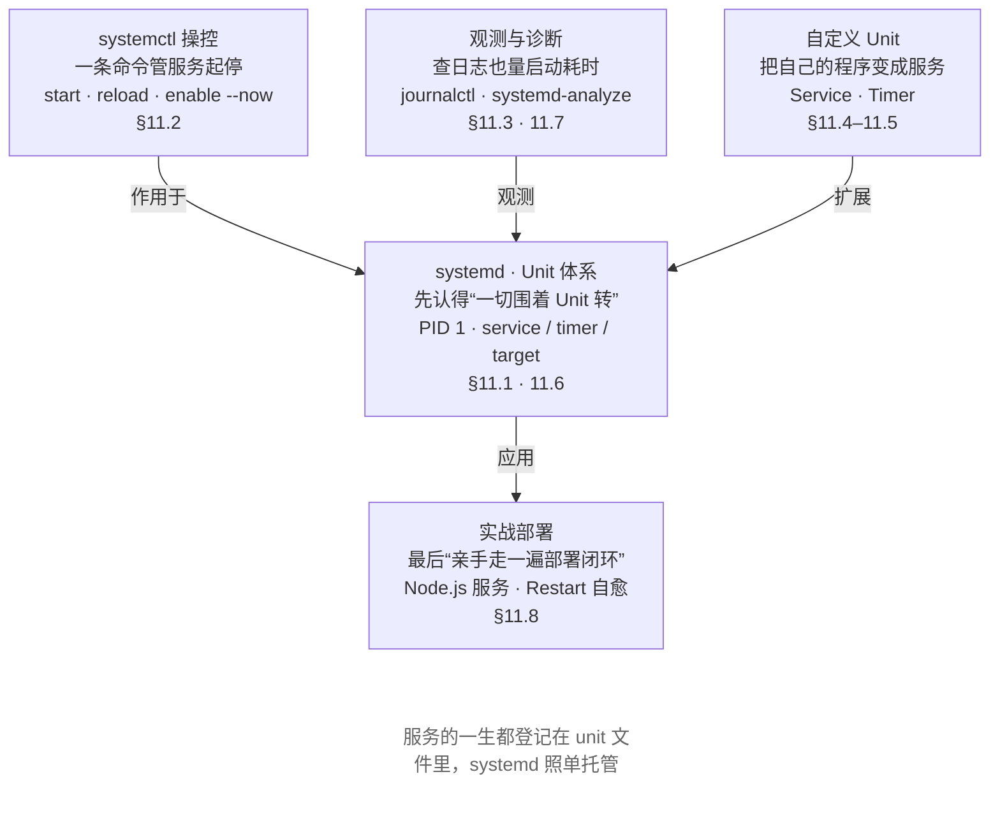
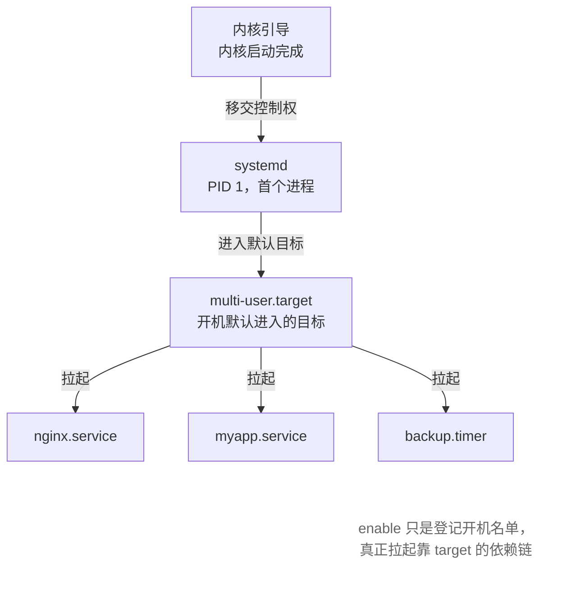
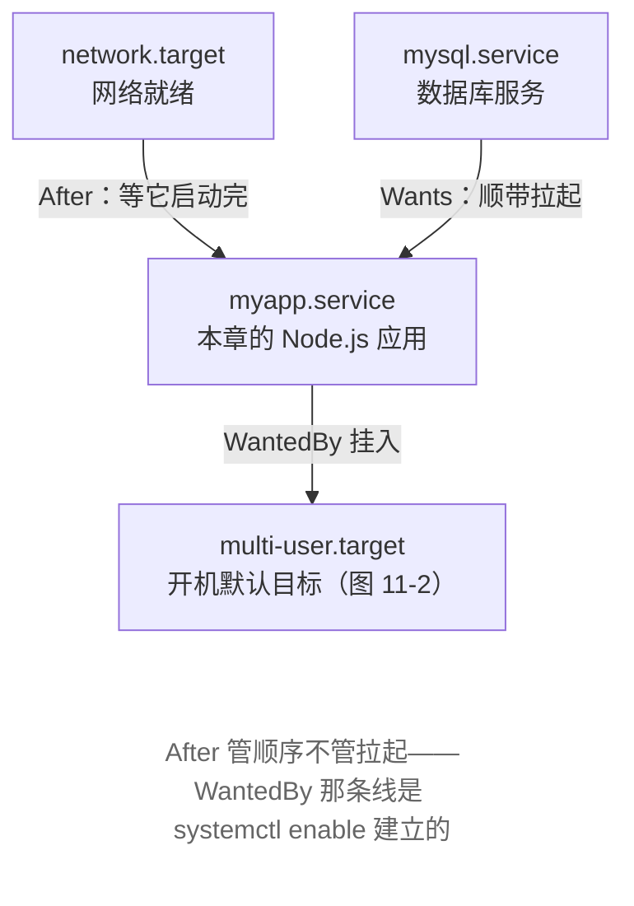

# 第11章 Systemd 与服务管理

> [!TIP] Part 2 · administration（系统管理）
> 从「会用」到「归我管」：进程、软件、磁盘、账号、服务、时间、日志，七件事各有台账。

## 为什么要学 Systemd？

**本章手柄：service（服务）**

长活程序由 PID 1 的 systemd 统一托管——unit 描述它、依赖定启动序、enable 只是登记开机、start 才真的跑。本章管服务——systemctl 启停查状态、journalctl 翻日志，把应用注册成开机自启的服务。

**图 11-1｜本章概念关系图**（节点内第二行为各环节目的，末行为小节号；箭头标注关系类型）：



> [!WARNING] 先猜再读
> 动手前先猜一猜，答案都在本章里：
>
> 1. `systemctl start nginx` 之后服务在跑，重启机器后它会自己起来吗？（答案见 11.2）
> 2. 手改了 unit 文件，`restart` 却没生效——漏了哪一步？（答案见 11.4）
> 3. `kill -9` 杀掉服务主进程，这个服务就死透了吗？（答案见 11.8）

枢纽是 Unit 体系——认识它的第一步，是搞清楚 Systemd 的架构与 Unit 类型：

## 11.1 Systemd 架构与 Unit 类型

| Unit 类型 | 文件后缀 | 用途 |
| ----------- | ---------- | ------ |
| **Service** | .service | 管理后台服务 |
| **Socket** | .socket | 管理套接字 |
| **Timer** | .timer | 定时任务（详见[第 12 章 12.7 节 · systemd timer](./ch12.md)） |
| **Target** | .target | Unit 集合（类似运行级别） |
| **Mount** | .mount | 管理挂载点（详见[第 9 章 9.7 节 · mount/umount](./ch09.md)） |
| **Path** | .path | 监控文件变化 |

```bash
# 查看所有活跃的服务 unit
systemctl list-units --type=service

# 查看所有活跃的 timer unit
systemctl list-units --type=timer
```

**图 11-2｜systemd 的开机启动链**（内核把控制权交给 PID 1 的 systemd，它从默认目标出发拉起各 Unit）：



如图 11-2，开机就是 systemd 从默认目标出发逐个拉起 Unit 的过程（systemd 为什么是 PID 1，见[第 7 章 7.1 节 · 进程的基本概念](./ch07.md)）。

## 11.2 systemctl 命令全家福

**命令格式**：`systemctl [OPTIONS] COMMAND [UNIT]...`

### 服务生命周期管理

```bash
# 启动/停止/重启/重载
sudo systemctl start nginx
sudo systemctl stop nginx
sudo systemctl restart nginx
sudo systemctl reload nginx          # 热更新配置（不中断服务）
sudo systemctl reload-or-restart nginx

# 查看服务状态
systemctl status nginx

# 检查是否运行/是否开机自启
systemctl is-active nginx
systemctl is-enabled nginx
```

### 开机自启管理

```bash
# 设置开机自启
sudo systemctl enable nginx

# 启用并立即启动
sudo systemctl enable --now nginx

# 取消开机自启
sudo systemctl disable nginx
```

前两组里两对近邻命令最易混，用一张表辨析：

| 近邻命令 | 差别 | 怎么选 |
| -------- | ---- | ------ |
| `start` / `enable` | `start` 只把服务拉起到本次运行，重启后不会自己起来；`enable` 只建立开机自启的挂入关系，当下并不启动 | 两者管的是不同时机，常配对使用——`enable --now` 一步到位 |
| `restart` / `reload` | `restart` 整个服务停掉再起，已有连接会断；`reload` 只重读配置文件，服务不中断（需要该服务支持） | 改完配置想不断连接用 `reload`，拿不准支不支持就用 `reload-or-restart`；服务假死、行为异常才 `restart` |

### 查看和过滤 Unit

```bash
# 列出所有正在运行的 unit
systemctl list-units

# 只列出失败的 unit（排障利器！）
systemctl list-units --failed

# 列出所有 unit 文件
systemctl list-unit-files

# 查看 unit 文件内容
systemctl cat nginx.service

# 查看依赖关系
systemctl list-dependencies nginx.service
```

### 系统级操作

```bash
# 修改 unit 文件后必须执行！
sudo systemctl daemon-reload

# 查看/修改默认启动目标（target 的对照表与立即切换见 11.6）
systemctl get-default
sudo systemctl set-default multi-user.target

# 重启/关机
sudo systemctl reboot
sudo systemctl poweroff
```

## 11.3 journalctl 日志查看

**命令格式**：`journalctl [OPTIONS] [MATCHES]...`

```bash
# 查看某个服务的日志
journalctl -u nginx

# 实时跟踪日志（类似 tail -f）
journalctl -u nginx -f

# 查看最近 N 行
journalctl -u nginx -n 100

# 按时间范围查看
journalctl --since "2024-01-01" --until "2024-01-02"
journalctl --since today
journalctl --since "1 hour ago"

# 按优先级查看
journalctl -p err            # 只看 error 及以上
# 优先级：0=emerg 1=alert 2=crit 3=err 4=warning 5=notice 6=info 7=debug

# 查看某次启动的日志
journalctl -b 0              # 当前启动
journalctl -b -1             # 上次启动

# 以 JSON 格式输出
journalctl -u nginx -o json

# 清理旧日志
sudo journalctl --vacuum-time=7d
sudo journalctl --vacuum-size=500M
```

## 11.4 编写自定义 Service Unit

```ini
# /etc/systemd/system/myapp.service
[Unit]
Description=My Awesome Node.js Application
After=network.target mysql.service
Wants=mysql.service

[Service]
User=www-data
Group=www-data
WorkingDirectory=/opt/myapp
ExecStart=/usr/bin/node /opt/myapp/server.js
ExecStartPre=/bin/mkdir -p /var/log/myapp
Restart=on-failure
RestartSec=5
Environment=NODE_ENV=production
Environment=PORT=3000
EnvironmentFile=/etc/myapp/env
LimitNOFILE=65536
NoNewPrivileges=true
ProtectSystem=strict
ProtectHome=true

[Install]
WantedBy=multi-user.target
```

**图 11-3｜myapp.service 的依赖关系**（对应上方 unit 文件中的 After、Wants、WantedBy 三条指令，箭头旁的标注即该指令）：



如图 11-3，这三条指令决定了 myapp 与网络、mysql 的启动关系。

```bash
# 部署流程
sudo vim /etc/systemd/system/myapp.service
sudo systemctl daemon-reload       # 必须！
sudo systemctl start myapp
systemctl status myapp
sudo systemctl enable myapp
journalctl -u myapp -f
```

## 11.5 编写自定义 Timer Unit

```ini
# /etc/systemd/system/backup.service
[Unit]
Description=Database Backup Service
[Service]
Type=oneshot
ExecStart=/opt/scripts/backup.sh
User=backup
```

```ini
# /etc/systemd/system/backup.timer
[Unit]
Description=Run Database Backup Daily
[Timer]
OnCalendar=*-*-* 02:00:00
Persistent=true
RandomizedDelaySec=300
Unit=backup.service
[Install]
WantedBy=timers.target
```

```bash
# 部署
sudo systemctl daemon-reload
sudo systemctl enable --now backup.timer
systemctl list-timers

# 验证日历表达式
systemd-analyze calendar "Mon *-*-* 09:00:00"   # systemd-analyze 详见 11.7
```

### 常用 OnCalendar 表达式

| 表达式 | 含义 |
| -------- | ------ |
| `*-*-* 02:00:00` | 每天凌晨 2:00 |
| `Mon *-*-* 09:00:00` | 每周一 9:00 |
| `*-*-1 03:00:00` | 每月 1 号 3:00 |
| `*-*-* *:30:00` | 每小时的第 30 分钟 |
| `hourly` / `daily` / `weekly` / `monthly` | 快捷方式 |

## 11.6 Target 与运行级别

| Target | 对应运行级别 | 含义 |
| -------- | ------------- | ------ |
| `poweroff.target` | 0 | 关机 |
| `rescue.target` | 1 | 单用户/救援模式 |
| `multi-user.target` | 3 | 多用户命令行模式 |
| `graphical.target` | 5 | 图形界面模式 |
| `reboot.target` | 6 | 重启 |

```bash
# 查看/切换 target
systemctl get-default
sudo systemctl set-default multi-user.target    # 默认进命令行模式（运行级别 3）
sudo systemctl set-default graphical.target     # 想默认进图形界面就改这条（运行级别 5）
sudo systemctl isolate multi-user.target    # 立即切换（不重启）
```

## 11.7 systemd-analyze——启动性能分析

**命令格式**：`systemd-analyze [OPTIONS] [COMMAND]`

```bash
# 查看系统启动时间
systemd-analyze

# 查看各服务的启动时间
systemd-analyze blame

# 生成 SVG 时间线图表
systemd-analyze plot > boot-timeline.svg

# 查看启动关键路径
systemd-analyze critical-chain

# 验证 unit 文件语法
systemd-analyze verify /etc/systemd/system/myapp.service
```

## 11.8 实战：将 Node.js 应用部署为 Systemd 服务

```bash
# 1. 准备应用
sudo mkdir -p /opt/myapp
sudo cp -r ~/myapp/* /opt/myapp/
cd /opt/myapp && npm install --production

# 2. 创建应用专用用户（系统用户配方见 10.2）
sudo useradd -r -s /usr/sbin/nologin -d /opt/myapp myapp
sudo chown -R myapp:myapp /opt/myapp

# 3. 创建 unit 文件（内容见 11.4 节）
sudo tee /etc/systemd/system/myapp.service <<'EOF'
[Unit]
Description=My Express.js Application
After=network.target

[Service]
Type=simple
User=myapp
WorkingDirectory=/opt/myapp
EnvironmentFile=/opt/myapp/.env
ExecStart=/usr/bin/node server.js
Restart=on-failure
RestartSec=5
NoNewPrivileges=true

[Install]
WantedBy=multi-user.target
EOF

# 4. 部署
sudo systemctl daemon-reload
sudo systemctl enable --now myapp

# 5. 验证
systemctl status myapp
journalctl -u myapp -f

# 6. 测试自动重启
sudo kill -9 $(systemctl show -p MainPID myapp --value)   # show：查单元属性，此处取主进程 PID
sleep 6
systemctl is-active myapp
# active ← 自动重启成功！
```

## 本章小结

**① 核心句**：长活程序由 PID 1 的 systemd 统一托管——unit 描述它、依赖定启动序、enable 只是登记开机、start 才真的跑。

**② 边界句**：管常驻托管；定时任务归 12，单次进程归 07。

**③ 可推导条目**：
- enable≠start。
- 改 unit 不 daemon-reload 不生效。
- 服务环境精简，登录 shell 里能跑的定时里未必。

> **词链互测**：合上书说出[第 8 章 package 的 3 个坑](./ch08.md#本章小结)；再自查：`apt install` 装出的服务，unit 文件是谁放的。
>
> 学到[第 12 章 schedule](./ch12.md#本章小结)回来——说出 schedule 的 3 个坑；timer 和 service 是什么关系。

**下一章预告**：服务稳了，到点的活交给时间——下一章的手柄是 **schedule**（调度）。
