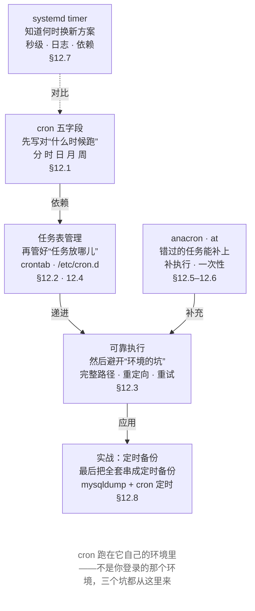
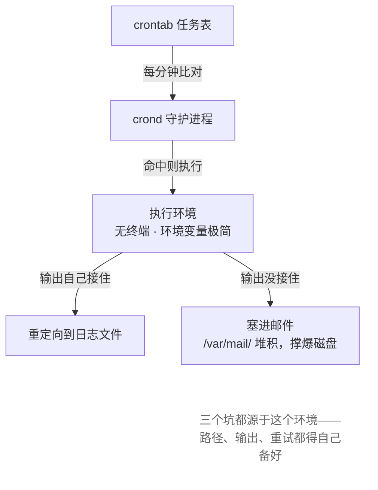

# 第12章 计划任务与自动化

> [!TIP] Part 2 · administration（系统管理）
> 从「会用」到「归我管」：进程、软件、磁盘、账号、服务、时间、日志，七件事各有台账。

## 为什么要学计划任务？

**本章手柄：schedule（调度）**

到点任务由守护进程代跑——cron 按「分 时 日 月 周」触发，用的是它自己的环境不是你的登录环境。本章管定时——cron 让任务按点自动跑，at 管一次性，systemd timer 是现代替代。

**图 12-1｜本章概念关系图**（节点内第二行为各环节目的，末行为小节号；箭头标注关系类型）：



> [!WARNING] 先猜再读
> 动手前先猜一猜，答案都在本章里：
>
> 1. `crontab -r` 只删掉刚才那一条任务吗？（答案见 12.2）
> 2. `0 2 * * * python3 backup.py` 在终端手动能跑，放进 crontab 却经常跑不起来——最可能踩了哪个坑？（答案见 12.3）
> 3. 凌晨 2 点的 cron 任务到点时正赶上关机，第二天开机会补跑吗？（答案见 12.5）

主线的第一环是 cron 表达式，我们就从它的概念与语法动手：

## 12.1 cron 概念与语法

```
┌───────────── 分钟 (0-59)
│ ┌───────────── 小时 (0-23)
│ │ ┌───────────── 日 (1-31)
│ │ │ ┌───────────── 月 (1-12)
│ │ │ │ ┌───────────── 周几 (0-7，0和7都是周日)
│ │ │ │ │
* * * * * command
```

**图 12-2｜cron 五字段图解**（以上表中的 `0 2 * * 1` 为例：每格上为字段名、中为取值、下为取值范围）：

<svg viewBox="0 0 380 436" xmlns="http://www.w3.org/2000/svg" font-family="system-ui, sans-serif">
  <defs>
    <marker id="arr12a" markerWidth="8" markerHeight="8" refX="7" refY="4" orient="auto">
      <path d="M0 0L8 4L0 8Z" fill="#666"/>
    </marker>
  </defs>
  <rect x="0" y="0" width="380" height="436" fill="#ffffff"/>
  <text x="190" y="24" text-anchor="middle" font-size="13" fill="#333">示例表达式：0 2 * * 1（表中的「每周一凌晨 2:00」）</text>

  <rect x="30" y="36" width="320" height="44" rx="8" fill="#f0f7ff" stroke="#4a90d9"/>
  <text x="48" y="63" font-size="12" fill="#555">分钟</text>
  <text x="190" y="65" text-anchor="middle" font-size="16" font-weight="bold" fill="#4a90d9">0</text>
  <text x="332" y="63" text-anchor="end" font-size="12" fill="#666">0-59</text>

  <rect x="30" y="90" width="320" height="44" rx="8" fill="#f0f7ff" stroke="#4a90d9"/>
  <text x="48" y="117" font-size="12" fill="#555">小时</text>
  <text x="190" y="119" text-anchor="middle" font-size="16" font-weight="bold" fill="#4a90d9">2</text>
  <text x="332" y="117" text-anchor="end" font-size="12" fill="#666">0-23</text>

  <rect x="30" y="144" width="320" height="44" rx="8" fill="#f0f7ff" stroke="#4a90d9"/>
  <text x="48" y="171" font-size="12" fill="#555">日</text>
  <text x="190" y="173" text-anchor="middle" font-size="16" font-weight="bold" fill="#4a90d9">*</text>
  <text x="332" y="171" text-anchor="end" font-size="12" fill="#666">1-31</text>

  <rect x="30" y="198" width="320" height="44" rx="8" fill="#f0f7ff" stroke="#4a90d9"/>
  <text x="48" y="225" font-size="12" fill="#555">月</text>
  <text x="190" y="227" text-anchor="middle" font-size="16" font-weight="bold" fill="#4a90d9">*</text>
  <text x="332" y="225" text-anchor="end" font-size="12" fill="#666">1-12</text>

  <rect x="30" y="252" width="320" height="44" rx="8" fill="#f0f7ff" stroke="#4a90d9"/>
  <text x="48" y="279" font-size="12" fill="#555">周几</text>
  <text x="190" y="281" text-anchor="middle" font-size="16" font-weight="bold" fill="#4a90d9">1</text>
  <text x="332" y="279" text-anchor="end" font-size="12" fill="#666">0-7</text>

  <line x1="190" y1="300" x2="190" y2="320" stroke="#666" marker-end="url(#arr12a)"/>

  <rect x="40" y="324" width="300" height="52" rx="8" fill="#fafafa" stroke="#999"/>
  <text x="190" y="346" text-anchor="middle" font-size="13" font-weight="bold" fill="#333">五个字段全部匹配才触发</text>
  <text x="190" y="367" text-anchor="middle" font-size="12" fill="#555">即每周一 02:00 执行一次</text>

  <text x="190" y="406" text-anchor="middle" font-size="12" fill="#666">* 读作「每」：日、月不限，</text>
  <text x="190" y="424" text-anchor="middle" font-size="12" fill="#666">只要分钟=0、小时=2、周几=1 就运行；0 和 7 都表示周日。</text>
</svg>

如图 12-2，五个位置各管一摊，全部匹配才执行。

### 常用 cron 表达式

| 表达式 | 含义 |
| -------- | ------ |
| `* * * * *` | 每分钟 |
| `*/5 * * * *` | 每 5 分钟 |
| `0 * * * *` | 每小时整点 |
| `0 2 * * *` | 每天凌晨 2:00 |
| `30 2 * * *` | 每天凌晨 2:30 |
| `0 2 * * 1` | 每周一凌晨 2:00 |
| `0 2 1 * *` | 每月 1 号凌晨 2:00 |
| `0 */6 * * *` | 每 6 小时 |
| `0 9-17 * * 1-5` | 工作日 9:00-17:00 每小时 |
| `@reboot` | 系统启动时 |
| `@daily` | 每天（= `0 0 * * *`） |
| `@weekly` | 每周 |
| `@monthly` | 每月 |

## 12.2 crontab 命令

**命令格式**：`crontab [-u USER] [-e|-l|-r]`、`crontab [-u USER] FILE`

```bash
# 编辑当前用户的 crontab
crontab -e

# 查看当前用户的 crontab
crontab -l

# 删除所有 crontab（谨慎！）
crontab -r

# 备份/恢复 crontab
crontab -l > my-crontab-backup.txt
crontab my-crontab-backup.txt

# 查看/编辑其他用户的 crontab
sudo crontab -u www-data -l
sudo crontab -u www-data -e

# 设置默认编辑器
select-editor
```

## 12.3 编写可靠的 cron 任务

cron 的三大"坑"：

```bash
# 坑1：环境变量很少！必须用完整路径
# 错：0 2 * * * python3 backup.py
# 对：0 2 * * * /usr/bin/python3 /opt/scripts/backup.py

# 坑2：输出不显示在终端！必须重定向
# 0 2 * * * /opt/scripts/backup.sh >> /var/log/backup.log 2>&1

# 坑3：失败不重试！需要在脚本中实现重试逻辑
```

**图 12-3｜cron 任务的执行链路**（从 crontab 到命令执行：crond 每分钟比对一次，执行环境无终端、变量极简，输出必须自己接住）：



如图 12-3，看清 cron 的执行环境，三个坑的来历就都清楚了（登录 Shell 的环境变量从 profile/bashrc 来，见[第 1 章 1.8 节 · ~/.bashrc 配置文件入门](./ch01.md)）。

```bash
#!/bin/bash
# /opt/scripts/backup.sh - 健壮的备份脚本
export PATH="/usr/local/sbin:/usr/local/bin:/usr/sbin:/usr/bin:/sbin:/bin"
LOG="/var/log/backup.log"

echo "[$(date '+%Y-%m-%d %H:%M:%S')] Backup started" >> "$LOG"

# mysqldump/mysql 为数据库命令，不在本章教学范围，照抄即可
if mysqldump -u backup_user -p'SECRET' --all-databases | \
   gzip > /backup/db-$(date +%Y%m%d).sql.gz; then
    echo "[$(date '+%Y-%m-%d %H:%M:%S')] Backup SUCCESS" >> "$LOG"
else
    echo "[$(date '+%Y-%m-%d %H:%M:%S')] Backup FAILED" >> "$LOG"
    echo "Database backup failed!" | mail -s "BACKUP ALERT" admin@example.com
fi

# 清理 30 天前的旧备份
find /backup/ -name "db-*.sql.gz" -mtime +30 -delete
echo "[$(date '+%Y-%m-%d %H:%M:%S')] Old backups cleaned" >> "$LOG"
```

## 12.4 /etc/cron.d 与系统级 cron

```bash
# /etc/crontab：系统级（多了用户名段）
cat /etc/crontab
# 格式：分 时 日 月 周 用户名 命令
# 17 *    * * *   root    cd / && run-parts --report /etc/cron.hourly

# /etc/cron.d/：放置额外的 cron 文件
sudo tee /etc/cron.d/myapp <<'EOF'
SHELL=/bin/bash
PATH=/usr/local/sbin:/usr/local/bin:/usr/sbin:/usr/bin:/sbin:/bin

# 每 5 分钟检查应用健康状态
*/5 * * * * www-data /opt/myapp/healthcheck.sh

# 每天凌晨 3 点清理临时文件
0 3 * * * root /opt/myapp/cleanup.sh
EOF

# /etc/cron.daily/weekly/monthly/hourly/：放置脚本
sudo cp /opt/scripts/backup.sh /etc/cron.daily/backup
sudo chmod +x /etc/cron.daily/backup
# 注意：文件名不能有点号（.），否则 run-parts 会跳过
```

## 12.5 anacron——弥补错过的任务

传统 cron 如果任务预定执行时系统处于关机状态，任务就会被**跳过**。`anacron` 解决了这个问题（systemd timer 的 `Persistent=true` 同样能补执行，见[第 11 章 11.5 节 · Timer Unit](./ch11.md)）。

**命令格式**：`anacron [OPTIONS] [JOB]...`

```bash
# 查看 anacron 配置
cat /etc/anacron.conf
# period  delay  job-id  command
# 1       5      cron.daily   run-parts /etc/cron.daily
# 7       10     cron.weekly  run-parts /etc/cron.weekly

# 手动运行 anacron（测试用）
sudo anacron -f -n
# -f = 强制执行  -n = 立即执行
```

## 12.6 at——一次性定时任务

**命令格式**：`at [OPTIONS] TIME`、`at -c JOB...`、`atq [OPTIONS]`、`atrm [OPTIONS] JOB...`

```bash
# 安装 at
sudo apt install at
sudo systemctl enable --now atd

# 在 5 分钟后执行
echo "wall 'Meeting in 5 minutes!'" | at now + 5 minutes

# 在今天下午 3 点执行
echo "/opt/scripts/report.sh" | at 3pm

# 在明天上午 9 点执行
echo "/opt/scripts/backup.sh" | at 9am tomorrow

# 交互式创建
at 2am
at> /opt/scripts/cleanup.sh
at> <Ctrl+D>

# 查看待执行的任务
atq

# 查看任务详情
at -c 1

# 删除待执行的任务
atrm 1
```

## 12.7 systemd timer——cron 的现代替代方案

```bash
# 查看系统中已有的 timer
systemctl list-timers --all

# Timer 表达式验证
systemd-analyze calendar "daily"
systemd-analyze calendar "Mon *-*-* 09:00:00"
systemd-analyze calendar "*-*-* *:00/15:00"  # 每 15 分钟
```

### cron vs systemd timer 对比

| 特性 | cron | systemd timer |
| ------ | ------ | --------------- |
| 语法 | 简洁（5 字段） | 略复杂（需要 unit 文件） |
| 日志 | 无内置日志 | journalctl 完整记录（用法见[第 13 章 13.2 节](./ch13.md)） |
| 错过执行 | 跳过（需 anacron） | Persistent=true 补执行 |
| 精度 | 分钟级 | 秒级 |
| 依赖管理 | 无 | 有（After/Wants） |
| 资源限制 | 无 | cgroup 限制 |
| 适用场景 | 简单定时任务 | 生产环境、需要可靠性 |

## 12.8 实战：自动备份数据库 + cron 定时执行

本节把 cron 用在一个完整场景上：定时备份数据库。脚本里的 mysql/mysqldump 是数据库命令，不在本章教学范围，照抄即可——重点还是 crontab 怎么把任务定时跑起来。

```bash
# 1. 创建备份目录
sudo mkdir -p /backup/mysql

# 2. 创建备份专用数据库用户
mysql -u root -p -e "CREATE USER 'backup_user'@'localhost' IDENTIFIED BY 'StrongPass123!';"
mysql -u root -p -e "GRANT SELECT, LOCK TABLES, SHOW VIEW, EVENT, TRIGGER ON *.* TO 'backup_user'@'localhost';"

# 3. 编写备份脚本（见 12.3 节完整版本）
# 4. 添加到 crontab
(sudo crontab -l 2>/dev/null; echo "30 2 * * * /opt/scripts/mysql-backup.sh >> /var/log/mysql-backup.log 2>&1") | sudo crontab -

# 5. 验证
sudo crontab -l
cat /var/log/mysql-backup.log

# 6.（可选）添加备份完整性检查
(sudo crontab -l 2>/dev/null; echo "0 5 * * * /opt/scripts/verify-backup.sh >> /var/log/mysql-backup.log 2>&1") | sudo crontab -
```

## 本章小结

**① 核心句**：到点任务由守护进程代跑——cron 按「分 时 日 月 周」触发，用的是它自己的环境不是你的登录环境。

**② 边界句**：管时间触发；事件触发与常驻不在词内。

**③ 可推导条目**：
- 手跑行、定时跑不行九成是环境。
- crontab 里 % 要转义。
- 「日」与「周」同时受限时取或。

> **词链互测**：合上书说出[第 11 章 service 的 3 个坑](./ch11.md#本章小结)；再自查：cron 环境精简，systemd 托管的服务环境呢。

**下一章预告**：任务跑没跑、干没干成，得有据可查——下一章的手柄是 **observability**（可观测性）。
