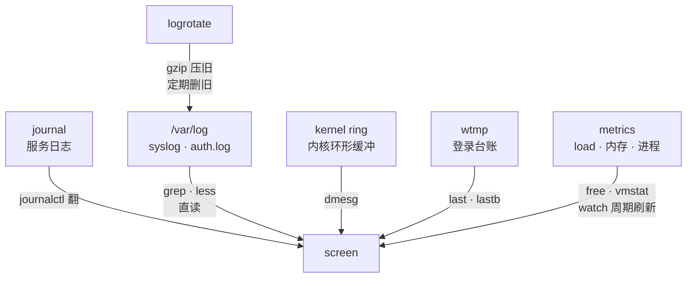
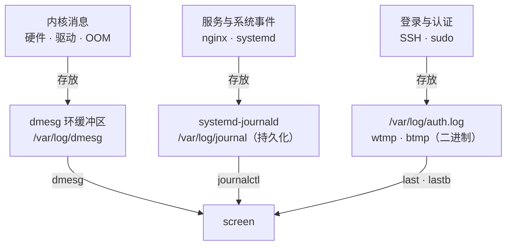

# 第13章 系统日志与监控

> [!TIP] Part 2 · administration（系统管理）
> 从「会用」到「归我管」：进程、软件、磁盘、账号、服务、时间、日志，七件事各有台账。

## 为什么要学日志与监控？

**本章手柄：observability（可观测性）**

系统的过去在日志里、现在在计数器里——journalctl/dmesg 翻历史，free/vmstat 看当下，合起来才叫看得见。本章管读懂系统状态——日志去哪翻（journalctl/dmesg/last），负载与内存怎么看（uptime/free/vmstat）（13.2 假定你已会 11.3 的 journalctl 基础用法，想不起来先回看）。

**图 13-1｜本章观测模型**（节点为实体——过去：journal、/var/log、内核环形缓冲、wtmp 登录台账，现在：metrics 计数器，维护者 logrotate，目的地 screen；边为工具操作，实线 = 翻过去、看现在与轮转维护——journalctl/grep/dmesg/last 各管一类日志，free/vmstat 看当下）：



<p class="figure-note">系统的过去在日志里、现在在计数器里——合起来才叫看得见</p>

> [!WARNING] 先猜再读
> 动手前先猜一猜，答案都在本章里：
>
> 1. `free -h` 显示 free 只剩 2.0Gi，available 却有 7.0Gi——内存到底够不够用？（答案见 13.8）
> 2. 重启之后，`journalctl` 还能查到上一次开机的日志吗？（答案见 13.2）
> 3. 4 核机器的 load average 持续 8.00，算"有点忙"还是已经过载？（答案见 13.7）

如图，主线自上而下先解决"日志在哪、怎么读"，再转到"资源指标怎么看"，最后落成一套能定时跑的监控方案；右侧两个分支分别给日志"保命"（轮转防止撑爆磁盘）、给指标"加刷新"（watch 把一次性命令变成持续观察）。下面先从日志的存放地 /var/log 目录说起：

## 13.1 /var/log 目录结构

| 日志文件 | 内容 | 用途 |
| ---------- | ------ | ------ |
| `/var/log/syslog` | 系统综合日志 | 大多数系统事件 |
| `/var/log/auth.log` | 认证日志 | SSH 登录、sudo 操作 |
| `/var/log/kern.log` | 内核日志 | 硬件错误、驱动问题 |
| `/var/log/dmesg` | 启动时的内核消息 | 硬件检测信息 |
| `/var/log/apt/` | apt 操作日志 | 包安装/卸载历史 |
| `/var/log/nginx/` | Nginx 日志 | Web 服务器日志 |
| `/var/log/wtmp` | 登录记录（二进制） | `last` 命令读取 |
| `/var/log/btmp` | 失败登录（二进制） | `lastb` 命令读取 |

```bash
# 查看系统日志
sudo tail -50 /var/log/syslog

# 查看认证日志（谁在尝试 SSH 登录？）
sudo tail -50 /var/log/auth.log

# 查看 apt 安装历史
cat /var/log/apt/history.log | head -30

# 实时监控
sudo tail -f /var/log/syslog

# 搜索关键词
sudo grep "error" /var/log/syslog | tail -20
sudo grep "failed" /var/log/auth.log | tail -20
```

先看一张全局地图——本章的命令各自守着哪条日志链路：

**图 13-2｜系统日志的流转与查看入口**（三列分别是内核、服务、登录日志：每列自上而下为 来源 → 存放位置，查看命令在边上，结果都汇到 screen）：



<p class="figure-note">排障先问「哪一类事件」——内核、服务、登录各有各的门</p>

## 13.2 journalctl 深度使用

**命令格式**：`journalctl [OPTIONS...] [MATCHES...]`

### 高级过滤

```bash
# 组合多个过滤条件
journalctl -u nginx _PID=1234 --since today -p err

# 按可执行文件名过滤
journalctl /usr/sbin/nginx

# 按 systemd unit 过滤
journalctl _SYSTEMD_UNIT=nginx.service

# 按用户/主机名过滤
journalctl _UID=1000
journalctl _HOSTNAME=web01

# 反向查看
journalctl -r
```

### 导出与分析

```bash
# JSON 格式导出
journalctl -u nginx --since today -o json > nginx-logs.json

# 统计错误数量
journalctl -u nginx -p err --since today --no-pager | wc -l

# 查看日志占用的磁盘空间
journalctl --disk-usage

# 设置持久化存储
sudo mkdir -p /var/log/journal
sudo systemd-tmpfiles --create --prefix /var/log/journal
sudo systemctl restart systemd-journald

# journald 配置（/etc/systemd/journald.conf）
# SystemMaxUse=500M         # 最大占用磁盘空间
# SystemKeepFree=1G         # 至少保留的可用空间
# MaxRetentionSec=1month    # 日志保留时间
# Storage=persistent        # 持久化存储
```

## 13.3 dmesg——内核消息

**命令格式**：`dmesg [OPTIONS]`

```bash
# 以人类可读时间戳显示
dmesg -T

# 按级别过滤
dmesg --level=err          # 只看错误
dmesg --level=warn         # 只看警告
dmesg --level=err,warn     # 看错误和警告

# 实时监控新的内核消息
dmesg -w

# 典型排障场景
dmesg -T | grep -i usb              # USB 设备检测
dmesg -T | grep -i "I/O error"      # 磁盘 I/O 错误（可能有坏道）
dmesg -T | grep -i "out of memory"  # OOM Killer 触发
dmesg -T | grep -i "killed process" # 被 OOM 杀死的进程
```

## 13.4 last/lastb——登录历史

**命令格式**：`last [OPTIONS] [USERNAME]`、`lastb [OPTIONS] [USERNAME]`

```bash
# 查看登录历史
last
# 输出示例：
# alice  pts/0  192.168.1.100  Mon Jan  1 10:00   still logged in
# bob    pts/1  10.0.0.5       Mon Jan  1 09:30 - 10:15  (00:45)

# 查看最近 10 条
last -10

# 查看失败的登录尝试（需要 root）
sudo lastb
# 大量来自不同 IP 的失败登录 = 有人在暴力破解你的 SSH！

# 查看特定用户
last alice

# 查看某个时间段
last --since "2024-01-01" --until "2024-01-31"

# 查看系统重启历史
last reboot

# 完整格式（包含秒和完整日期）
last -F
```

两者的分工：`last` 读 `/var/log/wtmp`，记录成功的登录；`lastb` 读 `/var/log/btmp`，记录失败的登录（b = bad，如密码爆破尝试）——btmp 只对 root 开放，查它要加 `sudo`。两个文件都是二进制，不能直接 cat（见 13.1 的 /var/log 清单）。

## 13.5 logrotate——日志轮转

日志文件会不断增长，如果不加以控制，最终会撑爆磁盘。`logrotate` 自动帮你"轮转"日志（轮转会改名换文件，`tail -f` 会跟丢、要换 `-F`——用法见[第 4 章 4.3 节 · head 和 tail](./ch04.md)）。

**命令格式**：`logrotate [OPTIONS] CONFIG_FILE...`

```bash
# 查看配置
cat /etc/logrotate.conf
ls /etc/logrotate.d/
```

### 编写自定义 logrotate 配置

```bash
sudo tee /etc/logrotate.d/myapp <<'EOF'
/var/log/myapp/*.log {
    daily              # 每天轮转一次
    missingok          # 文件不存在不报错
    rotate 30          # 保留 30 份
    compress           # 压缩旧日志（gzip）
    delaycompress      # 延迟一天压缩
    notifempty         # 空文件不轮转
    create 0640 myapp myapp  # 新文件权限和属主
    sharedscripts      # 所有日志轮转后只执行一次脚本
    postrotate
        systemctl reload myapp > /dev/null 2>&1 || true
    endscript
}
EOF

# 测试配置（不真正执行）
sudo logrotate -d /etc/logrotate.d/myapp

# 强制执行一次
sudo logrotate -f /etc/logrotate.d/myapp

# 查看轮转状态
cat /var/lib/logrotate/status
```

### logrotate 常用选项

| 选项 | 含义 |
| ------ | ------ |
| `daily` / `weekly` / `monthly` | 轮转频率 |
| `rotate N` | 保留 N 份旧日志 |
| `compress` | 用 gzip 压缩旧日志 |
| `delaycompress` | 延迟一轮再压缩 |
| `missingok` | 文件不存在不报错 |
| `notifempty` | 空文件不轮转 |
| `create MODE OWNER GROUP` | 创建新文件的权限 |
| `postrotate ... endscript` | 轮转后执行的脚本 |
| `size N` | 文件超过 N 大小才轮转 |
| `maxage N` | 删除超过 N 天的旧日志 |

## 13.6 watch——周期性执行命令

`watch` 周期性地执行一个命令并全屏显示结果，非常适合实时监控。

**命令格式**：`watch [OPTIONS] COMMAND`

```bash
# 每 2 秒刷新（默认间隔）
watch df -h

# 每 1 秒刷新
watch -n 1 free -h

# 高亮变化的部分
watch -d df -h

# 高亮持续显示（不仅闪烁一下）
watch -d=cumulative df -h

# 不显示标题栏
watch -t "date && df -h"

# 监控 nginx 连接数
watch -n 2 "ss -tn | grep :80 | wc -l"

# 监控内存和磁盘
watch -n 2 "free -h && echo '---' && df -h /"

# 监控特定服务状态
watch -n 10 "systemctl is-active nginx mysql"

# 按 Ctrl+C 退出 watch
```

## 13.7 uptime 与 load average

**命令格式**：`uptime [OPTIONS]`

```bash
# 查看系统运行时间和负载
uptime
# 14:30:00 up 30 days,  2:15,  1 user,  load average: 0.50, 0.65, 0.70

# 只看运行时间
uptime -p

# 查看启动时间
uptime -s

# 查看 CPU 核心数
nproc

# 只提取 load average
uptime | awk -F'load average:' '{print $2}'
```

### 理解 Load Average

Load Average 是 1 分钟、5 分钟、15 分钟的系统平均负载（top 的上半区也显示它，见[第 7 章 7.3 节 · top 实时监控](./ch07.md)）。

```bash
# 假设你的服务器有 4 个 CPU 核心：
# Load Average: 1.00  → 25% 的 CPU 被使用（很轻松）
# Load Average: 4.00  → 100% 的 CPU 被使用（满负荷）
# Load Average: 8.00  → 200%（任务在排队等待！系统过载了）

# 经验法则：
# Load < 核心数 * 0.7  → 健康
# Load = 核心数        → 满负荷，需要关注
# Load > 核心数        → 过载，需要排查

# 持续监控
watch -n 1 "uptime && echo '' && nproc"
```

把 load average 和 CPU 核心数画在一起，三种状态一目了然：

**图 13-3｜Load Average 与 CPU 核心数的关系**（以 4 核为例：实心格是正在执行的任务，虚线格是排队等 CPU 的任务）：

<svg viewBox="0 0 380 314" xmlns="http://www.w3.org/2000/svg" font-family="system-ui, sans-serif">
  <defs>
    <marker id="ch13fig3-arr" markerWidth="8" markerHeight="8" refX="7" refY="4" orient="auto">
      <path d="M0 0L8 4L0 8Z" fill="#666"/>
    </marker>
  </defs>
  <rect x="0" y="0" width="380" height="314" fill="#ffffff"/>
  <text x="110" y="22" font-size="12" fill="#999">4 核 CPU（nproc = 4）</text>

  <text x="16" y="53" font-size="13" font-weight="bold" fill="#333">load 1.00</text>
  <text x="16" y="72" font-size="12" fill="#555">约 25% CPU</text>
  <rect x="110" y="34" width="26" height="28" fill="#4a90d9"/>
  <rect x="141" y="34" width="26" height="28" fill="#fafafa" stroke="#999"/>
  <rect x="172" y="34" width="26" height="28" fill="#fafafa" stroke="#999"/>
  <rect x="203" y="34" width="26" height="28" fill="#fafafa" stroke="#999"/>
  <text x="110" y="90" font-size="13" fill="#333">很轻松：还有 3 核空闲</text>

  <text x="16" y="135" font-size="13" font-weight="bold" fill="#333">load 4.00</text>
  <text x="16" y="154" font-size="12" fill="#555">约 100% CPU</text>
  <rect x="110" y="116" width="26" height="28" fill="#4a90d9"/>
  <rect x="141" y="116" width="26" height="28" fill="#4a90d9"/>
  <rect x="172" y="116" width="26" height="28" fill="#4a90d9"/>
  <rect x="203" y="116" width="26" height="28" fill="#4a90d9"/>
  <text x="110" y="172" font-size="13" fill="#333">满负荷：核心刚好用满</text>

  <text x="16" y="217" font-size="13" font-weight="bold" fill="#333">load 8.00</text>
  <text x="16" y="236" font-size="12" fill="#555">约 200%，过载</text>
  <rect x="110" y="198" width="26" height="28" fill="#4a90d9"/>
  <rect x="141" y="198" width="26" height="28" fill="#4a90d9"/>
  <rect x="172" y="198" width="26" height="28" fill="#4a90d9"/>
  <rect x="203" y="198" width="26" height="28" fill="#4a90d9"/>
  <rect x="244" y="198" width="26" height="28" fill="none" stroke="#999" stroke-dasharray="4 3"/>
  <rect x="275" y="198" width="26" height="28" fill="none" stroke="#999" stroke-dasharray="4 3"/>
  <rect x="306" y="198" width="26" height="28" fill="none" stroke="#999" stroke-dasharray="4 3"/>
  <rect x="337" y="198" width="26" height="28" fill="none" stroke="#999" stroke-dasharray="4 3"/>
  <line x1="242" y1="212" x2="232" y2="212" stroke="#666" marker-end="url(#ch13fig3-arr)"/>
  <text x="110" y="254" font-size="13" fill="#333">过载：任务开始排队</text>

  <text x="190" y="284" text-anchor="middle" font-size="12" fill="#666">经验法则：load &lt; 核心数×0.7 → 健康；</text>
  <text x="190" y="302" text-anchor="middle" font-size="12" fill="#666">= 核心数 → 需要关注；&gt; 核心数 → 该排查了</text>
</svg>

## 13.8 free——内存使用

**命令格式**：`free [OPTIONS]`

```bash
# 以人类可读格式查看
free -h
#               total        used        free      shared  buff/cache   available
# Mem:           16Gi       8.0Gi       2.0Gi       512Mi       6.0Gi       7.0Gi
# Swap:         2.0Gi          0B       2.0Gi

# 关键理解：
# buff/cache = Linux 用"空闲"内存做的缓存（用来加速磁盘读写）
# available  = 应用程序实际可用的内存（看这个！不是看 free！）

# 持续监控
watch -n 2 free -h

# 以 MB 为单位
free -m

# 显示合计行
free -h -t

# 以秒为单位持续输出
free -s 2

# 一行式快速查看内存百分比
free | awk '/Mem:/ {printf "Memory: %.1f%% used (%.1f GB / %.1f GB)\n", $3/$2*100, $3/1048576, $2/1048576}'
```

## 13.9 vmstat、iostat、sar——系统性能监控

本节认识 3 个系统性能监控命令。它们回答三类不同的问题，先按问题分组列出通用格式（记号约定见[第 1 章 1.6 节](./ch01.md)），再用一张表区分彼此：

**整机实时快照**——现在这台机器忙不忙、内存够不够：

- `vmstat [OPTIONS] [DELAY [COUNT]]` —— 虚拟内存统计

**磁盘 I/O 专项**——磁盘到底是不是瓶颈：

- `iostat [OPTIONS] [DEVICE] [INTERVAL [COUNT]]` —— I/O 统计

**历史数据回溯**——昨晚那次卡顿，事后还原现场：

- `sar [OPTIONS] [INTERVAL [COUNT]]` —— 系统活动报告

| 监控场景 | 用哪个 | 区分点 |
| -------- | ------ | ------ |
| 现在整机状态如何 | `vmstat` | 一屏看全 CPU、内存、swap、I/O：`vmstat 1` 持续刷新，si/so 不为 0 说明内存不足 |
| 磁盘是不是瓶颈 | `iostat` | 设备级 I/O 专项：`%util`（利用率）与 `await`（等待时间）直接回答某块盘慢不慢，比 vmstat 的汇总 bi/bo 更进一步 |
| 事后回溯过去某时段 | `sar` | 三者中唯一能查历史：sysstat 后台定时采样落盘，vmstat/iostat 只能看当下 |

### 13.9.1 vmstat（虚拟内存统计）

```bash
# 安装
sudo apt install sysstat

# 基本用法
vmstat
# procs:  r(运行队列) b(阻塞队列)
# memory: swpd(交换空间使用) free(空闲) buff(缓冲) cache(缓存)
# swap:   si(换入) so(换出)  ← 如果不为 0，说明内存不足！
# io:     bi(读入块) bo(写出块)
# system: in(中断) cs(上下文切换)
# cpu:    us(用户) sy(系统) id(空闲) wa(等待IO) st(被偷走)

# 每秒刷新一次，共 10 次
vmstat 1 10

# 查看详细信息
vmstat -s

# 查看磁盘统计
vmstat -d
```

### 13.9.2 iostat（I/O 统计）

```bash
# 安装
sudo apt install sysstat

# 以扩展格式显示，每秒刷新
iostat -xz 1
# 关键列：
# %util = 设备利用率（100% = 磁盘满了）
# await = I/O 请求平均等待时间（ms，越高说明磁盘越慢）
# r/s, w/s = 每秒读/写操作数
# rMB/s, wMB/s = 每秒读/写吞吐量

# 只显示设备统计
iostat -d -x 1

# 查看特定设备
iostat -x sda 1
```

### 13.9.3 sar（系统活动报告）

`sar` 是 sysstat 包中的"瑞士军刀"，可以记录和查看历史系统性能数据。

```bash
# 安装并启用
sudo apt install sysstat
sudo sed -i 's/ENABLED="false"/ENABLED="true"/' /etc/default/sysstat
sudo systemctl restart sysstat

# 查看今天的 CPU 使用率
sar -u

# 查看今天的内存使用
sar -r

# 查看磁盘 I/O
sar -d

# 查看网络流量
sar -n DEV

# 查看历史数据（指定日期）
sar -u -f /var/log/sysstat/sa01

# 实时查看（每 2 秒，共 5 次）
sar -u 2 5

# 查看进程创建和上下文切换
sar -w

# 查看 swap 使用
sar -S
```

## 13.10 实战：搭建简单的服务器监控方案

### 场景：你需要一台服务器的基本健康监控

```bash
# 第一步：创建监控脚本
sudo mkdir -p /opt/monitoring
sudo tee /opt/monitoring/health-check.sh <<'SCRIPT'
#!/bin/bash
REPORT="/tmp/health-report-$(date +%Y%m%d).txt"
ALERT_THRESHOLD_MEM=85

echo "==============================" > "$REPORT"
echo "  Server Health Report" >> "$REPORT"
echo "  $(date '+%Y-%m-%d %H:%M:%S')" >> "$REPORT"
echo "==============================" >> "$REPORT"

echo "--- CPU Load ---" >> "$REPORT"
uptime >> "$REPORT"

echo "--- Memory Usage ---" >> "$REPORT"
free -h >> "$REPORT"
MEM_PERCENT=$(free | awk '/Mem:/ {printf "%.0f", $3/$2*100}')

echo "--- Disk Usage ---" >> "$REPORT"
df -h -x tmpfs -x devtmpfs >> "$REPORT"

echo "--- Top 5 CPU Consumers ---" >> "$REPORT"
ps aux --sort=-%cpu | head -6 >> "$REPORT"

echo "--- Top 5 Memory Consumers ---" >> "$REPORT"
ps aux --sort=-%mem | head -6 >> "$REPORT"

echo "--- Failed Services ---" >> "$REPORT"
systemctl list-units --failed >> "$REPORT"

echo "--- OOM Events ---" >> "$REPORT"
dmesg -T 2>/dev/null | grep -i "out of memory" | tail -5 >> "$REPORT"

# 告警检查
ALERTS=""
CPU_CORES=$(nproc)
LOAD_INT=$(uptime | awk -F'load average:' '{print int($2)}')
if [ "$LOAD_INT" -gt "$CPU_CORES" ]; then
    ALERTS="${ALERTS}[ALERT] CPU load exceeds core count\n"
fi
if [ "$MEM_PERCENT" -gt "$ALERT_THRESHOLD_MEM" ]; then
    ALERTS="${ALERTS}[ALERT] Memory ${MEM_PERCENT}% exceeds threshold\n"
fi
FAILED=$(systemctl list-units --failed --no-legend 2>/dev/null | wc -l)
if [ "$FAILED" -gt 0 ]; then
    ALERTS="${ALERTS}[ALERT] $FAILED failed service(s)\n"
fi

if [ -n "$ALERTS" ]; then
    echo "*** ALERTS ***" >> "$REPORT"
    echo -e "$ALERTS" >> "$REPORT"
fi
cat "$REPORT"
SCRIPT

sudo chmod +x /opt/monitoring/health-check.sh

# 第二步：测试运行
/opt/monitoring/health-check.sh

# 第三步：设置定时执行（每 6 小时一次）
(sudo crontab -l 2>/dev/null; echo "0 */6 * * * /opt/monitoring/health-check.sh") | sudo crontab -

# 第四步：设置 sysstat 持续收集性能数据
sudo apt install -y sysstat
sudo sed -i 's/ENABLED="false"/ENABLED="true"/' /etc/default/sysstat
sudo systemctl enable --now sysstat

# 第五步：设置 logrotate 管理监控日志
sudo tee /etc/logrotate.d/monitoring <<'EOF'
/tmp/health-report-*.txt {
    weekly
    rotate 4
    compress
    missingok
    notifempty
}
EOF
```

### 日常监控快捷命令

```bash
# 快速系统概览
echo "=== Uptime ===" && uptime
echo "=== Memory ===" && free -h
echo "=== Disk ===" && df -h /
echo "=== Load ===" && cat /proc/loadavg
echo "=== Top CPU ===" && ps aux --sort=-%cpu | head -3

# 一行式完整检查
uptime && echo "---" && free -h && echo "---" && df -h / && echo "---" && systemctl list-units --failed

# 实时监控（多窗口终端中使用）
# 窗口1：watch -n 2 free -h
# 窗口2：watch -n 2 "df -h /"
# 窗口3：journalctl -f
# 窗口4：htop
```

## 本章小结

**① 核心句**：系统的过去在日志里、现在在计数器里——journalctl/dmesg 翻历史，free/vmstat 看当下，合起来才叫看得见。

**② 边界句**：词管「看得见」；性能根因归 24。

**③ 可推导条目**：
- journal 默认易失要持久化。
- free 看 available 不是 free。
- logrotate 后 tail -f 失效要 -F。

> **词链互测**：合上书说出[第 9 章 mount 的 3 个坑](./ch09.md#本章小结)；再自查：df/du 对不上的两个来源，哪个能在本章的「看得见」里抓到。
>
> 学到[第 24 章 bottleneck](./ch24.md#本章小结)回来——说出 bottleneck 的 3 个坑；看看「看得见」到了排障章怎么用。

**下一章预告**：Part 2 的七个词都拿到了——去 [Part 2 自测](./part2-test.md) 闭卷验收，再进 Part 3。

---

*Part 2 完。接下来进入 Part 3：网络与安全篇。*

---
