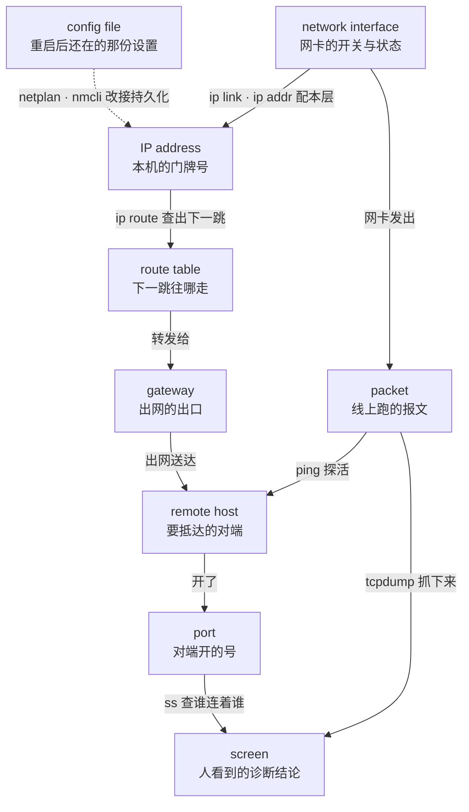

# 第14章：网络基础命令

> [!TIP] Part 3 · network（网络）
> 连得上 → 进得来 → 拦得住 → 开得了门 → 用得上 → 找得到，六关全过才算一台对外的机器。

> 欢迎来到 Linux 命令行世界的"网络层"。如果说前面两篇让你驯服了本地系统的文件、进程和用户，那么这一篇将带你征服服务器之间那片看不见但无处不在的"网络海洋"。从最基础的网络诊断命令，到 SSH 远程访问，再到防火墙安全、Web 服务搭建、API 调用和 DNS 解析——六章之后，你就是团队里那个"什么网络问题都能查"的人。

## 为什么要学网络命令？

网络是一条分层链路——网卡→IP→网关→外网→DNS→端口→路由→抓包，故障只能从底往上逐层排除，下层不通上层全废。本章管网络诊断——从 IP、连通性（ping）、路由（traceroute）、端口（ss）一路排到抓包（tcpdump）。

**图 14-1｜本章网络分层模型**（节点为实体——本机网卡 network interface、门牌号 IP address、路由表 route table、出网的 gateway、线上跑的报文 packet、对端主机 remote host、对端开的 port、重启后还在的那份设置 config file、诊断结论 screen；边为操作，实线 = 分层链路自下而上推进与逐层取证，虚线 = 改接——配置文件决定重启后还在不在）：



<p class="figure-note">故障只能从底往上逐层排除——下层不通，上层全废</p>

> [!WARNING] 先猜再读
> 动手前先猜一猜，答案都在本章里：
>
> 1. 用 `ip addr add` 给网卡加的 IP，重启之后还在吗？（答案见 14.6）
> 2. `ping` 不通一台服务器，就能断定它宕机了吗？（答案见 14.13）
> 3. `localhost` 和 `127.0.0.1` 是完全等价的写法吗？（答案见 14.13）

这张图的主线是自下而上的分层链路：网卡 → IP → 路由 → 网关 → 对端。先用一点前置知识补齐网络分层与关键概念，再从 14.1 的接口与地址讲起，一层一层往上走：

### 前置知识：网络概念速查

在进入具体命令之前，快速回顾一下你需要知道的网络概念。如果你已经熟悉这些，直接跳到第14章。

**TCP/IP 四层模型（简化版 OSI）：**

```
┌─────────────────────────────────────────────┐
│  应用层（HTTP/SSH/DNS/SMTP）                 │  ← 你用的具体协议
│  "你说的语言"                               │
├─────────────────────────────────────────────┤
│  传输层（TCP/UDP）                          │  ← 端口号、连接管理
│  "快递的运输方式"                            │  TCP = 挂号信（可靠）
│                                             │  UDP = 明信片（快但不保证）
├─────────────────────────────────────────────┤
│  网络层（IP）                               │  ← IP 地址、路由
│  "快递的地址系统"                            │
├─────────────────────────────────────────────┤
│  链路层（以太网/WiFi）                      │  ← MAC 地址、网卡
│  "快递员和交通工具"                          │
└─────────────────────────────────────────────┘
```

先看一张全局对照表——本章后面的命令各自工作在哪一层：

| 层 | 协议与职责 | 本章的排查命令 |
| --- | --- | --- |
| 应用层 | HTTP、SSH、DNS、SMTP——你用的具体协议 | `curl`、`dig`、`hostname` |
| 传输层 | TCP、UDP——端口号与连接管理 | `ss`、`netstat` |
| 网络层 | IP——IP 地址与路由 | `ping`、`traceroute`、`mtr`、`ip addr`、`ip route` |
| 链路层 | 以太网、WiFi——MAC 地址与网卡 | `ip link`、`ip neigh`、`tcpdump` |

排障自底向上：先网卡（链路层），再 IP 与路由（网络层），再端口（传输层），最后应用本身。

**你需要记住的关键概念：**

| 概念 | 解释 | 比喻 |
| ------ | ------ | ------ |
| IP 地址 | 设备在网络中的"门牌号" | 收件地址 |
| 端口 | 一个 IP 上的不同服务 | 大楼里的不同房间号 |
| MAC 地址 | 网卡的物理地址（出厂固定） | 身份证号 |
| DNS | 域名→IP 的翻译系统 | 电话簿 |
| 子网掩码 | 划分网络和主机部分 | 邮编（前几位=区域，后几位=门牌） |
| 网关 | 通往其他网络的"出口" | 小区大门 |
| NAT | 内网 IP 共享一个公网 IP | 一栋楼共用一个收件地址 |
| TCP 三次握手 | 建立连接的过程 | 打电话："喂？""听到了""好的开始说" |
| TLS/SSL | 加密通信层 | 信件用密码写成密文 |

**常用端口速查表：**

```
22    → SSH（远程登录）
80    → HTTP（网页）
443   → HTTPS（加密网页）
53    → DNS（域名解析）
25    → SMTP（发邮件）
3306  → MySQL
5432  → PostgreSQL
6379  → Redis
8080  → 常见的 Web 应用端口
```

**子网掩码速查：**

```
/8   → 255.0.0.0        → 16,777,216 个 IP（A类，大组织）
/16  → 255.255.0.0      → 65,536 个 IP（B类，中型组织）
/24  → 255.255.255.0    → 256 个 IP（C类，小型网络，最常见）
/32  → 255.255.255.255  → 1 个 IP（精确到单个主机）
```

---

## 14.1 网络接口与 IP 地址

### 14.1.1 ip 命令：现代 Linux 的网络瑞士军刀

`ip` 命令来自 `iproute2` 工具包，已经基本替代了老一代的 `ifconfig`。它就像一把瑞士军刀——不同的子命令就是不同的刀片。

**命令格式**：`ip [OPTIONS] OBJECT COMMAND`（`OBJECT` 是操作对象，如 `addr`、`link`、`route`；`COMMAND` 是动作，如 `show`、`set`、`add`）

```bash
# 查看所有网络接口的 IP 地址（最常用的起手式）
ip addr
# 输出示例：
# 1: lo: <LOOPBACK,UP,LOWER_UP> mtu 65536 qdisc noqueue state UNKNOWN group default qlen 1000
#     link/loopback 00:00:00:00:00:00 brd 00:00:00:00:00:00
#     inet 127.0.0.1/8 scope host lo
#        valid_lft forever preferred_lft forever
#     inet6 ::1/128 scope host
#        valid_lft forever preferred_lft forever
# 2: eth0: <BROADCAST,MULTICAST,UP,LOWER_UP> mtu 1500 qdisc fq_codel state UP group default qlen 1000
#     link/ether 52:54:00:ab:cd:ef brd ff:ff:ff:ff:ff:ff
#     inet 192.168.1.100/24 brd 192.168.1.255 scope global dynamic eth0
#        valid_lft 86399sec preferred_lft 86399sec
#     inet6 fe80::5054:ff:feab:cdef/64 scope link
#        valid_lft forever preferred_lft forever

# 输出字段详解：
# lo        → loopback 回环接口，永远 127.0.0.1，你的机器"自己和自己说话"
# eth0      → 第一块以太网卡（云服务器上可能是 ens3、enp0s3 等）
# UP        → 接口已启用（DOWN 就是断网了）
# mtu 1500  → 最大传输单元，以太网标准值
# /24       → 子网掩码长度，24 = 255.255.255.0
# brd       → 广播地址
# dynamic   → IP 是 DHCP 动态分配的

# 只显示 IPv4 地址（不看 IPv6）
ip -4 addr

# 只看某个特定网卡
ip addr show eth0

# 精简输出，只看 IP 地址行（强烈推荐！）
ip -br addr
# 输出示例：
# lo               UNKNOWN        127.0.0.1/8 ::1/128
# eth0             UP             192.168.1.100/24 fe80::5054:ff:feab:cdef/64

# 用 -j 获取 JSON 格式（脚本解析利器！）
ip -j addr | jq '.[].addr_info[].local'
# 输出：
# "127.0.0.1"
# "192.168.1.100"
```

### 14.1.2 ip link：管理网络接口的"开关"

```bash
# 查看网络接口的 UP/DOWN 状态和 MAC 地址
ip link show
# 输出示例：
# 1: lo: <LOOPBACK,UP,LOWER_UP> mtu 65536 qdisc noqueue state UNKNOWN
#     link/loopback 00:00:00:00:00:00 brd 00:00:00:00:00:00
# 2: eth0: <BROADCAST,MULTICAST,UP,LOWER_UP> mtu 1500 qdisc fq_codel state UP
#     link/ether 52:54:00:ab:cd:ef brd ff:ff:ff:ff:ff:ff

# 精简查看接口状态
ip -br link
# lo               UNKNOWN        00:00:00:00:00:00 <LOOPBACK,UP,LOWER_UP>
# eth0             UP             52:54:00:ab:cd:ef <BROADCAST,MULTICAST,UP,LOWER_UP>

# 启用/禁用网卡（需要 root）
sudo ip link set eth0 up      # 启用网卡（插上网线！）
sudo ip link set eth0 down    # 禁用网卡（拔网线！小心别把自己锁在外面）

# 修改 MTU（网络性能调优时会用到）
sudo ip link set eth0 mtu 9000   # 设置巨型帧（Jumbo Frame），数据中心内网常用

# 查看网卡统计数据（收发了多少包、有没有丢包/错误）
ip -s link show eth0
#     RX:  bytes packets errors dropped  missed   mcast
#          1234567    8901      0       0       0       0
#     TX:  bytes packets errors dropped carrier collsns
#          7654321    4567      0       0       0       0
# 重点关注 errors 和 dropped，不为零就要排查硬件或驱动问题
```

### 14.1.3 ip route：查看和配置路由表

```bash
# 查看路由表（数据包"出门"走哪条路？）
ip route
# 输出示例：
# default via 192.168.1.1 dev eth0 proto dhcp metric 100
# 192.168.1.0/24 dev eth0 proto kernel scope link src 192.168.1.100
# 10.0.0.0/8 via 192.168.1.254 dev eth0

# 输出解读：
# default via 192.168.1.1  → 默认网关，所有"不知道去哪"的包都发给 192.168.1.1
# 192.168.1.0/24           → 本地子网，同网段的包直接发，不经过网关
# proto dhcp               → 路由来源：dhcp 自动获取
# proto kernel             → 路由来源：内核自动生成

# 查看到某个 IP 走哪条路由（非常实用！）
ip route get 8.8.8.8
# 8.8.8.8 via 192.168.1.1 dev eth0 src 192.168.1.100 uid 1000
#     cache
# 解读：去 8.8.8.8 → 走 192.168.1.1 网关 → 从 eth0 出去 → 源 IP 是 192.168.1.100

ip route get 192.168.1.50
# local 192.168.1.50 dev lo src 192.168.1.100 uid 1000
#     cache <local>
# 解读：去 192.168.1.50 是本地地址（在本机）

# 手动添加/删除静态路由（需要 root）
sudo ip route add 10.0.0.0/8 via 192.168.1.254 dev eth0
# 告诉系统：去 10.x.x.x 的包走 192.168.1.254 这个"内网网关"
sudo ip route del 10.0.0.0/8    # 删除这条路由

# 添加默认路由（设置默认网关）
sudo ip route add default via 192.168.1.1 dev eth0

# 注意：ip route 的修改重启后会丢失！持久化需要写入配置文件（后面会讲）
```

## 14.2 主机名管理

**命令格式**：`hostnamectl [OPTIONS] [COMMAND]`

```bash
# 查看当前主机名
hostname
# 输出示例：web-prod-01

# 查看完整域名（FQDN）
hostname -f
# 输出示例：web-prod-01.example.com

# 查看 IP 地址（hostname 版本，不过建议用 ip addr）
hostname -I
# 输出示例：192.168.1.100

# 现代方式：hostnamectl（systemd 系统专用，功能更全）
hostnamectl
# 输出示例：
#    Static hostname: web-prod-01
#  Pretty hostname: Web Production Server 01
#          Icon name: computer-server
#            Chassis: server
#         Machine ID: abcdef1234567890
#            Boot ID: 12345678-abcd-efgh-ijkl-1234567890ab
#   Operating System: Ubuntu 22.04.3 LTS
#            Kernel: Linux 5.15.0-89-generic
#      Architecture: x86-64
#   Hardware Vendor: QEMU
#    Hardware Model: Standard PC (i440FX + PIIX, 1996)

# 修改主机名（立即生效 + 持久化）
sudo hostnamectl set-hostname web-prod-02

# 设置"漂亮"的主机名（可以有空格和特殊字符，仅用于显示）
sudo hostnamectl set-hostname --pretty "Web Server 02"

# 别忘了同步更新 /etc/hosts 文件！
# 把旧主机名替换成新的
sudo sed -i 's/web-prod-01/web-prod-02/g' /etc/hosts
```

两者的分工：`hostname` 以查看为主、旧系统也兼容；`hostnamectl` 查看、修改、持久化一手包办（`set-hostname` 立即生效且重启不丢），是 systemd 系统的现代方式。

## 14.3 连通性测试：ping

`ping` 就像声呐——你发一个包出去，对方回一个包回来，你就知道"路是通的"。

**命令格式**：`ping [OPTIONS] DESTINATION`

```bash
# 最基本的 ping（-c 指定次数，不加 -c 会一直 ping 下去）
ping -c 4 google.com
# 输出示例：
# PING google.com (142.250.80.46) 56(84) bytes of data.
# 64 bytes from lga25s77-in-x0e.1e100.net (142.250.80.46): icmp_seq=1 ttl=115 time=12.3 ms
# 64 bytes from lga25s77-in-x0e.1e100.net (142.250.80.46): icmp_seq=2 ttl=115 time=11.8 ms
# 64 bytes from lga25s77-in-x0e.1e100.net (142.250.80.46): icmp_seq=3 ttl=115 time=12.1 ms
# 64 bytes from lga25s77-in-x0e.1e100.net (142.250.80.46): icmp_seq=4 ttl=115 time=11.9 ms
#
# --- google.com ping statistics ---
# 4 packets transmitted, 4 received, 0% packet loss, time 3005ms
# rtt min/avg/max/mdev = 11.8/12.025/12.3/0.186 ms

# 输出字段详解：
# icmp_seq=1     → 第几个包（序号）
# ttl=115        → Time To Live，经过的路由器跳数（初始128-115=13跳）
# time=12.3 ms   → 往返时间（RTT），越小越好
# 0% packet loss → 丢包率（0% 最好，>1% 就要关注）
# rtt min/avg/max/mdev → 最小/平均/最大/抖动延迟

# 实用 ping 参数
ping -c 10 -i 0.2 8.8.8.8           # 快速 ping，每 0.2 秒一个包
ping -c 4 -s 1472 google.com         # 大包测试（1472+28=1500=MTU，测试 MTU）
ping -c 4 -t 5 10.0.0.1             # 设置 TTL 为 5（测试路由跳数）
ping -c 4 -W 2 slow-server.com       # 超时 2 秒（默认是 10 秒，慢服务器场景）
ping -c 4 -D google.com              # 显示时间戳（每一行前面加时间）
ping -c 20 -q google.com             # 安静模式，只看统计结果
ping -c 4 -I eth0 8.8.8.8           # 指定从 eth0 接口发出（多网卡环境）

# 用 ping 测试丢包率（网络质量的核心指标）
ping -c 100 -i 0.1 8.8.8.8 | tail -3
# --- 8.8.8.8 ping statistics ---
# 100 packets transmitted, 98 received, 2% packet loss, time 10123ms
# rtt min/avg/max/mdev = 10.2/12.5/25.8/2.345 ms
# 解读：2% 丢包 + 最大延迟 25.8ms → 网络有点不稳定

# 用 ping 测试 MTU（最大传输单元）
ping -c 4 -M do -s 1472 target.com   # -M do 禁止分片，-s 1472 = 1500-28
# 如果失败说明 MTU 不是 1500，逐步减小 -s 值找到最大可用值
ping -c 4 -M do -s 1400 target.com   # 试试 1400+28=1428

# 用 ping6 测试 IPv6 连通性
ping6 -c 4 ::1                       # ping IPv6 回环地址
ping6 -c 4 google.com                # ping Google 的 IPv6
```

## 14.4 路由追踪：traceroute 与 mtr

当你发现 ping 不通或者延迟很高时，你需要知道"问题出在哪一跳"。这就是路由追踪的用武之地。

**命令格式**：`traceroute [OPTIONS] HOST`、`mtr [OPTIONS] HOST`

```bash
# traceroute：追踪数据包经过的每一跳
traceroute google.com
# 输出示例：
# traceroute to google.com (142.250.80.46), 30 hops max, 60 byte packets
#  1  192.168.1.1 (192.168.1.1)  1.234 ms  1.100 ms  1.050 ms
#  2  10.0.0.1 (10.0.0.1)  5.678 ms  5.500 ms  5.400 ms
#  3  172.16.0.1 (172.16.0.1)  8.901 ms  8.800 ms  8.700 ms
#  4  * * *
#  5  142.250.80.46 (142.250.80.46)  12.345 ms  12.200 ms  12.100 ms

# 输出解读：
# 第 1 跳：192.168.1.1 → 你的路由器
# 第 2 跳：10.0.0.1 → ISP 的第一跳
# 第 4 跳：* * * → 该路由器不响应 ICMP（很正常，不是故障）
# 每一跳发 3 个包，看三个时间是否稳定

# traceroute 常用参数
traceroute -n google.com         # -n 不解析域名（更快！）
traceroute -w 2 google.com       # -w 等待超时 2 秒
traceroute -q 5 google.com       # -q 每跳发 5 个包（更准确）
traceroute -I google.com         # -I 用 ICMP 而非 UDP（穿透某些防火墙）
traceroute -T -p 80 google.com   # -T 用 TCP 80 端口（绕过 ICMP 屏蔽）

# mtr：traceroute + ping 的合体（强烈推荐！）
# mtr 是 traceroute 的"实时监控版"，同时显示每一跳的延迟和丢包率
mtr google.com
# 实时交互界面：
# Host                   Loss%   Snt   Last   Avg   Best   Wrst   StDev
# 1. 192.168.1.1          0.0%    10    1.2    1.3    1.0    1.8     0.2
# 2. 10.0.0.1             0.0%    10    5.6    5.8    5.2    6.5     0.3
# 3. 172.16.0.1           0.0%    10    8.9    9.1    8.5   10.2     0.5
# 4. ???                  0.0%    10    0.0    0.0    0.0    0.0     0.0
# 5. 142.250.80.46         0.0%    10   12.3   12.5   11.8   13.5     0.4

# 看 Loss% 列：如果某跳开始丢包，后面所有跳都丢 → 问题在那一跳
# 如果只有最后一跳丢 → 可能是目标限制 ICMP

# mtr 报告模式（非交互，适合脚本和分享）
mtr -r -c 20 -n google.com
# -r   → 报告模式（不进入交互界面）
# -c 20 → 发 20 个包
# -n   → 不解析域名

# 安装 mtr（默认可能没装）
sudo apt install mtr traceroute -y
```

两者的分工：`traceroute` 走一遍就退出，一次性定位路径与故障跳；`mtr` 实时刷新、持续观察每一跳的丢包率（Loss%）与延迟，排查间歇性丢包这类时好时坏的问题用 `mtr`。

## 14.5 端口与连接：ss 与 netstat

如果说 `ping` 测试的是"路通不通"，那 `ss` 看的就是"谁在打电话、跟谁打"。

**命令格式**：`ss [OPTIONS] [FILTER]`、`netstat [OPTIONS]`

```bash
# ss（socket statistics）：现代 Linux 查看连接的首选
# 替代了老旧的 netstat（更快、信息更全）

# 查看所有 TCP 连接
ss -t
# 输出示例：
# State      Recv-Q Send-Q  Local Address:Port   Peer Address:Port  Process
# ESTAB      0      0       192.168.1.100:45678  93.184.216.34:443
# ESTAB      0      0       192.168.1.100:22     10.0.0.5:54321
# TIME-WAIT  0      0       192.168.1.100:80     203.0.113.50:12345

# 状态解读：
# ESTAB     → 已建立连接（正在通话）
# LISTEN    → 监听中（等人打电话来）
# TIME-WAIT → 连接刚关闭，等待中（正常的，2分钟后自动消失）
# CLOSE-WAIT → 对方关了，我们还没关（可能有 bug！）
# SYN-SENT  → 正在发起连接（握手第一步）
# SYN-RECV  → 收到连接请求，等待确认（握手第二步）

# 最常用的 ss 组合（记住这几个就够日常使用了）
ss -tlnp        # 查看正在监听的 TCP 端口 + 进程名
# -t → TCP
# -l → 只显示 LISTEN
# -n → 显示数字（不解析服务名）
# -p → 显示进程信息

ss -ulnp        # 查看正在监听的 UDP 端口 + 进程名
ss -tunap       # 查看所有连接（TCP + UDP，所有状态）
ss -tlnp4       # 只看 IPv4 的监听端口
ss -tlnp6       # 只看 IPv6 的监听端口

# 查看某个端口的连接情况
ss -tlnp | grep :80
# LISTEN  0  511  0.0.0.0:80  0.0.0.0:*  users:(("nginx",pid=1234,fd=6))

# 查看连接到本机的所有远程 IP（排查异常连接）
ss -tn | awk '{print $5}' | cut -d: -f1 | sort | uniq -c | sort -rn
# 输出示例：
# 15 203.0.113.50     ← 这个 IP 有 15 个连接，正常吗？
# 3  10.0.0.5
# 1  93.184.216.34

# 统计各状态连接数（监控利器！）
ss -tn | awk '{print $1}' | sort | uniq -c | sort -rn
# 输出示例：
# 120 ESTAB
#  45 TIME-WAIT
#   3 SYN-RECV    ← SYN-RECV 太多可能遭受 SYN Flood 攻击！

# 老式 netstat（兼容旧系统，新系统建议用 ss）
sudo netstat -tlnp       # 等价于 ss -tlnp
sudo netstat -tunap      # 等价于 ss -tunap
```

两者的关系是替代而非分工：`ss` 直接从内核取 socket 数据，更快、信息更全，是现代 Linux 的首选；`netstat` 属于老旧的 net-tools 套件，新发行版默认不再预装，只在旧系统上兜底。参数基本对得上——`netstat -tlnp` ≈ `ss -tlnp`，`netstat -tunap` ≈ `ss -tunap`，会一个就会另一个。

## 14.6 网络配置管理

本节认识 3 个网络配置工具。它们从三个视角管同一件事——把网络配置持久化下来（对比 14.1 的 `ip` 只能临时改）：`nmcli` 是 NetworkManager 的命令行视角，`nmtui` 是它的文本界面视角，`netplan` 是 Ubuntu 的配置文件视角。先用一张表定位，再逐个展开：

| 工具 | 所属体系 | 持久化方式 | 何时选谁 |
| ---- | -------- | ---------- | -------- |
| `nmcli` | NetworkManager 的命令行 | 写入 NetworkManager 连接配置，重启不丢 | 带 NetworkManager 的现代发行版首选，脚本友好 |
| `nmtui` | NetworkManager 的文本界面 | 与 `nmcli` 同一套连接配置 | 记不住参数、想在 SSH 里交互式点选时用 |
| `netplan` | Ubuntu 18.04+ 的配置标准 | 写 `/etc/netplan/*.yaml`，`netplan apply` 生效 | Ubuntu 服务器做静态 IP 等声明式配置 |
| `ip` 命令（对照） | iproute2 | 不持久化——重启即丢 | 只适合临时验证；要持久化就用 `nmcli` 或 `netplan`（见 14.13 坑 2） |

### 14.6.1 nmcli：NetworkManager 的命令行工具

**命令格式**：`nmcli [OPTIONS] OBJECT COMMAND`（`OBJECT` 是操作对象，如 `connection`、`device`；`COMMAND` 是动作，如 `show`、`up`）

```bash
# NetworkManager 是现代 Linux 发行版的默认网络管理器
# nmcli 是它的命令行接口

# 查看所有连接（Connection）
nmcli connection show
# NAME                UUID                                  TYPE      DEVICE
# Wired connection 1  a1b2c3d4-e5f6-7890-abcd-ef1234567890  ethernet  eth0
# docker0             b2c3d4e5-f6a7-8901-bcde-f12345678901  bridge    docker0

# 查看设备状态
nmcli device status
# DEVICE  TYPE      STATE      CONNECTION
# eth0    ethernet  connected  Wired connection 1
# lo      loopback  unmanaged  --

# 查看当前活跃连接的详细信息
nmcli connection show --active

# 查看某个连接的所有配置
nmcli connection show "Wired connection 1" | head -30
# connection.id:                     Wired connection 1
# connection.uuid:                   a1b2c3d4-...
# connection.type:                   ethernet
# connection.interface-name:         eth0
# ipv4.method:                       auto          ← auto=DHCP, manual=静态
# ipv4.addresses:                    --
# ipv4.gateway:                      --
# ipv4.dns:                          --

# 配置静态 IP 地址
sudo nmcli connection modify "Wired connection 1" \
  ipv4.method manual \
  ipv4.addresses 192.168.1.100/24 \
  ipv4.gateway 192.168.1.1 \
  ipv4.dns "8.8.8.8 8.8.4.4"

# 重新激活连接使配置生效
sudo nmcli connection up "Wired connection 1"

# 配置 DHCP 自动获取 IP
sudo nmcli connection modify "Wired connection 1" ipv4.method auto

# 添加一个新的网络连接
sudo nmcli connection add type ethernet con-name "Office Network" \
  ifname eth1 ipv4.method manual ipv4.addresses 10.0.0.100/8

# WiFi 连接（如果有无线网卡）
nmcli device wifi list                              # 扫描可用 WiFi
sudo nmcli device wifi connect "MyWiFi" password "mypassword"  # 连接 WiFi
```

### 14.6.2 nmtui：图形化的网络配置（终端版）

**命令格式**：`nmtui [COMMAND]`

```bash
# nmtui 是 NetworkManager 的文本用户界面
# 在终端里给你一个"伪图形"的配置界面
# 特别适合那些记不住 nmcli 参数的同学

nmtui
# 会弹出一个菜单：
# ┌───────────────────────┐
# │ Edit a connection     │   ← 编辑连接（设置 IP、DNS 等）
# │ Activate a connection │   ← 启用/禁用连接
# │ Set system hostname   │   ← 设置主机名
# │ Quit                  │
# └───────────────────────┘

# 用 Tab 和方向键操作，非常直观
# 在 SSH 连上服务器但网络有问题时特别有用
```

### 14.6.3 Netplan：Ubuntu 的网络配置标准

**命令格式**：`netplan [OPTIONS] COMMAND`

```bash
# Ubuntu 18.04+ 使用 Netplan 配置网络
# 配置文件在 /etc/netplan/ 目录下

# 查看当前的 Netplan 配置
cat /etc/netplan/*.yaml
# 示例输出：
# network:
#   version: 2
#   renderer: networkd
#   ethernets:
#     eth0:
#       dhcp4: true

# 配置静态 IP（编辑配置文件）
sudo nano /etc/netplan/01-netcfg.yaml
# 内容：
# network:
#   version: 2
#   renderer: networkd
#   ethernets:
#     eth0:
#       dhcp4: false
#       addresses:
#         - 192.168.1.100/24
#       routes:
#         - to: default
#           via: 192.168.1.1
#       nameservers:
#         addresses: [8.8.8.8, 8.8.4.4]

# 测试配置（先 try，有问题自动回滚！）
sudo netplan try
# 会倒计时 120 秒，如果网络没断就按 Enter 确认
# 如果配错了网络断了，等 120 秒自动恢复（救命功能！）

# 应用配置（确认没问题后）
sudo netplan apply

# 调试模式（查看详细应用过程）
sudo netplan apply --debug
```

## 14.7 用 curl 快速查看公网 IP

**命令格式**：`curl [OPTIONS] URL...`

```bash
# 查看你的公网 IP（从外部看到的地址）
curl ifconfig.me
curl ipinfo.io/ip
curl icanhazip.com
curl api.ipify.org

# 查看 IP 的详细信息（地理位置、ISP 等）
curl ipinfo.io
# 输出示例：
# {
#   "ip": "203.0.113.50",
#   "city": "Shanghai",
#   "region": "Shanghai",
#   "country": "CN",
#   "loc": "31.2222,121.4581",
#   "org": "AS4812 China Telecom",
#   "timezone": "Asia/Shanghai"
# }

# 只看某个字段
curl -s ipinfo.io | jq -r '.city'
# Shanghai
```

## 14.8 tcpdump：网络抓包

`tcpdump` 是网络世界的"显微镜"——当其他工具都查不出问题时，抓个包看看数据到底长什么样。

**命令格式**：`tcpdump [OPTIONS] [FILTER]`

```bash
# 基本抓包（需要 root）
sudo tcpdump -i eth0
# 会实时打印经过 eth0 的所有数据包
# 按 Ctrl+C 停止

# 常用过滤规则
sudo tcpdump -i eth0 port 80              # 只抓 80 端口的包
sudo tcpdump -i eth0 port 80 or port 443  # 抓 80 和 443 端口
sudo tcpdump -i eth0 host 10.0.0.5        # 只抓和 10.0.0.5 有关的包
sudo tcpdump -i eth0 src 10.0.0.5         # 只抓从 10.0.0.5 发来的包
sudo tcpdump -i eth0 dst 10.0.0.5         # 只抓发往 10.0.0.5 的包
sudo tcpdump -i eth0 tcp                  # 只抓 TCP 包
sudo tcpdump -i eth0 udp                  # 只抓 UDP 包

# 组合过滤（BPF 表达式，很强大）
sudo tcpdump -i eth0 'tcp port 80 and host 10.0.0.5'
sudo tcpdump -i eth0 'tcp[tcpflags] & tcp-syn != 0'   # 只抓 SYN 包（连接建立）

# 抓包并保存到文件（后面用 Wireshark 分析）
sudo tcpdump -i eth0 -w capture.pcap port 443
# 抓 100 个包后自动停止
sudo tcpdump -i eth0 -c 100 -w capture.pcap

# 读取保存的抓包文件
sudo tcpdump -r capture.pcap
sudo tcpdump -r capture.pcap -n           # -n 不解析域名（更快）
sudo tcpdump -r capture.pcap -nn          # -nn 不解析域名和端口号

# 查看包的详细内容（十六进制 + ASCII）
sudo tcpdump -i eth0 -A port 80           # -A 显示 ASCII（看 HTTP 内容）
sudo tcpdump -i eth0 -X port 80           # -X 同时显示十六进制和 ASCII
sudo tcpdump -i eth0 -v port 53           # -v 详细信息（DNS 解析内容）
sudo tcpdump -i eth0 -vvv port 53         # -vvv 最详细

# 实用场景：抓 HTTP 请求看看到底请求了什么
sudo tcpdump -i eth0 -A -s 0 'tcp port 80 and (((ip[2:2] - ((ip[0]&0xf)<<2)) - ((tcp[12]&0xf0)>>2)) != 0)'
# 这个复杂的过滤器只抓包含数据的 HTTP 包（忽略空 ACK）
```

## 14.9 实用网络诊断脚本

把常用的网络诊断命令封装成脚本，效率翻倍。脚本里反复出场的 curl，完整用法在[第 18 章 18.1 节 · curl 发请求](./ch18.md)。

```bash
# 脚本 1：一键网络诊断（新人接手服务器时跑一遍）
cat > ~/net-diag.sh << 'SCRIPT'
#!/bin/bash
echo "========================================="
echo "       网络诊断报告"
echo "       $(date)"
echo "========================================="

echo ""
echo "=== 1. 网络接口状态 ==="
ip -br addr
echo ""

echo "=== 2. 默认路由 ==="
ip route | grep default
echo ""

echo "=== 3. DNS 配置 ==="
cat /etc/resolv.conf | grep nameserver
echo ""

echo "=== 4. 网关连通性 ==="
GATEWAY=$(ip route | grep default | awk '{print $3}')
if [ -n "$GATEWAY" ]; then
    ping -c 3 -W 2 "$GATEWAY" | tail -2
else
    echo "未找到默认网关！"
fi
echo ""

echo "=== 5. 外网连通性 ==="
ping -c 3 -W 3 8.8.8.8 | tail -2
echo ""

echo "=== 6. DNS 解析 ==="
dig +short google.com 2>/dev/null || echo "dig 未安装或 DNS 解析失败"
echo ""

echo "=== 7. 公网 IP ==="
curl -s --max-time 5 ifconfig.me 2>/dev/null || echo "无法获取公网 IP"
echo ""

echo "=== 8. 监听端口 ==="
ss -tlnp 2>/dev/null | head -20
echo ""

echo "=== 9. 活跃连接统计 ==="
ss -tn | awk '{print $1}' | sort | uniq -c | sort -rn 2>/dev/null
echo ""

echo "=== 10. 网卡错误统计 ==="
ip -s link show | grep -A1 "RX:" | head -4
echo ""

echo "========================================="
echo "       诊断完成"
echo "========================================="
SCRIPT
chmod +x ~/net-diag.sh

# 脚本 2：端口监控（查看哪些端口在监听，定期巡检）
cat > ~/port-check.sh << 'SCRIPT'
#!/bin/bash
echo "=== 端口监听状态 $(date) ==="
echo ""

# TCP 监听端口
echo "--- TCP 监听端口 ---"
ss -tlnp | awk 'NR>1 {printf "%-20s %-15s %s\n", $4, $6, $7}'

echo ""
echo "--- UDP 监听端口 ---"
ss -ulnp | awk 'NR>1 {printf "%-20s %s\n", $4, $6}'

echo ""
echo "--- 连接数 Top 10 远程 IP ---"
ss -tn | awk 'NR>1 {split($5,a,":"); print a[1]}' | \
    sort | uniq -c | sort -rn | head -10
SCRIPT
chmod +x ~/port-check.sh

# 脚本 3：网络延迟监控（持续 ping 并记录）
cat > ~/latency-monitor.sh << 'SCRIPT'
#!/bin/bash
TARGET=${1:-8.8.8.8}
LOGFILE="/tmp/latency-$(date +%Y%m%d).log"
echo "开始监控到 $TARGET 的延迟，日志：$LOGFILE"
echo "按 Ctrl+C 停止"

while true; do
    RESULT=$(ping -c 1 -W 2 "$TARGET" 2>/dev/null | \
        grep "time=" | awk -F'time=' '{print $2}' | awk '{print $1}')
    if [ -z "$RESULT" ]; then
        echo "$(date '+%Y-%m-%d %H:%M:%S') | TIMEOUT" | tee -a "$LOGFILE"
    else
        echo "$(date '+%Y-%m-%d %H:%M:%S') | ${RESULT}ms" | tee -a "$LOGFILE"
    fi
    sleep 5
done
SCRIPT
chmod +x ~/latency-monitor.sh

# 脚本 4：带宽测速（简易版）
cat > ~/speed-test.sh << 'SCRIPT'
#!/bin/bash
echo "=== 简易带宽测试 ==="
echo ""

# 下载测速（用 curl 下载一个测试文件）
echo "--- 下载速度测试 ---"
DOWNLOAD_SPEED=$(curl -o /dev/null -w "%{speed_download}" \
    https://speed.cloudflare.com/__down?bytes=10000000 2>/dev/null)
# speed_download 单位是 bytes/s，转换为 Mbps
if [ -n "$DOWNLOAD_SPEED" ]; then
    MBPS=$(echo "scale=2; $DOWNLOAD_SPEED / 125000" | bc 2>/dev/null || echo "N/A")
    echo "下载速度: ${MBPS} Mbps"
else
    echo "下载测试失败"
fi

echo ""
echo "--- 延迟测试 ---"
ping -c 10 -q 8.8.8.8 | tail -1
SCRIPT
chmod +x ~/speed-test.sh
```

## 14.10 ARP 与 MAC 地址

```bash
# ARP（Address Resolution Protocol）：IP 地址到 MAC 地址的映射
# 就像快递——你知道收件人名字（IP），但需要具体门牌号（MAC）才能送到

# 查看 ARP 缓存（ip neigh 替代了旧的 arp 命令）
ip neigh
# 输出示例：
# 192.168.1.1 dev eth0 lladdr aa:bb:cc:dd:ee:ff REACHABLE
# 192.168.1.50 dev eth0 lladdr 11:22:33:44:55:66 STALE
# 192.168.1.100 dev eth0  FAILED

# 状态解读：
# REACHABLE → 最近验证过，MAC 地址可用
# STALE     → 缓存过期，下次发包时会重新验证
# FAILED    → ARP 请求失败（目标不在线或不存在）
# DELAY     → 等待验证中
# INCOMPLETE → ARP 请求已发出，等待回应

# 清空 ARP 缓存
sudo ip neigh flush all

# 手动添加静态 ARP 条目（防 ARP 欺骗）
sudo ip neigh replace 192.168.1.1 lladdr aa:bb:cc:dd:ee:ff dev eth0 nud permanent

# 查看 MAC 地址表（交换机场景）
# 在服务器上只能看到本机和本地网络的 MAC
ip link show eth0 | grep ether
# link/ether 52:54:00:ab:cd:ef brd ff:ff:ff:ff:ff:ff
```

## 14.11 网络命名空间（Network Namespace）

```bash
# 网络命名空间是 Linux 网络隔离的基础（Docker/K8s 都在用！）
# 每个命名空间有自己的网络栈（接口、路由表、iptables）

# 创建网络命名空间
sudo ip netns add ns1
sudo ip netns add ns2

# 查看所有命名空间
ip netns list

# 在命名空间中执行命令
sudo ip netns exec ns1 ip addr
# 只有 lo 接口，没有任何网卡

# 创建 veth 对（虚拟网线，连接两个命名空间）
sudo ip link add veth1 type veth peer name veth2
sudo ip link set veth1 netns ns1
sudo ip link set veth2 netns ns2

# 配置 IP 并启用
sudo ip netns exec ns1 ip addr add 10.0.0.1/24 dev veth1
sudo ip netns exec ns1 ip link set veth1 up
sudo ip netns exec ns1 ip link set lo up

sudo ip netns exec ns2 ip addr add 10.0.0.2/24 dev veth2
sudo ip netns exec ns2 ip link set veth2 up
sudo ip netns exec ns2 ip link set lo up

# 测试两个命名空间之间的连通性
sudo ip netns exec ns1 ping -c 3 10.0.0.2
# 能 ping 通！两个隔离的网络空间通过 veth 对连接了

# 删除命名空间
sudo ip netns del ns1
sudo ip netns del ns2

# 实用场景：测试网络配置、模拟多机环境、理解 Docker 网络
```

## 14.12 常见网络故障诊断工作流

**当"网断了"的时候，按这个顺序查：**

```bash
# Step 1: 网卡是否正常？
ip link show eth0
# 看状态是 UP 还是 DOWN。DOWN → ip link set eth0 up

# Step 2: 有没有 IP 地址？
ip -br addr show eth0
# 没有 IP → 检查 DHCP 或静态配置

# Step 3: 能 ping 通网关吗？
ip route | grep default    # 先找到网关
ping -c 4 192.168.1.1      # ping 网关
# ping 不通 → 局域网问题（网线、交换机、WiFi）

# Step 4: 能 ping 通外网 IP 吗？
ping -c 4 8.8.8.8
# ping 不通 → 网关/NAT/ISP 的问题

# Step 5: DNS 解析正常吗？
dig google.com
# 解析失败 → DNS 配置问题，检查 /etc/resolv.conf

# Step 6: 具体端口通不通？
curl -I http://target.com:8080
ss -tn | grep :8080

# Step 7: 路由正常吗？
traceroute target.com
# 看哪一跳开始出问题

# Step 8: 终极手段——抓包
sudo tcpdump -i eth0 -c 50 port 80
```

把八步清单压缩成四道关卡，上一关过了才查下一关：

| 关卡 | 排查范围 | 对应步骤 | 过关判据 |
| --- | --- | --- | --- |
| 第 1 关 · 本机 | 网卡与 IP | Step 1–2 | 网卡 UP，且已配到 IP |
| 第 2 关 · 局域网 | 默认网关 | Step 3 | ping 得通网关 |
| 第 3 关 · 公网 | 外网 IP 与 DNS | Step 4–5 | 外网 IP 可达，域名能解析 |
| 第 4 关 · 服务 | 端口与路径 | Step 6–8 | 端口通、路由正常，再抓包确认 |

顺序不能乱——下层不通，查上层是白费劲；按这条链走，95% 的网络问题都能定位。

四关里用到的 DNS 与防火墙各有专章——DNS 排查见[第 19 章 19.12 节 · DNS 故障排查](./ch19.md)，拦你端口的防火墙见[第 16 章 16.1 节 · ufw 门禁](./ch16.md)。

## 14.13 常见坑与注意事项

```bash
# 坑 1：ifconfig 已过时
# 老教程还在用 ifconfig，新系统可能根本没装
# 用 ip addr 替代！如果非要装：
sudo apt install net-tools -y

# 坑 2：ip 命令修改不持久
# ip addr add / ip route add 的修改重启就没了
# 要持久化，用 nmcli 或 netplan

# 坑 3：ping 不通不一定是网断了
# 很多服务器/防火墙会屏蔽 ICMP
# 试试 TCP ping：
sudo nmap -Pn -p 80 target.com

# 坑 4：localhost 和 127.0.0.1 不完全一样
# localhost 可能解析为 IPv6 的 ::1
# 如果服务只监听 IPv4，用 127.0.0.1 而不是 localhost

# 坑 5：Docker/VPN 会创建虚拟网卡
ip addr
# 你会看到 docker0、veth*、tun0 等一堆接口
# 这是正常的，别慌！

# 坑 6：双网卡路由冲突
# 如果两块网卡都有默认路由，只有一个生效
# 需要手动配置策略路由
ip route show table all
```

## 本章小结

- **核心句**：网络是一条分层链路——网卡→IP→网关→外网→DNS→端口→路由→抓包，故障只能从底往上逐层排除，下层不通上层全废。
- **边界句**：词是方法论不是对象；具体命令挂在链路节点上。
- **坑 1**：ping 通端口不通是防火墙。
- **坑 2**：hosts 优先于 DNS。
- **坑 3**：监听 127.0.0.1 外面连不进、网关错则出不了子网。
- **回访**：学到[第 15 章 SSH 远程访问](./ch15.md#本章小结)回来——说出这一章的 3 个坑；想想隧道走的是分层的哪几层。
- **再回访**：学到[第 25 章 Docker 与现代化](./ch25.md#本章小结)再回来——说出这一章的 3 个坑；看看容器网络劫了链路的哪一段。

**下一章预告**：分层链路通了，下一步是人要进到机器前去——下一章讲**隧道**（tunnel）。
