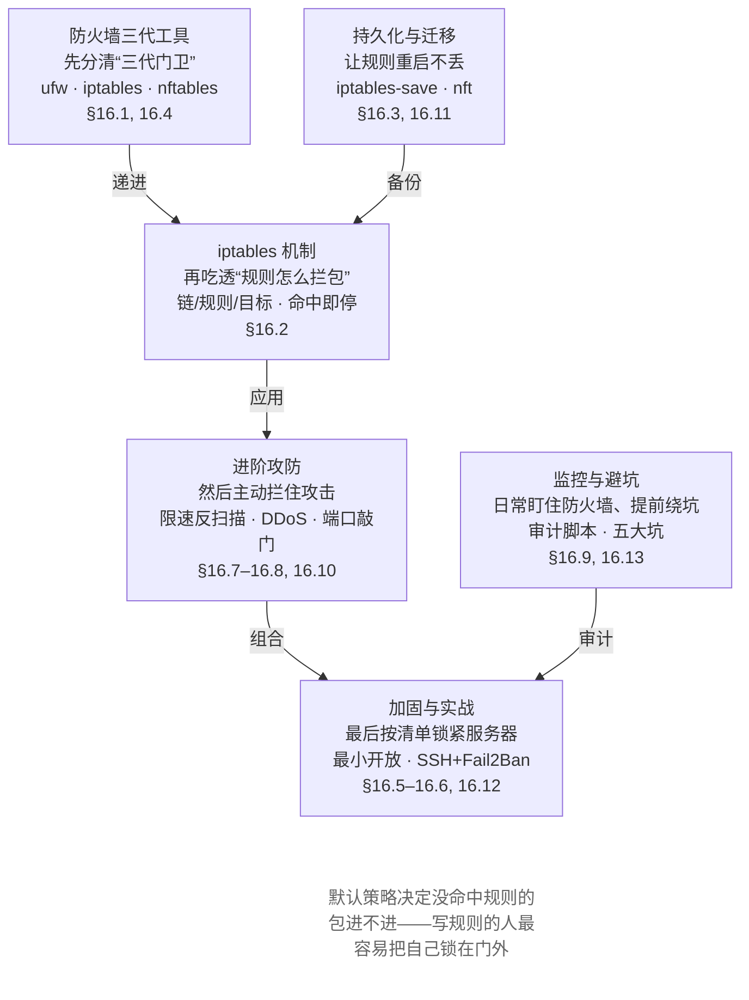
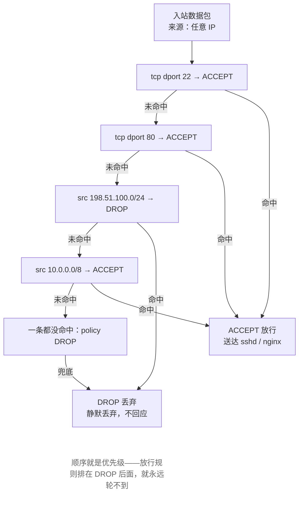
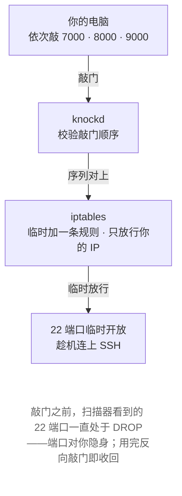

# 第16章：防火墙与安全

> [!TIP] Part 3 · network（网络）
> 连得上 → 进得来 → 拦得住 → 开得了门 → 用得上 → 找得到，六关全过才算一台对外的机器。

## 为什么要学防火墙？

**本章手柄：firewall（防火墙）**

准入是规则列表自上而下命中即停——默认策略决定没命中的进不进，写规则的人最容易把自己锁在门外。本章管网络门禁——ufw 简单挡、iptables 精细控，决定哪些端口能进、哪些被拒。

**图 16-1｜本章概念关系图**（节点内第二行为各环节目的，末行为小节号；箭头标注关系类型）：



> [!WARNING] 先猜再读
> 动手前先猜一猜，答案都在本章里：
>
> 1. 执行 `sudo ufw enable` 前忘了放行 SSH，下一步会发生什么？（答案见 16.13）
> 2. INPUT 链第一条规则是 DROP，之后再追加一条放行 80 端口的 ACCEPT，80 端口还能访问吗？（答案见 16.13）
> 3. 手动加的 iptables 规则，重启之后还在吗？（答案见 16.3）

带着这张图进入正文。第一节先从大楼的"门卫"讲起，回答为什么需要防火墙：

如果把服务器比作一栋大楼，那防火墙就是大楼的"门卫大叔"——检查每个进出的人（数据包），看看有没有通行证（规则匹配），没证的就拦住。没有防火墙的服务器就像一栋没锁门的大楼，任何人都可以随便进出。这些「进出的人」就是[第 14 章 14.5 节 · 端口与连接](./ch14.md)里 ss 看到的那些连接。

**Linux 防火墙的三代工具：**

1. **iptables**：经典老牌，功能强大但语法复杂
2. **ufw**：Uncomplicated Firewall，iptables 的简化前端，适合新手
3. **nftables**：iptables 的继任者，更现代、更高效

## 16.1 UFW：简单好用的防火墙

**命令格式**：`ufw [OPTIONS] COMMAND`

```bash
# 安装 UFW（Ubuntu 默认已装）
sudo apt install ufw -y

# 查看 UFW 状态
sudo ufw status
# Status: inactive   ← 还没启用

# 设置默认策略（先拒绝所有入站，允许所有出站）
sudo ufw default deny incoming
sudo ufw default allow outgoing

# 允许 SSH（⚠️ 必须先开 SSH，否则启用防火墙后自己连不上！）
sudo ufw allow ssh
# 或指定端口：sudo ufw allow 22/tcp
# 如果你改了 SSH 端口：sudo ufw allow 2222/tcp

# 允许 HTTP 和 HTTPS
sudo ufw allow http       # 80/tcp
sudo ufw allow https      # 443/tcp
# 或用应用配置文件：
sudo ufw allow 'Nginx Full'    # 同时开放 80 和 443

# 启用防火墙
sudo ufw enable
# 输出：Firewall is active and enabled on system startup

# 查看状态（详细）
sudo ufw status verbose
# Status: active
# Logging: on (low)
# Default: deny (incoming), allow (outgoing), disabled (routed)
#
# To                         Action      From
# --                         ------      ----
# 22/tcp                     ALLOW IN    Anywhere
# 80/tcp                     ALLOW IN    Anywhere
# 443/tcp                    ALLOW IN    Anywhere
# 22/tcp (v6)                ALLOW IN    Anywhere (v6)
# 80/tcp (v6)                ALLOW IN    Anywhere (v6)
# 443/tcp (v6)               ALLOW IN    Anywhere (v6)

# 高级规则
sudo ufw allow from 10.0.0.0/8                   # 允许内网所有访问
sudo ufw allow from 203.0.113.50                  # 允许特定 IP
sudo ufw allow from 203.0.113.50 to any port 22   # 只允许某 IP 访问 SSH
sudo ufw deny from 198.51.100.0/24                # 封禁某个网段
sudo ufw allow 3000:3100/tcp                      # 允许端口范围

# 删除规则
sudo ufw delete allow 80/tcp
# 或用编号删除
sudo ufw status numbered     # 查看编号
sudo ufw delete 3            # 删除第 3 条规则

# 查看 UFW 的日志
sudo ufw logging on          # 开启日志
sudo ufw logging medium      # 日志级别：low/medium/high/full
tail -f /var/log/ufw.log     # 查看被防火墙拦截的记录

# 禁用/重启 UFW
sudo ufw disable             # 禁用
sudo ufw reload              # 重新加载规则
sudo ufw reset               # 重置所有规则（慎用！）
```

## 16.2 iptables：经典防火墙

**命令格式**：`iptables [-t TABLE] COMMAND [CHAIN] [RULE]`

```bash
# iptables 是 Linux 最经典的防火墙工具
# 理解 iptables 是理解 Linux 网络安全的基石

# iptables 的基本概念：
# 链（Chain）  → 数据包经过的"检查站"
#   INPUT    → 进入本机的数据包
#   OUTPUT   → 从本机发出的数据包
#   FORWARD  → 经过本机转发的数据包（路由器场景）
#
# 规则（Rule） → 每条链上的具体过滤规则
# 目标（Target） → 匹配后的动作
#   ACCEPT → 放行
#   DROP   → 丢弃（静默丢弃，不回应）
#   REJECT → 拒绝（回应"被拒绝"）
#   LOG    → 记录日志

# 查看当前规则
sudo iptables -L -n -v
# -L → 列出所有规则
# -n → 不解析域名（显示 IP 数字）
# -v → 详细信息（包计数、字节数）
# 输出示例：
# Chain INPUT (policy ACCEPT 0 packets, 0 bytes)
#  pkts bytes target     prot opt in     out     source         destination
#  1234  567K ACCEPT     tcp  --  *      *       0.0.0.0/0      0.0.0.0/0      tcp dpt:22
#   890  123K ACCEPT     tcp  --  *      *       0.0.0.0/0      0.0.0.0/0      tcp dpt:80
#   456  78K  DROP       all  --  *      *       198.51.100.0/24 0.0.0.0/0

# 查看特定链的规则
sudo iptables -L INPUT -n -v --line-numbers
# --line-numbers → 显示规则编号（方便删除和插入）

# 设置默认策略
sudo iptables -P INPUT DROP         # 默认拒绝所有入站
sudo iptables -P FORWARD DROP       # 默认拒绝所有转发
sudo iptables -P OUTPUT ACCEPT      # 默认允许所有出站

# 允许已建立的连接和关联连接（必须加！否则已有的连接也会断）
sudo iptables -A INPUT -m conntrack --ctstate ESTABLISHED,RELATED -j ACCEPT

# 允许回环接口
sudo iptables -A INPUT -i lo -j ACCEPT

# 允许 SSH（注意顺序！规则是从上到下匹配的）
sudo iptables -A INPUT -p tcp --dport 22 -j ACCEPT

# 允许 HTTP 和 HTTPS
sudo iptables -A INPUT -p tcp --dport 80 -j ACCEPT
sudo iptables -A INPUT -p tcp --dport 443 -j ACCEPT

# 允许 ICMP（ping）
sudo iptables -A INPUT -p icmp --icmp-type echo-request -j ACCEPT

# 允许特定 IP 访问
sudo iptables -A INPUT -s 10.0.0.0/8 -j ACCEPT

# 拒绝特定 IP
sudo iptables -A INPUT -s 198.51.100.50 -j DROP

# 端口范围
sudo iptables -A INPUT -p tcp --dport 3000:3100 -j ACCEPT

# 限速（防暴力破解 SSH）
sudo iptables -A INPUT -p tcp --dport 22 -m conntrack --ctstate NEW -m recent --set
sudo iptables -A INPUT -p tcp --dport 22 -m conntrack --ctstate NEW -m recent --update --seconds 60 --hitcount 4 -j DROP
# 60 秒内新建 SSH 连接超过 4 次就 DROP

# 记录日志（在被 DROP 之前记录）
sudo iptables -A INPUT -j LOG --log-prefix "IPTABLES-DROP: " --log-level 4
# 日志在 /var/log/syslog 或 /var/log/kern.log 中查看

# 插入规则到指定位置（-I 在第 N 条之前插入）
sudo iptables -I INPUT 3 -p tcp --dport 8080 -j ACCEPT

# 替换规则
sudo iptables -R INPUT 5 -p tcp --dport 8080 -j DROP

# 删除规则
sudo iptables -D INPUT -p tcp --dport 8080 -j DROP    # 按规则内容删除
sudo iptables -D INPUT 3                               # 按编号删除

# 清空所有规则（⚠️ 慎用！）
sudo iptables -F          # 清空所有链的规则
sudo iptables -X          # 删除自定义链
sudo iptables -Z          # 清零计数器
```

这些规则到底怎么生效的？跟着一个数据包走一遍：

**图 16-2｜一个入站包在 INPUT 链里的命运**（规则从上到下逐条匹配、命中即停；规则示例取自本章 iptables 命令，谁都不匹配就走默认策略）：



## 16.3 iptables 规则持久化

**命令格式**：`iptables-save [OPTIONS]`、`iptables-restore [OPTIONS] [FILE]`、`netfilter-persistent COMMAND`

```bash
# iptables 规则重启后会丢失！需要保存和恢复

# 方法 1：iptables-persistent（推荐）
sudo apt install iptables-persistent -y
# 安装时会问你是否保存当前规则

# 手动保存当前规则
sudo netfilter-persistent save
# 或
sudo iptables-save > /etc/iptables/rules.v4
sudo ip6tables-save > /etc/iptables/rules.v6

# 手动恢复规则
sudo netfilter-persistent reload
# 或
sudo iptables-restore < /etc/iptables/rules.v4

# 方法 2：systemd 服务
# 创建 /etc/systemd/system/iptables-restore.service
sudo systemctl daemon-reload
sudo systemctl enable iptables-restore
```

## 16.4 nftables：下一代防火墙

**命令格式**：`nft [OPTIONS] COMMAND`

```bash
# nftables 是 iptables 的继任者
# 更现代的语法、更好的性能、更灵活的管理

# 安装 nftables
sudo apt install nftables -y
sudo systemctl enable nftables

# 查看当前规则集
sudo nft list ruleset

# 创建表和链
sudo nft add table inet filter
sudo nft add chain inet filter input { type filter hook input priority 0 \; policy drop \; }
sudo nft add chain inet filter forward { type filter hook forward priority 0 \; policy drop \; }
sudo nft add chain inet filter output { type filter hook output priority 0 \; policy accept \; }

# 添加规则
sudo nft add rule inet filter input iif lo accept
sudo nft add rule inet filter input ct state established,related accept
sudo nft add rule inet filter input tcp dport 22 accept
sudo nft add rule inet filter input tcp dport 80 accept
sudo nft add rule inet filter input tcp dport 443 accept
sudo nft add rule inet filter input icmp type echo-request accept

# 配置文件方式（推荐！）
sudo nano /etc/nftables.conf
# 内容：
# #!/usr/sbin/nft -f
# flush ruleset
#
# table inet filter {
#     chain input {
#         type filter hook input priority 0; policy drop;
#         iif lo accept
#         ct state established,related accept
#         tcp dport { 22, 80, 443 } accept
#         icmp type echo-request accept
#         log prefix "nftables-drop: " drop
#     }
#     chain forward {
#         type filter hook forward priority 0; policy drop;
#     }
#     chain output {
#         type filter hook output priority 0; policy accept;
#     }
# }

# 加载配置文件
sudo nft -f /etc/nftables.conf

# 保存当前规则到配置文件
sudo nft list ruleset > /etc/nftables.conf
```

## 16.5 安全加固清单

```bash
# 服务器安全加固 Checklist（新服务器必做！）

# ✅ 1. 更新系统
sudo apt update && sudo apt upgrade -y

# ✅ 2. 配置 SSH 安全
# - 修改默认端口
# - 禁止 root 登录
# - 使用密钥认证
# - 禁止密码登录

# ✅ 3. 配置防火墙
# - 启用 UFW 或 nftables
# - 只开放必要端口
# - 默认拒绝所有入站

# ✅ 4. 安装 Fail2Ban
sudo apt install fail2ban -y

# ✅ 5. 配置自动安全更新
sudo apt install unattended-upgrades -y
sudo dpkg-reconfigure -plow unattended-upgrades
# 选择 Yes，自动安装安全更新

# ✅ 6. 禁用不需要的服务
sudo systemctl list-unit-files --state=enabled
# 查看启用了哪些服务，禁用不需要的
sudo systemctl disable 不需要的服务

# ✅ 7. 创建普通用户（不用 root；adduser/usermod 细讲见第 5、10 章）
sudo adduser deploy
sudo usermod -aG sudo deploy

# ✅ 8. 配置日志监控
# 定期检查 /var/log/auth.log（登录日志）
sudo tail -100 /var/log/auth.log | grep "Failed password"

# ✅ 9. 文件权限检查
sudo find / -perm -4000 -type f 2>/dev/null
# 查看 SUID 文件（可能被利用提权）

# ✅ 10. 检查开放端口
sudo ss -tlnp
# 确认没有不该开放的端口
```

## 16.6 实战：Web 服务器安全策略

```bash
# 场景：为一台 Nginx Web 服务器配置完整安全策略

# 1. SSH 加固
sudo nano /etc/ssh/sshd_config
# Port 2222
# PermitRootLogin no
# PasswordAuthentication no
# AllowUsers deploy admin

# 2. 防火墙规则
sudo ufw default deny incoming
sudo ufw default allow outgoing
sudo ufw allow 2222/tcp     # SSH
sudo ufw allow 80/tcp       # HTTP
sudo ufw allow 443/tcp      # HTTPS
sudo ufw enable

# 3. Fail2Ban 配置
sudo nano /etc/fail2ban/jail.local
# [sshd]
# enabled = true
# port = 2222
# maxretry = 3
# bantime = 3600
#
# [nginx-http-auth]
# enabled = true
# port = 80,443
# maxretry = 5

sudo systemctl restart fail2ban

# 4. 自动更新（安装与启用同 16.5 第 5 项：unattended-upgrades）

# 5. 验证
sudo ss -tlnp              # 确认只有 2222、80、443 在监听
sudo ufw status            # 确认防火墙规则
sudo fail2ban-client status  # 确认 Fail2Ban 运行中
sudo systemctl restart sshd  # 应用 SSH 配置
```

## 16.7 iptables 高级规则模式

```bash
# 模式 1：SYN Flood 防护
sudo iptables -A INPUT -p tcp --syn -m limit --limit 1/s --limit-burst 3 -j ACCEPT
# 限制每秒最多 1 个 SYN 包，突发允许 3 个

# 模式 2：端口扫描检测与阻断
sudo iptables -A INPUT -p tcp --tcp-flags ALL NONE -j DROP     # NULL 扫描
sudo iptables -A INPUT -p tcp --tcp-flags ALL ALL -j DROP      # XMAS 扫描
sudo iptables -A INPUT -p tcp --tcp-flags ALL FIN,URG,PSH -j DROP  # FIN/URG/PSH
sudo iptables -A INPUT -p tcp --tcp-flags SYN,RST SYN,RST -j DROP  # SYN/RST

# 模式 3：ICMP Flood 防护
sudo iptables -A INPUT -p icmp --icmp-type echo-request \
  -m limit --limit 1/s --limit-burst 4 -j ACCEPT
sudo iptables -A INPUT -p icmp --icmp-type echo-request -j DROP

# 模式 4：多端口规则（一条规则处理多个端口）
sudo iptables -A INPUT -p tcp -m multiport --dports 80,443,8080,8443 -j ACCEPT

# 模式 5：基于时间的规则（工作时间才开放某端口）
sudo iptables -A INPUT -p tcp --dport 3306 \
  -m time --timestart 09:00 --timestop 18:00 --weekdays Mon,Tue,Wed,Thu,Fri \
  -s 10.0.0.0/8 -j ACCEPT
# 只在工作时间 9:00-18:00 允许内网访问 MySQL

# 模式 6：基于连接数的限制
sudo iptables -A INPUT -p tcp --dport 80 \
  -m connlimit --connlimit-above 50 --connlimit-mask 32 -j DROP
# 单个 IP 最多 50 个并发 HTTP 连接

# 模式 7：IP 黑名单（封禁恶意 IP 段）
sudo iptables -N BLACKLIST
sudo iptables -A BLACKLIST -s 198.51.100.0/24 -j DROP
sudo iptables -A BLACKLIST -s 203.0.113.0/24 -j DROP
sudo iptables -A BLACKLIST -s 192.0.2.0/24 -j DROP
sudo iptables -A INPUT -j BLACKLIST
# 用自定义链管理黑名单，更清晰

# 模式 8：日志 + 丢弃（知道是谁在捣乱）
sudo iptables -A INPUT -p tcp --dport 22 -m state --state NEW \
  -m recent --set --name SSH
sudo iptables -A INPUT -p tcp --dport 22 -m state --state NEW \
  -m recent --update --seconds 300 --hitcount 5 --name SSH \
  -j LOG --log-prefix "SSH-BRUTE: "
sudo iptables -A INPUT -p tcp --dport 22 -m state --state NEW \
  -m recent --update --seconds 300 --hitcount 5 --name SSH \
  -j DROP
# 5 分钟内新建 SSH 连接超过 5 次 → 记录日志 + 丢弃

# 模式 9：地理封禁（封禁某些国家的 IP 段）
# 需要安装 xtables-addons 获取 geoip 模块
# sudo iptables -A INPUT -m geoip --src-cc CN,RU -j DROP
# 注意：地理封禁误杀率高，生产环境慎用
```

## 16.8 DDoS 基础防护

```bash
# DDoS（分布式拒绝服务）是最常见的网络攻击之一
# 以下是命令行层面的基础防护措施

# 1. 内核参数优化（sysctl）
sudo sysctl -w net.ipv4.tcp_syncookies=1         # 启用 SYN Cookie 防护
sudo sysctl -w net.ipv4.tcp_max_syn_backlog=2048  # 增大 SYN 队列
sudo sysctl -w net.ipv4.tcp_synack_retries=2      # 减少 SYN-ACK 重试
sudo sysctl -w net.ipv4.tcp_fin_timeout=15        # 缩短 FIN-WAIT-2 超时
sudo sysctl -w net.ipv4.tcp_keepalive_time=300    # 缩短 keepalive
sudo sysctl -w net.ipv4.icmp_echo_ignore_broadcasts=1  # 忽略广播 ping
sudo sysctl -w net.ipv4.conf.all.rp_filter=1      # 反向路径过滤（防 IP 欺骗）

# 持久化 sysctl 设置
cat >> /etc/sysctl.conf << 'EOF'
# DDoS Protection
net.ipv4.tcp_syncookies = 1
net.ipv4.tcp_max_syn_backlog = 2048
net.ipv4.tcp_synack_retries = 2
net.ipv4.tcp_fin_timeout = 15
net.ipv4.icmp_echo_ignore_broadcasts = 1
net.ipv4.conf.all.rp_filter = 1
EOF
sudo sysctl -p    # 应用配置

# 2. 连接速率限制
sudo iptables -A INPUT -p tcp --dport 80 -m state --state NEW \
  -m limit --limit 50/minute --limit-burst 100 -j ACCEPT
sudo iptables -A INPUT -p tcp --dport 80 -m state --state NEW -j DROP

# 3. 封禁异常连接
# 查看连接数最多的 IP
ss -tn | awk '{print $5}' | cut -d: -f1 | sort | uniq -c | sort -rn | head -20

# 自动封禁连接数超过 100 的 IP
for ip in $(ss -tn | awk '{print $5}' | cut -d: -f1 | sort | uniq -c | \
    sort -rn | awk '$1 > 100 {print $2}'); do
    echo "封禁异常 IP: $ip"
    sudo iptables -A INPUT -s "$ip" -j DROP
done

# 4. Nginx 层面的限速（配合防火墙）
# 在 nginx.conf 的 http 块中添加：
# limit_req_zone $binary_remote_addr zone=one:10m rate=10r/s;
# limit_conn_zone $binary_remote_addr zone=addr:10m;
#
# 在 server/location 块中：
# limit_req zone=one burst=20 nodelay;
# limit_conn addr 10;
```

## 16.9 防火墙监控脚本

```bash
# 脚本 1：防火墙规则审计
cat > ~/fw-audit.sh << 'SCRIPT'
#!/bin/bash
echo "=== 防火墙规则审计 $(date) ==="
echo ""

echo "--- UFW 状态 ---"
sudo ufw status verbose 2>/dev/null || echo "UFW 未安装或未启用"

echo ""
echo "--- iptables 规则统计 ---"
echo "INPUT 链规则数: $(sudo iptables -L INPUT -n | wc -l)"
echo "OUTPUT 链规则数: $(sudo iptables -L OUTPUT -n | wc -l)"
echo "FORWARD 链规则数: $(sudo iptables -L FORWARD -n | wc -l)"

echo ""
echo "--- DROP 规则（封禁）---"
sudo iptables -L INPUT -n -v | grep DROP

echo ""
echo "--- 被拦截的包统计 ---"
sudo iptables -L INPUT -n -v | awk '/DROP|REJECT/{printf "%-20s %-10s %s packets\n", $8, $4, $1}'

echo ""
echo "--- Fail2Ban 封禁统计 ---"
sudo fail2ban-client status 2>/dev/null
for jail in $(sudo fail2ban-client status 2>/dev/null | grep "Jail list" | \
    cut -d: -f2 | tr -d ' ' | tr ',' ' '); do
    echo "  $jail: $(sudo fail2ban-client status $jail 2>/dev/null | \
        grep "Currently banned" | awk '{print $4}') 个 IP 被封禁"
done
SCRIPT
chmod +x ~/fw-audit.sh

# 脚本 2：实时防火墙监控（每 5 秒刷新）
cat > ~/fw-monitor.sh << 'SCRIPT'
#!/bin/bash
while true; do
    clear
    echo "=== 防火墙实时监控 $(date) ==="
    echo ""

    echo "--- 连接状态统计 ---"
    ss -tn | awk '{print $1}' | sort | uniq -c | sort -rn

    echo ""
    echo "--- 连接数 Top 10 IP ---"
    ss -tn | awk 'NR>1{split($5,a,":");print a[1]}' | \
        sort | uniq -c | sort -rn | head -10

    echo ""
    echo "--- 最近被 DROP 的包 ---"
    sudo dmesg | grep -i "iptables-drop" | tail -5 2>/dev/null

    sleep 5
done
SCRIPT
chmod +x ~/fw-monitor.sh
```

## 16.10 Port Knocking：隐身 SSH 端口

**命令格式**：`knock [OPTIONS] HOST PORT...`

```bash
# Port Knocking（端口敲门）：让端口对外完全隐身
# 只有按特定顺序"敲门"（访问特定端口序列）后，目标端口才会对你开放
# 就像特工对暗号——对上暗号才开门

# 安装 knockd
sudo apt install knockd -y

# 配置敲门规则
sudo nano /etc/knockd.conf
# [options]
#     UseSyslog
#     LogFile = /var/log/knockd.log
#
# [openSSH]
#     sequence    = 7000,8000,9000     # 敲门顺序：依次访问 7000→8000→9000
#     seq_timeout = 15                 # 15 秒内必须完成敲门
#     command     = /sbin/iptables -A INPUT -s %IP% -p tcp --dport 22 -j ACCEPT
#     tcpflags    = syn
#
# [closeSSH]
#     sequence    = 9000,8000,7000     # 反向敲门：关门
#     seq_timeout = 15
#     command     = /sbin/iptables -D INPUT -s %IP% -p tcp --dport 22 -j ACCEPT
#     tcpflags    = syn

# 启动 knockd
sudo systemctl enable knockd
sudo systemctl start knockd

# 使用方法：先敲门，再 SSH
# 在客户端：
knock server-ip 7000 8000 9000         # 敲门
ssh user@server-ip                      # 现在可以连接了！
knock server-ip 9000 8000 7000         # 用完了，关门

# 安装 knock 客户端
sudo apt install knockd -y             # knock 命令和 knockd 在同一个包

# 没有 knock 客户端？用 nmap 代替
nmap -Pn -p 7000 server-ip
nmap -Pn -p 8000 server-ip
nmap -Pn -p 9000 server-ip
ssh user@server-ip

# Port Knocking 的优势：
# - 端口扫描器看不到 SSH 端口（因为 iptables 默认 DROP）
# - 即使知道端口号，不知道敲门顺序也进不去
# - 只有你的 IP 被临时放行（其他 IP 依然被封锁）
```

整个开门过程如图 16-3：

**图 16-3｜Port Knocking 的开门与关门**（先按 7000→8000→9000 依次敲门，knockd 才给你的 IP 临时放行 22；反向敲门即关门）：



敲开门之后连上去用的，就是[第 15 章 15.1 节 · SSH 加密隧道](./ch15.md)的那条隧道。

## 16.11 iptables 迁移到 nftables

**命令格式**：`iptables-restore-translate [-f FILE]`

```bash
# 如果你还在用 iptables，是时候考虑迁移到 nftables 了
# Debian 10+ 和 Ubuntu 20.04+ 默认用 nftables 后端

# 自动转换工具
sudo apt install iptables-nft -y       # 使用 nft 后端的 iptables

# 把 iptables 规则转换为 nftables 格式
sudo iptables-save > /tmp/iptables-rules.v4
sudo iptables-restore-translate -f /tmp/iptables-rules.v4
# 输出对应的 nftables 语法

# 直接生成 nftables 配置文件
sudo iptables-restore-translate -f /tmp/iptables-rules.v4 > /tmp/nft-rules.nft

# 完整的 nftables 配置示例（Web 服务器）
cat > /etc/nftables.conf << 'EOF'
#!/usr/sbin/nft -f

flush ruleset

table inet filter {
    # 定义集合（方便管理）
    set blocked_ips {
        type ipv4_addr
        flags timeout
        timeout 1h
    }

    set allowed_ssh {
        type ipv4_addr
        elements = { 10.0.0.5, 10.0.0.10, 192.168.1.50 }
    }

    chain input {
        type filter hook input priority 0; policy drop;

        # 允许回环
        iif lo accept

        # 允许已建立的连接
        ct state established,related accept

        # 丢弃无效连接
        ct state invalid drop

        # 黑名单
        ip saddr @blocked_ips drop

        # SSH：只允许白名单 IP
        ip saddr @allowed_ssh tcp dport 22 accept
        tcp dport 22 meter ssh_limit { ip saddr limit rate 5/minute } accept

        # HTTP/HTTPS
        tcp dport { 80, 443 } accept

        # ICMP（限速）
        icmp type echo-request limit rate 5/second accept

        # 日志（被丢弃的包）
        log prefix "nft-drop: " drop
    }

    chain forward {
        type filter hook forward priority 0; policy drop;
    }

    chain output {
        type filter hook output priority 0; policy accept;
    }
}
EOF

# 加载配置
sudo nft -f /etc/nftables.conf
sudo systemctl enable nftables

# nftables 的实用命令
sudo nft list ruleset                    # 查看所有规则
sudo nft list table inet filter          # 查看特定表
sudo nft list chain inet filter input    # 查看特定链
sudo nft add element inet filter blocked_ips { 198.51.100.50 }  # 添加黑名单
sudo nft delete element inet filter blocked_ips { 198.51.100.50 }  # 删除
sudo nft flush ruleset                   # 清空所有规则
```

## 16.12 防火墙最佳实践清单

```bash
# ✅ 新服务器防火墙配置清单

# 条目 1-3 的五条 ufw 命令同 16.6 实战：default deny incoming / allow outgoing，只放行 2222（自定义 SSH 端口）、80、443

# 1. 最小开放原则：只开必要端口

# 2. SSH 加固
# PermitRootLogin no
# PasswordAuthentication no

# 3. 只开放业务端口
# 数据库端口（3306/5432/6379）永远不要对外开放！

# 4. 启用 Fail2Ban
sudo apt install fail2ban -y
sudo systemctl enable fail2ban

# 5. 内网访问用防火墙限制来源 IP
sudo ufw allow from 10.0.0.0/8 to any port 3306    # MySQL 只允许内网

# 6. 定期检查
sudo ufw status                      # 每周看一次
sudo ss -tlnp                        # 确认没有意外端口
sudo grep "DROP\|REJECT" /var/log/ufw.log | tail -20    # 看被拦截的流量

# 7. 日志监控
sudo ufw logging medium
# 把 ufw 日志接入集中式日志系统（ELK/Loki）

# 8. 自动化巡检
# 用 cron 每天自动检查：
# 0 9 * * * /root/fw-audit.sh >> /var/log/fw-audit.log
```

## 16.13 常见坑与注意事项

```bash
# 坑 1：启用防火墙前忘了开 SSH
# 结果：把自己锁在外面了！
# 解决：如果用的云服务器，用控制台 VNC 登录
# 预防：启用前一定先 ufw allow ssh

# 坑 2：iptables 规则顺序很重要
# 规则从上到下匹配，匹配到就执行动作，不再继续
# 如果 DROP 在前面，后面的 ACCEPT 永远不生效
# 解决：用 -I 插入到正确位置，或 -R 替换

# 坑 3：UFW 和 iptables 冲突
# UFW 其实是 iptables 的前端，不要同时手动管理两者
# 解决：选了 UFW 就用 UFW，别手动加 iptables 规则

# 坑 4：iptables 规则不持久
# 重启后规则丢失！
# 解决：安装 iptables-persistent 或迁移到 nftables

# 坑 5：DROP vs REJECT 的区别
# DROP：静默丢弃，对方等到超时才知道（更安全，隐藏防火墙存在）
# REJECT：立即回应"被拒绝"（对方马上知道，但暴露了防火墙）
# 建议：默认用 DROP
```

## 本章小结

**① 核心句**：准入是规则列表自上而下命中即停——默认策略决定没命中的进不进，写规则的人最容易把自己锁在门外。

**② 边界句**：管网络层准入；文件权限归 05，应用层鉴权不在词内。

**③ 可推导条目**：
- 默认 DROP 先于允许=全拒。
- ufw 与 iptables 两套并存打架。
- Docker 的 DOCKER 链绕过 ufw，改规则前留自动恢复后路。

> **词链互测**：合上书说出[第 5 章 access control 的 3 个坑](./ch05.md#本章小结)；两道门对一遍——「命中即停」是谁的规矩。
>
> 学到[第 17 章 dispatch](./ch17.md#本章小结)回来——说出 dispatch 的 3 个坑；403 的时候先查谁的门。

**下一章预告**：城墙立好，门要开了——下一章的手柄是 **dispatch**（分诊）。
