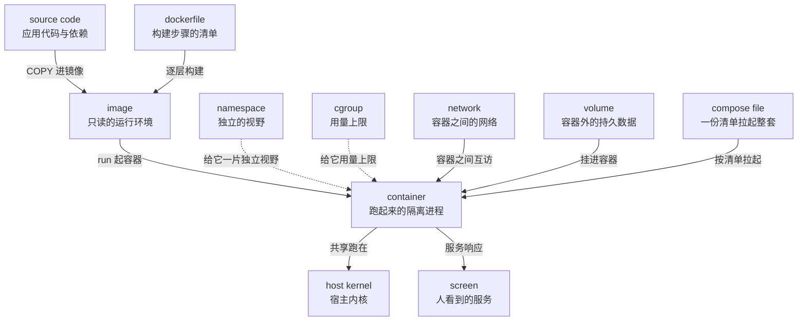

# 第25章：Docker容器与Linux现代化——拥抱云原生时代

> [!TIP] Part 4 · automation（自动化）
> 重复劳动交给脚本与三剑客，突发故障交给方法论，环境漂移交给容器。

## 为什么要学Docker？

容器是同一颗内核上的隔离进程——镜像给只读根文件系统、namespace 给独立视野、cgroup 限用量，「在我机器上能跑」的解法是把环境一起打包。本章管容器化——把应用连同环境打包成镜像跑起来，命令行能力的现代延伸。

**图 25-1｜本章容器模型**（节点为实体——应用代码 source code、构建清单 dockerfile、只读的运行环境 image、跑起来的隔离进程 container、独立的视野 namespace、用量上限 cgroup、宿主内核 host kernel、容器之间的网络 network、容器外的持久数据 volume、一份拉起整套的清单 compose file、人看到的服务 screen；边为操作，实线 = 构建与运行的主路，虚线 = 改接——namespace 与 cgroup 决定容器看到什么、能用多少）：



<p class="figure-note">「在我机器上能跑」的解法是把环境一起打包——容器是同一颗内核上的隔离进程</p>

> [!WARNING] 先猜再读
> 动手前先猜一猜，答案都在本章里：
>
> 1. `EXPOSE 3000` 写进 Dockerfile，端口就自动对外发布了吗？（答案见 25.4）
> 2. 两个容器都接在默认 bridge 网络上，能用容器名互相访问吗？（答案见 25.5）
> 3. `docker rm` 删掉容器，容器里的数据就一定没了吗？（答案见 25.6）

这张图的主线是构建与运行：代码进镜像、镜像跑成容器，容器与宿主共享内核，靠 namespace 与 cgroup 划出视野与用量。第一节先回答最根本的问题——容器到底是什么，它和虚拟机差在哪：

## 25.1 容器化概念——为什么需要容器

```
传统部署 vs 虚拟机 vs 容器：

传统部署：
┌──────────────────────────────────┐
│ App A    App B    App C          │  ← 应用之间可能冲突
│ Libraries & Dependencies         │  ← 依赖版本冲突
│ OS (物理机)                      │
└──────────────────────────────────┘

虚拟机：
┌─────────┐ ┌─────────┐ ┌─────────┐
│ App A   │ │ App B   │ │ App C   │
│ Libs    │ │ Libs    │ │ Libs    │
│ Guest OS│ │ Guest OS│ │ Guest OS│  ← 每个VM都有完整OS，浪费
└────┬────┘ └────┬────┘ └────┬────┘
     └───────────┼───────────┘
            Hypervisor
            Host OS / Hardware
└──────────────────────────────────┘

容器：
┌─────────┐ ┌─────────┐ ┌─────────┐
│ App A   │ │ App B   │ │ App C   │
│ Libs    │ │ Libs    │ │ Libs    │  ← 共享Host OS内核
│ Bin     │ │ Bin     │ │ Bin     │     更轻量、启动更快
└────┬────┘ └────┬────┘ └────┬────┘
     └───────────┼───────────┘
          Docker Engine
            Host OS
└──────────────────────────────────┘
```

**容器 vs 虚拟机的核心区别：**

- 虚拟机：硬件级虚拟化，每个VM运行完整的OS（GB级别，分钟级启动）
- 容器：OS级虚拟化，共享Host内核（MB级别，秒级启动）；每个容器有独立的文件视野，底子在[第 3 章 · 文件与目录操作](./ch03.md)
- 容器更轻量，但不是完整隔离（共享内核意味着内核漏洞可能影响所有容器）

虚拟机与容器的差别，落在分层结构上：

| 对比项 | 虚拟机 | 容器 |
| ------ | ------ | ---- |
| 分层 | App + Libs + Guest OS → Hypervisor → Host OS → Hardware | App + Libs + Bin → Docker Engine → Host OS → Hardware |
| 是否带 Guest OS | 带，每个应用一份完整 OS | 不带，少这一层 |
| 内核归属 | 各 VM 各跑各的内核，互不共享 | 所有容器共享宿主内核 |
| 启动速度与体积 | 分钟级启动，GB 级镜像 | 秒级启动，MB 级镜像 |

两相对比，容器栈少了一层 Guest OS——这正是 MB 级体积与秒级启动的来源。

## 25.2 Docker安装（Ubuntu）

```bash
# ============================
# 卸载旧版本（如果有）
# ============================
sudo apt remove docker docker-engine docker.io containerd runc 2>/dev/null

# ============================
# 安装依赖
# ============================
sudo apt update
sudo apt install -y \
    ca-certificates \
    curl \
    gnupg \
    lsb-release

# ============================
# 添加Docker官方GPG密钥
# ============================
sudo mkdir -p /etc/apt/keyrings
curl -fsSL https://download.docker.com/linux/ubuntu/gpg | \
    sudo gpg --dearmor -o /etc/apt/keyrings/docker.gpg

# ============================
# 添加Docker软件源
# ============================
echo \
  "deb [arch=$(dpkg --print-architecture) signed-by=/etc/apt/keyrings/docker.gpg] \
  https://download.docker.com/linux/ubuntu \
  $(lsb_release -cs) stable" | \
  sudo tee /etc/apt/sources.list.d/docker.list > /dev/null

# ============================
# 安装Docker Engine
# ============================
sudo apt update
sudo apt install -y docker-ce docker-ce-cli containerd.io docker-compose-plugin

# ============================
# 配置当前用户免sudo使用Docker
# ============================
sudo usermod -aG docker $USER
newgrp docker    # 立即生效（或重新登录）

# ============================
# 验证安装
# ============================
docker --version
docker run hello-world
```

## 25.3 Docker核心命令

先把本节教到的 Docker 子命令按用途分组、集中列出通用格式（记号约定见[第 1 章 1.6 节 · 通用命令格式](./ch01.md)；单个子命令的完整选项可用 `docker 子命令 --help` 查看），再用一张表辨析三对近邻命令：

**镜像管理**——先有镜像才有容器：

- `docker search TERM` —— 搜索镜像
- `docker pull NAME[:TAG]` —— 拉取镜像
- `docker images` —— 查看本地镜像
- `docker rmi IMAGE` —— 删除镜像
- `docker image prune [OPTIONS]` —— 清理悬空/未使用镜像

**容器生命周期**——从创建到删除：

- `docker run [OPTIONS] IMAGE [COMMAND]` —— 创建并启动容器
- `docker ps [OPTIONS]` —— 查看容器列表
- `docker stop/kill/start/restart CONTAINER` —— 停止/强制停止/启动/重启容器
- `docker rm [OPTIONS] CONTAINER` —— 删除容器

**进入与排查**——容器跑起来之后：

- `docker exec [OPTIONS] CONTAINER COMMAND` —— 在运行中的容器里执行命令
- `docker logs [OPTIONS] CONTAINER` —— 查看容器日志
- `docker inspect [OPTIONS] NAME|ID` —— 查看详细信息
- `docker stats` —— 实时查看容器资源使用
- `docker top CONTAINER` —— 查看容器内进程

**文件复制**——容器与宿主机之间：

- `docker cp [OPTIONS] CONTAINER:SRC_PATH DEST_PATH` —— 在容器与宿主机之间复制文件

| 近邻命令 | 差别 | 怎么选 |
| ------ | ------ | ------ |
| `stop` / `kill` | `stop` 发 SIGTERM 优雅停止，给进程清理时间（可用 `-t` 指定宽限期）；`kill` 发 SIGKILL 强制立即停止 | 正常停止用 `stop`；进程卡死不响应才用 `kill` |
| `rm` / `rmi` | 只差一个字母：`rm` 删容器，`rmi` 删镜像（i = image） | 清理容器用 `rm`（运行中的容器要 `rm -f`）；释放磁盘删镜像用 `rmi` |
| `run` / `exec` | `run` 用镜像新建并启动容器；`exec` 在已运行的容器里执行命令 | 部署新容器用 `run`；进入排查调试用 `exec -it` |

```bash
# ============================
# 镜像操作（Image）
# ============================

# 搜索镜像
docker search nginx

# 拉取镜像
docker pull nginx                  # 拉取最新版
docker pull nginx:1.25-alpine      # 拉取特定版本
docker pull ubuntu:22.04           # 拉取Ubuntu 22.04

# 查看本地镜像
docker images
docker image ls

# 删除镜像
docker rmi nginx                   # 按名称
docker rmi abc123def               # 按ID
docker image prune                 # 删除悬空镜像
docker image prune -a              # 删除所有未使用的镜像

# ============================
# 容器操作（Container）
# ============================

# 运行容器
docker run nginx                   # 前台运行
docker run -d nginx                # 后台运行（-d = detach）
docker run -d --name my-nginx nginx  # 指定容器名
docker run -d -p 8080:80 nginx     # 端口映射（宿主机:容器）
docker run -d -v /data:/app/data nginx  # 目录挂载

# 常用的 run 参数
docker run -d \
    --name my-app \                # 容器名
    -p 3000:3000 \                 # 端口映射
    -v /host/path:/container/path \ # 目录挂载
    -e NODE_ENV=production \       # 环境变量
    --restart unless-stopped \     # 重启策略
    --memory 512m \                # 内存限制
    --cpus 1.0 \                   # CPU限制
    nginx

# 查看容器
docker ps                          # 运行中的容器
docker ps -a                       # 所有容器（包括已停止的）
docker ps -q                       # 只显示容器ID

# 容器生命周期
docker stop <container>            # 停止容器（发送SIGTERM）
docker kill <container>            # 强制停止（发送SIGKILL）
docker start <container>           # 启动已停止的容器
docker restart <container>         # 重启容器
docker rm <container>              # 删除容器（必须先停止）
docker rm -f <container>           # 强制删除（停止并删除）

# 批量操作
docker stop $(docker ps -q)        # 停止所有容器
docker rm $(docker ps -aq)         # 删除所有已停止的容器

# 进入运行中的容器
docker exec -it <container> /bin/bash
# -it: -i(保持stdin) + -t(分配终端)

# 查看容器日志
docker logs <container>            # 所有日志
docker logs -f <container>         # 实时跟踪（类似 tail -f）
docker logs --tail 100 <container> # 最后100行
docker logs --since 1h <container> # 最近1小时

# 查看容器详细信息
docker inspect <container>         # 完整JSON信息
docker stats                       # 实时资源使用
docker top <container>             # 容器内的进程

# 容器与宿主机之间复制文件
docker cp <container>:/path/file /host/path    # 容器 -> 宿主机
docker cp /host/path/file <container>:/path    # 宿主机 -> 容器
```

## 25.4 Dockerfile——自定义镜像

Dockerfile是构建自定义镜像的"配方"。它定义了从基础镜像出发，经过哪些步骤，最终得到你需要的镜像。

```bash
# ============================
# Dockerfile 指令详解
# ============================

# 创建一个Node.js应用的Dockerfile
cat > Dockerfile << 'EOF'
# ---- 基础镜像 ----
FROM node:18-alpine
# 使用Alpine版本，体积小（约150MB vs Debian版约900MB）

# ---- 设置工作目录 ----
WORKDIR /app
# 后续命令都在/app目录下执行

# ---- 安装依赖（利用Docker缓存层） ----
COPY package*.json ./
# 先只复制package文件，如果package没变，这层会缓存
RUN npm ci --only=production
# npm ci 比 npm install 更快、更确定

# ---- 复制应用代码 ----
COPY . .
# 复制所有文件到工作目录

# ---- 暴露端口 ----
EXPOSE 3000
# 声明容器监听的端口（只是文档，实际映射靠 -p）

# ---- 设置环境变量 ----
ENV NODE_ENV=production

# ---- 非root用户（安全最佳实践） ----
RUN addgroup -g 1001 -S appgroup && \
    adduser -S appuser -u 1001 -G appgroup
USER appuser

# ---- 启动命令 ----
CMD ["node", "server.js"]
# CMD: 容器启动时执行的命令（可以被override）
# ENTRYPOINT: 容器启动时执行的命令（不会被override）
EOF

# ============================
# 构建镜像
# ============================
docker build -t myapp:1.0 .
# -t: 标签（名称:版本）
# .: 构建上下文（当前目录）

# 构建并指定Dockerfile路径
docker build -t myapp:1.0 -f docker/Dockerfile .

# 不使用缓存构建
docker build --no-cache -t myapp:1.0 .

# ============================
# 多阶段构建——镜像瘦身的终极武器
# ============================
cat > Dockerfile << 'EOF'
# 阶段1：构建（使用完整的Node镜像）
FROM node:18 AS builder
WORKDIR /app
COPY package*.json ./
RUN npm ci
COPY . .
RUN npm run build

# 阶段2：运行（使用精简的Alpine镜像）
FROM node:18-alpine
WORKDIR /app

# 只从builder阶段复制构建产物
COPY --from=builder /app/dist ./dist
COPY --from=builder /app/node_modules ./node_modules
COPY package*.json ./

EXPOSE 3000
CMD ["node", "dist/server.js"]
EOF

# 多阶段构建的好处：
# - 最终镜像不包含源代码、开发依赖、构建工具
# - 镜像大小可以从 1GB+ 缩小到 100MB 以下
# - 更安全（减少了攻击面）

# ============================
# .dockerignore——排除不需要的文件
# ============================
cat > .dockerignore << 'EOF'
node_modules
npm-debug.log
.git
.gitignore
.env
.env.*
Dockerfile
docker-compose.yml
README.md
tests/
coverage/
.nyc_output/
EOF

# ============================
# Dockerfile最佳实践
# ============================
# 1. 使用Alpine基础镜像（体积小）
# 2. 合并RUN指令（减少镜像层数）
# 3. 利用缓存层（不常变的放前面，常变的放后面）
# 4. 使用多阶段构建（构建和运行分离）
# 5. 使用非root用户运行（安全）
# 6. 使用.dockerignore（排除无关文件）
# 7. 不要存储敏感信息（密码、密钥等）

# ============================
# 常用Dockerfile指令速查（按阶段分组）
# ============================

# ---- 基础镜像：一切的起点 ----
# FROM       基础镜像

# ---- 构建期：镜像分层生成，RUN 在这里执行 ----
# RUN        执行命令（构建时）
# COPY       复制文件到镜像
# ADD        类似COPY，但支持URL和自动解压tar
# WORKDIR    设置工作目录
# ENV        设置环境变量
# LABEL      添加元数据
# ARG        构建时变量

# ---- 运行期：容器启动时生效 ----
# EXPOSE     声明端口
# CMD        容器启动命令（可被覆盖）
# ENTRYPOINT 容器启动命令（不可被覆盖，参数追加）
# USER       切换用户
# VOLUME     声明数据卷
```

**CMD vs ENTRYPOINT**：

| 对比 | `CMD` | `ENTRYPOINT` |
| ------ | ------ | ------ |
| 角色 | 默认启动命令 | 固定入口命令 |
| `docker run` 传参 | 整体覆盖 CMD | 作为参数追加（可叠加） |
| 怎么选 | 只想给默认命令，允许运行时替换 | 主程序固定、需要追加参数；常与 CMD 搭配：ENTRYPOINT 写主程序，CMD 存默认参数 |

**COPY vs ADD**：

| 对比 | `COPY` | `ADD` |
| ------ | ------ | ------ |
| 能力 | 复制文件到镜像 | COPY 的一切，外加自动解压 tar、支持 URL 下载 |
| 怎么选 | 一般都用 COPY，行为简单可预期 | 确需自动解压或拉取 URL 才用 ADD |

## 25.5 Docker网络

**命令格式**：`docker network COMMAND`

```bash
# ============================
# 网络模式
# ============================

# 1. bridge（默认）：容器有自己的网络命名空间
docker run -d --network bridge nginx
# 容器获得一个内部IP（如172.17.0.2），通过端口映射访问

# 2. host：容器共享宿主机的网络栈
docker run -d --network host nginx
# 容器直接使用宿主机的端口，无需 -p 映射
# 性能最好，但可能端口冲突

# 3. none：无网络
docker run -d --network none alpine
# 完全隔离，没有任何网络接口

# ============================
# 自定义网络（推荐！）
# ============================

# 创建自定义网络
docker network create my-network
docker network create --subnet 172.20.0.0/16 my-network

# 在自定义网络中运行容器
docker run -d --name web --network my-network nginx
docker run -d --name api --network my-network node:18-alpine

# 自定义网络的优势：
# 1. 容器之间可以用容器名互相访问（内置DNS）
docker exec api ping web     # 可以直接用 "web" 作为主机名！

# 2. 更好的隔离性
# 3. 可以连接/断开容器
docker network connect my-network another-container
docker network disconnect my-network another-container

# ============================
# 网络管理
# ============================
docker network ls             # 列出所有网络
docker network inspect my-network  # 查看网络详情
docker network rm my-network  # 删除网络
docker network prune          # 删除所有未使用的网络
```

## 25.6 Docker数据持久化

**命令格式**：`docker volume COMMAND`

```bash
# ============================
# Volume（推荐）
# ============================
# Volume由Docker管理，存储在 /var/lib/docker/volumes/

# 创建Volume
docker volume create my-data

# 使用Volume
docker run -d -v my-data:/app/data nginx
# 容器删除后，Volume中的数据仍然存在

# 在Dockerfile中声明
# VOLUME /app/data

# ============================
# Bind Mount
# ============================
# 直接挂载宿主机的目录

docker run -d -v /host/data:/app/data nginx
# 宿主机 /host/data 的内容出现在容器 /app/data

# 开发环境常用（代码修改实时同步）
docker run -d -v $(pwd):/app -w /app node:18-alpine npm start

# ============================
# 数据管理
# ============================
docker volume ls              # 列出所有Volume
docker volume inspect my-data # 查看Volume详情
docker volume rm my-data      # 删除Volume
docker volume prune           # 删除所有未使用的Volume

# 备份Volume
docker run --rm -v my-data:/data -v $(pwd):/backup alpine \
    tar czf /backup/my-data-backup.tar.gz -C /data .

# 恢复Volume
docker run --rm -v my-data:/data -v $(pwd):/backup alpine \
    tar xzf /backup/my-data-backup.tar.gz -C /data
```

两者的分工在 `-v` 源位置的写法：写**卷名**（`-v my-data:/app/data`）是 Volume——由 Docker 统一管理（匿名卷、命名卷都算，存放在 `/var/lib/docker/volumes/`），不依赖宿主机目录结构，适合数据库这类要长期留存的数据，生产环境首选；写**绝对路径**（`-v /host/data:/app/data`）是 Bind Mount——把宿主机目录原样挂进容器，适合开发同步代码、注入配置文件（compose 里挂 `./nginx.conf` 用的就是它）。两种方式的数据都不随容器删除而消失。一句话选型：数据留存用 Volume，开发同步用 Bind Mount。

## 25.7 docker-compose——多容器编排

当你的应用需要多个服务（Web服务器 + 数据库 + 缓存 + 消息队列）时，手动docker run就变得很痛苦。docker-compose让你用一个YAML文件定义和管理所有服务。

**命令格式**：`docker compose [OPTIONS] COMMAND`

```bash
# ============================
# docker-compose.yml 示例
# ============================
cat > docker-compose.yml << 'EOF'
version: "3.8"

services:
  # Web应用
  web:
    build:
      context: .
      dockerfile: Dockerfile
    ports:
      - "3000:3000"
    environment:
      - NODE_ENV=production
      - DATABASE_URL=postgresql://user:pass@db:5432/myapp
      - REDIS_URL=redis://cache:6379
    depends_on:
      db:
        condition: service_healthy
      cache:
        condition: service_started
    restart: unless-stopped
    networks:
      - app-network

  # PostgreSQL数据库
  db:
    image: postgres:16-alpine
    environment:
      - POSTGRES_USER=user
      - POSTGRES_PASSWORD=pass
      - POSTGRES_DB=myapp
    volumes:
      - postgres-data:/var/lib/postgresql/data
    healthcheck:
      test: ["CMD-SHELL", "pg_isready -U user"]
      interval: 5s
      timeout: 5s
      retries: 5
    restart: unless-stopped
    networks:
      - app-network

  # Redis缓存
  cache:
    image: redis:7-alpine
    volumes:
      - redis-data:/data
    restart: unless-stopped
    networks:
      - app-network

  # Nginx反向代理
  nginx:
    image: nginx:alpine
    ports:
      - "80:80"
      - "443:443"
    volumes:
      - ./nginx.conf:/etc/nginx/conf.d/default.conf:ro
    depends_on:
      - web
    restart: unless-stopped
    networks:
      - app-network

volumes:
  postgres-data:
  redis-data:

networks:
  app-network:
    driver: bridge
EOF

# ============================
# docker-compose 命令
# ============================

# 启动所有服务（后台运行）
docker compose up -d

# 查看服务状态
docker compose ps

# 查看日志
docker compose logs              # 所有服务
docker compose logs -f web       # 特定服务，实时跟踪

# 停止所有服务
docker compose down

# 停止并删除数据卷（慎用！会丢数据）
docker compose down -v

# 重新构建
docker compose up -d --build

# 只启动某个服务
docker compose up -d db

# 在服务中执行命令
docker compose exec web npm run migrate
docker compose exec db psql -U user -d myapp

# 查看资源使用
docker compose top

# 扩容（启动多个实例）
docker compose up -d --scale web=3
```

一份 YAML 拉起来的典型拓扑是一条四服务的链路：用户请求 `http://localhost:80` 先到 nginx（`nginx:alpine`，发布 80:80），nginx 用 `proxy_pass → web:3000` 转给 web（Node.js 应用，容器端口 3000）；web 再分两路出去——SQL 走 `:5432` 到 db（`postgres:16-alpine`），缓存走 `:6379` 到 cache（`redis:7-alpine`）。四个服务同处一个 bridge 网络（`app-network`），彼此靠内置 DNS 用服务名互访；数据则落在 postgres-data、redis-data 两个命名卷里，容器删了数据还在（`-p`/`ports` 发布的端口靠 iptables 插规则进宿主机、会绕过 ufw，见[第 16 章 16.1–16.2 节 · ufw 与 iptables](./ch16.md)）。

## 25.8 Docker最佳实践

```bash
# ============================
# 1. 镜像瘦身
# ============================
# 使用Alpine基础镜像
FROM node:18-alpine              # ~150MB
# 而非
# FROM node:18                   # ~900MB

# 清理apt缓存
RUN apt update && apt install -y curl && \
    rm -rf /var/lib/apt/lists/*

# 使用多阶段构建（前面已演示）

# ============================
# 2. 安全实践
# ============================
# 使用非root用户
RUN addgroup -g 1001 appgroup && \
    adduser -u 1001 -G appgroup -s /bin/sh -D appuser
USER appuser

# 不要在镜像中存储敏感信息
# 错误做法：
# ENV API_KEY=sk-1234567890
# 正确做法：运行时通过环境变量或secrets注入

# 扫描镜像漏洞
docker scout cves myapp:latest

# ============================
# 3. 健康检查
# ============================
# 在Dockerfile中添加
HEALTHCHECK --interval=30s --timeout=3s --retries=3 \
    CMD curl -f http://localhost:3000/health || exit 1

# ============================
# 4. 日志管理
# ============================
# 限制日志大小（防止磁盘被日志撑爆）
docker run -d \
    --log-driver json-file \
    --log-opt max-size=10m \
    --log-opt max-file=3 \
    nginx

# 或在 docker-compose.yml 中
# logging:
#   driver: json-file
#   options:
#     max-size: "10m"
#     max-file: "3"

# ============================
# 5. 资源限制
# ============================
docker run -d \
    --memory 512m \              # 内存上限
    --memory-swap 1g \           # 内存+swap上限
    --cpus 1.0 \                 # CPU限制
    --pids-limit 100 \           # 进程数限制
    nginx

# ============================
# 6. 清理无用资源
# ============================
docker system df                 # 查看Docker磁盘使用
docker system prune              # 清理悬空资源
docker system prune -a           # 清理所有未使用的资源（谨慎！）
docker builder prune             # 清理构建缓存
```

## 25.9 实战：容器化一个Node.js + PostgreSQL全栈应用

```bash
#!/usr/bin/env bash
# ============================================================
# 实战：从零开始容器化一个全栈应用
# 包含：Node.js API + PostgreSQL + Redis + Nginx
# ============================================================

# ============================
# 1. 项目结构
# ============================
mkdir -p fullstack-app && cd fullstack-app

mkdir -p app/src app/nginx

# ============================
# 2. 创建Node.js应用
# ============================
cat > app/package.json << 'EOF'
{
  "name": "fullstack-app",
  "version": "1.0.0",
  "main": "src/server.js",
  "scripts": {
    "start": "node src/server.js",
    "dev": "node --watch src/server.js"
  },
  "dependencies": {
    "express": "^4.18.0",
    "pg": "^8.12.0",
    "redis": "^4.6.0"
  }
}
EOF

cat > app/src/server.js << 'JSEOF'
const express = require('express');
const { Pool } = require('pg');
const { createClient } = require('redis');

const app = express();
const PORT = process.env.PORT || 3000;

// PostgreSQL连接池
const pool = new Pool({
  connectionString: process.env.DATABASE_URL || 'postgresql://user:pass@db:5432/myapp'
});

// Redis连接
const redis = createClient({
  url: process.env.REDIS_URL || 'redis://cache:6379'
});

// 健康检查端点
app.get('/health', async (req, res) => {
  try {
    await pool.query('SELECT 1');
    const redisOk = redis.isReady;
    res.json({ status: 'ok', db: true, redis: redisOk });
  } catch (err) {
    res.status(503).json({ status: 'error', message: err.message });
  }
});

// API示例
app.get('/api/info', async (req, res) => {
  try {
    const result = await pool.query('SELECT NOW() as time, version() as pg_version');
    res.json({
      app: 'fullstack-app',
      time: result.rows[0].time,
      pg_version: result.rows[0].pg_version.split(' ')[0] + ' ' + result.rows[0].pg_version.split(' ')[1]
    });
  } catch (err) {
    res.status(500).json({ error: err.message });
  }
});

async function start() {
  try {
    await redis.connect();
    console.log('Redis connected');
  } catch (err) {
    console.warn('Redis connection failed:', err.message);
  }

  app.listen(PORT, () => {
    console.log(`Server running on port ${PORT}`);
  });
}

start();
JSEOF

# ============================
# 3. 创建Dockerfile
# ============================
cat > app/Dockerfile << 'EOF'
# 构建阶段
FROM node:18-alpine AS builder
WORKDIR /app
COPY package*.json ./
RUN npm ci --only=production

# 运行阶段
FROM node:18-alpine
WORKDIR /app

RUN addgroup -g 1001 -S appgroup && \
    adduser -S appuser -u 1001 -G appgroup

COPY --from=builder /app/node_modules ./node_modules
COPY src/ ./src/
COPY package*.json ./

USER appuser

EXPOSE 3000

HEALTHCHECK --interval=30s --timeout=3s --retries=3 \
    CMD wget --no-verbose --tries=1 --spider http://localhost:3000/health || exit 1

CMD ["node", "src/server.js"]
EOF

cat > app/.dockerignore << 'EOF'
node_modules
npm-debug.log
.git
.env
EOF

# ============================
# 4. 创建Nginx配置
# ============================
cat > app/nginx/default.conf << 'EOF'
upstream api {
    server web:3000;
}

server {
    listen 80;
    server_name localhost;

    location / {
        proxy_pass http://api;
        proxy_http_version 1.1;
        proxy_set_header Upgrade $http_upgrade;
        proxy_set_header Connection 'upgrade';
        proxy_set_header Host $host;
        proxy_set_header X-Real-IP $remote_addr;
        proxy_set_header X-Forwarded-For $proxy_add_x_forwarded_for;
        proxy_cache_bypass $http_upgrade;
    }

    location /health {
        proxy_pass http://api/health;
    }
}
EOF

# ============================
# 5. 创建docker-compose.yml
# ============================
cat > docker-compose.yml << 'EOF'
version: "3.8"

services:
  web:
    build:
      context: ./app
      dockerfile: Dockerfile
    environment:
      - NODE_ENV=production
      - DATABASE_URL=postgresql://appuser:secret@db:5432/fullstack
      - REDIS_URL=redis://cache:6379
      - PORT=3000
    depends_on:
      db:
        condition: service_healthy
    restart: unless-stopped
    logging:
      driver: json-file
      options:
        max-size: "10m"
        max-file: "3"
    networks:
      - app-net

  db:
    image: postgres:16-alpine
    environment:
      - POSTGRES_USER=appuser
      - POSTGRES_PASSWORD=secret
      - POSTGRES_DB=fullstack
    volumes:
      - pg-data:/var/lib/postgresql/data
    healthcheck:
      test: ["CMD-SHELL", "pg_isready -U appuser -d fullstack"]
      interval: 5s
      timeout: 3s
      retries: 5
    restart: unless-stopped
    networks:
      - app-net

  cache:
    image: redis:7-alpine
    command: redis-server --maxmemory 128mb --maxmemory-policy allkeys-lru
    volumes:
      - redis-data:/data
    restart: unless-stopped
    networks:
      - app-net

  nginx:
    image: nginx:alpine
    ports:
      - "80:80"
    volumes:
      - ./app/nginx/default.conf:/etc/nginx/conf.d/default.conf:ro
    depends_on:
      - web
    restart: unless-stopped
    networks:
      - app-net

volumes:
  pg-data:
  redis-data:

networks:
  app-net:
    driver: bridge
EOF

# ============================
# 6. 启动全部服务
# ============================
echo "构建并启动所有服务..."
docker compose up -d --build

echo ""
echo "等待服务启动..."
sleep 5

echo ""
echo "检查服务状态:"
docker compose ps

echo ""
echo "测试API:"
curl -s http://localhost/health | jq .
echo ""
curl -s http://localhost/api/info | jq .

echo ""
echo "查看日志:"
docker compose logs --tail 5

echo ""
echo "============================================"
echo "  全栈应用已就绪！"
echo "  API: http://localhost"
echo "  健康检查: http://localhost/health"
echo "============================================"

# 停止服务
# docker compose down

# 停止并删除数据（开发环境重置）
# docker compose down -v
```

## 25.10 Linux现代化趋势

Docker只是Linux容器化的开始。现代Linux生态中还有许多值得关注的技术：

```bash
# ============================
# Podman——无需守护进程的容器引擎
# ============================
# Podman 是 RedHat 开发的 Docker 替代品
# 优势：无需root、无需守护进程、兼容Docker CLI

sudo apt install podman

# 用法几乎和Docker一样
podman run -d -p 8080:80 nginx
podman build -t myapp .
podman-compose up -d

# 关键区别：
# - 没有 docker daemon，容器由用户进程直接管理
# - 默认以非root用户运行（更安全）
# - 可以生成systemd服务文件
podman generate systemd --new --name my-nginx > nginx.service

# ============================
# cgroups v2——资源管理的新标准
# ============================
# cgroups (control groups) 是Linux内核的资源限制机制
# v2 相比 v1 有更统一的层级结构和更好的安全性

# 查看cgroup版本
stat -fc %T /sys/fs/cgroup/
# cgroup2fs = v2, tmpfs = v1

# Docker的资源限制（--memory, --cpus）底层就是cgroups

# ============================
# systemd 容器管理
# ============================
# systemd-nspawn：轻量级容器（不需要Docker）
sudo systemd-nspawn -D /var/lib/machines/ubuntu --bind=/home

# 用systemd管理容器（生产环境推荐）
cat > /etc/systemd/system/myapp.service << 'EOF'
[Unit]
Description=My Docker App
After=docker.service
Requires=docker.service

[Service]
Restart=always
ExecStartPre=-/usr/bin/docker stop myapp
ExecStartPre=-/usr/bin/docker rm myapp
ExecStart=/usr/bin/docker run --name myapp -p 3000:3000 myimage
ExecStop=/usr/bin/docker stop myapp

[Install]
WantedBy=multi-user.target
EOF

# ============================
# eBPF——Linux可观测性的未来
# ============================
# eBPF (Extended Berkeley Packet Filter) 允许在内核中安全运行程序
# 用于：网络、安全、可观测性

# BCC工具集（基于eBPF的诊断工具）
sudo apt install bpfcc-tools

# 追踪文件打开
sudo open-bpfcc

# 追踪TCP连接
sudo tcplife-bpfcc

# 追踪进程执行
sudo execsnoop-bpfcc

# 这些工具比strace高效得多（几乎零开销）
```

## 本章小结

- **核心句**：容器是同一颗内核上的隔离进程——镜像给只读根文件系统、namespace 给独立视野、cgroup 限用量，「在我机器上能跑」的解法是把环境一起打包。
- **边界句**：管共享内核的隔离；虚机级隔离与跨机编排不在词内。
- **坑 1**：容器内 PID 1 要会转发信号（入口脚本用 exec）。
- **坑 2**：删容器不删卷、数据卷独立于镜像层。
- **坑 3**：-p 发布端口会插 iptables 规则绕过 ufw、latest 标签会漂移。
- **回访**：合上书说出[第 3 章 文件与目录操作的 3 个坑](./ch03.md#本章小结)；再自查：容器里的 namespace 和文件系统那份，是不是一回事。
- **再回访**：再合上书说出[第 16 章 防火墙与安全的 3 个坑](./ch16.md#本章小结)；`-p` 发布的端口为什么绕过了你的规则。

**下一章预告**：25 章都学完了——去 [全书毕业测试](./final-test.md) 收口。

---

## 结语：命令行之路，永无止境

恭喜你完成了《Linux命令行完全教程》的全部学习之旅！从Part 1的基础操作到Part 4的Shell编程和Docker容器化，你已经从一个"不敢碰终端"的新手，成长为一个能够驾驭命令行的Linux实践者。

回顾这四篇教程，我们走过的路：

- **Part 1 基础篇**：文件操作、权限管理、进程管理——学会了Linux的基本生存技能
- **Part 2 系统管理篇**：用户管理、网络配置、包管理、服务管理——掌握了系统管理员的日常
- **Part 3 进阶篇**（如果有的话）：更深入的Linux知识
- **Part 4 Shell编程与进阶篇**：Shell脚本、文本处理三剑客、性能调优、Docker容器化——从使用者进化为创造者

**但请记住，这不是终点，而是新的起点。**

Linux的世界浩瀚无垇，你现在掌握的只是冰山一角。还有太多值得探索的领域：

- **Kubernetes**：容器编排的终极武器
- **Ansible/Terraform**：基础设施即代码
- **eBPF**：下一代Linux可观测性
- **Linux内核**：理解操作系统的心脏
- **安全加固**：iptables/nftables、SELinux/AppArmor、审计日志

**学习的最佳方式就是实践。** 不要只是读这本书——打开你的终端，敲下那些命令，犯错误，解决问题，然后再来一遍。每一个你解决过的问题都会变成你技能树上一个新的节点。

最后，送你一句Linux社区的格言：

> *"There is no place like 127.0.0.1"*
> *（没有地方比家（localhost）更好）*

愿你的终端永远不报Segmentation Fault，愿你的脚本永远返回0，愿你的服务器永远uptime。

Happy Hacking!

---
