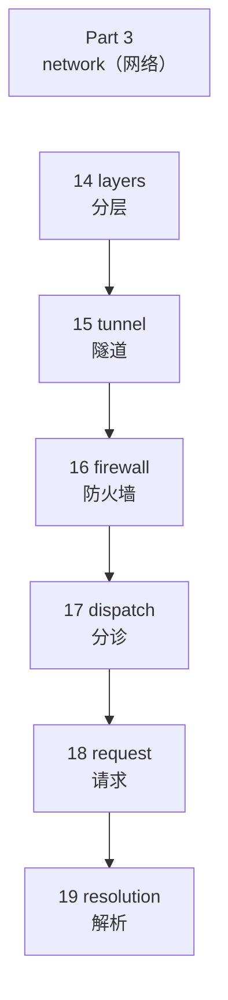

# Part 3 自测

本卷覆盖 Part 3 的六个词：**layers、tunnel、firewall、dispatch、request、resolution**。玩法：闭卷——合上书从第 1 题做到最后，全部做完再逐题打开 `
` 对答案；每题答案带一句推导与回指小节，答错的按回指重读该章「本章小结」的①②③，隔 1 天重做错题。

**图 P3-1｜Part 3 词链**（Part 词打头，六个章词按章序成链——第 1 题要默写的就是它）：

---

## 题目

**T1**：合上书，默写 Part 3 词链（六个章词的顺序不能乱），并把这些词串成一句话。

答案

词序：layers → tunnel → firewall → dispatch → request → resolution。

串句：连得上 → 进得来 → 拦得住 → 开得了门 → 用得上 → 找得到，六关全过才算一台对外的机器。

推导：先分层排障（layers），再加密进出（tunnel）、立准入规则（firewall）、开 Web 门（dispatch），自己当客户端验货（request），最后让名字找得到（resolution）。回指：ch00 词链表、第 14–19 章本章小结。

**T2**：预测：`location /api/ { proxy_pass http://localhost:8080/; }`，请求 /api/users 到达后端时是什么路径？把 proxy_pass 末尾的 / 去掉呢？

答案

带 / 是 `/users`（替换前缀）；不带 / 是 `/api/users`（原样透传）。

推导：proxy_pass 带 URI 时用替换语义——分诊台把「科室前缀」摘掉再转上游。回指：17.4。

**T3**：ping 不通某台服务器，能断定「网断了」吗？为什么？

答案

不能。可能服务器禁 ICMP、中间防火墙拦截，但 TCP 端口仍可用。

推导：ping 走 ICMP，端口服务走 TCP——ping 通端口不通是防火墙，反过来 ping 不通也不等于服务不可达。回指：14.3。

**T4**：预测：INPUT 链第一条规则是 `-A INPUT -j DROP`，之后又追加了 `-A INPUT -p tcp --dport 80 -j ACCEPT`。80 端口能访问吗？怎么修正？

答案

不能。规则自上而下命中即停，DROP 在前先命中，后面的 ACCEPT 永远轮不到；修正用 `-I` 把放行规则插到 DROP 之前。

推导：这是准入列表的顺序语义——先挡后放等于全挡。回指：16.2。

**T5**：curl 不加 `-L` 会怎样？为什么很多 API 调用要加 `-L`？

答案

收到 301/302 时不跟随，拿到重定向响应就停；加 -L 才跟着新地址继续请求。

推导：curl 裸写方法与头，不写 -L 就把「换地址的便条」当最终回包。回指：18.1。

**T6**：列出至少三项 SSH 安全加固措施。为什么改 sshd 配置前要保持一个 SSH 连接不断？Fail2Ban 起什么作用？

答案

禁 root 密码登录、只用密钥认证、改默认端口、Fail2Ban 自动封禁；保持旧连接是因为 sshd 配置错了 `restart` 后新连接进不来，旧会话可回滚；Fail2Ban 读日志自动拉黑爆破 IP。

推导：改 sshd 配置是把门规则重写——测试期最容易把自己锁外，留活连接等于留后门钥匙。回指：15.10。

**T7**：/etc/hosts 和 DNS 服务器谁的解析优先级高？由哪个文件的哪一行控制？

答案

hosts 优先；由 `/etc/nsswitch.conf` 的 `hosts:` 行控制顺序。

推导：解析链按 nsswitch 顺序查——hosts 排在 dns 前就压过 DNS。回指：19.9。

**T8**：写出命令：修改 Nginx 配置后的标准两步（验证语法 + 不中断服务重载）。为什么必须先做第一步？

答案

`nginx -t` 验证语法，再 `systemctl reload nginx` 平滑重载；先验证是因为带语法错误 reload 会让新 worker 起不来、服务挂掉。

推导：总机改接线表前先查表有没有写错——`nginx -t` 永远在 reload 之前。回指：17.2。

**T9**：「网断了」时，书中要求的排查顺序是什么？为什么顺序不能乱？

答案

从底层往上逐层排查——网卡/IP（ip addr）→ 连通性（ping）→ 路由（traceroute/ip route）→ 端口（ss）→ 抓包（tcpdump）。

推导：下层不通上层全废——IP 都没配对，ping 与端口检查只会白做；分层链路决定了排除方向只能自底向上。回指：14.12。

**T10**：执行 `sudo ufw enable` 之前必须先做什么？忘了做会怎样，如何补救？

答案

先放行 SSH 端口（`ufw allow 2222/tcp` 等）；忘做会把自己 SSH 踢下线锁在门外；补救靠云控制台/VNC 登录删规则。

推导：默认策略一变拒绝，未放行的 SSH 立即被拦——写规则的人最容易锁自己。回指：16.1。

**T11**：预测：`curl -d "x=1" URL` 默认用什么请求方法？想改用 PUT 怎么写？

答案

默认变 POST；改 PUT 用 `-X PUT`。

推导：-d 带请求体时 curl 按表单语义默认套 POST——不写方法就有默认，裸写才显式。回指：18.1。

**T12**：SSH 三种端口转发 -L、-R、-D 各把端口往哪个方向映射？哪个是 SOCKS 代理？

答案

-L 本地→远程，-R 远程→本地，-D 动态 SOCKS 代理。

推导：方向看「监听端在哪边」——本地监听是 -L，远程监听是 -R，-D 在本地开 SOCKS 出口。回指：15.6。

**T13**：「网站打不开」时，DNS 排查的前几步按什么顺序？

答案

dig 域名看能否解析 → `dig @8.8.8.8` 绕本机缓存对比 → 查 /etc/resolv.conf 与 hosts → 看 TTL 是否未过期。

推导：沿缓存链逐环排除，每环都可能给旧答案——先分流是本机缓存还是权威端。回指：19.12。

---

## 下一站

Part 3 的六关都过了——机器已经对外可用。接下来 Part 4 的 Part 词是 **automation**（自动化）：重复劳动交给脚本与三剑客，突发故障交给方法论，环境漂移交给容器。从[第 20 章 script](./ch20.md) 开始。

---
