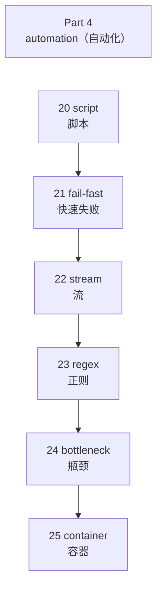

# Part 4 自测

本卷覆盖 Part 4 的六个词：**script、fail-fast、stream、regex、bottleneck、container**。玩法：闭卷——合上书从第 1 题做到最后，全部做完再逐题打开 `
` 对答案；每题答案带一句推导与回指小节，答错的按回指重读该章「本章小结」的①②③，隔 1 天重做错题。

**图 P4-1｜Part 4 词链**（Part 词打头，六个章词按章序成链——第 1 题要默写的就是它）：

---

## 题目

**T1**：合上书，默写 Part 4 词链（六个章词的顺序不能乱），并把这些词串成一句话。

答案

词序：script → fail-fast → stream → regex → bottleneck → container。

串句：重复劳动交给脚本与三剑客，突发故障交给方法论，环境漂移交给容器。

推导：先把会敲的固化成脚本（script）并让它错了就停（fail-fast），量级文本上流水线（stream）配花纹（regex），出了故障找堵点（bottleneck），环境惯犯交给容器（container）。回指：ch00 词链表、第 20–25 章本章小结。

**T2**：预测：一台 4 核机器 uptime 显示 load average 6，说明什么？load 只统计正在用 CPU 的进程吗？

答案

load 6 > 核心数 4 → CPU 过载、进程在排队（>N×5 即 20 以上才严重）；load 含正在运行 + 等待运行 + 等待 IO 的进程。

推导：load 高也可能是磁盘 IO 瓶颈——看 top 的 wa% 区分 CPU 密集还是 IO 等待。回指：24.9。

**T3**：`bash script.sh`、`./script.sh`、`source script.sh` 三种执行方式有什么区别？预测：set_var.sh 里写了 `MY_SECRET="top_secret_123"` 与 `export MY_EXPORTED="global_value"`，用 bash 执行后再 echo 这两个变量，输出什么？改用 source 呢？

答案

bash 与 ./ 都开子进程执行，变量随进程销毁（./ 还要先 chmod +x、按 Shebang 选解释器）；source 在当前 Shell 内执行，变量函数都留下；export 只传给子进程、不回流父 Shell。bash 后两个变量皆空，source 后分别为 top_secret_123 与 global_value——所以加载 ~/.bashrc 这类配置必须 source。

推导：执行方式决定「在哪个 Shell 里跑」，子 Shell 的改动不回流。回指：20.1、20.3。

**T4**：下面三件事分别该交给 grep、sed、awk 中的谁：(a) 找出日志里所有含 ERROR 的行；(b) 把配置里的 port=80 改成 port=8080；(c) 统计每个 IP 的访问次数？

答案

(a) grep 选行；(b) sed 改内容 `sed -i 's/^port=.*/port=8080/'`；(c) awk 按字段统计 `awk '{ count[$1]++ } END { for (ip in count) print count[ip], ip }'`。

推导：一句话选型——找行用 grep，改内容用 sed，算列用 awk。回指：22.4。

**T5**：预测：全栈实战里 nginx/web/db/cache 四个服务如何互访？为什么删掉 db、cache 容器数据不丢？

答案

四服务同在自定义网络 app-network，靠内置 DNS 用服务名互访（nginx→web:3000，web 连 db:5432/cache:6379）；数据落在 pg-data、redis-data 命名卷。

推导：命名卷独立于容器生命周期，`docker compose down`（不带 -v）删容器不删卷，数据还在。回指：25.7、25.9。

**T6**：预测输出：`count=0`，`increment() { local count=$1; count=$((count + 1)); echo $count; }`，执行 `result=$(increment 5)` 后 `echo "$result"` 与 `echo "$count"` 各是什么？去掉 local 又会有什么不同？

答案

result=6、全局 count 仍 0——local 让 count 只在函数内可见；去掉 local 后，`result=$(increment 5)` 的命令替换开子 Shell 全局仍不被改，只有直接调用才会改全局。

推导：函数内一律用 local——既不污染全局，也不依赖调用方式。回指：21.3（子 Shell 陷阱另见 20.10）。

**T7**：预测输出：对同一行 `<h1>Hi</h1>`，`grep -oP '<.*>'` 与 `grep -oP '<.*?>'` 各输出什么？

答案

贪婪版 1 行 `<h1>Hi</h1>`——`.*` 一口气吃到最后一个 `>`；非贪婪版 2 行 `<h1>`、`</h1>`——`.*?` 遇第一个 `>` 就停。

推导：提取 HTML 标签要用非贪婪，否则整行被当成一个匹配。回指：23.1。

**T8**：写出命令：查谁占用了 3000 端口。磁盘满了但 du 找不到大文件，又该查什么？

答案

`lsof -i :3000` 列出监听进程（拿到 PID 再处置）；`lsof +L1` 找已删除仍被进程持有的文件。

推导：这类文件 du 看不到、df 仍算占用——重启或 kill 持有进程，空间才释放。回指：24.3。

**T9**：预测输出：file.txt 有 3 行，执行 `count=0; cat file.txt | while read line; do count=$((count + 1)); done; echo $count` 打印什么？怎么改才能得到 3？

答案

打印 0——管道每段都在子 Shell 里跑，count 的修改随子 Shell 丢弃；改成重定向 `done < file.txt` 让循环留在当前 Shell。

推导：子 Shell 的变量改动不传回父 Shell，所以计数归零；重定向后循环体在当前 Shell 执行，得 3。回指：20.10（执行方式背景见 20.3）。

**T10**：管道 `grep "GET" access.log | awk '{ print $1, $7 }' | sort | uniq -c | sort -rn | head -10` 每一段各做什么？为什么 uniq 前必须先 sort？

答案

grep 筛 GET 行、awk 取 IP+URL 两列、sort 让相同组合相邻、uniq -c 合并相邻重复并计数、sort -rn 按次数降序、head 取前 10。

推导：uniq 只合并相邻的重复行——不先 sort，分散各处的相同行不会被合并计数。回指：22.4。

**T11**：容器和虚拟机的核心区别是什么？为什么容器更轻量？共享内核带来什么风险？

答案

VM 硬件级虚拟化、每个应用带整套 Guest OS（GB 级、分钟级启动）；容器 OS 级虚拟化、共享宿主内核（MB 级、秒级启动）。

推导：轻量来自省掉每容器一套 OS；代价是共享内核并非完整隔离——内核漏洞可能波及所有容器。回指：25.1。

**T12**：`set -euo pipefail` 三件套各防什么？为什么清理逻辑挂在 `trap EXIT` 上最可靠？写出临时文件自动清理的两行命令。

答案

-e 命令失败立即退出；-u 引用未定义变量报错；-o pipefail 管道任一环节失败整条算败（false | true 默认 0，开启后 1）。EXIT 对正常结束、set -e 中途退出、显式 exit 1 都触发，清理挂这里不漏。命令：`tmpfile=$(mktemp)` + `trap 'rm -f "$tmpfile"' EXIT`——mktemp 给唯一文件名防竞态，trap 保证任何退出路径都清理。

推导：三件套把「错」变「停」，trap 把「停」变「有交代」。回指：21.6。

**T13**：预测输出：`printf "apple\nbanana\napple\n" | uniq -c`。为什么通常要先 sort 再 uniq？写出统计 access.log 中 TOP 10 访问 IP 的管道。

答案

输出 `1 apple`、`1 banana`、`1 apple`——uniq 只合并相邻重复行，两个 apple 不相邻各算一次；先 sort 聚拢才能正确计数。管道：`awk '{print $1}' access.log | sort | uniq -c | sort -rn | head -10`——awk 取 IP 列，后面全靠 sort/uniq/sort -rn/head 逐级加工。

推导：流式加工的顺序就是语义——uniq 的「相邻」假设由上游 sort 兑现。回指：23.3。

---

## 下一站

六个词都收齐了——25 个词的最后一关在[全书毕业测试](./final-test.md)：词柄乱序抽问、四条词链默写、五条跨篇硬依赖、三道综合操作。

---
