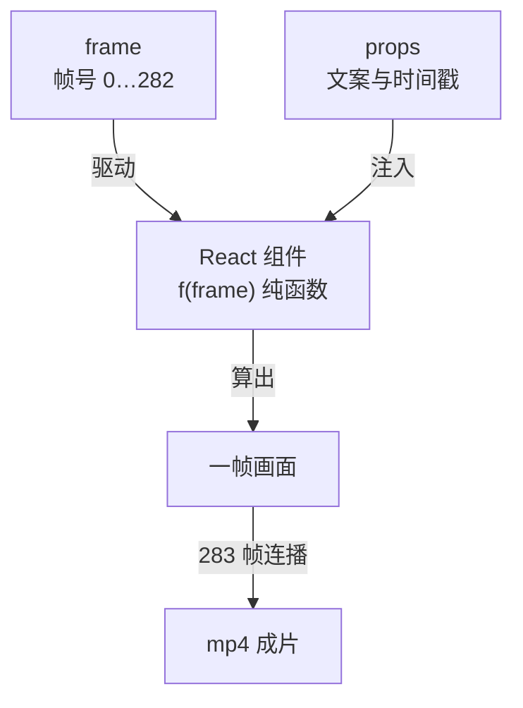
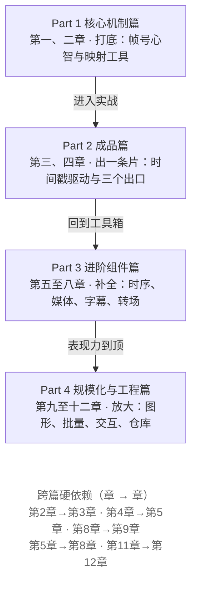
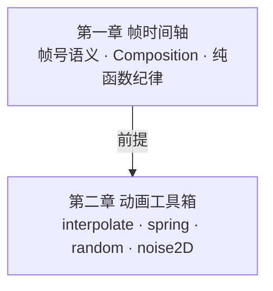
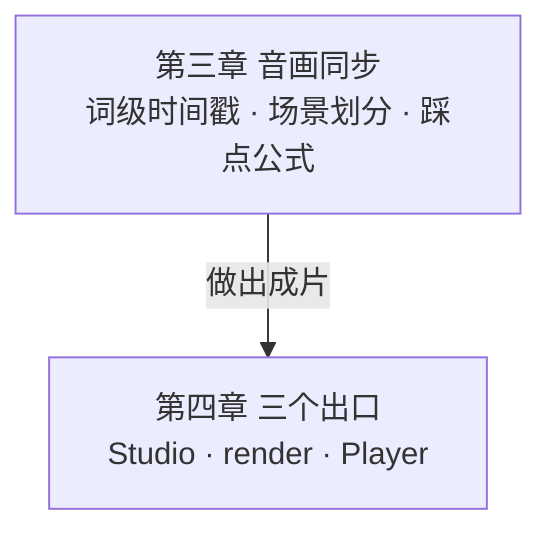
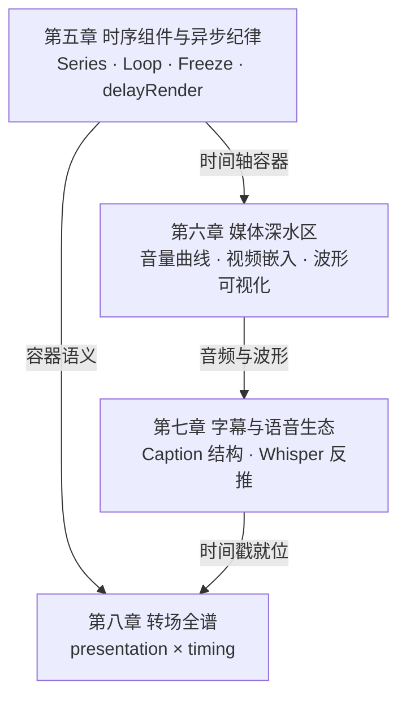
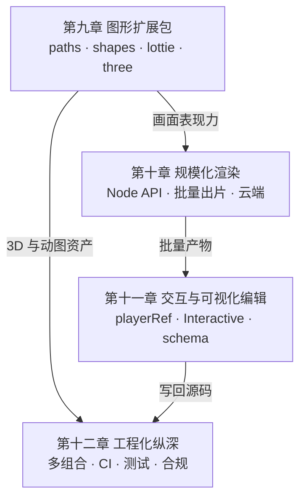

# Remotion 完全教程

> 用 React 写视频：把「做动画」变成「写代码」，让每一帧都确定、可复现、可版本管理

---

## 目录

### Part 1: 核心机制篇（基础概念篇）

- [第一章 帧时间轴——Remotion 的世界观](./ch01.md)
- [第二章 动画工具箱——interpolate、spring、random 与 noise](./ch02.md)
- [Part 1 自测](./part1-test.md)

### Part 2: 成品篇（做出片与交出片）

- [第三章 音画同步——用时间戳驱动一部视频](./ch03.md)
- [第四章 三个出口——Studio、render 与 Player](./ch04.md)
- [Part 2 自测](./part2-test.md)

### Part 3: 进阶组件篇（组件与媒体篇）

- [第五章 时序组件与异步纪律——Series、Loop、Freeze 与 delayRender](./ch05.md)
- [第六章 媒体深水区——音量曲线、视频嵌入与波形可视化](./ch06.md)
- [第七章 字幕与语音生态——Caption 结构与 Whisper 反推时间戳](./ch07.md)
- [第八章 转场全谱——preset 画廊、两种 timing 与自定义转场](./ch08.md)
- [Part 3 自测](./part3-test.md)

### Part 4: 规模化与工程篇（图形、规模与工程）

- [第九章 图形扩展包——paths、shapes、lottie、rive、motion-blur 与 three](./ch09.md)
- [第十章 规模化渲染——Node API、批量出片与云端渲染](./ch10.md)
- [第十一章 交互与可视化编辑——playerRef、Interactive 与属性面板](./ch11.md)
- [第十二章 工程化纵深——多组合、CI、测试与合规](./ch12.md)
- [Part 4 自测](./part4-test.md)

### 全书收口

- [全书毕业测试](./final-test.md)

---

## 心智模型

### 一、核心模型：视频是帧的纯函数（Pure Function）

剪辑软件的操作对象是「时间轴上的片段」，After Effects 的操作对象是「图层与关键帧」，而 Remotion（拉丁语「来自运动」）的操作对象是一个函数：

```
画面 = f(帧号)
```

给定帧号 12，组件算出第 12 帧的画面；给定帧号 13，算出第 13 帧的画面。视频不再是被「编辑」出来的，而是被「计算」出来的——30fps 的 9.41 秒视频，就是把这个函数从帧号 0 调用到帧号 **282**，把 283 张截图编码成 mp4。

**图 0-1｜核心模型：画面是帧号的纯函数**（节点为实体——帧号与 props 进、React 组件算、一帧画面出；边为操作：组件按帧号算出那一帧，283 帧连播即一条视频）：



<p class="figure-note">没有状态、没有时间轴素材，只有「第几帧」这一个输入</p>

这条规则是全书的地基。它带来三个其他视频工具给不了的性质：

- **可复现**（Reproducible）：今天渲染和下个月渲染，逐像素一致；
- **可版本管理**：改画面 = 改代码，git diff 一目了然；
- **可参数化**：同一套组件，换 props 就能换文案、换时长、换配色，批量出片。

### 二、易混概念对照表

| 概念 | 它是什么 | 它不是什么 |
| ---- | ---- | ---- |
| 组合（Composition） | 一条视频的「规格说明书」：宽高、帧率、总帧数、入口组件 | 不是时间轴上的一个片段 |
| 序列（Sequence） | 把组件「平移」到时间轴某处开始播放 | 不是图层蒙版，也不裁剪内容 |
| `useCurrentFrame()` | 当前帧号，相对最近的 Sequence 起点 | 不是真实时间戳，与墙钟无关 |
| `interpolate()` | 帧号区间到数值区间的映射 | 不是动画库，它只是查表 |
| Player | 把同一组件嵌进网页的播放器 | 不是另一个渲染引擎，输出与成片完全一致 |
| `staticFile()` | 指向 public/ 目录资产的路径函数 | 不是 import，路径不在打包期确定 |
| calculateMetadata | 渲染前按 props 动态计算规格 | 不是运行时每帧执行，整片只算一次 |
| 场景局部帧 | Sequence 内部重新从 0 计数的帧号 | 不是全局时间轴帧，跨场景不连续 |
| 转场（Transition） | 相邻场景重叠期间的两段画面混合 | 不是独立的场景，它「借用」两侧的时长 |
| `<Loop>` | 把一段帧区间循环播放的容器 | 不是 CSS 动画的 infinite 循环，循环由帧号取模（modulo）实现 |
| `delayRender()` | 让渲染等待异步数据就绪的闸门 | 不是异步加载动画，整片仍处于逐帧截图模型内 |
| `evolvePath()` | 把进度变成描边 dasharray/offset 的计算 | 不是动画库，输出的只是 SVG 属性值 |
| 运动模糊 | 一帧内多份采样叠加出的轨迹 | 不是 CSS blur 滤镜，模糊方向随运动而变 |
| InteractivitySchema | Studio 时间轴控件与关键帧的字段描述 | 不是 zod schema——它管画面编辑，不管数据校验 |

最容易踩的坑是左边第一列与右边第三列混用：比如以为 `useCurrentFrame()` 拿到的是「秒」，或是以为 `<Sequence>` 会把内容裁掉。第一、二章会把这几组概念逐一拆开。

### 三、Remotion 在视频工具版图上的位置

| 工具 | 你对它的操作 | 输出 | 适合 |
| ---- | ---- | ---- | ---- |
| 剪辑软件（DaVinci/PR） | 拖拽时间轴、调关键帧 | 手工产物 | 一次性成片 |
| After Effects | 图层 + 关键帧 + 表达式 | 手工产物 | 高复杂度特效 |
| FFmpeg | 命令行参数 | 可脚本化 | 转码、拼接、滤镜（见站内[《FFmpeg 完全教程》](/ffmpeg/ch00)） |
| Remotion | 写 React 组件 | 可编程、可复用 | 数据驱动的批量视频 |

最右边一列的「数据驱动」是 Remotion 独有的生态位：字幕视频、数据播报、个性化问候视频、自动生成的产品介绍——凡是「内容是数据、样式是模板」的场景，手工剪辑都会在第二批视频时崩溃，而 Remotion 只需要换一份 props。

用一张二维地图看四个工具的分工，两个维度分别是「谁来定节奏」（手工时间轴还是代码）与「谁来定内容」（人工素材还是数据）：

**图 0-2｜视频工具版图**（横轴看「内容从哪来」，纵轴看「节奏由谁定」，右上角的生态位即本书主题）：

<svg viewBox="0 0 400 300" xmlns="http://www.w3.org/2000/svg" font-family="system-ui, sans-serif">
  <defs>
    <marker id="arr00c" markerWidth="8" markerHeight="8" refX="7" refY="4" orient="auto">
      <path d="M0 0L8 4L0 8Z" fill="#999"/>
    </marker>
  </defs>

  <line x1="40" y1="150" x2="380" y2="150" stroke="#999" marker-end="url(#arr00c)"/>
  <line x1="60" y1="270" x2="60" y2="30" stroke="#999" marker-end="url(#arr00c)"/>

  <text x="388" y="146" font-size="12" text-anchor="end" fill="#555">内容：人工 → 数据</text>
  <text x="66" y="34" font-size="12" fill="#555">节奏：手工时间轴 → 代码</text>

  <rect x="90" y="180" width="130" height="52" rx="8" fill="#fafafa" stroke="#bbb"/>
  <text x="155" y="202" font-size="13" text-anchor="middle" fill="#333" font-weight="bold">剪辑软件</text>
  <text x="155" y="220" font-size="12" text-anchor="middle" fill="#555">DaVinci / PR</text>

  <rect x="240" y="180" width="130" height="52" rx="8" fill="#fafafa" stroke="#bbb"/>
  <text x="305" y="202" font-size="13" text-anchor="middle" fill="#333" font-weight="bold">FFmpeg</text>
  <text x="305" y="220" font-size="12" text-anchor="middle" fill="#555">参数驱动，无动画概念</text>

  <rect x="90" y="90" width="130" height="52" rx="8" fill="#f0f7ff" stroke="#4a90d9"/>
  <text x="155" y="112" font-size="13" text-anchor="middle" fill="#333" font-weight="bold">After Effects</text>
  <text x="155" y="130" font-size="12" text-anchor="middle" fill="#555">关键帧 + 表达式</text>

  <rect x="240" y="90" width="130" height="52" rx="8" fill="#f0f7ff" stroke="#4a90d9"/>
  <text x="305" y="112" font-size="13" text-anchor="middle" fill="#333" font-weight="bold">Remotion</text>
  <text x="305" y="130" font-size="12" text-anchor="middle" fill="#4a90d9" font-weight="bold">数据驱动的代码视频</text>

  <text x="200" y="284" text-anchor="middle" font-size="12" fill="#666">右上角是 Remotion 的生态位：内容批量来自数据，节奏完全由代码决定</text>
</svg>

### 四、贯穿全书的主线场景：一部 9 秒的「北京的冬天」

全书所有示例来自同一个真实项目：把一段中文旁白自动做成带配音、带字幕、带转场的短视频。

设定如下，全书数字与此保持一致：

- 文案（script.txt）：「今天是2026年的冬天，来到北京已经接近15年。又到了临近年末的日子，冬天来临了。」
- 配音：Edge-TTS，音色 zh-CN-XiaoxiaoNeural，音频时长 **8.81 秒**；
- 时间戳：TTS（Text-to-Speech，语音合成）服务返回**词级**时间点（word-level timestamp），共 **21 个词、2 个句子**（句一 0.1–5.225 秒，句二 5.175–8.75 秒，注意两句首尾重叠了 50 毫秒——第三章会专门处理这种脏数据）；
- 规格：1280×720、30fps；音频结束后保留 0.6 秒尾帧，总帧数 `ceil((8.81+0.6)×30) = 283` 帧；
- 画面：标题卡 → 每句一张大字卡片 → 结尾卡，共 3 个场景，用 15 帧（0.5 秒）的淡入淡出转场衔接；
- 呈现：底部卡拉OK式逐词高亮字幕，全程覆盖 120 片确定性雪花。

这套架构的每个环节都是**可替换的标准接口**：配音源不限于 Edge-TTS（任何能产出「音频 + 词级时间戳」的方案——人工配音打轴、语音识别反推——都能接入）；画面模板不限于字幕视频（数据播报、产品介绍只换组件不换流水线）；输出规格不限于 720p（改一个数字的事）。可替换性正是「模板」二字的价值：内容与样式的耦合点只剩 props 一个。

先把成片的形态画出来，全书每章都会回到这张时间轴：

**图 0-3｜贯穿示例的时间轴**（上下对照读：上半部三个场景按帧号排布——标题卡「北京的冬天」[0,172)、句子卡 [157,278)、结尾卡 [263,283)；中部横条为全程覆盖的元素；横轴为断轴示意、非等比）：

<svg viewBox="0 0 400 210" xmlns="http://www.w3.org/2000/svg" font-family="system-ui, sans-serif">
  <defs>
    <marker id="arr00d" markerWidth="8" markerHeight="8" refX="7" refY="4" orient="auto">
      <path d="M0 0L8 4L0 8Z" fill="#999"/>
    </marker>
  </defs>

  <line x1="20" y1="40" x2="360" y2="40" stroke="#999" marker-end="url(#arr00d)"/>
  <g font-size="12" text-anchor="middle" fill="#555">
    <text x="20" y="26">0s</text>
    <text x="192" y="26">5.2s</text>
    <text x="330" y="26">9.4s</text>
  </g>

  <rect x="192" y="34" width="16" height="58" fill="#ffe8cc" opacity="0.55"/>
  <rect x="308" y="34" width="17" height="58" fill="#ffe8cc" opacity="0.55"/>

  <rect x="20" y="50" width="188" height="46" rx="6" fill="#f0f7ff" stroke="#4a90d9"/>
  <text x="114" y="70" font-size="13" text-anchor="middle" fill="#333" font-weight="bold">场景一：标题卡</text>
  <text x="114" y="88" font-size="12" text-anchor="middle" fill="#555">句一 0.1–5.225s</text>

  <rect x="192" y="50" width="133" height="46" rx="6" fill="#f0f7ff" stroke="#4a90d9"/>
  <text x="258" y="70" font-size="13" text-anchor="middle" fill="#333" font-weight="bold">场景二：句子卡</text>
  <text x="258" y="88" font-size="12" text-anchor="middle" fill="#555">句二 5.175–8.75s</text>

  <rect x="308" y="50" width="22" height="46" rx="6" fill="#f0f7ff" stroke="#4a90d9"/>
  <text x="334" y="70" font-size="12" fill="#333" font-weight="bold">结尾卡</text>
  <text x="334" y="86" font-size="11" fill="#555">尾帧 20 帧</text>

  <rect x="20" y="112" width="310" height="46" rx="6" fill="#fafafa" stroke="#999"/>
  <text x="175" y="132" font-size="13" text-anchor="middle" fill="#333" font-weight="bold">全程覆盖：卡拉OK字幕 + 120 片雪花 + 进度条</text>
  <text x="175" y="150" font-size="12" text-anchor="middle" fill="#555">字幕、雪花不随场景切换消失</text>

  <text x="186" y="172" font-size="11" text-anchor="end" fill="#b06f00">转场1</text>
  <text x="302" y="172" font-size="11" text-anchor="end" fill="#b06f00">转场2</text>

  <text x="200" y="192" text-anchor="middle" font-size="12" fill="#666">横轴为断轴示意（非等比）；橙色竖带为两处 15 帧转场重叠区</text>
  <text x="200" y="206" text-anchor="middle" font-size="12" fill="#666">右侧窄条是结尾卡；字幕与雪花全程覆盖，不受转场影响</text>
</svg>

### 五、学习路径建议

- **会用 React**：按章节顺序通读即可，全书代码量最大的两处（ch02 雪花、ch03 场景踩点）都控制在 50 行以内；
- **不熟 React**：先读站内[《React 完全教程》](/react/ch00)的组件与 Hooks 两章再回来，Remotion 只用到 `useState` 级别的基础；
- **只想快速出片**：直接读第三章 + 第四章，抄走流水线骨架，回头再补前两章；
- **进阶按需选读**：Part 3 建议顺序读（时序与异步是后续各章的地基）；Part 4 各章相对独立——做批量出片读 ch10、做交互与可视化编辑读 ch11、要图形表现力读 ch09、建仓库读 ch12。

时间预估：第一、二章各半天（每章都有可动手的验证动作），第三章一天（跟做流水线），第四章半天（交付与排错）——一个有 React 基础的读者，两到三天走完主线并拥有第一条流水线；Part 3 / Part 4 每章约半天到一天，按需选读。

**自测怎么用**：每学完一个 Part，去该 Part 的自测章闭卷作答——全部做完再逐题看答案，错题按「回指小节」重读，隔 1 天重做错题。四个 Part 全过之后，做[全书毕业测试](./final-test.md)收口：它用跨章综合题确认这十二章在你手里是一套东西，而不是十二块零件。

### 六、全书约定

- **版本**：所有代码基于 Remotion 4.x（示例取自 4.0.545），3.x 的旧 API 不保证兼容。Part 4 涉及的部分新 API 会标注引入版本（如 Interactive 4.0.475 起、转场 motionBlur 4.0.545 起），均已包含在 4.0.545 内；
- **目录**：示例项目结构约定为 `remotion/`（组件与入口）、`public/`（音频、字体、时间戳）、`web/`（Player 网页）、`scripts/`（流水线脚本），与第四章的三个出口一一对应；
- **单位**：时间戳一律以「秒」出现在 props 中，进入组件后用 `t = frame / fps` 还原，帧号换算只发生在场景划分等少数边界处（第三章）；
- **示例数字**：全书共用同一份贯穿数据（8.81 秒音频、283 帧、三个场景），任何一章看到的帧号都可以和另一章互相印证。

---

## 全景总览

**图 0-4｜四个 Part 的关系**（箭头示 Part 之间的依赖方向，灰字列出跨篇的章到章硬依赖）：



<p class="figure-note">四个 Part 是四级放大：机制 → 成品 → 全量工具箱 → 规模与工程；每级自测章负责把这一级闭卷过关</p>

各章之间是严格的依赖链：不懂「帧的纯函数」（第一章）就无法理解为什么动画工具都围绕帧号设计（第二章）；没有前两章的确定性心智，第三章的时间戳踩点公式看起来会像魔法咒语；第四章的三个出口只是把前三章的产物换一种方式交付。Part 3 各章以 3.5 的踩点与 5.5 的异步纪律为地基，建议顺序读；Part 4 各章相对独立，可按需求直接跳读。下面四张图把每一篇内部的章与章依赖摊开。

### Part 1 内部关系（第一、二章）

第一章铺好「画面 = f(帧号)」的地基与纯函数纪律；第二章把帧号到数值的映射交给四个官方工具。

**图 0-5｜Part 1 章节关系**（帧号心智 → 映射工具，后者是前者的直接延伸）：



### Part 2 内部关系（第三、四章）

第三章用词级时间戳把画面踩到正确的帧上；第四章把这份组件交到 Studio、render、Player 三个出口。

**图 0-6｜Part 2 章节关系**（时间戳驱动 → 三个出口交付）：



### Part 3 内部关系（第五至八章）

第五章给时间轴的排列与等待立规矩；第六章把音视频资产接进来；第七章解决字幕从哪来；第八章把转场讲到全谱——四章是「先立容器，再填内容」的顺序。

**图 0-7｜Part 3 章节关系**（容器 → 媒体 → 字幕 → 转场，第五与第八章之间另有一条容器语义的依赖）：



### Part 4 内部关系（第九至十二章）

第九章补上图形资产与 3D；第十章把渲染变成程序里的一个 `await`；第十一章让画面可以被遥控与可视化编辑；第十二章收口成能长期维护的仓库。

**图 0-8｜Part 4 章节关系**（表现力 → 规模 → 可编辑 → 可维护）：



最后说明一下本教程的读法：所有代码都是**可运行的节选**，取自一个真实的 TTS 字幕视频项目，可以逐段敲进你自己的项目里验证；每章末尾的「本章小结」负责收束，「下一章预告」负责衔接——赶时间时只读小结串起全书，也是一种完整的读法。

如果读的过程中想随时动手，官方的 Remotion Playground 模板（`npx create-video@latest`）与本教程示例结构最接近，建议作为练手沙盒。

---
