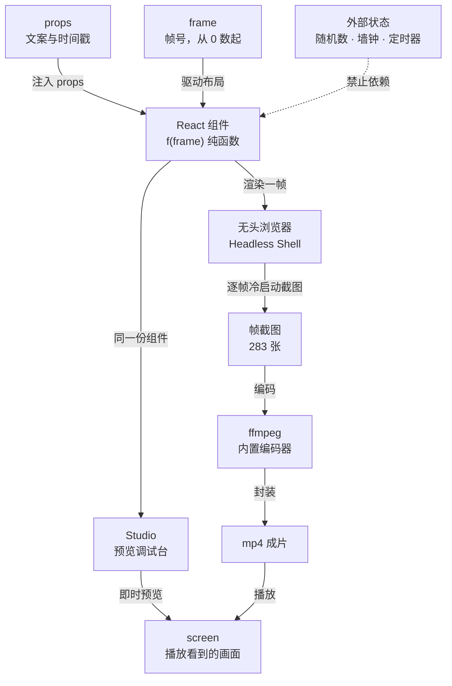

# 第一章：帧时间轴——Remotion 的世界观

> [!TIP] Part 1: 核心机制篇（基础概念篇）
> 本篇回答两个问题：画面为什么必须是帧的纯函数（本章），以及官方提供了哪些围绕帧号设计的动画工具（第二章）。本章是全书的地基，先修要求：会写基本的 React 函数组件。

## 为什么要学帧时间轴？

本章管 Remotion 的世界观——把「视频」这个连续的时间概念，变成「帧号到画面的函数」这个离散的计算概念；后面所有 API 的形状都由这个模型决定。

**图 1-1｜本章模型：画面是帧号的纯函数**（节点为实体——帧号与 props 进、React 组件算、无头浏览器截图、ffmpeg 编码、成片出；实线是常态路径，虚线是被纪律禁止的依赖）：



<p class="figure-note">同一个帧号永远算出同一张画面，渲染只是把这个函数从第 0 帧调用到第 282 帧</p>

> [!WARNING] 先猜再读
> - 先猜一猜：30fps 的视频里，`useCurrentFrame()` 在第 1 秒那一刻返回多少？100？1？还是 30？（答案见 1.3）
> - 多数人以为网页动画要靠 CSS transition 或 setTimeout 才「会动」，其实在 Remotion 里这两个东西都会失效——为什么？（答案见 1.4）
> - 先猜一猜：渲染 9 秒视频时，Remotion 是「实时播放并录屏」，还是「一帧一帧截图」？耗时差多少？（答案见 1.5）

## 1.1 视频是什么——一叠按帧排列的画面

视频的本质是快速连播的静态图片，每一张叫一帧（Frame）。每秒播放的帧数叫帧率（fps，frames per second）。fps 是「秒」和「帧」之间的汇率：

| 帧率 | 每帧时长 | 典型用途 |
| ---- | ---- | ---- |
| 24 fps | 41.7 ms | 电影胶片质感 |
| 30 fps | 33.3 ms | 网络视频、本教程主线 |
| 60 fps | 16.7 ms | 高流畅度游戏录屏 |

换算只有两条公式，全书反复使用：

```text
帧号 = 秒 × fps          （把时间戳换算成第几帧）
秒   = 帧号 ÷ fps        （把帧号还原成时间）

例：30fps 下，音频 8.81 秒 + 0.6 秒尾帧 = 9.41 秒
    ceil(9.41 × 30) = 283 帧
```

还有一个贯穿全书的 off-by-one 约定要在此钉死：**帧号从 0 开始数**。283 帧的视频，最后一帧的帧号是 **282**——第 283 帧不存在。后续所有「转场落在第 157 帧」「结尾卡在 [263, 283)」的区间写法都遵循「左闭右开、末帧 = 总帧数 − 1」的惯例，第一次接触区间记号时容易在这里犯晕。

同理，秒转帧用 `Math.round` 后得到的帧号也是「这一帧开始显示」的含义：157 帧对应 5.233 秒，意味着**从这一帧起**画面切换，而此前的每一帧仍属于旧场景。第三章的场景区间公式全部建立在这个语义上。

贯穿全书的示例视频由此确定规格：**30fps、283 帧、1280×720**。这两条换算看似平淡，但第三章所有「时间戳踩点」都是它们的应用——任何以秒计的时间戳，乘以 fps 取整，就得到它在时间轴上的帧位置。拿贯穿示例的三个真实时间戳先练一遍手感：

| 时间戳 | 含义 | 换算 | 帧号 |
| ---- | ---- | ---- | ---- |
| 5.225 s | 句一结束 | round(5.225 × 30) = round(156.75) | 157 |
| 5.175 s | 句二开始 | round(5.175 × 30) = round(155.25) | 155 |
| 8.750 s | 句二结束 | round(8.75 × 30) = round(262.5) | 263 |

注意三行里的取整手法：`Math.round` 是「四舍五入到最近的整数帧」，误差最多半帧（30fps 下约 17ms）。这三个帧号在第三章会被反复引用——现在先记住一个事实：**两个换算结果 155 与 157 出现了倒挂**，这正是贯穿示例里埋着的脏数据（详解见 3.4）。

## 1.2 组合（Composition）——视频的规格说明书

一条 Remotion 视频，先要有「规格」：多宽、多高、多少帧率、多少帧、入口组件是什么。这个规格叫组合（Composition）：

```tsx
// Root.tsx —— 每个项目的入口
import { Composition } from "remotion";

export const RemotionRoot: React.FC = () => (
  <Composition
    id="WinterVideo"                    // 视频的唯一 ID，命令行渲染时用它点名
    component={WinterVideo}             // 入口组件
    durationInFrames={300}              // 兜底帧数（见下方 calculateMetadata）
    fps={30}                            // 帧率
    width={1280}                        // 画布宽
    height={720}                        // 画布高
    defaultProps={{ voice: "", duration: 10, words: [], sentences: [] }}
    calculateMetadata={({ props }) => ({
      durationInFrames: getDurationInFrames(props),   // 按音频时长动态算
    })}
  />
);
```

两个细节值得停留：

- **defaultProps 是兜底**。Studio 打开时还没拿到真实数据（比如音频时长 8.81 秒），会先用默认 props 渲染一版，所以默认值必须合法——`duration: 10` 让 Studio 至少有一版能画出来；
- **calculateMetadata 让规格跟着数据走**。帧数不再是写死的常数，而是「音频 8.81 秒 + 尾帧 0.6 秒 → 283 帧」的计算结果。这是「数据驱动视频」的第一块拼图：文案变了、音频变了，视频总长自动跟着变。

Composition 的字段一张表收全：

| 字段 | 作用 | 贯穿示例的取值 |
| ---- | ---- | ---- |
| `id` | 组合的唯一标识，命令行与 Studio 都用它点名 | `WinterVideo` |
| `component` | 入口组件 | `WinterVideo` 组件 |
| `fps` | 帧率，决定秒与帧的换算 | 30 |
| `width` / `height` | 画布尺寸 | 1280 × 720 |
| `durationInFrames` | 兜底总帧数 | 300（被 calculateMetadata 覆盖） |
| `defaultProps` | 无数据时的兜底 props | 空的 words/sentences |
| `calculateMetadata` | 按 props 动态算规格 | 总帧数 = 283 |

`durationInFrames` 与 `calculateMetadata` 的关系要说明白：前者是**兜底值**，后者是**真实值**。渲染时以 `calculateMetadata` 的返回为准——所以「成片时长和音频对不上」这类问题，第一反应永远是查 `calculateMetadata` 有没有生效（4.2 的排错表）。

一个项目可以注册多条 Composition（比如同一模板的横版与竖版），它们并列写在 `RemotionRoot` 里，各有一个 `id`。渲染与 Studio 都用 `id` 点名：`npx remotion render remotion/index.ts WinterVideo out/video.mp4` 中的 `WinterVideo` 就是 `<Composition id>`。贯穿示例只注册一条，但「id 是点名凭证」这个约定从现在起就要建立——第四章的流水线脚本会用到它。

`id` 的命名值得定个规矩，因为它会出现在命令行、CI 配置和产物路径里：

| 规矩 | 反例 | 正例 |
| ---- | ---- | ---- |
| 用业务名，不用序号 | `video1` | `WinterVideo` |
| 同一模板的变体用同一前缀 | `a` / `b` | `WinterVideo` / `SummerVideo` |
| 与产物文件名对齐 | id 是 `Winter`，文件叫 `winter.mp4` | id 与文件名同形（大小写差异可接受） |

> [!TIP]
> `calculateMetadata` 只在「渲染/导出前」和「Studio 里修改 defaultProps 时」执行，不会随播放逐帧运行。所以它里面可以做取整、查表这类计算，但拿不到 `useCurrentFrame()`——执行的那一刻还没有「当前帧」的概念。

## 1.3 useCurrentFrame 与 useVideoConfig——时间轴的两把尺子

组件内部拿时间只有一把尺子：`useCurrentFrame()`，返回**当前帧号，从 0 开始的整数**。它不返回秒、不返回毫秒——帧是 Remotion 世界的时间原子。

```tsx
import { useCurrentFrame, useVideoConfig } from "remotion";

export const Clock: React.FC = () => {
  const frame = useCurrentFrame();          // 0, 1, 2, ... 282
  const { fps, durationInFrames } = useVideoConfig();
  const t = frame / fps;                    // 帧号还原成秒：0.0, 0.033, 0.067, ...

  return <span>{t.toFixed(1)}s / {(durationInFrames / fps).toFixed(1)}s</span>;
};
```

回答「先猜再读」：30fps 的视频第 1 秒那一刻，`useCurrentFrame()` 返回 **30**——因为帧号从 0 数起，第 0 帧到第 29 帧是第 1 秒。

`useVideoConfig()` 返回本组合的四件套：`fps`、`width`、`height`、`durationInFrames`。**永远从它读 fps，不要把 30 写死在组件里**——否则哪天改 60fps，所有动画的节奏都会悄悄翻倍。

两把尺子的分工与读法，一张表收全：

| API | 返回 | 什么时候用 | 常见错误 |
| ---- | ---- | ---- | ---- |
| `useCurrentFrame()` | 当前帧号（整数，从 0 起） | 一切随时间变化的东西 | 在 Sequence 外用（11.2 会细说） |
| `useVideoConfig().fps` | 帧率 | 秒↔帧换算 | 把 30 写死 |
| `useVideoConfig().width/height` | 画布尺寸 | 布局与比例计算 | 假设画布是 1920 |
| `useVideoConfig().durationInFrames` | 总帧数 | 进度条、归一化位置 | 与 props 里的总长不一致（3.4 的坑） |

「不要写死 fps」的代价值得具体算一遍：把 fps 从 30 改成 60，而组件里写死了 `t = frame / 30`，那么所有按秒写的逻辑（`t >= word.start`）在 60fps 下会**慢一倍**——画面不会报错，只是节奏全错，等到成片才发现就晚了。而从 `useVideoConfig()` 读 fps，改一次全局生效。

全书示例统一用 `t = frame / fps` 换算成秒再写逻辑，原因在第三章揭晓：TTS 时间戳的单位是秒，统一成秒后，判断「当前词是否已读到」就是一行 `t >= word.start`。

## 1.4 纯函数渲染——同一帧必须同一画面

**同一帧号，无论渲染多少次，必须产出完全相同的画面。** 这是 Remotion 唯一的硬性纪律，也是它「可复现」承诺的代价。违反它的常见途径与替代方案：

| 禁用 | 为什么 | 替代 |
| ---- | ---- | ---- |
| `Math.random()` | 每帧结果都不同，雪花会疯狂抖动 | `random(seed)`（第二章） |
| `Date.now()` | 渲染时刻不同，画面随日期漂移 | `frame / fps` |
| 网络请求 / 读文件 | 结果随外部状态变化 | 数据走 props 预先注入 |
| CSS `transition` / `animation` | 每帧都是新页面，transition 永远停在起点 | 用帧号算插值（第二章） |
| `setTimeout` / `setInterval` | 截图不等待定时器，动画脱帧 | 全部逻辑由 frame 驱动 |

「纯函数」在这里有三层含义，逐一对应上面的禁令：

| 层次 | 判据 | 违反时的表现 |
| ---- | ---- | ---- |
| 输入确定 | 同样输入必得同样输出 | 雪花每帧乱跳 |
| 输入有限 | 只依赖 frame 与 props，不依赖外部状态 | 今天的片和下周的片不一样 |
| 无隐藏状态 | 组件之间不共享可变数据 | 换一台机器渲染结果就变 |

第三层最隐蔽：两个组件共享一个模块级的可变变量（比如 `let currentTime = 0`），渲染时多个标签页并发跑同一份代码，变量互相踩——本地预览看不出来，一到并发渲染就出错。所以「所有状态都从 frame 算出来」不只是为了可复现，也是为了并发安全。

反例与正例对比（实现「进度条随时间前进」）：

```tsx
// 反例：CSS transition 驱动 —— 截图时 width 永远是 0%
<div className="progress" style={{ transition: "width 9s linear" }} />

// 正例：帧号直接算出宽度 —— 第 100 帧就一定是 100/283 的宽度
const width = `${(frame / durationInFrames) * 100}%`;
<div style={{ width }} />
```

正例里没有「动画」这个词——没有过渡、没有缓动、没有定时器，宽度就是帧号乘一个系数。**动的不是样式，是帧号**；样式每帧都重新算一遍，看起来就「动」了。这个视角转换是 Remotion 上手最大的门槛，跨过去之后，第二章的四个工具都只是「让帧号到数值的映射更优雅」而已。

提交前可以跑一遍这份确定性自检清单：

- 全文件搜 `Math.random` 与 `Date.now`——应当零命中；
- 全文件搜 `setTimeout` 与 `setInterval`——应当零命中；
- 组件内没有 fetch、没有直接读文件，所有数据来自 props；
- 把时间轴拖到同一帧两次（或用 `--frames=157-157` 渲染两遍）——画面逐像素一致。

## 1.5 渲染原理——无头浏览器截图机 + 内置 ffmpeg

`npx remotion render` 背后发生的事，就是图 1-1 里那条从组件到成片的链路展开：源码先被 esbuild 打成一份静态 bundle，无头 Chrome（Headless Shell）按并发数开多个标签页，每个标签页负责一段帧号（标签页 A 截 0~70 帧、标签页 B 截 71~140 帧……），每一帧都是「打开页面 → 设定 frame → 截一张图」，最后内置 ffmpeg 把图片序列编码成 H.264 视频、把音频轨混成 AAC，一并封装成 mp4。

三个推论值得记住：

- **渲染不是播放**。9 秒的视频不需要渲染 9 秒——283 帧是并行截图的，默认并发数约为 CPU 核心数的一半，示例项目在 M 系列芯片上十几秒出片；反过来，渲染 10 分钟视频可能要几分钟，比实时播放慢；
- **音频不是截图截来的**。`<Audio>` 组件只负责在最终封装时把音频轨混进去（第三章详述），截图阶段只有画面；
- **首次渲染会下载 Chrome Headless Shell**（约 100 MB，一次性），因为 Remotion 需要一个确定版本的浏览器来保证截图一致。

这也解释了 1.4 的纪律为什么存在：每个标签页每帧都重新加载页面、重新执行组件——任何「状态」都会在 283 次冷启动之间丢失或漂移，只有纯函数能在这种执行模型下保持稳定。

并发度直接决定渲染耗时，值得单独看一眼：默认并发是 CPU 线程数的一半（上限 8），也就是说 8 核机器同时开 4 个标签页截图。三个调参的方向：

| 现象 | 可能原因 | 处置 |
| ---- | ---- | ---- |
| 渲染很慢但 CPU 没满 | 并发太低 | 调高 `--concurrency`（不超过 CPU 核数） |
| 渲染很慢且 CPU 满 | 真的在算 | 查 10.3 的 `slowestFrames` 找慢帧 |
| 内存吃紧 / 页面崩溃 | 并发太高，每个标签页都开一个完整页面 | 调低 `--concurrency` |
| 同一台机器同时跑两条渲染 | 两条流水线互相抢标签页 | 错开执行，或调低单条的并发 |

## 1.6 Studio——帧时间轴的可视化调试台

写代码出片是最终形态，开发过程用的是 Remotion Studio：

```bash
npx remotion studio remotion/index.ts --props=out/timestamps.json
```

浏览器打开 localhost:3000，得到三个能力：

- **时间轴拖拽（scrub）**：拖到第 157 帧，画面立刻呈现第 157 帧——逐帧检查转场、字幕高亮的对齐，比反复看视频精确得多；
- **热更新**：改组件代码，画面即时刷新，与前端开发体验完全一致；
- **props 面板**：右侧面板直接编辑输入数据，用来模拟不同文案下的画面。

界面的主要分区用一张平面图建立方位感：

```text
┌──────────────────────────────────────────────┐
│ 顶部栏：Composition 切换 / 渲染按钮 / 设置    │
├──────────────────────────────┬───────────────┤
│                              │  右侧面板：    │
│   中央：画面预览              │  props 编辑器 │
│   （下方是时间轴刻度条，       │  当前树状态   │
│    可拖拽 scrub / 单步进退）  │  元素检查器   │
│                              │               │
├──────────────────────────────┴───────────────┤
│ 底部：时间轴输入框（直接键入帧号，最精确）     │
└──────────────────────────────────────────────┘
```

其中最常用的隐藏技巧是底部时间轴**直接键入帧号**：要核对第 157 帧的转场，输入 `157` 回车比拖拽精确得多。

Studio 里最常用的五个动作，对应五类检查：

| 动作 | 检查什么 | 对应章节 |
| ---- | ---- | ---- |
| 输入帧号 157 回车 | 转场踩点是否准 | 3.5 / 8.2 |
| 拖到 263 帧 | 结尾卡是否如预期 | 3.4 |
| 打开 props 面板改一句文案 | 换数据后画面是否还对 | 3.3 |
| 单步前进/后退一帧 | 某一帧是否有闪帧 | 1.4 |
| 渲染按钮出单帧 | 该帧在渲染管线里是否正常 | 4.2 |

Studio 不是预览的备胎，而是主要的开发界面：本书贯穿示例在开发期全程开着 Studio，成片只在最后用 `render` 导出一次。

## 本章小结

- 视频是帧的序列，fps 是秒与帧的换算率；30fps 下 9.41 秒 = 283 帧
- 组合（Composition）是视频的规格说明书，`calculateMetadata` 让帧数跟随数据动态计算；`durationInFrames` 只是兜底值，`id` 是命令行点名的凭证
- 组件内只有一把时间尺子：`useCurrentFrame()` 返回从 0 开始的帧号；fps 一律从 `useVideoConfig()` 读（写死 30 改 60fps 会让节奏悄悄翻倍）
- **同一帧号必须同一画面**——这是纯函数纪律（输入确定 / 输入有限 / 无隐藏状态），禁用随机数、时钟、网络与一切外部状态；模块级可变变量还会被并发标签页互相踩
- CSS transition、setTimeout 在 Remotion 里失效，动画 = 帧号到数值的映射
- 渲染 = 无头浏览器并行逐帧截图 + 内置 ffmpeg 编码，与实时播放无关；并发默认 CPU 半数（上限 8），调它前先分清是「不够并行」还是「某一帧太重」
- Studio 是主开发界面：拖时间轴逐帧检查、热更新、props 面板；底部输入框键入帧号是最精确的核对方式

**下一章预告**：帧号到手了，但「第 100 帧 → 位移 37px」这种映射手写很笨。第二章介绍 Remotion 官方工具箱：`interpolate` 管线性映射，`spring` 管物理回弹，`random` 与 `noise2D` 管「看起来随机、实则确定」的两种 randomness——并用它们写出贯穿全书的 120 片雪花。

---
