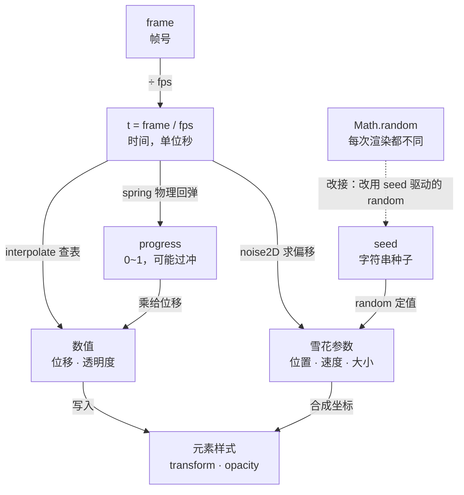

# 第二章：动画工具箱——interpolate、spring、random 与 noise

> [!TIP] Part 1: 核心机制篇（基础概念篇）
> 上一章确立了「动画 = 帧号到数值的映射」，本章给出官方提供的四种映射工具：两个管「动」（interpolate、spring），两个管「随机」（random、noise2D）。章末用它们写出贯穿全书的 120 片雪花。先修见 1.3。

## 为什么要学动画工具箱？

本章管「怎么动」——把第一章的裸映射 `frame * 系数` 升级成带缓动、带回弹、带随机性的专业映射，同时守住「同一帧同一画面」的纪律。

**图 2-1｜本章模型：帧号到数值的四种映射**（节点为实体——帧号与种子进、数值出、元素样式落地；实线是本章教的映射路径，虚线是被改接掉的随机源）：



<p class="figure-note">前两个工具管「从 A 到 B 怎么走」，后两个管「随机性从哪来」；随机性可以有，但必须由种子钉死</p>

> [!WARNING] 先猜再读
> - 先猜一猜：`interpolate(frame, [0, 100], [0, 200])` 在 frame = 150 时返回多少？200？300？还是报错？（答案见 2.1）
> - 多数人以为 spring 动画也要配一个时长参数，其实 spring 没有 durationInFrames——那动画到底播多久？（答案见 2.2）
> - 先猜一猜：把 `Math.random()` 包进 `useMemo` 是否就满足确定性了？（答案见 2.6）

## 2.1 interpolate——线性映射查表器

`interpolate` 回答的问题：帧号落在输入区间 `inputRange` 的某个位置，对应输出区间 `outputRange` 的哪个值：

```tsx
import { interpolate } from "remotion";

// 帧 0~30 映射到位移 0~24px：第 15 帧时位移 12px
const translateY = interpolate(frame, [0, 30], [0, 24]);
```

它只是查表，没有状态、没有定时器——给定 frame 永远返回同一个数，天然满足确定性。

三个行为细节决定了它好不好用：

- **默认超出即延长（extend）**。回答「先猜再读」：frame = 150 时返回 **300**——超出 `[0, 100]` 后按斜率继续外推。多数场景需要的是停在边界，所以几乎每次都要显式收口；
- **clamp 收口**。`extrapolateLeft / extrapolateRight` 设为 `"clamp"` 后，超出区间的输入按边界值返回，帧号再多也不会飞；
- **easing 参数改变节奏**。线性映射的匀速感很机械，`easing: Easing.out(Easing.cubic)` 让数值先快后慢（减速滑入），一行得到电影感的 ease-out。

反例与正例成对出现：

```tsx
// 反例：帧号超过 30 后标题继续往上飞，飞出画面
const y = interpolate(frame, [0, 30], [0, -24]);

// 正例：clamp 收口 + ease-out，第 30 帧后稳稳停在 -24
import { Easing } from "remotion";
const y = interpolate(frame, [0, 30], [0, -24], {
  extrapolateRight: "clamp",
  easing: Easing.out(Easing.cubic),
});
```

贯穿示例的顶部进度条就是一行 interpolate：`width: interpolate(frame, [0, 282], ["0%", "100%"])`——282 帧匀速走满，与视频总长严格同步。

`extrapolateLeft` 与 `extrapolateRight` 是两个独立开关，四种组合各有各的用途：

| 左边界 | 右边界 | 效果 | 用在哪 |
| ---- | ---- | ---- | ---- |
| extend | extend | 两侧都按斜率外推 | 需要「持续加速」的量（如进度条到片尾继续冲） |
| clamp | clamp | 两侧都停在端点 | 入场动画（最常用） |
| extend | clamp | 开头继续外推、结尾停住 | 从上一段延续进来的量 |
| clamp | extend | 开头停住、结尾继续外推 | 退场动画（元素飞出画面） |

`easing` 改的是区间内的推进速度，不改端点。四条常用曲线：

| easing | 观感 | 典型用途 |
| ---- | ---- | ---- |
| 不写（默认） | 匀速 | 进度条、匀速滚动 |
| `Easing.in(Easing.cubic)` | 慢起快收 | 退场（加速离场） |
| `Easing.out(Easing.cubic)` | 快起慢收 | 入场（减速落位） |
| `Easing.inOut(Easing.cubic)` | 两头慢中间快 | 位移类、需要两头稳的场景 |

## 2.2 spring——物理弹簧

`spring` 用物理模型（质量-弹簧-阻尼）从 0 运动到 1，输出一个 progress 值，再由你乘到位移、透明度上：

```tsx
import { spring, useVideoConfig } from "remotion";

const { fps } = useVideoConfig();
const progress = spring({
  frame,                          // 同样以帧号驱动
  fps,
  config: { damping: 200 },       // 阻尼越大越「稳」，越小回弹越多
});
const translateY = (1 - progress) * 24;   // 从下方 24px 弹入
```

回答「先猜再读」：spring **没有时长参数**——动画播多久由物理参数决定，damping 越小、质量越大，弹得越久。这是它与 CSS animation 最大的思维差异：你指定的不是「几秒完成」，而是「弹簧多硬」。

与 2.1 的 easing 淡入对比：

| 维度 | `interpolate + Easing.out` | `spring` |
| ---- | ---- | ---- |
| 时长 | 精确指定（输入区间就是几帧） | 由物理参数涌现，不精确可控 |
| 手感 | 数学曲线，先快后慢 | 有惯性，可过冲回弹（progress > 1） |
| 适用 | 转场、进度条等要精确踩点的场合 | 标题入场、卡片浮现等要手感的场合 |

选型口诀：**要踩点用 interpolate，要手感用 spring**。贯穿示例的转场必须精确落在时间戳帧上，所以全部用固定帧数的 linearTiming + fade（第三章）；而雪花不需要踩点，用最朴素的公式就够了。

三个物理参数各管一头，调参时按症状对症下药：

| 参数 | 调大的效果 | 调小的效果 | 症状 → 处置 |
| ---- | ---- | ---- | ---- |
| `damping`（阻尼） | 更快停住，几乎不回弹 | 弹得更久、回弹更多 | 「回弹太夸张」→ 调大 damping |
| `mass`（质量） | 起动更迟缓、更有重量感 | 更轻、更快 | 「入场太肉」→ 调小 mass |
| `stiffness`（劲度） | 更硬更快、回弹更急 | 更软更慢 | 「节奏太拖」→ 调大 stiffness |

贯穿示例的标题卡入场用 `damping: 200`（几乎不回弹的「稳」），为什么不是 26？——2.2 的选型表已经给了答案：卡片要「落位利落」，回弹会让人读不全标题上的字。

一个注意点：spring 的 progress 可能超过 1（过冲），直接乘透明度会算出 >100% 的无效值——用 `interpolate(progress, [0, 1], [0, 1], { extrapolateRight: "clamp" })` 收口，或只把 progress 乘给位移不乘透明度。

## 2.3 random(seed) 与 noise2D——确定性的两种随机

第一章禁止了 `Math.random()`，替代品有两种，「随机」的性格完全不同：

| 维度 | `random(seed)` | `noise2D(seed, x, y)` |
| ---- | ---- | ---- |
| 输出 | [0, 1) 的数 | [-1, 1] 的数 |
| 相邻输入的关系 | 完全无关（离散乱序） | 相近输入给相近输出（连续） |
| 视觉性格 | 撒芝麻：乱但均匀 | 风吹沙：连绵起伏 |
| 适用 | 每片雪花一个初始位置 | 摆动、漂移等「有连续感」的运动 |

```tsx
import { random } from "remotion";
import { noise2D } from "@remotion/noise";

random("flake-0");           // 永远返回同一个数，如 0.6193
random("flake-0");           // 同种子 → 同输出（这正是我们想要的）
random("flake-1");           // 换种子 → 换输出

noise2D("sway", 1.0, 0);     // 0.31
noise2D("sway", 1.1, 0);     // 0.35 —— 输入相近，输出相近
noise2D("sway", 5.0, 0);     // -0.72 —— 输入远了才无关
```

为什么「同种子同输出」如此重要？120 片雪花每片需要一组初始参数（横向位置、下落速度、大小）——用 `random("base", i)` 为第 i 片取值，那么**无论第几次渲染、哪个标签页截哪一帧，第 0 片雪花永远在同一个位置**。这就是第一章纪律的正面解法：随机性可以有，但必须由种子钉死。

noise2D 的第三个妙处是**用时间当输入坐标**：`noise2D("sway", t * 0.5, i)` 把秒数喂进噪声函数，输出随时间平滑起伏——这就是「风吹」效果的全部秘密，一行代码，无需任何物理引擎。

两个随机工具分工明确，但常常一起用：`random` 负责「每片雪花天生就不一样」（初始位置、大小、速度），`noise2D` 负责「每片雪花随时间晃动的姿态」。前者给身份，后者给运动。

```tsx
// 每片一份「身份证」：种子拼字符串，取值永远一致
const id = (key: string, i: number) => random(`${key}-${i}`);

// 每片的横向摆动：同一个 seed 串 + 时间当坐标 → 连续起伏
const sway = noise2D("sway", t * 0.5, i);
```

种子字符串怎么拼也值得定个规矩：把「用途」和「序号」都用 `-` 连起来（`base-0`、`speed-12`），这样换用途不会串号，排查时一眼能看出是哪一组参数。

## 2.4 实战：120 片确定性雪花

现在把三个工具拼起来，写贯穿示例的雪景。每片雪花的运动拆成两个分量——纵向匀速下落、横向噪声摆动，叠加即最终坐标：

| 分量 | 公式 | 数据来源 |
| ---- | ---- | ---- |
| 纵向：匀速下落 | `y = (t × speed + offset) % 高度` | speed 与 offset 来自 `random(seed)` |
| 横向：噪声摆动 | `x = baseX + noise2D(sway, t, i) × 幅度` | baseX 与幅度来自 `random(seed)` |
| 合成 | `(x, y)` 即一片斜着飘落的雪花 | 全部是 `t` 的纯函数 |

三者都是时间的纯函数：下落管节奏，摆动管形态，随机种子管个性。

对应实现（删去样式细节后的完整逻辑，约 40 行）：

```tsx
import { useMemo } from "react";
import { AbsoluteFill, useCurrentFrame, useVideoConfig } from "remotion";
import { noise2D } from "@remotion/noise";
import { random } from "remotion";

const FLAKES = 120;

export const SnowField: React.FC = () => {
  const frame = useCurrentFrame();
  const { fps, width, height } = useVideoConfig();
  const t = frame / fps;

  // 派生参数：每片一份「身份证」，只算一次
  const flakes = useMemo(
    () =>
      new Array(FLAKES).fill(0).map((_, i) => ({
        baseX: random(`base-${i}`) * width,          // 初始横向位置
        speed: 40 + random(`speed-${i}`) * 60,       // 40~100 px/s 下落
        size: 2 + random(`size-${i}`) * 4,           // 2~6 px 直径
        offset: random(`offset-${i}`) * (height + 60),
        swayAmp: 10 + random(`sway-${i}`) * 25,      // 摆幅 10~35 px
      })),
    [width, height]
  );

  return (
    <AbsoluteFill style={{ pointerEvents: "none" }}>
      {flakes.map((f, i) => {
        const y = ((t * f.speed + f.offset) % (height + 60)) - 30;
        const x = f.baseX + noise2D("sway", t * 0.5, i) * f.swayAmp;
        return <div key={i} style={{ position: "absolute", left: x, top: y,
          width: f.size, height: f.size, borderRadius: "50%",
          background: "#fff", opacity: 0.35 + (f.size / 6) * 0.45 }} />;
      })}
    </AbsoluteFill>
  );
};
```

三个设计决策值得逐个过：

- **参数派生放 useMemo**：120 片 × 5 个种子只算一次，后续每帧只做加乘——性能考虑；
- **取模制造循环**：`(t * speed + offset) % (height + 60)` 让雪花飘出底部后从顶部无缝重来，offset 保证 120 片不同时进出；
- **验证确定性**：在 Studio 里把时间轴拖到第 100 帧记住画面，拖走再拖回——画面逐像素一致，即通过。这个验证动作值得对每个新动画执行一遍。

## 2.5 第三方库的正确姿势

Remotion 里能不能用 npm 上的动画库？判别标准只有一条：**这个库是替你「计算数值」，还是自己「驱动时间」？**

| 能用 | 不能直接用 | 原因 |
| ---- | ---- | ---- |
| GSAP 的 `Easing` 函数 | GSAP 的 timeline / tween | 前者是纯计算，后者自带 tick 驱动 |
| d3-interpolate、手写物理公式 | anime.js 的 play() | 自带 requestAnimationFrame 与截图机制冲突 |
| three.js（配 `@remotion/three`） | three.js 自带的 AnimationLoop | 官方包装把渲染循环换成了帧号驱动 |

自带时钟的库不是不能救：把它的「时间」参数换成 `frame / fps` 传入即可——只要最终收敛成「帧号进、数值出」，就仍然守纪。3D 场景则直接用官方的 `@remotion/three`，它把 three.js 的渲染循环改造成了「每帧渲染一次」。

改造一个自带时钟的库，三步就够：

| 步骤 | 做什么 | 以 anime.js 的 `play()` 为例 |
| ---- | ---- | ---- |
| 1 找到它的时间入口 | 哪个参数是「当前时间」 | `play({ duration, easing })` 里的时间轴 |
| 2 把时间换成帧号 | 用 `frame / fps` 驱动，不让它自己走 | 改成 `seek(frame / fps)` |
| 3 逐帧取数 | 每帧只算一次值并渲染 | 不调 `play()`，只调 `seek` + `render` |

第三步是关键：**能 seek 的库都能救**（把播放头拨到指定时刻再取状态）；只能 play 的库救不了（它的推进由自己的时钟控制），除非它也暴露了 seek。

## 2.6 常见坑：动画的三个隐形杀手

**坑一：把随机数包进 useMemo 就以为安全了**。回答「先猜再读」：不安全。`useMemo` 只挡「同一页面会话内的重复计算」，而渲染时**每一帧都是一次全新的页面加载**——第 0 帧的页面里 `Math.random()` 摇出一个值，第 1 帧的页面重新摇，雪花的初始位置每帧都在洗牌。种子化随机（2.3）才是解法，useMemo 只是性能优化不是确定性保障。

**坑二：interpolate 忘记 clamp**。帧号天然会超出你设计的输入区间——视频 283 帧，你只为入场动画设计了 `[0, 30]`，第 31 帧起数值按 extend 外推持续增长，元素「飞出画面」。看到元素在动画结束后继续漂移，先查 extrapolate。

**坑三：用 CSS 做了「看不见的动画」**。Studio 里拖时间轴时一切正常（每帧独立渲染），但成片里元素纹丝不动——因为 CSS transition/animation 需要时间流逝，而截图机不会给页面任何时间。排查法：把动画的每一个数值都追溯到 `frame` 的表达式，追溯到不了的都在裸奔。

三个坑的排查顺序也有讲究——按「谁最先出问题」排：

| 顺序 | 查什么 | 一句话判据 |
| ---- | ---- | ---- |
| 1 | 数值是不是 `frame` 的表达式 | 追溯不到 frame 表达式 → 裸奔（坑三） |
| 2 | 有没有随机源 | 搜 `Math.random` → 命中就是坑一 |
| 3 | 数值有没有收口 | 看 `extrapolate` → 没 clamp 就是坑二 |

先查 1 再查 2，是因为「不动的动画」比「每帧乱跳的动画」更常见，而两者的修法完全不同：坑三要改架构（把 CSS 换成帧号驱动），坑一只要换一个函数调用。

## 本章小结

- `interpolate(frame, inputRange, outputRange)` 是查表器；默认 extend 外推，几乎总要配 `extrapolate: "clamp"`；`easing` 参数提供缓动曲线（左/右收口是两个独立开关，四种组合各有用途）
- `spring` 无时长参数，时长由物理参数涌现（damping / mass / stiffness 各管一头）；progress 可能过冲 >1；**要踩点用 interpolate，要手感用 spring**
- `random(seed)` 同种子同输出，替代 `Math.random()`；`noise2D(seed, x, y)` 输出 [-1, 1] 且连续，把 `t` 喂进去即得自然起伏；前者给身份、后者给运动
- 雪花 = 匀速下落（取模循环）+ 噪声摆动，参数全部种子化，同帧逐像素可复现
- 第三方库的判别标准：替你计算数值（可用）还是自带时钟驱动（需改造）；能 seek 的库都能救
- useMemo 只优化性能，不提供确定性——渲染是逐帧冷启动页面；三个坑的排查顺序：先查 frame 表达式，再查随机源，最后查收口

**下一章预告**：工具在手，该动真格了。第三章把贯穿示例的完整流水线拆开：Edge-TTS 返回词级时间戳后，如何让每个字在正确的一帧高亮、每个场景在正确的一帧切换——以及转场公式里那个「重叠会缩短总时长」的深坑。

---
