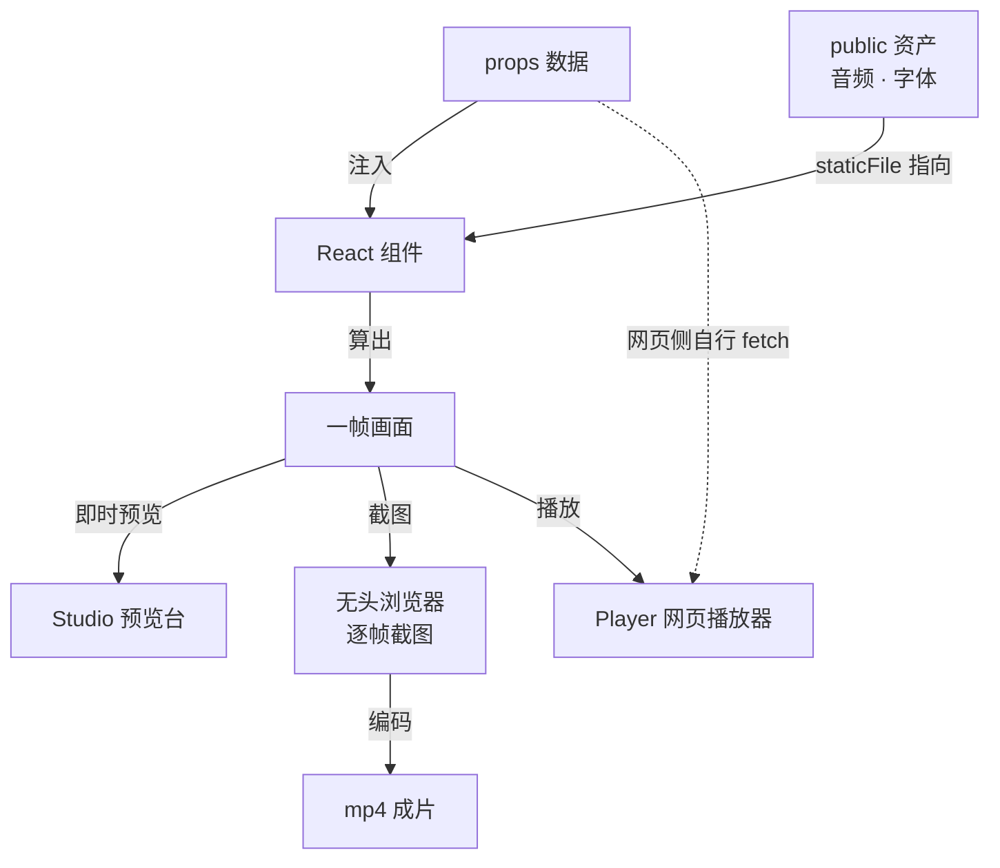

# 第四章：三个出口——Studio、render 与 Player

> [!TIP] Part 2: 成品篇（做出片与交出片）
> 第三章产出了组件，本章解决「怎么交付」：同一份组件代码，三个出口——开发用 Studio、成片用 render、网页用 Player；末尾给一套本地起步的四条命令，仓库级的 CI 与合规留到[第 12 章](./ch12.md)（授权口径本章先给一句，完整三问见 12.4）。先修见[第 3 章 3.3 节](./ch03.md)（--props 注入）。

## 为什么要学三个出口？

本章管交付——把「一段 React 组件」变成「调试台、mp4 成片、网页播放器」三种形态，并让三者永远渲染自同一份代码，不会出现「网页版和成片长得不一样」。

**图 4-1｜本章模型：一个组件，三个出口**（节点为实体——组件算出一帧画面，Studio 预览它、浏览器截图成片、Player 播放它；实线是共用路径，虚线是 Player 环境的数据来源差异）：



<p class="figure-note">三个出口读同一份代码与同一份 props——形态不同，画面一致</p>

三个出口的分工，一张表收口：

| 出口 | 用什么命令 | 产出 | 谁在用 |
| ---- | ---- | ---- | ---- |
| Studio | `npx remotion studio` | 不产出文件，只有预览 | 你（开发期） |
| render | `npx remotion render` | `out/video.mp4` | 投放方（成片） |
| Player | 自己的 React 网页里挂 `<Player>` | 不产出文件，网页内播放 | 终端用户 |

三者的共同前提只有一条：**都读同一份组件与同一份 props**。本章就按这条前提往下走：先解决资产从哪来，再解决画面怎么出，然后是调试台与网页播放器，最后收在本地流水线与授权边界上。

> [!WARNING] 先猜再读
> - 先猜一猜：`remotion render` 前要不要先在本机安装 ffmpeg？（答案见 4.2）
> - 多数人以为 Player 里也该像 Root.tsx 一样包一层 `<Composition>`，其实包了直接报错——为什么？（答案见 4.4）
> - 先猜一猜：网页播放器里 `staticFile("audio.mp3")` 会指向哪个地址？（答案见 4.3）

## 4.1 Remotion Studio——所见即所得的调试台

Studio 是开发期的主要界面（命令见[第 1 章 1.6 节](./ch01.md)），按「出口一」的说法重新审视它的三个能力，每个都对应一种调试场景：

| 能力 | 操作 | 对应的调试场景 |
| ---- | ---- | ---- |
| 时间轴拖拽 | 拖到任意帧号，画面即时呈现 | 转场是否踩准时间戳帧（3.5） |
| 热更新 | 改组件代码自动刷新 | 调样式、调动画参数 |
| props 面板 | 手改输入数据 | 模拟长文案、单句文案等边界情况 |

贯穿示例的标准调试节奏值得照抄一遍：先算出理论踩点帧（157、263），在时间轴上精确拖到这两帧，逐帧检查「字幕高亮到哪个词、旧场景淡出了没有」；确认无误后整段播放看节奏。**逐帧检查替代反复观看**，是 Studio 相比「渲染完再看视频」最大的效率差异。

每次改完画面，Studio 里过一遍「三查」再出片：

- **查规格**：总帧数、画布宽高是否仍与数据一致（calculateMetadata 是否被绕过）；
- **查转场**：拖到理论踩点帧，旧场景淡出与新场景淡入是否恰好重叠；
- **查字幕**：任意一帧的当前高亮词，与该帧时间戳对应的词是否一致。

Studio 的三种启动姿势，用途不同，别混用：

| 启动方式 | 命令 | 什么时候用 |
| ---- | ---- | ---- |
| 带真实数据 | `npx remotion studio remotion/index.ts --props=out/timestamps.json` | 日常开发（贯穿示例的默认姿势） |
| 不带数据 | `npx remotion studio remotion/index.ts` | 只调样式；走 `defaultProps` 兜底 |
| 指定组合 | Studio 顶栏切组合 / 命令行加 `--props` | 一个仓库多条片时对比 |

不带数据启动最容易踩的坑是「Studio 里好好的，出片却是空的」——因为 Studio 用的是 `defaultProps`，而渲染用的是 `--props` 注入的真数据，两者不是同一份。所以**出片前要确认 Studio 启动时带了 `--props`**，否则你在预览里验的根本不是要交付的那一版。

> [!TIP]
> Studio 的时间轴支持直接键入帧号跳转——点住帧数字段输入 `157` 回车，比拖拽精确得多。调转场、调字幕时这是最高频的动作。

## 4.2 remotion render——命令行成片

回答「先猜再读」：**不需要装 ffmpeg**——Remotion 内置了 ffmpeg-static 依赖（[第 1 章 1.5 节](./ch01.md)的编码环节），开箱即可导出 H.264 + AAC 的 mp4。完整命令在[第 3 章](./ch03.md)已出现过，这里补全工程参数：

```bash
npx remotion render remotion/index.ts WinterVideo \
  --props=out/timestamps.json \     # 数据注入（3.3）
  --concurrency=4 \                 # 并行截图的标签页数，默认约为 CPU 核心一半
  --log=error \                     # 只输出错误，流水线里避免刷屏
  out/video.mp4                     # 输出路径
```

出片后的验收动作推荐固化成习惯：用 `ffmpeg -i out/video.mp4` 读一遍元信息——贯穿示例的验收基准是「9.45 秒、1280×720、30fps、h264 + aac」，与计算值 283 帧（9.41 秒 + 封装取整）对得上即通过。**时长对不上，第一反应是查 calculateMetadata**，而不是重渲染碰运气。

渲染失败的报错大多有固定形状，一张对照表收口（本地流水线跑不顺时的症状也一并列在这里）：

| 报错 / 症状 | 根因 | 处置 |
| ---- | ---- | ---- |
| 成片时长与音频对不上（或提示时长与 props 不符） | `calculateMetadata` 没生效，用了 `durationInFrames` 兜底值 | 核对 `--props` 路径与字段名 |
| 画面里 props 字段全是 undefined | props 文件结构与 `defaultProps` 不一致 | 两边字段逐字对齐（3.3） |
| 转场点比预期晚几帧 | 场景帧数在两处各算一遍，取整结果不一致 | 收敛为单一来源（3.4 的教训） |
| 元素动画纹丝不动 | 用了 CSS transition，截图机不给时间 | 改为帧号驱动的插值（[第 1 章 1.4 节](./ch01.md)） |
| 雪花每帧位置乱跳 | `Math.random()` 未种子化 | 换 `random(seed)`（2.3） |
| 字幕个别帧变宋体 | 字体走 CDN，某帧加载失败 | 字体离线化进 public/fonts（4.3） |
| 3D 场景渲染全黑 | 无头浏览器默认 OpenGL 渲染器不工作 | 切 `gl: "angle"`（9.5） |
| 卡在下载浏览器 | 首次渲染要拉 Chrome Headless Shell（约 100 MB） | CI 里预热并缓存（12.2） |
| 标签页崩溃 / 内存爆 | 并发开太高 | 调低 `--concurrency` |
| npm 安装报 ERESOLVE | 生态包与主包版本不对齐 | `npx remotion add` 或对齐版本号（12.4） |
| Player 进度条与成片时长不同 | 网页侧自己算帧数，与渲染用了不同公式 | 共享 `getDurationInFrames`（4.4） |

这张表值得收藏：多数行是「同一份数据被两处计算」或「不确定状态混入渲染」的变体——全书的确定性纪律，落到工程上就是防住这两类问题。

日常用得到的参数一张表就够了：

| 参数 | 作用 | 贯穿示例的取值 |
| ---- | ---- | ---- |
| `--props` | 注入输入数据（3.3） | `out/timestamps.json` |
| `--concurrency` | 并行截图标签页数 | 默认（≈CPU 核心一半），CI 里显式设 4 |
| `--log` | 日志级别 | 流水线脚本里用 `error` 防刷屏 |
| `--frames` | 只渲染指定帧区间 | 排查单帧时 `--frames=157-157` |
| `--codec` | 编码器 | 默认 h264，网页动图场景可换 `--codec=gif` |

`--frames` 值得单独点名：调试「第 157 帧转场为什么闪了一下」时，只渲染一帧比渲染全片快两个数量级，是逐帧排查的标准工具。

## 4.3 staticFile 与公共资产

视频里有两样「非代码」资产：音频轨和字体。Remotion 的约定是把它们放进项目根的 `public/` 目录，代码里用 `staticFile()` 引用：

```tsx
import { staticFile, Audio } from "remotion";
import { loadFont } from "@remotion/fonts";

<Audio src={staticFile("audio.mp3")} />          // public/audio.mp3

loadFont({                                       // public/fonts/ 下的离线字体
  family: "Noto Sans SC",
  url: staticFile("fonts/NotoSansSC.ttf"),
  weight: "100 900",
});
```

`staticFile("audio.mp3")` 返回的地址取决于运行环境：Studio 里是 `http://localhost:3000/audio.mp3`，渲染时是 bundle 的本地路径。**组件代码不关心具体地址**，这正是它能在三个出口间无缝切换的关键。

贯穿示例的 public/ 目录最终长这样，资产按「谁消费」分层：

```text
public/
├── audio.mp3        ← <Audio> 消费（音频轨）
├── timestamps.json  ← Player 网页 fetch 消费（props 数据）
└── fonts/
    └── NotoSansSC.ttf  ← loadFont 消费（离线字体）
```

字体走离线化有明确理由：渲染发生在无头浏览器里，若字体来自 CDN，一次网络抖动就让 283 帧里的部分帧用回退字体渲染——字幕闪一帧都是瑕疵。17.7 MB 的 Noto Sans SC 提前放 `public/fonts/`，所有帧从同一份本地文件取字，渲染快且稳。

同一份 `public/` 目录，三个出口各取所需：

| 资产 | Studio | render | Player 网页 |
| ---- | ---- | ---- | ---- |
| `audio.mp3` | 读 `public/` 目录 | 打进 bundle 一起部署 | 需要能被网页访问（设 `remotion_staticBase`） |
| `timestamps.json` | 用 `--props` 注入的那份 | 用 `--props` 注入的那份 | 网页自己 `fetch` |
| `fonts/*.ttf` | 读 `public/` 目录 | 打进 bundle 一起部署 | 同样要能被访问 |

这张表也解释了 4.5 流水线里「同步资产到 public/」这一步为什么必须存在：渲染读 `out/`，Studio 与网页读 `public/`，两边不同源就会出现「网页上的片和成片不一样」。

## 4.4 @remotion/player——同一个组件放上网页

Player 是 Remotion 的第三个出口：在任意 React 网页里嵌入一个「可拖进度条、可循环」的播放器，播放的就是你的组件。与 Root.tsx 相比有两处不同：

```tsx
import { useEffect, useState } from "react";
import { Player } from "@remotion/player";
import { WinterVideo } from "../../remotion/components/WinterVideo";
import { FPS, getDurationInFrames } from "../../remotion/helpers";

// 挂载前声明静态基址：staticFile("audio.mp3") → 网站根下的 /audio.mp3
(window as { remotion_staticBase?: string }).remotion_staticBase = "/";

export const App: React.FC = () => {
  const [props, setProps] = useState<VideoProps | null>(null);

  useEffect(() => {
    fetch("/timestamps.json")            // 网页自己取数据
      .then((r) => r.json())
      .then(setProps);
  }, []);

  if (!props) return <div>加载中…</div>;
  return (
    <Player
      component={WinterVideo}            // 直接传组件，不包 <Composition>
      durationInFrames={getDurationInFrames(props)}  // 规格自己算
      fps={FPS}
      compositionWidth={1280}
      compositionHeight={720}
      inputProps={props}
      controls                           // 显示控制条
      loop                               // 循环播放
      style={{ width: 960 }}
    />
  );
};
```

回答「先猜再读」的两问：

- **为什么不能包 Composition**：Composition 是「渲染管线」的规格声明，Player 已经自己承担了这个角色——`durationInFrames`、`fps`、`compositionWidth` 等参数直接写在 Player 的 props 上，再包一层 Composition 等于声明了两次规格，Remotion 直接报错；
- **staticFile 指向哪**：Player 环境没有 Studio 的静态服务，需要手动把 `remotion_staticBase` 指向站点根（代码第 6 行），Vite 用 `publicDir` 把 `public/` 目录直接暴露在 `/` 下，于是 `staticFile("audio.mp3")` 解析为 `/audio.mp3`。

数据流也换了个方向：渲染时数据由命令行 `--props` 注入，网页里则由页面自己 `fetch("/timestamps.json")`。**规格计算函数 `getDurationInFrames` 是两个世界共享的同一份实现**——这正是 3.4「单一来源」原则在交付端的延伸：帧数算错一个取整，Player 的进度条和成片的时长就会对不上。

一个浏览器常识要交代：Player 挂载后不会自动出声（浏览器 autoplay 策略禁止未经交互的音频），`controls` 提供的播放按钮即用户手势，点一下即可有声播放。

Player 常用 props 一览（与 Composition 的重名项含义相同）：

| props | 作用 | 默认 |
| ---- | ---- | ---- |
| `controls` | 显示进度条与播放按钮 | 关 |
| `loop` | 播完自动循环 | 关 |
| `clickToPlay` | 点击画面播放/暂停 | 开 |
| `initiallyMuted` | 首次播放静音（autoplay 场景用） | 关 |
| `inputProps` | 传给组件的数据 | 必传 |
| `style` | 容器样式（常设宽度自适应） | 无 |

Player 侧最容易踩的三个坑：

| 症状 | 根因 | 处置 |
| ---- | ---- | ---- |
| 报「Composition 重复声明」 | 在 Player 里又包了一层 `<Composition>` | 删掉它，规格写在 Player 的 props 上 |
| 音频 404 | 没设 `remotion_staticBase`，`staticFile` 解析不到 | 设成站点根，并用 `publicDir` 暴露 `public/` |
| 进度条长度和成片对不上 | 网页侧另算了一份帧数 | 共享 `getDurationInFrames`（4.4） |

## 4.5 本地流水线——四条命令串起来

三个出口最终收敛为四条命令，贯穿示例的 package.json 全部脚本如下：

```text
npm run tts      → 仅重新合成音频 + 时间戳
npm run studio   → 同步资产到 public/ + 打开 Studio
npm run player   → 启动 Vite 网页播放器
npm run video    → 一键全流程出片
```

`npm run video` 背后的编排脚本 `build-video.mjs` 把本章前三节按序串联：

```text
npm run video
  └─ scripts/build-video.mjs
       ├─ [1/3] Edge-TTS 合成
       │        → out/audio.mp3 + out/timestamps.json
       ├─ [2/3] 同步资产到 public/
       │        → public/audio.mp3 + public/timestamps.json
       └─ [3/3] remotion render
                → out/video.mp4（--props 注入 + 内置 ffmpeg）
```

三个要点：

- **步骤 [2/3] 是 Studio 与 Player 的补给线**。渲染读的是 `out/`，Studio 与网页读的是 `public/`——sync-assets 脚本把前者拷给后者，三个出口的数据永远同源；
- **生态包与主包同版本**。`@remotion/transitions`、`@remotion/noise`、`@remotion/player` 必须与 `remotion` 主包同版本（官方推荐用 `npx remotion add <包名>` 安装，自动匹配）；给项目补 Vite 时若遇 peer 依赖冲突，优先降级到与现有 @babel/core 大版本兼容的稳定组合，而不是 `--force` 硬装；
- **这是本地版流水线**。它假设你坐在开发机前敲命令；把它搬进 CI 的 GitHub Actions，再叠上多组合组织、测试与版本合规，是[第 12 章](./ch12.md)的事。

四条 npm scripts 与三个出口的对应关系，一张表收口：

| 脚本 | 走哪个出口 | 产物 | 典型触发时机 |
| ---- | ---- | ---- | ---- |
| `npm run tts` | 不出画面 | `out/audio.mp3` + `out/timestamps.json` | 改了文案 |
| `npm run studio` | Studio | 无（只开发） | 调画面 |
| `npm run player` | Player 网页 | 无（本地预览） | 验网页端表现 |
| `npm run video` | render | `out/video.mp4` | 出片交付 |

顺序也有讲究：改文案后先 `tts`（数据变了），再 `video`（画面跟着数据重算）。直接跑 `video` 而跳过 `tts`，成片用的还是旧音频与旧时间戳——这是流水线最常见的误操作。

跑不顺时按 4.2 的排错表逐条对症。

## 4.6 适用边界与授权速览

Remotion 的授权模式与大多数开源库不同，口径先记住一句：**个人与 ≤3 人公司免费，更大团队需商业授权**（`remotion`、`@remotion/transitions`、`@remotion/player` 都是 Remotion License；`@remotion/noise` 是 MIT，免费）。完整的合规自查三问与 `licenseKey` 配置在 12.4。

适用边界更值得诚实交代：Remotion 的甜区是**数据驱动的模板化视频**——字幕视频、数据播报、批量个性化内容、自动化节目；而影视级复杂特效（粒子模拟、逐帧手调的关键帧动画）仍是 After Effects 的主场。判断标准一句话：内容是数据、样式是模板，就用 Remotion；内容需要手工雕琢，就用传统工具。

## 本章小结

- 三个出口读同一份组件与同一份 props：Studio 管开发调试，render 管成片，Player 管网页嵌入
- Studio 的标准节奏是逐帧检查替代反复观看：算出理论帧号，拖过去核对；启动时务必带 `--props`，否则验的不是要交付的那版
- render 不需要装 ffmpeg（内置），出片后用 `ffmpeg -i` 核对时长与编码规格；报错多有固定形状，4.2 的排错表把渲染与流水线的症状收在一处
- `staticFile()` 抹平了三个出口的资产路径差异；同一份 `public/` 三出口各取所需，所以要有「同步资产」那一步
- Player 直接收组件不包 Composition，规格参数手动传入且与渲染共享同一份计算函数
- 网页端 `remotion_staticBase = "/"` + Vite `publicDir` 让 staticFile 落到站点根
- 本地四条命令串起全流程：改文案 → `tts` → `video` → 新片，中间无人工环节；顺序错了会拿到旧数据
- 授权口径一句话：≤3 人免费，更大团队需商业授权（合规三问见 12.4）；甜区是数据驱动的模板化视频

**下一章预告**：三个出口解决的是「一条视频怎么交付」，但 Remotion 的工具箱还没到底：`<Series>` 与 `<Loop>` 让重复的时间轴排列交给组件，`delayRender` 为异步数据打开闸门。第五章进入进阶组件篇，从时序组件与异步纪律讲起。

**Part 2 收尾**：走完一条片就该闭卷复盘一次——做[Part 2 自测](./part2-test.md)，十二道题覆盖时间戳驱动与三个出口，错题按回指回炉。

---
