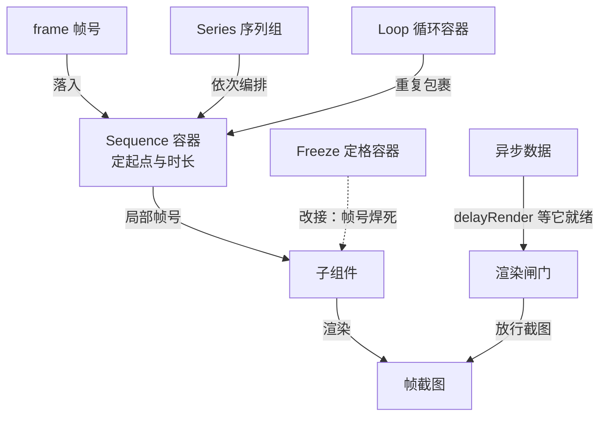

# 第五章：时序组件与异步纪律——Series、Loop、Freeze 与 delayRender

> [!TIP] Part 3: 进阶组件篇（组件与媒体篇）
> 本篇把工具箱补到全量：本章管「时间轴的排列与等待」，第六章下潜媒体标签与音频可视化，第七章接入官方字幕与语音生态，第八章把转场讲到全谱。先修：Part 1 两章与[第 3 章 3.5 节](./ch03.md)（TransitionSeries）。

## 为什么要学时序组件？

前四章的贯穿示例只用到过 `<TransitionSeries>`（它自带 `<TransitionSeries.Sequence>`）与根级挂载的字幕元素。本章补齐官方时序组件的剩余三件——`<Series>`（顺序）、`<Loop>`（重复）、`<Freeze>`（定格）——它们都是 `<Sequence>` 的语法糖或变体，学会之后，时间轴的排列组合不再需要手算帧号。

本章先用一段话把 `<Sequence>` 本身立住，后面三个组件都建立在它之上：`<Sequence from={30} durationInFrames={90}>` 把子树挂到第 30 帧起播 90 帧，内部的 `useCurrentFrame()` 从 0 重新计数（3.6 的局部帧号规则）；`layout="none"` 可以去掉它默认套的那层 `<div>`（放进 3D 场景时需要，9.5 会用到）。本章后半处理纪律的另一面：1.4 禁掉了外部状态，但当数据必须异步获取时，`delayRender` 是唯一的合规出口。

**图 5-1｜本章模型：时间轴容器与异步闸门**（节点为实体——帧号进容器、子组件拿到局部帧号出画面，异步数据经闸门放行截图；实线是常态嵌套，虚线是 Freeze 的改接）：



<p class="figure-note">前三个是 Sequence 的变体（排、重、停），第四个管渲染前的等待</p>

> [!WARNING] 先猜再读
> - 先猜一猜：`<Series.Sequence>` 内部调用 `useCurrentFrame()`，第一段的第一帧返回 0，还是它在整条时间轴上的全局位置？（答案见 5.1）
> - `<Loop>` 设了无限循环，子组件怎么知道自己正处在第几轮？（答案见 5.2）
> - `delayRender()` 会不会把 Studio 的预览也卡住，直到数据就绪才显示画面？（答案见 5.5）

## 5.1 Series——顺序场景的声明式写法

`<Series>` 把「一段接一段播」变成声明：子项按书写顺序排列，起点自动衔接，不用算任何帧号：

```tsx
import { Series } from "remotion";

// 无转场版的贯穿示例：三段首尾相接，总长 157 + 106 + 20 = 283 帧
<Series>
  <Series.Sequence durationInFrames={157}>
    <TitleCard />
  </Series.Sequence>
  <Series.Sequence durationInFrames={106}>
    <SentenceCard sentence={sentences[1]} />
  </Series.Sequence>
  <Series.Sequence durationInFrames={20}>
    <EndCard />
  </Series.Sequence>
</Series>
```

回答「先猜再读」：第一段的第一帧返回 **0**——4.0.443 起 `<Series.Sequence>` 本质就是 `<Sequence>`（`<Series>` 外壳也是），[第 3 章 3.6 节](./ch03.md)的「局部帧号」规则原样适用，段内入场动画照常从 0 开始弹。

与 3.5 的 TransitionSeries 对照着看就清楚了：贯穿示例的场景时长是 172/121/20（每个 duration 里预加了 15 帧转场），而 Series 版本就是名义差值 157/106/20——**TransitionSeries ≈ Series + 强制声明转场**。选型标准：

| 场景 | 用什么 |
| ---- | ---- |
| 场景边界来自数据（时间戳踩点） | getScenePlan + TransitionSeries（3.5） |
| 固定结构（片头 3 秒 + 正文 + 片尾） | `<Series>` |
| 相邻段需要重叠交叉 | TransitionSeries 的转场 |

`<Series.Sequence>` 还有一个 `offset` 属性处理「不完全首尾相接」：正数在本段之前留白（如 `offset={30}` 空出 1 秒），负数让本段提前开始、与上一段叠放（`offset={-10}` 顶部叠加 10 帧）——叠放正是转场的底层语义，只是不带淡入淡出的画面混合。

`offset` 的三种用法与它们在时间轴上的效果：

| offset | 效果 | 典型用途 |
| ---- | ---- | ---- |
| 不写（0） | 与上一段首尾相接 | 常规顺序排列 |
| 正数（如 `+30`） | 本段之前空出 30 帧 | 片头留白、两段之间插一页空场 |
| 负数（如 `-10`） | 本段提前 10 帧开始，与上一段叠放 | 无淡入淡出的硬叠放、字幕条压住场景 |

注意 `offset` 改的是**本段的起点**，不影响后面各段的推算——Series 的总长是「各段时长之和」，加上负 offset 只会让实际显示区间前移。

## 5.2 Loop——把取模循环交给官方

2.4 的雪花用 `(t * speed + offset) % (height + 60)` 手写了循环。当循环单位是「一段完整动画」而非「单个元素的相位」时，官方的 `<Loop>` 更直接：

```tsx
import { Loop } from "remotion";

// 单程下落组件内部不用取模：useCurrentFrame() 在 0~89 之间走完，然后重来
<Loop durationInFrames={90}>
  <SingleFlake seed="flake-0" />
</Loop>
```

`SingleFlake` 内部把 90 帧映射成一次从画面顶到底的匀速下落（`interpolate(frame, [0, 90], [-30, height + 30])`），落完即被 Loop 拨回 0——取模消失在组件边界里。两个可选参数：

- `times`：循环几次，默认 `Infinity`（贯穿示例 283 帧内 90 帧的循环约走 3.1 轮，注意最后一轮只播到 283 帧为止）；
- 嵌套：Loop 套 Loop 会级联（外层 4 轮 × 内层 3 轮 = 12 轮节奏）。

回答「先猜再读」：子组件用 `Loop.useLoop()` 拿当前轮次：

```tsx
const loop = Loop.useLoop();              // 不在 Loop 内返回 null
const iteration = loop?.iteration ?? 0;   // 0, 1, 2, ...（第几轮，从 0 起）
// 用轮次做差异：每轮横向起点偏移一点，雪花不会原地打转
const baseX = random(`base-${seed}-${iteration}`) * width;
```

手写取模与 Loop 的分工：**给一片雪花做相位偏移，取模更顺手**（offset 项天然错开 120 片的起点）；**让一段含多个元素的动画整体重来，用 Loop**。4.0.x 还给了第三种写法——`<Sequence durationInFrames={50} loop>` 的 `loop` 属性，适合要同时配 `playbackRate`、`trimBefore` 等参数的场合。

## 5.3 Freeze——把时间轴定在某一帧

`<Freeze>` 把子树的时间轴焊死在指定帧上：

```tsx
import { Freeze } from "remotion";

<Freeze frame={157}>
  <WinterVideo {...props} />
</Freeze>
```

内部所有 `useCurrentFrame()`（无论套了多少层 Sequence）都永远返回 157——用它拖到第 157 帧静止检视转场，或为[第 10 章](./ch10.md)的封面图渲染（`renderStill`）定格一个「最上镜」的帧。两个必须知道的副作用：

| 子元素 | Freeze 下的行为 |
| ---- | ---- |
| `useCurrentFrame()` | 永远返回 `frame` 属性值 |
| `<Video>` / `<OffthreadVideo>` | 暂停在对应帧 |
| `<Audio>` | 静音（定格无声） |

`active` 参数让定格带条件——传布尔或回调，回调拿当前帧做判断：

```tsx
// 前 30 帧定格在标题「蓄势」，之后恢复播放
<Freeze frame={0} active={(f) => f < 30}>
  <TitleCard />
</Freeze>
```

4.0.476 起官方推荐新写法 `<Sequence freeze={30}>`——定格被并入了 Sequence 的属性体系，还能被 Studio 识别和可视化编辑（[第 11 章](./ch11.md)会回到这条线）。

定格与封面的配合是它最直接的用法：封面图不需要「播到第 157 帧再截」，而是「让第 157 帧成为唯一的一帧」——

```tsx
// renderStill 的组件：把整片视频钉在第 157 帧，输出即为封面
export const Cover: React.FC<{ props: VideoProps }> = ({ props }) => (
  <Freeze frame={157}>
    <WinterVideo {...props} />
  </Freeze>
);
```

这样「选哪一帧当封面」就变成了一个常量，批量出片时每条片子都能用同一行代码抽封面（第十章的 `renderStill` 就是它的工作流位置）。

## 5.4 interpolateColors——颜色也是数值

2.1 的 `interpolate` 只能插数字：把颜色字符串塞进 outputRange，它会对字符串做线性外推，产出 `#12ab#cd` 这样的乱码。颜色的官方对应物是 `interpolateColors`，输入帧号区间，输出 rgba 字符串：

```tsx
import { Easing, interpolateColors } from "remotion";

// 标题卡背景：入场 30 帧内从深夜蓝过渡到主色蓝
const bg = interpolateColors(frame, [0, 30], ["#12203f", "#4a90d9"], {
  easing: Easing.out(Easing.cubic),
});
```

三个行为细节：

- **格式宽容，输出统一**：输入支持 hex、CSS 颜色名、`rgb()`、`hsl()`、`oklch()` 等（4.0.439 起覆盖 CSS Color Level 4 全家），返回值永远是 `rgba(255, 128, 0, 1)` 形态的字符串，可以直接进 style；
- **多段与分段缓动**：`inputRange` 可以是 `[0, 30, 60]` 三点两段，`easing` 传数组时每段各配一条曲线；
- **posterize 量化**（4.0.470）：`posterize: 3` 让颜色每 3 帧跳一次而不是逐帧渐变——做「翻页变色」「像素感」时是现成的工具。

posterize 的效果可以直接看出来：同样 30 帧的过渡，`posterize: 3` 只有 10 个台阶，其余两帧之间颜色不变——像老式调色板，而不是连续的渐变。

```tsx
// 像素感变色：每 3 帧跳一档，而不是逐帧渐变
const bg = interpolateColors(frame, [0, 30], ["#12203f", "#4a90d9"], { posterize: 3 });
```

贯穿示例的用法在「状态色」：卡拉OK字幕的三态（未读/正在读/已读）是二值判定，颜色跳变就是设计意图；但「已读词的蓝色深浅随阅读进度渐进」这类连续色彩，就该交给 interpolateColors 而不是三份手调的 hex。

## 5.5 delayRender——异步纪律的唯一出口

1.4 的禁令表写的是「网络请求 → 结果随外部状态变化」，禁的是**不等结果就截图**。当数据真的只能异步来（第三方 API、用户上传的大文件），`delayRender` 提供了合规姿势：**挂起渲染，等数据就绪再放行截图**。

```tsx
import { useEffect, useState } from "react";
import { useDelayRender } from "remotion";

export const WeatherCard: React.FC<{ city: string }> = ({ city }) => {
  const [data, setData] = useState<Weather | null>(null);
  const { delayRender, continueRender, cancelRender } = useDelayRender();
  const [handle] = useState(() => delayRender(`fetch weather ${city}`));

  useEffect(() => {
    fetch(`https://api.example.com/weather?city=${city}`)
      .then((r) => r.json())
      .then((d) => { setData(d); continueRender(handle); })
      .catch((err) => cancelRender(err));
  }, []);

  if (!data) return null;
  return <div>{data.temp}°C</div>;
};
```

四条纪律细节，少一条就会在某个并发的标签页里炸掉：

- **句柄用 `useState(() => delayRender())` 惰性初始化**。直接写 `const handle = delayRender()` 会在每次 React 重渲染时新建句柄、永不释放，渲染卡到超时；
- **必须写在组件内，不能写在模块顶层**——顶层的句柄会让渲染其他 Composition 时也被卡住；
- **默认 30 秒超时**。超时报错形如 `A delayRender() "fetch weather hangzhou" was called but not cleared after 28000ms`，这就是 label 参数的用途：报错时能定位是哪个异步任务；慢任务可用 `{ timeoutInMilliseconds, retries }` 加时与重试（重试会整页重来）；
- **失败用 `cancelRender(err)`**，让渲染带着明确错误退出，而不是干等超时。

回答「先猜再读」：Studio 与 Player 里 `delayRender` 是 **no-op**——渲染时才需要门控，预览环境异步数据自己更新自己。组件里若要区分环境（如 Studio 里给请求加防抖），用 `getRemotionEnvironment()`：`isStudio`、`isRendering`、`isPlayer` 三个布尔对应三个出口。数据能提前算的，还有比 delayRender 更好的位置：`calculateMetadata` 只执行一次（而非每个并发标签页各来一遍），且不需要手动 continueRender——它才是「先取数再渲染」的首选，delayRender 留给必须发生在组件内的等待。

三个「异步数据该放哪」的位置，一张表收口：

| 位置 | 执行次数 | 适合 | 不适合 |
| ---- | ---- | ---- | ---- |
| `calculateMetadata` | 每条组合一次 | 决定总帧数的数据（音频时长、词数） | 与帧号相关的逐帧数据 |
| `delayRender` | 每个标签页各一次 | 组件内才知道要取什么的数据 | 能提前算的数据（浪费 N 倍请求） |
| `preload` / `prefetch` | 播放前一次 | 媒体资源、字体 | 业务数据 |

判据一句话：**数据只影响「多长」→ calculateMetadata；数据影响「每一帧长什么样」→ delayRender；数据是文件 → preload。**

这套机制不破坏纯函数纪律：同一帧号的每个标签页都会等到同一份数据才截图，确定性依旧由「同帧同画面」兜底。

上半是「帧号怎么流到子组件」，下半是「异步数据怎么在截图前拦住渲染」。

```text
全局帧号
   │
   ▼
Sequence / Series / Loop / Freeze    ← 改接与局部帧
   │  局部帧号
   ▼
子组件 ──────────────▶ 帧截图
                            ▲
异步数据 ─▶ delayRender 闸门 ─┘
```

## 5.6 preload 与 prefetch——播放前的补给线

渲染（截图机）不需要预加载——它按帧冷启动页面，资源按需加载即可。预加载是给**播放**（Studio 预览与 4.4 的 Player 网页）准备的：把资源提前拉好，避免播放第一帧闪白、音频迟进。

官方给的第一条建议其实不是这两个 API，而是 **premounting**：让 `<Player>` 预先挂载若干帧，给媒体留出加载与初始化的时间。两个 API 属于「早期方案」，选之前先看清它们作用在谁身上：

```tsx
// @remotion/preload：插 <link rel="preload"> 或隐藏媒体标签，只对原生 HTML5 标签生效
import { preloadAudio, preloadFont } from "@remotion/preload";

preloadAudio("/audio.mp3");                             // 只影响原生 <audio> / <Html5Audio>
preloadFont("/fonts/NotoSansSC.ttf", "Noto Sans SC");   // 与 4.3 的离线字体是同一个文件

// prefetch()：整个下载成 Blob URL 挂在内存里，Remotion 自己的媒体组件会用它
import { prefetch } from "remotion";

const { free, waitUntilDone } = prefetch("/audio.mp3");
waitUntilDone().then(() => console.log("audio ready"));
// 组件卸载时调 free()，把占住的内存还回去
```

| 维度 | `@remotion/preload` | `prefetch()` |
| ---- | ---- | ---- |
| 作用对象 | 原生 HTML5 `<audio>`/`<video>`、图片、字体 | Remotion 的 `<Audio>`/`<Video>`/`` 等媒体组件 |
| 机制 | 插 `<link rel="preload">` 标签 | 完整下载后转成 Blob URL |
| 就绪 | 尽力而为，不保证完成 | `waitUntilDone()` 可等待完成 |
| 代价 | 极低 | 占内存（整文件进内存，用完 `free()`） |
| 官方态度 | 不推荐直接用，首选 premounting | 标注「不要用」，除非必须等完全就绪 |

选型口诀：**先看资源被谁消费**——Remotion 自己的 `<Audio>`/`<Video>` 用 `prefetch()`，原生 HTML5 标签、字体与图片用 `preload*()`；两者都不理想时，回到官方首选的 premounting。

贯穿示例的 Player 网页因此这样升级：音频走 `prefetch()`（它由 Remotion 的 `<Audio>` 消费），字体走 `preloadFont()`，首次出声就不再有可闻的延迟。第十一章做程序化控制时还会回到这条补给线。

## 本章小结

- `<Series>` 声明式顺序排列，子项自动首尾相接；`offset` 正数留白、负数叠放前段（只改本段起点，不影响后续推算）；固定结构用它，数据踩点仍用 getScenePlan + TransitionSeries
- `<Loop>` 循环一段动画（`times` 默认无限）；`Loop.useLoop()` 给出轮次 `iteration`；单个元素错相位仍用手写取模
- `<Freeze frame>` 把子树焊在指定帧：useCurrentFrame 冻结、视频暂停、**音频静音**；`active` 回调支持条件定格；新代码可用 `<Sequence freeze>`；与 `renderStill` 配合即「把第 157 帧变成唯一的一帧」
- `interpolateColors` 是颜色的 interpolate：输出统一 rgba 字符串，`posterize` 做量化跳色（每 N 帧一档，像老式调色板）
- `delayRender` 是异步纪律的唯一出口：句柄惰性初始化、写在组件内、30 秒超时、失败 `cancelRender`；能提前算的数据放 `calculateMetadata`
- 异步数据落位三选一：影响「多长」→ calculateMetadata；影响「每帧长什么样」→ delayRender；是文件 → preload
- `getRemotionEnvironment()` 区分 Studio / 渲染 / Player 三个出口；delayRender 在预览环境是 no-op
- `preload*()` 与 `prefetch()` 服务播放不服务渲染；`preload*()` 只对原生 HTML5 标签与字体图片生效，Remotion 自己的 `<Audio>`/`<Video>` 要用 `prefetch()`，官方首选其实是 premounting

**下一章预告**：贯穿示例的音频至今只有「裸挂一条音轨」的最简形态。第六章下潜到媒体标签的深水区：`volume` 表达式做淡入淡出与音量曲线、多轨混音、`<OffthreadVideo>` 的逐帧截图语义，以及 `@remotion/media-utils` 的音频波形可视化——把「数据播报」类视频的最后一块拼图补上。

---
