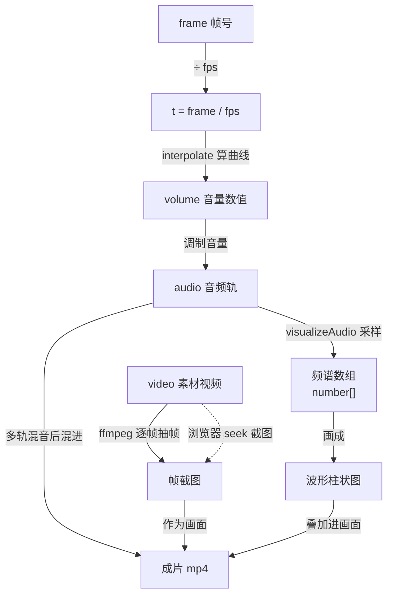

# 第六章：媒体深水区——音量曲线、视频嵌入与波形可视化

> [!TIP] Part 3: 进阶组件篇（组件与媒体篇）
> 上一章补齐了时序组件与异步纪律；本章下潜媒体标签：把贯穿示例「裸挂一条音轨」的形态升级成调音台，并讲清视频素材在截图机里的特殊语义。先修：4.4（staticFile）与 2.1（interpolate）。

## 为什么要学媒体深水区？

贯穿示例的音频至今只有一行 `<Audio src={staticFile("audio.mp3")} />`——音量 1.0、从头铺到尾。真实的视频几乎都要第二轨：背景音乐要压低音量、随片头淡入、随片尾淡出；素材视频要逐帧精确地嵌进画面；「数据播报」类视频还需要让画面跟着声音的波形起伏。本章把这几件事一次讲透。

**图 6-1｜本章模型：声音与素材怎么进画面**（节点为实体——帧号算音量曲线、音频混音、视频抽帧、频谱数组画波形；实线是推荐路径，虚线是浏览器 seek 的对比路径）：



<p class="figure-note">前两个管声音，后两个管「声音以外的媒体资产」</p>

> [!WARNING] 先猜再读
> - 先猜一猜：把 `<Audio>` 挂进起点 157 帧的 Sequence，用 `useCurrentFrame()` 算音量曲线，第 0 帧读到的 frame 是 0 还是 157？（答案见 6.1）
> - 渲染时 `<OffthreadVideo>` 与 `<Html5Video>` 截出来的帧可能不一样——为什么？（答案见 6.2）
> - `visualizeAudio` 的 `numberOfSamples` 传 100 可以吗？（答案见 6.3）

## 6.1 Audio 的音量与裁剪——从裸挂到调音台

`volume` 接受一个数值，而「随时间变化的数值」正是 2.1 的 interpolate 的主场——官方推荐的做法是 `useCurrentFrame()` + `interpolate` 算出数值传给 volume（旧的 `(frame) => number` 回调形式已不推荐）：

```tsx
import { Audio, interpolate, staticFile, useCurrentFrame, useVideoConfig } from "remotion";

export const BackgroundMusic: React.FC = () => {
  const frame = useCurrentFrame();
  const { durationInFrames } = useVideoConfig();
  const bgm = interpolate(
    frame,
    [0, 30, durationInFrames - 30, durationInFrames],   // 头 1 秒淡入，尾 1 秒淡出
    [0, 0.15, 0.15, 0],
    { extrapolateLeft: "clamp", extrapolateRight: "clamp" },
  );
  return <Audio src={staticFile("bgm.mp3")} volume={bgm} />;
};
```

回答「先猜再读」：返回 **0**——`useCurrentFrame()` 在 Sequence 内返回局部帧号（3.6 的规则），所以音量曲线跟着 `<Audio>` 所在的时间段走，挂进 [157, 263) 的 Sequence 时曲线自动从该场景起点起算，不用减 157。

把这条组件加进贯穿示例的根级（与 3.6 的字幕同理，BGM 必须挂根级才能横跨转场连续），旁白轨保持默认音量 1.0，两条轨并列即自动混音：

```tsx
<Audio src={staticFile("audio.mp3")} />          {/* 旁白，音量 1.0 */}
<BackgroundMusic />                               {/* BGM，音量曲线 0 → 0.15 → 0 */}
```

裁剪与变速的三个常用参数（4.0.319 起启用新名）：

- `trimBefore={60}`：掐掉源文件前 60 帧（30fps 下即前 2 秒）再开始播，适合「只取音频中段」；配合 `durationInFrames` 指定源区间长度。旧参数名 `startFrom / endAt` 已废弃，遇到旧代码要能认出来；
- `playbackRate={1.25}`：变速播放（>1 加速），配 `preservePitch={false}` 可得到「磁带变速」的音调变化；
- `loop`：源音频比视频短时循环铺满——BGM 的常见姿势。

真实项目里 BGM 只有一条淡入淡出曲线是不够的：旁白一开口，BGM 就得让位——这就是混音里的 ducking（闪避）。它的触发信号不是「时间到了」，而是**旁白的时间戳**——旁白的区间本来就是数据（3.2 的 `sentences`），拿它算增益即可：

```tsx
const BGM_LEVEL = 0.15;    // 无人说话的底噪
const DUCK_LEVEL = 0.04;   // 有人说话时的压低值

// 返回「此刻旁白有多近」：1 = 离得远，0 = 正在说话
const speechGain = (t: number, sentences: Sentence[]) => {
  let gain = 1;
  for (const s of sentences) {
    const near = interpolate(
      t,
      [s.start - 0.2, s.start, s.end, s.end + 0.2],   // 前后各留 0.2 秒斜坡
      [1, 0, 0, 1],
      { extrapolateLeft: "clamp", extrapolateRight: "clamp" },
    );
    gain = Math.min(gain, near);
  }
  return gain;
};

export const DuckingBgm: React.FC<{ sentences: Sentence[] }> = ({ sentences }) => {
  const frame = useCurrentFrame();
  const { fps } = useVideoConfig();
  const t = frame / fps;
  const base = interpolate(frame, [0, 30], [0, BGM_LEVEL], { extrapolateRight: "clamp" });
  return <Audio src={staticFile("bgm.mp3")} volume={base * speechGain(t, sentences)} />;
};
```

几个设计点值得拆开看：斜坡用 0.2 秒而不是 0 帧——直接切会「咔」一声；用 `Math.min` 聚合多句——两句话挨得近时不会把增益抬回 1；增益乘在淡入淡出之上——两条曲线正交，改任一条都不影响另一条。

裁剪与变速的取舍一张表：

| 需求 | 用哪个 | 注意 |
| ---- | ---- | ---- |
| 只取音频中段 | `trimBefore` + `durationInFrames` | 帧号按源文件的 fps 算，不是成片的 fps |
| BGM 比片子短 | `loop` | 循环点在听感上要藏进淡出或淡入里 |
| 磁带感加速 | `playbackRate` + `preservePitch={false}` | 音调会变，适合旁白不适合 BGM |
| 音量随画面走 | `volume` + `interpolate` | 音量曲线跟所在 Sequence 的局部帧走 |

## 6.2 视频嵌入——Html5Video 与 OffthreadVideo

嵌入视频素材有两个标签，渲染语义完全不同：

| 维度 | `<Html5Video>` | `<OffthreadVideo>` |
| ---- | ---- | ---- |
| 渲染时怎么出帧 | 浏览器 `<video>` 元素 seek 后截图 | ffmpeg 在**浏览器外**抽出精确帧，贴进 `` |
| 精确性 | 受浏览器 seek 粒度限制，可能偏 1~2 帧 | 逐帧精确，与源视频严格对齐 |
| `loop` | 支持 | 不支持（要用 `<Loop>` 包） |
| 透明通道 | 不支持 | `transparent` 以 PNG 抽帧（比默认 BMP 慢） |
| 支持编码 | 浏览器支持的编码 | H.264 / H.265 / VP8 / VP9 / AV1 / ProRes |

回答「先猜再读」：**抽帧机制不同**。Html5Video 靠浏览器 seek，粒度受关键帧间距影响；OffthreadVideo 由 ffmpeg 直接按帧号解码，第 157 帧就是源视频的第 157 帧——凡是「视频素材要和时间戳对齐」的场景（画中画、卡点混剪）都用后者。素材视频里有音轨时它会一并混入，`muted` 可以丢弃。

「画中画 + 时间戳对齐」的最小形态：素材挂进场景 Sequence，靠 `trimBefore` 掐掉片头、`muted` 丢掉自带音轨，位置交给 style：

```tsx
<OffthreadVideo
  src={staticFile("broll.mp4")}
  trimBefore={60}          // 源文件前 60 帧不要
  durationInFrames={120}   // 取源区间 120 帧（4 秒）
  muted                    // 素材自带音轨会和旁白打架
  style={{ position: "absolute", right: 40, bottom: 40, width: 480, height: 270 }}
/>
```

素材与时间戳的对齐有两个前提，缺一个就会错位：一是用 `OffthreadVideo`（ffmpeg 按帧号解码，不受关键帧间距影响）；二是**素材的 fps 要和成片一致**——源片是 25fps、成片是 30fps 时，「第 157 帧」在两边指的不是同一时刻。

还有一个正在发生的演变要交代：4.0.5xx 起，core 包的 `<Audio>`/`<Video>` 被重命名为 `<Html5Audio>`/`<Html5Video>`，而新的 `<Audio>`/`<Video>` 名字让给了基于 Mediabunny/WebCodecs 的 `@remotion/media` 包（逐帧精确、按需取流，是官方推荐的长期方向）。本教程锚定 4.0.545——该版本里 core 的 `<Audio>` 仍叫 `<Audio>`，全书照旧；你在更新版本里看到 `<Html5Audio>` 时，知道它是同一个东西即可。

## 6.3 波形可视化——visualizeAudio

`@remotion/media-utils` 提供「声音 → 数值数组」的转换，画面吃数组就能起伏：

```tsx
import { useAudioData, visualizeAudio } from "@remotion/media-utils";
import { Audio, staticFile, useCurrentFrame, useVideoConfig } from "remotion";

export const WaveBars: React.FC = () => {
  const frame = useCurrentFrame();
  const { fps, height } = useVideoConfig();
  const audioData = useAudioData(staticFile("audio.mp3"));

  if (!audioData) return null;   // 音频还在解析中，先渲染空白帧

  const bars = visualizeAudio({
    fps,
    frame,                        // 想看哪一刻的频谱就传哪一帧
    audioData,
    numberOfSamples: 32,          // 输出 32 个频率段
  });

  return (
    <div style={{ display: "flex", alignItems: "flex-end", gap: 4, height }}>
      {bars.map((v, i) => (
        <div key={i} style={{
          width: 12,
          height: v * 200,                      // 振幅 0~1 → 高度 0~200px
          background: interpolateColors(frame, [0, 60], ["#4a90d9", "#7bc96f"]),
        }} />
      ))}
    </div>
  );
};
```

回答「先猜再读」：**不行**——`numberOfSamples` 必须是 2 的幂（16、32、64、128……），100 会直接报错。这个数组从左到右是低频到高频：左边是鼓点与贝斯，右边是人声与镲片。三个使用细节：

- **左侧值天然偏大**（能量集中在低频），画柱状图前常用对数后处理压平：`Math.log10(v)` 或官方文档给出的 WebAudio 规格映射，视觉上才均匀；
- `smoothing` 默认开，把当前帧与前后的值平均，跳动更柔和；追求卡点锐利就关掉；
- `useAudioData` 返回 `null` 表示解析未完成——它内部已经替你做了 5.5 的 delayRender，渲染版不会截到空帧，但组件里**必须**处理 null 分支。

`numberOfSamples` 的取值决定画面上画几根柱子，也决定每帧要算多少频段：

| numberOfSamples | 频段数 | 画面表现 | 取舍 |
| ---- | ---- | ---- | ---- |
| 16 | 16 | 粗线条，一眼看出强弱 | 最省，帧率最稳 |
| 32 | 32 | 左右可辨（贯穿示例选它） | 信息量与成本的平衡点 |
| 64 | 64 | 细节更多，柱子更密 | 每帧计算量翻倍 |
| 128 | 128 | 频谱拉满 | 渲染成本最高，短视频慎用 |

压平低频偏重这件事，用分贝映射最省事——把线性振幅转成 dB 再归一化到 0~1：

```tsx
// -60dB 映射到 0，0dB 映射到 1；安静段落贴近 0，响的地方顶到 1
const toDb = (v: number) => (20 * Math.log10(Math.max(v, 1e-6)) + 60) / 60;

const bars = visualizeAudio({ fps, frame, audioData, numberOfSamples: 32 })
  .map(toDb);          // 直接把 0~1 的振幅换成可画的高度
```

这行映射还有个副产品：`toDb(0)` 恰好是 0，所以静音段落的柱子会自然贴地而不是被 `Math.log10(0)` 变成 `NaN`（`Math.max(v, 1e-6)` 就是防这个）。

贯穿示例把 `WaveBars` 挂在标题卡下方、喂旁白的 audio.mp3，说话时波形跳动、静音处波形归零——「画面跟着声音走」这个数据播报类视频的核心需求，就是 `frame` 进、`number[]` 出的一行转换。

## 6.4 GIF 与动图资产——@remotion/gif

GIF 是视频里的常客（表情包、产品演示循环）。直接把 `` 放进组件是错的：GIF 自带播放时钟，与帧号脱节——每次冷启动截图都从 GIF 的第 0 帧开始，成片里它永远播前几帧。官方的 `<Gif>` 把它的播放时钟换成了 `useCurrentFrame()`：

```tsx
import { Gif } from "@remotion/gif";

<Gif
  src={staticFile("demo.gif")}
  width={480}
  height={270}
  fit="contain"                // fill 拉伸 / contain 完整显示 / cover 裁切填满
  playbackRate={0.5}           // 半速播放
  loopBehavior="pause-after-finish"   // 播完定格在最后一帧
/>
```

`loopBehavior` 三选一：`loop`（默认，无限循环）、`pause-after-finish`（定格末帧）、`unmount-after-finish`（播完卸载）。配套的 `getGifDurationInSeconds()` 拿 GIF 时长——按 2.5 的判别标准，`<Gif>` 是「被改造好的自带时钟库」的标准范例。要嵌 WebP/AVIF 动图，用同族的 `<AnimatedImage>`。

`getGifDurationInSeconds(src)` 返回一个 Promise，值是 GIF 的时长秒数，**不区分是否循环**（循环播放也算这一遍的时长）。它是做「动画播完正好接下一句旁白」这类对齐时唯一需要的数：先问出 GIF 有多长，再据此安排它在时间轴上的位置，而不是反过来让时间轴迁就 GIF。远程 GIF 走 `fetch` 拉取，需要对方服务器支持 CORS——这是把表情包放到自己的 CDN 上时最常踩的坑。

GIF 与视频素材怎么选，一张表收口：

| 维度 | GIF（`<Gif>`） | 视频素材（`<OffthreadVideo>`） |
| ---- | ---- | ---- |
| 体积 | 小（几百 KB 级） | 大（几 MB 起） |
| 帧率 | 自带（常见 10–15 fps） | 与成片一致 |
| 清晰度 | 256 色，边缘有锯齿 | 全彩，无损缩放 |
| 逐帧精确 | 不保证（源帧率与成片 fps 不一致时有半帧偏差） | 逐帧精确 |
| 典型用途 | 表情包、装饰小动画 | 画中画、实拍素材、卡点混剪 |

一句话：只要素材要「卡在某个时间戳上」，就用视频；GIF 属于氛围件。

## 6.5 媒体解析——渲染前先看清资产

最后一组工具不进画面，而是回答「这个文件到底多长、什么规格」：

- **`@remotion/media-parser`**：纯浏览器解析媒体元数据（时长、轨道、分辨率、编码），不依赖 ffmpeg，Node 与浏览器通用。批量流水线里的守门员：渲染前校验用户上传的素材，不合格直接 fail fast，而不是等截图机跑一半报错；
- **`@remotion/webcodecs`**：浏览器端编解码（转码、压缩、抽帧），做「用户上传后即时预览」类功能时用，渲染管线一般用不到。

「先体检再渲染」的守门员长这样：

```ts
// scripts/check-assets.mjs —— 渲染前跑一遍，不合格立刻退出
import { parseMedia } from "@remotion/media-parser";
import { nodeReader } from "@remotion/media-parser/node";

const info = await parseMedia({
  src: "public/broll.mp4",
  fields: { durationInSeconds: true, dimensions: true },
  reader: nodeReader,          // 读本地文件必须显式给 reader
});

if (info.durationInSeconds < 3) throw new Error("broll.mp4 太短（不足 3 秒）");
if (info.dimensions.width !== 1280) throw new Error("broll.mp4 宽度与画布不一致");
```

两处细节：读本地文件路径要配 `nodeReader`，否则解析器不知道去哪儿读；`fields` 是按需声明的——只勾 `durationInSeconds` 就只解析时长，勾得越多读得越多。另外 `parseMedia` 自 4.0.190 起被官方标注为实验性 API 并指向 Mediabunny 的元数据接口，方向上在换代；本章只交代它的定位（渲染前的守门员），具体 API 以你所用版本的官方文档为准。

体检清单可以直接抄成流水线的一步：

| 检查项 | 判据 | 不合格的后果 |
| ---- | ---- | ---- |
| 素材时长 | ≥ 计划取用的区间长度 | 画面提前黑屏 |
| 素材分辨率 | 宽高与画布或缩放策略匹配 | 画面模糊或被裁 |
| 素材 fps | 与成片一致（贯穿示例 30fps） | 时间戳整体错位 |
| 素材音轨 | 旁白素材必须静音（`muted`） | 两路声音打架 |
| 编码格式 | 在 `<OffthreadVideo>` 支持列表内 | 抽帧失败、渲染报错 |

这两个包与 6.2 的 `@remotion/media` 共同构成官方正在推进的 WebCodecs 路线。本教程只交代定位不展开实战：模板化视频管线中，ffmpeg（见站内《FFmpeg 完全教程》）仍是资产预处理的通用解，WebCodecs 路线适合「一切都在浏览器里完成」的产品形态。

## 本章小结

- `volume` 接数值：官方推荐 `useCurrentFrame()` + `interpolate` 算曲线（含 clamp），回调形式已不推荐；音量曲线跟所在 Sequence 的局部帧走
- 多个 `<Audio>` 并列即混音；全程存在的音轨挂根级（同 3.6 字幕的道理）；`trimBefore`/`durationInFrames` 掐段，`loop` 铺满，`playbackRate` 变速
- ducking 用旁白时间戳算增益，边界留 0.2 秒斜坡，增益乘在淡入淡出之上
- `<Html5Video>` 浏览器 seek 截图（可 loop），`<OffthreadVideo>` ffmpeg 浏览器外逐帧精确抽帧——要对齐时间戳就用后者，且素材 fps 必须与成片一致；core 的 `<Audio>`/`<Video>` 在新版本里更名为 `<Html5Audio>`/`<Html5Video>`，新名字归 `@remotion/media`
- `visualizeAudio` 把某帧的频谱变成 `number[]`（0~1，左低频右高频）；`numberOfSamples` 必须是 2 的幂；用 dB 映射压平低频、避开 `log10(0)` 的 NaN；`useAudioData` 为 null 时组件必须处理
- `<Gif>` 把 GIF 的自带时钟换成帧号驱动，`fit`/`playbackRate`/`loopBehavior` 控制形态；`` 直接塞 GIF 是错法；`getGifDurationInSeconds` 返回不循环的单遍时长，远程 GIF 需 CORS
- `@remotion/media-parser` 渲染前校验资产元数据（读本地文件要配 `nodeReader`，`parseMedia` 自 4.0.190 起标注为实验性）；WebCodecs 路线是官方长期方向

**下一章预告**：贯穿示例的时间戳来自 Edge-TTS，但如果素材是「已经录好的人声」呢？第七章接入官方字幕与语音生态：`@remotion/captions` 的标准字幕结构、`@remotion/install-whisper-cpp` 用本地语音识别反推词级时间戳——把 ch00 埋下的「语音识别反推」路线走通，并顺手解决字体的类型安全加载。

---
