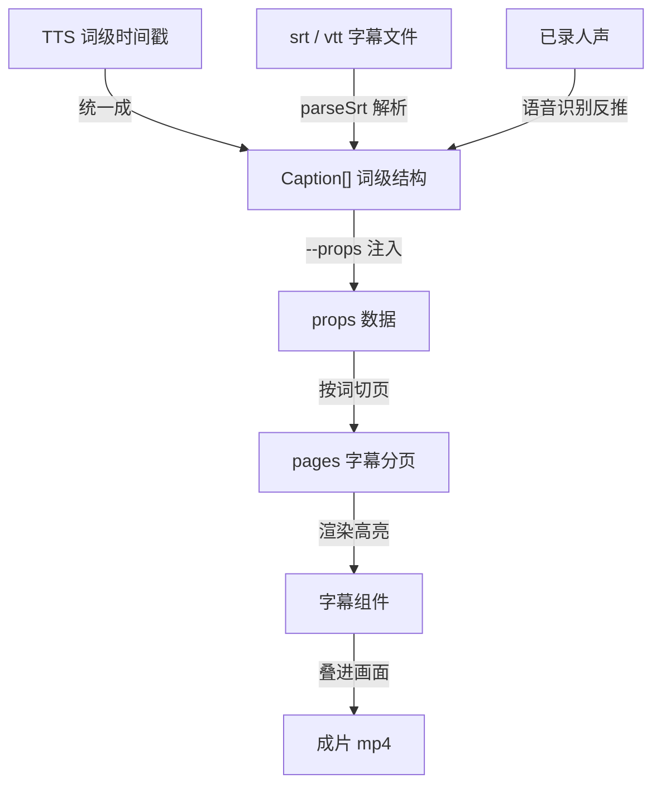

# 第七章：字幕与语音生态——Caption 结构与 Whisper 反推时间戳

> [!TIP] Part 3: 进阶组件篇（组件与媒体篇）
> 本篇最后一章接通官方的「语音生态」：把贯穿示例自造的时间戳结构升级为官方标准，走通 ch00 预告过的「语音识别反推时间戳」路线，并给字体加载一个类型安全的官方姿势。先修：3.2（词级时间戳）、3.6（卡拉OK字幕）、5.5（delayRender 与 calculateMetadata）。

## 为什么要学字幕与语音生态？

ch00 的可替换性承诺里有一句「语音识别反推——都能接入」，本章兑现它。贯穿示例的时间戳来自 Edge-TTS 的「合成时顺手返回」，可当素材是**已经录好的人声**（真人配音、播客、访谈）时，没有谁会给你时间戳——唯一来源是语音识别。官方为此准备了一套标准：`Caption` 数据结构（各来源的最大公约数）、本地 Whisper 转写工具链、TikTok 式分页渲染。读完本章，字幕视频的配音源从「一种」变成「任意」。

**图 7-1｜本章模型：三个来源，一个结构**（节点为实体——TTS 时间戳、人工字幕与已录人声汇入 Caption 结构，经 props 进分页与字幕组件；实线是常态流向）：



<p class="figure-note">来源可替换，结构与渲染不变——ch00「可替换标准接口」承诺的落点</p>

> [!WARNING] 先猜再读
> - 先猜一猜：`Caption` 的时间字段单位是秒还是毫秒？贯穿示例的 Word 用的是秒，官方为什么选另一个单位？（答案见 7.1）
> - `medium.en` 是 Whisper 的中等模型，能转写贯穿示例的中文旁白吗？（答案见 7.2）
> - `createTikTokStyleCaptions` 分页靠什么切？处理中文文本时会出什么事？（答案见 7.3）

## 7.1 Caption——官方字幕数据结构

`@remotion/captions`（4.0.216 起）定义了字幕的官方形状，官方生态里所有转写来源（本地 Whisper、OpenAI API、ElevenLabs、浏览器 WebGPU 版）都收敛到它：

| 字段 | 含义 | 贯穿示例的 Word 对应 |
| ---- | ---- | ---- |
| `text` | 词文本，**前导空格是数据的一部分**（分词分隔符，见 7.3） | `text`（中文无空格） |
| `startMs` | 开始时间，毫秒 | `start`（秒） |
| `endMs` | 结束时间，毫秒 | `end`（秒） |
| `timestampMs` | 词的中点参考时间（部分来源提供） | 无 |
| `confidence` | 识别置信度（0~1，部分来源提供） | 无 |

回答「先猜再读」：官方选**毫秒**——语音识别的原始精度就在毫秒级（整数存储无小数误差），而贯穿示例选秒是因为 TTS 返回秒、且全书公式以秒为准。两套结构互转只有一行：`startMs / 1000`。

围绕这个结构有四个纯函数（浏览器、Node 通用）：`parseSrt()` / `parseVtt()` 把既有字幕文件解析成 `Caption[]`，`serializeSrt()` 反向导出——「人工打轴」路线由此接通：剪辑师在专业软件里压好的字幕，解析进来即可用同一套 Remotion 组件渲染。贯穿示例的 `Word` 与 `Caption` 的对照在 7.3 会变成代码：同一套高亮判定，换数据不换组件。

换算只该发生在一个地方，适配函数就是那个地方：

```tsx
// helpers/caption-adapter.ts —— 自研 Word 结构 ↔ 官方 Caption 结构
import type { Caption } from "@remotion/captions";
import type { Word } from "../types";

// 官方毫秒 → 自研秒：秒转毫秒只在进结构时做一次
export const wordsToCaptions = (words: Word[]): Caption[] =>
  words.map((w) => ({
    text: w.text,
    startMs: Math.round(w.start * 1000),
    endMs: Math.round(w.end * 1000),
    timestampMs: Math.round(((w.start + w.end) / 2) * 1000),
  }));

// 反向：官方毫秒 → 自研秒
export const captionsToWords = (captions: Caption[]): Word[] =>
  captions.map((c) => ({ text: c.text, start: c.startMs / 1000, end: c.endMs / 1000 }));
```

判定「这个词正在被读出」时，把时间统一换算成整数毫秒再比，能避开浮点边界带来的偶发抖动：

```tsx
const tMs = Math.round(t * 1000);            // t = frame / fps
const isCurrent = tMs >= c.startMs && tMs < c.endMs;
```

`timestampMs` 与 `confidence` 两个字段不是所有来源都给：前者是词的中点参考时间，做「居中对齐」类排版时用得上；后者是识别置信度，来源提供时可以在 Studio 里标出「这句没听清」。没有它们不影响判定——判定只认 `startMs` 与 `endMs`。

## 7.2 Whisper 反推时间戳——已录人声的唯一路线

`@remotion/install-whisper-cpp` 把 whisper.cpp 的安装、模型下载、转写包成三个 Node 函数，整条流水线一个脚本跑完：

```js
// scripts/transcribe.mjs —— Node 侧运行
import { execSync } from "child_process";
import path from "path";
import { installWhisperCpp, downloadWhisperModel, transcribe, toCaptions }
  from "@remotion/install-whisper-cpp";

const to = path.join(process.cwd(), "whisper.cpp");
await installWhisperCpp({ to, version: "1.5.5" });
await downloadWhisperModel({ model: "medium", folder: to });

// whisper.cpp 只吃 16kHz wav，先用 ffmpeg 转格式（站内《FFmpeg 完全教程》）
execSync("ffmpeg -i out/audio.mp3 -ar 16000 out/audio-16k.wav -y");

const output = await transcribe({
  model: "medium",
  whisperPath: to,
  whisperCppVersion: "1.5.5",
  inputPath: "out/audio-16k.wav",
  tokenLevelTimestamps: true,   // 词级时间戳——卡拉OK字幕的前提
});
const { captions } = toCaptions({ whisperCppOutput: output });
// captions.json 落地后，走 3.3 的 --props 注入，下游组件一概不改
```

两个选型决策值得停留：

- **模型带不带 `.en`**：回答「先猜再读」——`medium.en` 是**英文专用**模型，喂中文旁白会得到一串乱码。中文必须用不带后缀的多语言模型（`medium`、`large-v3`）。模型越大越准越慢，`medium` 是中文可用的起步档，`large-v3` 精度最好但需要更多内存；
- **`tokenLevelTimestamps: true` 是必须的**：不加它只有句级时间戳，词级高亮无从谈起——这与 3.2 「Edge-TTS 一次请求返回词级时间」等价的开关。

转写完成后，数据流与第三章完全重合：`captions.json` 通过 `--props` 注入，`getScenePlan`、转场公式、卡拉OK判定原样运转。**「音频先行」没变，只是时间戳的出处从 TTS 换成了识别**——如果转写结果的切分粒度与贯穿示例的 21 个词不同（Whisper 按自己的分词器切），属于预期行为：数字变、公式不变。给已有人声配画面，这是唯一自动化的路。

模型选型一张表收口：

| 模型 | 语言 | 中文可用 | 速度 | 内存量级 | 何时选 |
| ---- | ---- | ---- | ---- | ---- | ---- |
| `small` | 多语言 | 可以 | 最快 | 约 1 GB | 跑通流程、先看效果 |
| `medium` | 多语言 | 可以 | 中等 | 约 2–3 GB | 中文旁白的起步档（贯穿示例选它） |
| `large-v3` | 多语言 | 可以 | 最慢 | 5 GB 以上 | 正式成片、专有名词多 |
| `medium.en` 一类 | 仅英文 | 不行 | 较快 | 同上 | 纯英文素材专用 |

转写这条链路的排错表，按「症状 → 根因 → 处置」组织：

| 症状 | 根因 | 处置 |
| ---- | ---- | ---- |
| 转写结果是一串乱码 | 用了 `*.en` 英文专用模型 | 换成不带后缀的多语言模型重跑 |
| 只有句子、没有词 | `tokenLevelTimestamps` 没开 | 打开它重新转写 |
| 转写结果为空 | 输入不是 whisper.cpp 认的格式 | 先转成 16kHz 单声道 wav 再喂 |
| 转写慢到跑不动 | 模型太大且无 GPU 加速 | 先用 `small` / `medium` 跑通，再换 `large-v3` |
| 词边界和配音对不齐 | 识别分词与 TTS 分词粒度不同 | 属预期行为：数字变、公式不变 |

两种时间戳的差异值得摆在一起看——它们不是「谁更准」的关系，而是「怎么来的」不同：

| 维度 | Edge-TTS 时间戳 | Whisper 反推 |
| ---- | ---- | ---- |
| 来源 | 合成时顺带给出 | 事后从波形里识别 |
| 前提 | 必须有文本 | 只需要音频 |
| 粒度 | TTS 的分词（贯穿示例 21 个词） | Whisper 自己的分词器（可能 15 个，也可能 25 个） |
| 误差 | 精确到 100 纳秒 tick | 词边界可能偏几十到几百毫秒 |

所以反推路线多了一个隐含成本：词级高亮的「正在读」判定会有几十毫秒的人眼不可察偏差（不到 2 帧）。真要做到帧级精确，只有「合成时就拿到时间戳」这一条路。

## 7.3 TikTok 式分页——createTikTokStyleCaptions

3.6 的字幕按句子显示全文，短视频更常见的形态是**逐页滚动**：一次显示几个词，页面随时间翻动。官方的 `createTikTokStyleCaptions` 把 `Caption[]` 切成页：

```tsx
import { createTikTokStyleCaptions } from "@remotion/captions";

const { pages } = createTikTokStyleCaptions({
  captions,                                  // 7.2 产出的 Caption[]
  combineTokensWithinMilliseconds: 1200,     // 每页约 1.2 秒
  // breakOnSilenceAfterMilliseconds: 300,  // 4.0.514 起：句间停顿也强制翻页
});
// pages: { text, startMs, durationMs, tokens: [{ text, fromMs, toMs }] }[]
```

渲染组件复用 3.6 的判定模式，只是从「句 + 词」两层变成「页 + token」两层：

```tsx
export const TikTokSubtitle: React.FC<{ pages: TikTokPage[]; t: number }> = ({ pages, t }) => {
  const page = pages.find(
    (p) => t >= p.startMs / 1000 && t < (p.startMs + p.durationMs) / 1000,
  );
  if (!page) return null;
  return (
    <div style={{ whiteSpace: "pre" }}>
      {page.tokens.map((w, i) => (
        <span key={i} style={{ color: t >= w.fromMs / 1000 && t < w.toMs / 1000
          ? "#4a90d9" : "#666" }}>
          {w.text}
        </span>
      ))}
    </div>
  );
};
```

回答「先猜再读」：分页靠 **`text` 里的前导空格**——函数把空格当词界，切满 1.2 秒就翻页。中文文本没有空格，整句会被当成一个词挤在同一页上。三个应对：`breakOnSilenceAfterMilliseconds` 在停顿处补页界（识别结果的停顿天然存在）；或自己按中文标点切分后再喂；或像贯穿示例那样保持 3.4 的自研结构——这正是 ch00 说的「字幕模板不限于一种实现」，官方生态擅长英文形态，中文场景自研结构仍是务实选择。容器记得配 `white-space: pre`，否则前导空格被浏览器吞掉、词会粘连。

切出来的页是什么形状，一张表说清：

| 字段 | 类型 | 含义 |
| ---- | ---- | ---- |
| `text` | string | 整页文本（token 拼起来的） |
| `startMs` | number | 本页第一个 token 的开始时间 |
| `durationMs` | number | 本页覆盖的时长 |
| `tokens[].text` | string | 页内每个词 |
| `tokens[].fromMs` / `toMs` | number | 词级高亮判定的起止时间 |

中文自研切页其实只有三十行——按标点断句 + 卡时长上限，产出结构与官方 `pages` 完全一致，下游组件一行都不用改：

```tsx
// helpers/caption-pages.ts —— 中文没有空格，自研切页
import type { Caption } from "@remotion/captions";

const PUNCT = /[，。！？；：,.!?;:]/;

export function paginateChinese(captions: Caption[], maxMs = 1200): TikTokPage[] {
  const pages: TikTokPage[] = [];
  let tokens: Caption[] = [];
  let pageStart = captions[0]?.startMs ?? 0;

  const flush = () => {
    if (tokens.length === 0) return;
    pages.push({
      text: tokens.map((t) => t.text).join(""),
      startMs: pageStart,
      durationMs: tokens[tokens.length - 1].endMs - pageStart,
      tokens: tokens.map((t) => ({ text: t.text, fromMs: t.startMs, toMs: t.endMs })),
    });
    tokens = [];
  };

  for (const c of captions) {
    if (tokens.length === 0) pageStart = c.startMs;
    tokens.push(c);
    const pageLen = c.endMs - pageStart;
    if (pageLen >= maxMs || PUNCT.test(c.text.slice(-1))) flush();  // 到时长上限或遇到标点就翻页
  }
  flush();
  return pages;
}
```

两条路线怎么选，一张表收口：

| 维度 | 官方 `createTikTokStyleCaptions` | 自研切页（中文） |
| ---- | ---- | ---- |
| 切页依据 | 词间空格 + `combineTokensWithinMilliseconds` | 标点 + 时长上限 |
| 英文素材 | 直接可用 | 也能用，但没必要重造 |
| 中文素材 | 空格缺失 → 整句挤在一页 | 按标点切，逐句成页 |
| 维护成本 | 零（官方持续更新） | 一段 30 行函数，规则全在自己手里 |

贯穿示例走的是第三条路（3.4 的自研 `Word` 结构）：它连「词」这一层都不依赖官方结构，代价是分页与高亮都要自己写；换来的是对中文标点、标红、逐字变色这类定制效果的完全控制。

## 7.4 google-fonts——类型安全的字体加载

4.3 用「字体文件放进 public/ + `@font-face`」手工解决了字体问题。官方的 `@remotion/google-fonts` 把这件事自动化：每种 Google 字体一个子包，`loadFont()` 返回字体族名，并**自动阻塞渲染直到字体就绪**——5.5 的 delayRender 被包在了里面：

```tsx
import { loadFont } from "@remotion/google-fonts/NotoSansSC";

const { fontFamily, waitUntilDone } = loadFont("normal", {
  weights: ["400", "700"],      // 只加载用到的字重
  subsets: ["latin"],           // 只加载用到的字符子集
});

export const WinterVideo: React.FC = () => (
  <AbsoluteFill style={{ fontFamily, ... }}>
    {/* 283 帧每帧冷启动都会等字体就绪，宋体帧从此绝迹 */}
  </AbsoluteFill>
);
```

与 4.3 手动方案的对比：

| 维度 | `@remotion/google-fonts` | 手动离线化（4.3） |
| ---- | ---- | ---- |
| 来源 | Google CDN，按需下载 | 自己放 public/，无外网依赖 |
| 就绪保证 | 自动 delayRender，渲染零宋体帧 | 依赖浏览器预加载行为 |
| 类型安全 | weights/subsets 参数有补全与校验 | 无 |
| 风险 | CDN 慢或大子集会拖慢渲染甚至超时 | 无网络风险，但要自己维护字体文件 |

中文字体（如 Noto Sans SC）子集很大、CDN 拉取慢，渲染机离线化仍是更稳的选择；google-fonts 适合拉丁字符为主或内网可控的场景。两者可以共存：用 `waitUntilDone()` 在流水线里预热缓存，渲染时命中本地。

`waitUntilDone()` 返回一个 Promise，兑现「字体真正就绪」的时刻。官方 `loadFont` 已经把它接进了渲染等待机制（等价于 5.5 的 delayRender），所以多数时候你不用手写 `await`；需要自己控制时序时再用它——比如把字体的就绪时刻和别的异步数据对齐。

字体这类「看起来像样式、实际影响渲染正确性」的东西，排错按这个表走：

| 症状 | 根因 | 处置 |
| ---- | ---- | ---- |
| 个别帧变成宋体 | 该帧渲染时字体还没就绪 | 用 google-fonts（自动阻塞）或 4.3 的离线化 |
| 首帧卡住十几秒 | CDN 首次拉取大子集 | 换离线字体文件，或把子集压到实际用到的字符 |
| 字体名改了却没生效 | `fontFamily` 没挂到根容器 | 挂在 `AbsoluteFill` 的 style 上，根容器统一继承 |
| 渲染偶发超时 | 字体请求卡住且没有超时兜底 | 离线化彻底断掉这条网络依赖 |

## 本章小结

- `Caption { text, startMs, endMs, timestampMs, confidence }` 是官方字幕结构（4.0.216 起），毫秒为单位，前导空格是数据的一部分；`parseSrt`/`parseVtt`/`serializeSrt` 覆盖字幕文件的进出
- 换算只发生在一个地方（适配函数）：判定一律在整数毫秒上做，避开浮点边界的抖动
- Whisper 路线四步：`installWhisperCpp` → `downloadWhisperModel` → `transcribe`（`tokenLevelTimestamps: true`）→ `toCaptions`；音频先转 16kHz wav；中文必须用多语言模型（无 `.en` 后缀）
- 「音频先行」的来源可替换：TTS 时间戳、srt 人工打轴、Whisper 反推，全部收敛为 `--props` 注入，下游组件不动；反推多出的代价是词边界有几十毫秒偏差
- `createTikTokStyleCaptions` 按 `combineTokensWithinMilliseconds` 分页，`tokens` 逐词给 `fromMs/toMs`；分页依赖空格，中文要按标点自切（三十行）或保持自研结构；容器加 `white-space: pre`
- `@remotion/google-fonts` 的 `loadFont()` 自动阻塞渲染至字体就绪、参数类型安全；中文字体子集大，渲染机仍优先离线化；字体类问题按「宋体帧 / 首帧卡 / 不生效 / 超时」四类对症

**下一章预告**：贯穿示例的转场至今只有一种「15 帧线性淡入淡出」。第八章把 `@remotion/transitions` 讲到全谱：官方全部转场 preset（滑动、擦除、翻转、时钟扫描）、timing 的两种调度（linearTiming 与 springTiming），以及自己写一个转场函数的固定套路——踩点公式（3.5）在全谱下依然成立。

---
