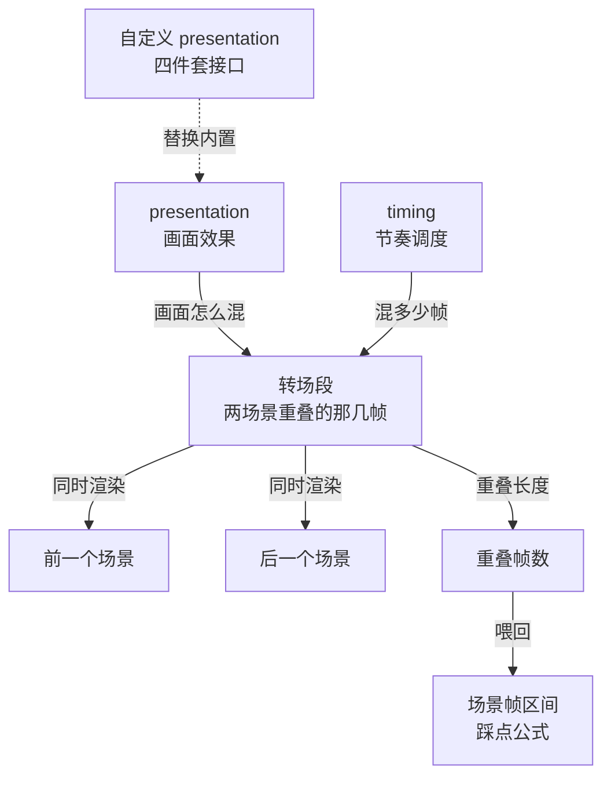

# 第八章：转场全谱——preset 画廊、两种 timing 与自定义转场

> [!TIP] Part 3: 进阶组件篇（组件与媒体篇）
> 贯穿示例的转场至今只有一种配方：`fade()` + `linearTiming({ durationInFrames: 15 })`。本章把 `@remotion/transitions` 拆成「画面效果」与「时间调度」两个独立维度讲全，并给出自己写转场的固定套路。先修：[第 3 章 3.5 节](./ch03.md)（TransitionSeries 的重叠语义与踩点公式）。

## 为什么要学转场全谱？

3.5 的踩点公式与转场用什么画面效果、什么节奏调度无关——它只关心「重叠了多少帧」。理解这一点，本章的内容就变成自由组合：21 个官方 presentation 管画面、2 种官方 timing 管节奏，两者任意配对；都不够用还有固定接口的自定义转场。所有组合共享同一套时长语义，**踩点公式不用改一行**。

**图 8-1｜本章模型：presentation × timing**（节点为实体——画面效果与节奏调度汇成转场，重叠帧数喂回场景帧区间；实线是常态组合，虚线是自定义转场的改接）：



<p class="figure-note">画面效果与节奏调度各自独立，换哪一头都不改踩点公式</p>

> [!WARNING] 先猜再读
> - `slide({ direction: "from-left" })` 的方向是「新场景从左边进来」还是「旧场景往左边退场」？（答案见 8.1）
> - `springTiming({ config: { damping: 200 } })` 不指定时长，这次转场到底有几帧？（答案见 8.2）
> - 自定义 presentation 的组件会为进入和退出的场景各渲染一次，两边的 `presentationProgress` 是同一个值吗？（答案见 8.3）

## 8.1 presentation——21 个内置效果画廊

回答「先猜再读」：`from-left` 是**新场景从左边滑入**——direction 描述的是「进场的来向」。所有内置 presentation 从各自的子路径导入（按需加载）：

```tsx
import { linearTiming, TransitionSeries } from "@remotion/transitions";
import { slide } from "@remotion/transitions/slide";

<TransitionSeries.Transition
  presentation={slide({ direction: "from-left" })}
  timing={linearTiming({ durationInFrames: TRANSITION_FRAMES })}
/>
```

贯穿示例只需把 3.5 代码里的 `presentation={fade()}` 换成上面这行——场景时长、踩点公式、总帧数 283 一概不动。21 个内置效果按性格分组：

| 分组 | presentation | 一句话 |
| ---- | ---- | ---- |
| 基础 | `fade` / `dissolve` / `none` | 淡入淡出、像素溶解、纯硬切 |
| 方向 | `slide` / `wipe` / `pushCut` / `clockWipe` / `iris` | 推入、擦除、时钟扫描、圆形揭示 |
| 3D | `cube` / `flip` / `bookFlip` / `swap` | 立方体翻转、翻页、对调 |
| 镜头 | `crossZoom` / `dreamyZoom` / `zoomInOut` / `zoomBlur` | 变焦类，vlog 常见 |
| 质感 | `filmBurn` / `ripple` / `crosswarp` / `blurSlide` / `linearBlur` | 胶片烧帧、涟漪、扭曲模糊 |

方向类效果大多接受 `direction`（`from-left / from-right / from-top / from-bottom`），从 4.0.84 起还接受 `enterStyle` / `exitStyle` 给进出场容器追加 CSS（如转场中加一点位移或缩放）。选型口诀沿袭 2.2：**信息密度高的内容用轻转场**（fade、wipe），场景差异大、节奏点强时才上 3D 与镜头类——转场是标点符号，不是主角。

`direction` 说的是「进场的来向」，与阅读流有关：横向信息（图表、时间线）用左右，纵向堆叠（标题、卡片）用上下。`enterStyle` / `exitStyle` 则作用在转场中的容器上，让「滑进来的那一侧」和「被推走的那一侧」各有各的附加样式：

```tsx
<TransitionSeries.Transition
  presentation={slide({
    direction: "from-left",
    enterStyle: { transform: "scale(1.02)" },  // 进场一侧：轻微放大
    exitStyle: { opacity: 0.6 },               // 退场一侧：压暗
  })}
  timing={linearTiming({ durationInFrames: TRANSITION_FRAMES })}
/>
```

两个参数记一下出处：`direction` 一直都在；`enterStyle` / `exitStyle` 是 **4.0.84 起**才有的（本书钉的 4.0.545 已包含）。低版本里想在转场中做同样的事，只能自己写自定义 presentation（8.3）。

官方内置的 21 个 presentation 里有 12 个是 **HTML-in-canvas 形态**——`zoomBlur`、`dreamyZoom`、`filmBurn`、`linearBlur`、`bookFlip`、`zoomInOut`、`dissolve`、`ripple`、`crosswarp`、`crossZoom`、`swap`、`blurSlide`。它们把两个场景渲染成位图再做像素级混合，画面真实度高，代价是每帧要跑两遍场景渲染：283 帧的片子换一次这种转场，渲染时间会明显上一个台阶。`cube()`（3D 立方体）官方另外标了 Paid，属于需要商业授权的能力。

按内容类型选转场，一张表收口：

| 内容类型 | 首选 | 别用 | 理由 |
| ---- | ---- | ---- | ---- |
| 字幕卡、逐句大字 | `fade` | `cube` `flip` `filmBurn` | 观众在读字，任何花哨转场都抢注意力 |
| 数据看板、图表切换 | `wipe` `slide` | `dissolve` `ripple` | 分界清晰，观众一眼知道「换页了」 |
| 产品展示、要镜头感 | `zoomInOut` `crossZoom` | `none`（硬切） | 硬切太生硬，轻微推拉更像纪录片 |
| 章节分隔、情绪转折 | `clockWipe` `iris` `swap` | `fade` | 需要一个明确的「断点」标记 |
| 片头片尾、logo 露出 | `bookFlip` `blurSlide` `pushCut` | — | 这里本就该有设计感 |

反例与正例成对看：字幕视频里换成 `filmBurn`（胶片烧帧）看着热闹，实际结果是每次转场都有一帧强光，观众在强光里根本读不到下一个字——**转场强度必须低于内容强度**，这是它的上限。反过来，产品片里全用 `fade` 又会像 PPT 逐页翻——**转场强度又要高于场景间的信息落差**，这是它的下限。两个边界之间靠内容类型判断，不是靠效果数量。

## 8.2 timing——精确踩点与物理手感的调度

timing 决定「重叠多少帧」，官方有两种，性格对立：

| 维度 | `linearTiming` | `springTiming` |
| ---- | ---- | ---- |
| 时长来源 | 你指定的 `durationInFrames`（或毫秒），精确 | spring 物理模拟测出，**不是你指定的** |
| 缓动 | 可配 `easing` 曲线 | 自带弹簧曲线（含过冲） |
| 踩点友好度 | 完美——常数直接进公式 | 需要实测帧数喂回公式 |
| 适用 | 卡点字幕视频（贯穿示例） | 无踩点需求的节奏型视频 |

回答「先猜再读」：`springTiming({ config: { damping: 200 } })` 的时长由物理测量，可以精确问出来：

```tsx
import { springTiming } from "@remotion/transitions";

springTiming({ config: { damping: 200 } }).getDurationInFrames({ fps: 30 });
// → 23 帧（damping 200 @ 30fps 的弹簧在这个 fps 下走到静止）

springTiming({ config: { damping: 200 }, durationInFrames: 15 })
  .getDurationInFrames({ fps: 30 });
// → 15 帧：durationInFrames 不是「必须传」，而是把弹簧曲线拉成固定时长
```

这个实测帧数必须**喂回 3.5 的踩点公式**——`TRANSITION_FRAMES` 若仍是手写的 15 而转场实际占了 23 帧，每个场景的实际显示起点会**早** 8 帧（157 − 8 = 149），全片长度也从 283 缩到 313 − 2×23 = 267 帧，踩点整体崩掉。这正是 3.4「单一来源」原则的延伸：贯穿示例如果升级 springTiming，`getScenePlan` 里的转场帧数要改成 `springTiming({...}).getDurationInFrames({ fps: FPS })` 的返回值，而不是再写一个常数。还有一条硬约束的连锁反应：23 帧的转场塞不进 20 帧的结尾卡（3.5 规定转场不得长于相邻场景），要么调**大** damping 让弹簧更快停住（实测帧数随之变短）、要么给结尾卡加帧——报错信息会直接告诉你超了多少。

`linearTiming` 还有第二个旋钮 `easing`（来自 `remotion` 的 `Easing`）：

```tsx
import { Easing } from "remotion";

// 匀速 15 帧：机械、可预测
linearTiming({ durationInFrames: 15 });

// 同样 15 帧，但先快后慢：转场收尾更利落
linearTiming({ durationInFrames: 15, easing: Easing.out(Easing.cubic) });
```

关键区别：`easing` 改的是「帧号到进度的映射」，**不改变转场占多少帧**——15 帧仍是 15 帧，踩点公式一个字都不用改；它改的是这 15 帧里画面推进的快慢。想要「有点加速感」却不想动帧数，easing 才是正确的旋钮。

`springTiming` 另有一个容易忽略的细节：默认 `durationRestThreshold: 0.005`（进度 99.5% 即视为结束），转场尾段会被轻微截断，官方推荐显式设 `0.001` 让动画走完。

**喂回公式的正确姿势**：决定用 springTiming 之后，转场帧数就从「写下来的常数」变成「查出来的值」。它必须回到 3.4 的单一来源里去：

```tsx
// helpers/transitions.ts —— 全项目唯一与转场有关的文件
import { springTiming } from "@remotion/transitions";

export const TRANSITION_TIMING = springTiming({
  config: { damping: 200 },
  durationRestThreshold: 0.001,
});

// 23 帧（damping 200 @ 30fps）：由物理测量得来，不手写
export const TRANSITION_FRAMES = TRANSITION_TIMING.getDurationInFrames({ fps: 30 });
```

```tsx
// helpers/scene-plan.ts —— 3.5 的踩点公式，只改取值来源
import { TRANSITION_FRAMES } from "./transitions";

// duration = 下一场景名义起点 − 本场景名义起点 + TRANSITION_FRAMES（公式本身不动）
```

**坑：23 帧的转场塞不进 20 帧的结尾卡**。结尾卡名义起点 263、名义终点 283，duration 恰好 20 帧；springTiming 实测 23 帧 > 20 帧，TransitionSeries 直接报错——转场不得长于相邻任一场景。两条处置路线：

| 路线 | 做法 | 连带改动 | 结果 |
| ---- | ---- | ---- | ---- |
| A 给结尾卡腾地方 | 音频尾帧从 0.6 秒改 0.7 秒 | 总帧数 283 → 286，结尾卡 20 → 23 帧 | 23 帧转场刚好放得下，场景边界不动 |
| B 缩短弹簧 | 调大 damping，直到实测 ≤ 20 帧 | 只改 timing 常量，帧数与公式不动 | 转场短一点，手感更「利」 |

路线 A 的算式要自己走一遍：`ceil((8.81 + 0.7) × 30) = 286`，结尾卡 = 286 − 263 = 23 帧，正好容纳 23 帧转场。尾帧是[第 3 章 3.3 节](./ch03.md)`getDurationInFrames` 里的一个常量（`TAIL`），改它等于改总帧数——这正是「帧数推算只允许一份实现」的含义：改一处，所有引用它的地方自动跟着变。

## 8.3 自定义转场——固定接口四件套

21 个都不合适时，自定义 presentation 的接口是固定的：一个工厂函数返回 `{ component, props }`，组件拿到四个固定参数——`children`（场景内容）、`presentationDirection`（`"entering"` 进场 / `"exiting"` 退场）、`presentationProgress`（0~1 的进度）、`presentationDurationInFrames`（4.0.153 起）。

回答「先猜再读」：**是同一个值**——转场进行到进度 p 时，组件对进场场景与退场场景各渲染一次，两边的 `presentationProgress` 都是 p，由你自己决定两边怎么用 p（进场做遮罩（Mask）揭示、退场保持原样）。约定俗成的实现套路：**entering 侧包效果，exiting 侧直接放 children**。一个「圆形遮罩揭示」的最小实现：

```tsx
import { AbsoluteFill, interpolate } from "remotion";
import type { TransitionPresentation, TransitionPresentationComponentProps } from "@remotion/transitions";

const Reveal: React.FC<TransitionPresentationComponentProps<Record<string, never>>> = ({
  children, presentationDirection, presentationProgress,
}) => {
  const clip = `circle(${interpolate(presentationProgress, [0, 1], [0, 120])}%)`;
  return (
    <AbsoluteFill>
      <AbsoluteFill style={{ clipPath: presentationDirection === "entering" ? clip : undefined }}>
        {children}
      </AbsoluteFill>
    </AbsoluteFill>
  );
};

export const circleReveal = (): TransitionPresentation<Record<string, never>> =>
  ({ component: Reveal, props: {} });

// 用法与内置完全一致：presentation={circleReveal()}
```

进度值交给 `interpolate`（动画的全部数值仍源自帧号，1.4 的纪律原样适用），遮罩尺寸用百分比可以无视画布尺寸。

四个参数逐个说清，另加一个自己传进来的 `passedProps`：

| 参数 | 类型 | 含义 |
| ---- | ---- | ---- |
| `children` | ReactNode | 要包裹的场景内容，进出两侧各渲染一次 |
| `presentationDirection` | `"entering"` \| `"exiting"` | 当前这一侧是进场还是退场 |
| `presentationProgress` | number | 转场进度 0~1，两侧数值相同 |
| `presentationDurationInFrames` | number | 转场总帧数（4.0.153 起） |
| `passedProps` | 任意 | 你在工厂里传进来的自定义参数 |

官方那个 star 示例走的就是这条路子：先用 `makeStar`（[第 9 章](./ch09.md)）算出星形路径，再用 `getBoundingBox` / `translatePath` 把它挪到画布正中，最后用 `clipPath` 裁进场的场景——遮罩是算出来的，不是 CSS 拼出来的。

```text
customPresentation({ width, height })
        │  工厂函数，返回 { component, props }
        ▼
    Reveal 组件
        │  收到 children / direction / progress
        ├── entering 一侧：套遮罩（clipPath 圆形揭示）
        └── exiting 一侧：原样放 children，不做遮罩
```

```tsx
// 官方 star 示例的骨架（完整实现见 Remotion 官方文档）
import { useState } from "react";
import { AbsoluteFill, random } from "remotion";
import { makeStar } from "@remotion/shapes";
import { getBoundingBox, translatePath } from "@remotion/paths";
import type { TransitionPresentationComponentProps } from "@remotion/transitions";
const Star: React.FC<TransitionPresentationComponentProps<{width: number; height: number}>> = ({
  children, presentationDirection, presentationProgress, passedProps,
}) => {
  const radius = (Math.sqrt(passedProps.width ** 2 + passedProps.height ** 2) / 2) * presentationProgress;
  const { path } = makeStar({ innerRadius: radius, outerRadius: radius * 2, points: 5 });

  // 量出星形的包围盒，再把它挪到画布正中
  const box = getBoundingBox(path);
  const { path: centered } = translatePath(
    path,
    passedProps.width / 2 - box.width / 2,
    passedProps.height / 2 - box.height / 2,
  );

  // clipPath 的 id 必须稳定：每次渲染都换 id，浏览器会当成新路径，遮罩会「闪」
  const [clipId] = useState(() => String(random(null)));

  return (
    <AbsoluteFill>
      <AbsoluteFill style={{
        clipPath: presentationDirection === "entering" ? `url(#${clipId})` : undefined,
      }}>
        {children}
      </AbsoluteFill>
      <svg style={{ position: "absolute" }}>
        <defs>
          <clipPath id={clipId}><path d={centered} fill="black" /></clipPath>
        </defs>
      </svg>
    </AbsoluteFill>
  );
};
```

自定义转场的常见坑，一张表收口：

| 症状 | 根因 | 处置 |
| ---- | ---- | ---- |
| 遮罩在两幕之间闪一下 | `clipPath` 的 id 每次渲染都变 | id 用 `useState(() => String(random(null)))` 钉死，只生成一次 |
| 退场那一侧也被遮罩盖住 | 没判断 `presentationDirection` | 只在 `entering` 一侧套 clipPath |
| 转场中内容整块消失 | 组件忘了渲染 `children` | `{children}` 原样放进 `AbsoluteFill` |
| 两侧画面糊成一团 | 两边都做了半透明 | 套路固定：entering 侧做效果、exiting 侧原样放 children |
| 自定义转场加不上 motionBlur | 不是 HTML-in-canvas 形态（9.4） | 用 `makeHtmlInCanvasPresentation` 包装，或改用内置效果 |

## 8.4 三个周边——场景内的转场感知、转场音效与叠加层

**`useTransitionProgress()`**（4.0.177 起）：在 `<TransitionSeries.Sequence>` 的子组件里调用，直接拿到自己这一侧在转场中的进度：

```tsx
import { useTransitionProgress } from "@remotion/transitions";

const { entering, exiting, isInTransitionSeries } = useTransitionProgress();
// 进场一侧：entering 从 0 走到 1，exiting 恒为 0
// 退场一侧：exiting 从 0 走到 1，entering 恒为 1
// 不在 TransitionSeries 里：entering 恒为 1、exiting 恒为 0
```

它的官方用法是配合 `none()` presentation——不要内置的视觉混合，只要「重叠期」这个时间窗口，自己拿进度去驱动场景内的元素。典型用途是**让内容在转场期间避让**：场景卡在重叠期轻微缩放，转场结束后回到原尺寸。

```tsx
export const SentenceCard: React.FC<{ sentence: Sentence }> = ({ sentence }) => {
  const { entering, exiting } = useTransitionProgress();
  const isExiting = exiting > 0;
  const scale = isExiting
    ? interpolate(exiting, [0, 1], [1, 0.96])     // 退场：越转越远
    : interpolate(entering, [0, 1], [0.96, 1]);   // 进场：越转越近
  return <div style={{ transform: `scale(${scale})` }}>{sentence.text}</div>;
};
```

**转场音效**（4.0.58 起）：官方的做法不是往 `<TransitionSeries.Transition>` 里塞音频，而是**把音效包装进 presentation**——包装后的组件只在进场一侧渲染 `<Audio>`：

```tsx
import { Audio, staticFile } from "remotion";
import { fade } from "@remotion/transitions/fade";
import type { TransitionPresentation, TransitionPresentationComponentProps } from "@remotion/transitions";

export function addSound<T extends Record<string, unknown>>(
  transition: TransitionPresentation<T>,
  src: string,
): TransitionPresentation<T> {
  const { component: Component, ...other } = transition;
  const C = Component as React.FC<TransitionPresentationComponentProps<T>>;

  const NewComponent: React.FC<TransitionPresentationComponentProps<T>> = (p) => (
    <>
      {p.presentationDirection === "entering" ? <Audio src={src} /> : null}
      <C {...p} />
    </>
  );
  return { component: NewComponent, ...other };
}

// 用法：包一层即可，音量、offset、playbackRate 都可以在 <Audio> 上继续调
const whoosh = addSound(fade(), staticFile("whoosh.mp3"));
```

（本书把 `Audio` 写成从 `remotion` 导入；更新版本里 core 的 `<Audio>` 更名为 `<Html5Audio>`、新名字归 `@remotion/media`，见[第 6 章 6.2 节](./ch06.md)。）

为什么这样就自动对齐了？音效挂在进场一侧，而进场一侧只存在于重叠期——**画面重叠几帧，声音就占几帧**，不需要手动把音量曲线对齐时间轴。

**`<TransitionSeries.Overlay>`**：叠在两个场景切点之上的一层东西，**不缩短时间轴**——序列仍是原长，切点默认居中。它的用途是「让光晕、闪白、彩带这类东西骑在切点上」，而这些效果不属于任何一段场景，所以不该由转场来承担：

```tsx
<TransitionSeries.Overlay durationInFrames={20}>
  <LightLeak />
</TransitionSeries.Overlay>
```

官方对排列有硬约束：两个转场不能相邻、两个 Overlay 不能相邻、转场与 Overlay 也不能相邻（它们占同一个「缝」），且转场或 Overlay 的前后至少要有一个 Sequence。

## 8.5 实战——把转场做成一个可配置项

贯穿示例至今把转场写死成 `fade()` + 15 帧。项目要同时出「字幕版」和「花絮版」两条片时，转场就该是配置而不是常量。改造分三步。

第一步，把「用哪个效果、混多久」收进一份配置：

```tsx
// helpers/transitions.ts —— 全项目唯一与转场有关的文件（8.2 与 8.5 共用这一个）
import { fade } from "@remotion/transitions/fade";
import { slide } from "@remotion/transitions/slide";
import { linearTiming } from "@remotion/transitions";

export const transitionConfig = {
  plain: { presentation: fade(), timing: linearTiming({ durationInFrames: 15 }) },
  slide: { presentation: slide({ direction: "from-right" }), timing: linearTiming({ durationInFrames: 20 }) },
};

export type TransitionStyle = keyof typeof transitionConfig;
```

第二步，把踩点公式改成读这份配置（而不是读常量，见[第 3 章 3.5 节](./ch03.md)）：

```tsx
// helpers/scene-plan.ts —— 3.5 的公式一个字没动，只换了 TRANSITION_FRAMES 的来源
export const buildPlan = (style: TransitionStyle) => {
  const { timing } = transitionConfig[style];
  const TRANSITION_FRAMES = timing.getDurationInFrames({ fps: FPS });
  // …其余仍是 3.5 的原样：duration = 下一场景名义起点 − 本场景名义起点 + TRANSITION_FRAMES
  return { TRANSITION_FRAMES };
};
```

第三步，把 `style` 放进 props，让「换一条片」变成换一份数据：

```tsx
type VideoProps = { voice: string; duration: number; words: Word[]; sentences: Sentence[]; style: TransitionStyle };
```

这里有一个反直觉但重要的结论：**换转场长度不等于换场景边界**。只要 3.5 的 duration 公式用的是同一个 TRANSITION_FRAMES，157 与 263 这两个名义起点就不会动——变的是重叠窗口的宽度（15 帧 → 20 帧），以及每个场景 duration 里预加的那一截（标题卡 172 → 177，句子卡 121 → 126）。

改动点与连带影响，一张表收口：

| 改动点 | 必须同步的地方 | 漏了会怎样 |
| ---- | ---- | ---- |
| 转场帧数 15 → 20 | 3.5 的 duration 计算改读配置值 | duration 写死成 172/121/20 时，场景实际显示起点整体偏移，踩点全崩 |
| 转场帧数变化 | 结尾卡的余量（20 帧结尾卡配 20 帧转场，余量归零） | 转场再长一点就报错：不得长于相邻场景 |
| presentation 换成 slide | 场景组件要铺满画布 | slide 会推移画面，元素不满幅就露黑边 |
| style 进 props | `--props` 注入的文件同步更新 | 渲染时 style 为 undefined，配置回落默认 |

余量归零这一条值得多说一句：结尾卡只有 20 帧，配 20 帧的转场意味着**结尾卡全程都泡在重叠期里**，观众看不到它独立存在的画面——不是报错，但也不是你想要的。转场长度与最短场景长度的关系，比转场本身的观感更值得先算一遍。

验证动作与 4.1 的「三查」同源：改完先在 Studio 里拖到两个转场起点（157、263），确认旧场景的推移或淡出与新场景的进场在同一帧开始；再整段播放看节奏；最后渲染 `--frames=157-177` 这一段，逐帧确认重叠期没有「双画面糊在一起」。

## 本章小结

- 转场 = presentation（画面）× timing（节奏），二者独立组合；所有组合共享[第 3 章 3.5 节](./ch03.md)的重叠语义，踩点公式不动
- 21 个内置 presentation 按子路径导入（`@remotion/transitions/slide`）；方向类有 `direction`（进场来向），4.0.84 起可加 `enterStyle`/`exitStyle`；其中 12 个是 HTML-in-canvas 形态，`cube()` 需商业授权
- 转场强度要低于内容强度：字幕视频用 `fade`，产品片才上镜头类；选型按内容类型查表
- `linearTiming` 精确指定帧数，`easing` 只改节奏不改帧数；`springTiming` 时长由物理测量，`getDurationInFrames({ fps })` 查出来**必须喂回 getScenePlan**；`durationRestThreshold` 建议 0.001
- 23 帧转场塞不进 20 帧结尾卡：要么尾帧 0.6 → 0.7 秒（总帧数 283 → 286），要么调大 damping 让弹簧更快停住（实测帧数变短）
- 自定义 presentation = 工厂函数返回 `{ component, props }`；组件按 entering/exiting 各渲染一次，progress 相同；套路是 entering 包效果、exiting 原样放 children；`clipPath` 的 id 必须用 `useState` 钉死
- `useTransitionProgress()` 让场景感知自己正处于转场（4.0.177 起）；转场音效用 `addSound` 包装 presentation（4.0.58 起）；`<TransitionSeries.Overlay>` 骑在切点上且不缩短时间轴
- 换转场长度不等于换场景边界：157 与 263 不动，变的是重叠窗口与各场景 duration 里预加的那一截

**下一章预告**：画面效果的下一层是图形资产。第九章盘点官方图形扩展包：`@remotion/paths` 的描边动画（logo 沿路径生长）、`@remotion/shapes` 的几何图形、Lottie/Rive 动画的帧号化改造，以及 `@remotion/three` 的 3D 场景——[第 2 章 2.5 节](./ch02.md)那张表里 three.js 那一行「官方包装」的展开，加另外五个同族扩展包。

**Part 3 收尾**：工具箱补到全量了，做一次[Part 3 自测](./part3-test.md)把四章串一遍——时序、媒体、字幕、转场，这四样缺一环都会在后面的批量与工程化里露出来。

---
