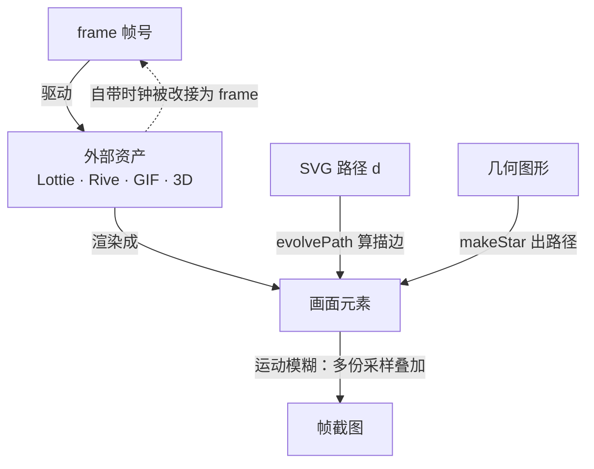

# 第九章：图形扩展包——paths、shapes、lottie、rive、motion-blur 与 three

> [!TIP] Part 4: 规模化与工程篇（图形、规模与工程）
> 画面效果的下一层是图形资产。本章盘点官方图形扩展包：`@remotion/paths` 的描边动画、`@remotion/shapes` 的几何图形、Lottie/Rive 动画的帧号化改造、运动模糊与 `@remotion/three` 的 3D 场景——[第 2 章 2.5 节](./ch02.md)那张表里 three.js 那一行「官方包装」的展开，加另外五个同族扩展包。先修：[第 2 章 2.1 节](./ch02.md)（interpolate 收口）、[第 8 章 8.3 节](./ch08.md)（自定义转场）。

## 为什么要学图形扩展包？

Remotion 核心只提供插值与弹簧两种动效，表现力再往上一层靠六个官方扩展包补齐。它们不是六套新世界观——每个包都在做同一件事：**把外部的时间源换成 frame**，其余内容原样使用。

**图 9-1｜本章模型：把外部时钟换成帧号**（节点为实体——帧号驱动外部资产，外部资产与路径几何汇成画面元素再进截图；实线是常态流向，虚线是时钟被改接）：



<p class="figure-note">六个包共用一条纪律：外部时间源一律换成 frame</p>

> [!WARNING] 先猜再读
> - 先猜一猜：`evolvePath(1.2, path)` 的描边会怎样——超过 100% 继续变粗？报错？还是从头回退？（答案见 9.1）
> - Lottie JSON 里自带帧时钟（`fr: 60`、`op: 190`），放进 Remotion 会不会违反「禁用自带时钟」的纪律？（答案见 9.3）
> - 先猜一猜：3D 场景在 Studio 里好好的，一渲染就黑屏——最可能缺了哪个配置？（答案见 9.5）

## 9.1 @remotion/paths——SVG 路径的计算器

SVG 的 `d` 属性是一串对程序不可读的命令文本，这个包把它变成可计算的对象：

```tsx
import { getLength, getPointAtLength } from "@remotion/paths";

getLength("M 0 0 L 100 0");                  // 100
getPointAtLength("M 0 0 L 100 0", 50);       // {x: 50, y: 0}
```

API 按用途分四组，先建全局索引再挑常用的讲：

| 分组 | 代表成员 | 用途 |
| ---- | ---- | ---- |
| 度量 | `getLength` / `getBoundingBox` | 路径总长、包围盒 |
| 定位 | `getPointAtLength` / `getTangentAtLength` | 沿线取点、取切线方向 |
| 进度 | `evolvePath` / `interpolatePath` / `reversePath` | 描边动画、路径 morphing、倒放 |
| 变换 | `translatePath` / `scalePath` / `centerPath` / `warpPath` | 几何变换后再喂回 `d` |

最常用的是 `evolvePath`——描边动画的全部秘密：

```tsx
import { evolvePath } from "@remotion/paths";
import { interpolate, useCurrentFrame } from "remotion";

const SNOW_TRACK = "M 0 120 C 100 40 220 200 320 90";

export const TrackDrawing: React.FC = () => {
  const frame = useCurrentFrame();
  const progress = interpolate(frame, [0, 60], [0, 1], {
    extrapolateRight: "clamp",
  });
  const { strokeDasharray, strokeDashoffset } = evolvePath(progress, SNOW_TRACK);

  return (
    <svg width={400} height={220}>
      {/* 底轨：完整路径的淡色版本 */}
      <path d={SNOW_TRACK} fill="none" stroke="#dfe7f2" strokeWidth={2} />
      {/* 前景：按 progress 生长的描边 */}
      <path d={SNOW_TRACK} fill="none" stroke="#4a90d9" strokeWidth={2}
        strokeDasharray={strokeDasharray} strokeDashoffset={strokeDashoffset} />
    </svg>
  );
};
```

回答「先猜再读」：`evolvePath(1.2, path)` **不会从头回退**——按本章 9.1 的公式 `strokeDashoffset = 总长 × (1 − progress)`，progress 超过 1 时虚线整体前移、实画段从**终点**往回缩（画出 2 − 1.2 = 80%）；progress 小于 0 时虚线被推出路径之外，结果是**整条不画**。所以描边动画几乎总要 clamp 收口，与 2.2 的 spring 过冲收口是同一个道理。

原理一句话就能说透：`strokeDasharray` 把路径总长变成一段虚线，`strokeDashoffset` 把虚线推出 `总长 × (1 − progress)` 的距离——视觉上就是线从起点画到了 progress 的位置。两条路径叠放（淡色底轨 + 生长的前景）是这类装饰动画的标准构图，贯穿示例用它给标题卡加一条「雪花飘落轨迹」，60 帧画完，区间用场景局部帧，与 3.5 的踩点公式同源。

四个高频成员点到为止：

- `getPointAtLength(path, len)`：沿线取点——把一颗雪花钉在轨迹的 progress 位置上，描边与元素运动同步；
- `getTangentAtLength(path, len)`：取切线——箭头、小车沿路径转向；
- `interpolatePath(a, b, progress)`：两条形状渐变（morphing），要求两条路径指令数相同；
- `getBoundingBox(path)`：拿包围盒做自适应布局——路径画在什么坐标都不怕。

## 9.2 @remotion/shapes——现成的几何图形

手画五角星要算十个顶点坐标，这个包直接给。每个图形提供两种形态，用法完全不同：

```tsx
// 组件式：直接渲染一个 SVG 元素
import { Star } from "@remotion/shapes";
<Star points={5} innerRadius={40} outerRadius={100} fill="#f5f7fa" />

// 函数式：返回 { path } 字符串，自己决定拿它做什么
import { makeStar } from "@remotion/shapes";
const { path } = makeStar({ points: 5, innerRadius: 40, outerRadius: 100 });
```

| 维度 | 组件式 `<Star>` | 函数式 `makeStar()` |
| ---- | ---- | ---- |
| 返回物 | 已渲染的 SVG 元素 | `d` 路径字符串 |
| 何时用 | 只要画出来 | 要拿到路径继续加工 |
| 典型组合 | 直接放进场景 | 喂给 `evolvePath` 做描边 |

内置星形、三角形、饼图、圆环切片等常用几何，函数式与组件式一一对应（`makeStar` ↔ `<Star>`）。

函数式的价值在与 9.1 打组合拳——「先描边生长、再填充淡入」：

```tsx
// 承接 9.1 的 import：makeStar / evolvePath / interpolate / frame（局部帧）
const { path } = makeStar({ points: 5, innerRadius: 60, outerRadius: 120 });
const { strokeDasharray, strokeDashoffset } = evolvePath(
  interpolate(frame, [0, 45], [0, 1], { extrapolateRight: "clamp" }),
  path
);
// 0~45 帧：描边沿轮廓生长
// 45 帧后：<path fill="#f5f7fa" opacity={...}> 淡入填充
```

贯穿示例的挂钩：结尾卡的雪花徽章可以这样做——星形描边长出后填充，替换原来的静态图形。注意 9.2 示例里的区间都是**场景局部帧**，而结尾卡只有 20 帧（263–283），所以要把它压到 20 帧以内（例如描边用 `[0, 18]`），动画才收得进这个窗。

## 9.3 @remotion/lottie 与 @remotion/rive——外部动画资产

2.5 的判别标准说过：自带时钟的库，把「时间」参数换成 frame 就能救。Lottie 与 Rive 的官方包装就是替你做完了这件事——外部时钟在组件内部被拔掉，纪律完好。

**Lottie**：After Effects 导出的 JSON 动画。

```tsx
import { Lottie } from "@remotion/lottie";
import animationData from "./snowflake.json";

export const SnowBadge: React.FC = () => {
  return <Lottie animationData={animationData} playbackRate={0.8} />;
};
```

回答「先猜再读」：JSON 确实自带时钟（`fr` 帧率、`op` 出点字段），但 `<Lottie>` 内部把 lottie-web 的播放循环换成了「按当前帧号 seek」——它读的是 Remotion 的帧号而不是墙钟，所以同帧同画面。常用 props 三个：`playbackRate`（倍速）、`loop`（默认 false，不循环）、`direction`（`"forward" / "backward"`）。

一个引用身份的坑：`animationData` 对象身份变化会触发动画重新初始化。静态 import 天然稳定；若从 props 传入，用 `useMemo` 钉住引用——这里 useMemo 管的是**身份稳定**而不是性能，和 2.4 的用法同名不同职。

**Rive**：rive.app 编辑器制作的 `.riv` 文件，偏交互级动画。

```tsx
import { RemotionRiveCanvas } from "@remotion/rive";

<RemotionRiveCanvas
  src={staticFile("weather.riv")}
  artboard="Beijing"          // 画板名
  animation="snowfall"        // 动画名
  fit="contain"
/>
```

Rive 有个数据驱动的彩蛋：`onLoad` 拿到 File 后可以改 TextRun——把动画里画好的文字换成 props 传来的内容：

```tsx
const handleLoad = useCallback((file: File) => {
  const textRun = file.defaultArtboard().textRun("city");
  if (textRun) textRun.text = "北京";
}, []);

<RemotionRiveCanvas src={staticFile("weather.riv")} onLoad={handleLoad} />
```

这对贯穿示例的启发是：模板化视频的「换文案」不一定都走 DOM 字幕——美术在 Rive 里留好文字槽，流水线按 props 填字，画面品质不丢。

选型一句话：素材在 AE 里 → lottie；在 Rive 编辑器里 → rive；纯代码可写 → 不引外部资产，interpolate 就够。

六个包干的是同一件事：拔掉外部资产自带的那口钟。

```text
外部资产（自带时钟）
   │
   ▼
官方包装：把「时间」换成 frame / fps
   │
   ├── paths / shapes ──▶ 路径与几何 ──▶ 画面元素
   ├── lottie / rive ───▶ 动画资产 ────▶ 画面元素
   ├── gif ─────────────▶ 动图 ────────▶ 画面元素
   └── three ───────────▶ 3D 场景 ─────▶ 画面元素
```

## 9.4 @remotion/motion-blur——运动模糊

模糊的物理本质：快门曝光的一瞬间物体移动了，画面里留下一段轨迹。Remotion 的实现是**在一个帧内采样多份、叠加平均**：

```tsx
import { HtmlInCanvasMotionBlur } from "@remotion/motion-blur";
import { useVideoConfig } from "remotion";
// MovingBox 是本例自带的子组件（内含一个会移动的方块）

export const MyScene: React.FC = () => {
  const { width, height } = useVideoConfig();
  return (
    <HtmlInCanvasMotionBlur width={width} height={height}
      samples={8} shutterAngle={180}>
      <MovingBox />
    </HtmlInCanvasMotionBlur>
  );
};
```

两个参数各管一头：

- **shutterAngle**：曝光时长占一帧的比例。360° = 整帧，180° = 半帧（30fps 下即 1/60 秒，电影感的标准值），90° = 四分之一帧；
- **samples**：曝光窗口内采几份叠加——越多越顺滑，渲染成本线性上涨。

它和[第 8 章](./ch08.md)的转场能直接合流——4.0.545 起（恰好是全书钉住的版本）`TransitionSeries.Transition` 支持 `motionBlur`：

```tsx
<TransitionSeries.Transition
  presentation={slide({ direction: "from-right" })}
  timing={linearTiming({ durationInFrames: TRANSITION_FRAMES })}
  motionBlur={{ shutterAngle: 180, samples: 10 }}
/>
```

贯穿示例的挂钩：三段式淡入淡出（fade）本身位移极小，不值得上模糊；若哪天把转场换成 `slide`，这一行 `motionBlur` 就能让滑入带上惯性拖影。

两条限制要知道：

- 自定义 presentation 想支持 motionBlur，必须用 HTML-in-canvas 形态实现——8.3 的 `enterStyle` 写法不支持；
- `enterStyle / exitStyle` 等样式与 `motionBlur` 不能同时使用。

另外两个老组件 `<CameraMotionBlur>` 与 `<Trail>` 官方已不推荐——前者颜色不准，后者只是复制历史位置、不是真模糊。

## 9.5 @remotion/three——3D 场景

React Three Fiber（R3F）的 Canvas 自带渲染循环，`@remotion/three` 把它改造成帧驱动——这正是[第 2 章 2.5 节](./ch02.md)表格里 three.js 那一行「官方包装」的实体：

```bash
npm i three @react-three/fiber @remotion/three @types/three
```

```tsx
import { ThreeCanvas } from "@remotion/three";
import { useCurrentFrame, useVideoConfig } from "remotion";

export const SpinningCube: React.FC = () => {
  const frame = useCurrentFrame();
  const { width, height } = useVideoConfig();

  return (
    <ThreeCanvas width={width} height={height} camera={{ position: [0, 0, 6] }}>
      <ambientLight intensity={0.5} />
      <pointLight position={[5, 5, 5]} />
      <mesh rotation={[0, frame * 0.02, 0]}>
        <boxGeometry args={[2.5, 2.5, 2.5]} />
        <meshStandardMaterial color="#4a90d9" />
      </mesh>
    </ThreeCanvas>
  );
};
```

关键差异只有一处：R3F 的 `useFrame` 是自带动钟（浏览器每帧回调），放进 Remotion 会失控——正确姿势是把旋转写成 `frame` 的表达式直接放在 JSX 上，1.4 的「动的不是样式，是帧号」在 3D 里一字不改。

两个工程坑：

- **`<Sequence>` 默认渲染 `<div>`**，放进 ThreeCanvas 会报错——需要时加 `layout="none"`；
- **渲染黑屏**：three.js 在无头浏览器的默认 OpenGL 渲染器下不工作，要切到 ANGLE（转译到 DirectX/Metal 的渲染层）：

```ts
// remotion.config.ts —— CLI 渲染时生效
import { Config } from "@remotion/cli/config";
Config.setChromiumOpenGlRenderer("angle");
```

回答「先猜再读」：Studio 正常、渲染黑屏，多数是没设 `gl: angle`。但注意配置文件**只对 CLI 渲染生效**——[第 10 章](./ch10.md)的 Node API 渲染要显式传 `chromiumOptions: { gl: "angle" }`，这是给下一章埋的接口。

贯穿示例的挂钩：结尾卡的雪场若要体积感，可用 three 的 `Points` 做一层 3D 雪花，其余场景维持 DOM——一个组合里 3D 与 DOM 混排完全合法，ThreeCanvas 只是又一个普通组件。

## 本章小结

- `@remotion/paths` 把 `d` 字符串变成可计算对象；`evolvePath(progress, path)` 是描边动画的全部秘密，progress > 1 会从终点回缩、< 0 则整条不画，记得 clamp
- `@remotion/shapes` 组件式直接画、函数式给 path；`makeStar()` × `evolvePath()` 可打「描边生长再填充」的组合拳
- `<Lottie>` 与 `<RemotionRiveCanvas>` 已在内部把外部时钟换成帧号；`animationData` 引用要用 useMemo 钉住身份；Rive 的 TextRun 可按 props 填字
- 运动模糊 = 一帧内多份采样叠加；shutterAngle 定曝光、samples 定平滑；4.0.545 起 TransitionSeries 可直接加 `motionBlur`，自定义转场需 HTML-in-canvas 形态
- three 场景把 R3F 的 useFrame 换成 frame 表达式；`<Sequence layout="none">`；渲染必须切 `gl: "angle"`，Node API 下要显式传参
- 六个包共用一条纪律：外部时间源一律换成 frame——外部时钟换成帧号，其余内容原样使用
- 12 个内置效果是 HTML-in-canvas 形态（把两个场景渲染成位图再混合）；自定义转场想加 motionBlur 也必须走这个形态

**下一章预告**：画面表现力到顶了，接下来解决「规模」。第十章把 CLI 那条 `remotion render` 命令拆开——`@remotion/bundler` 与 `renderMedia` 的 Node API、`renderStill` 抽帧封面、一张数据集批量出片的流水线，以及 `@remotion/lambda` 云端渲染的适用边界——兑现 ch00「换一份 props 批量出片」的生态位承诺。

---
