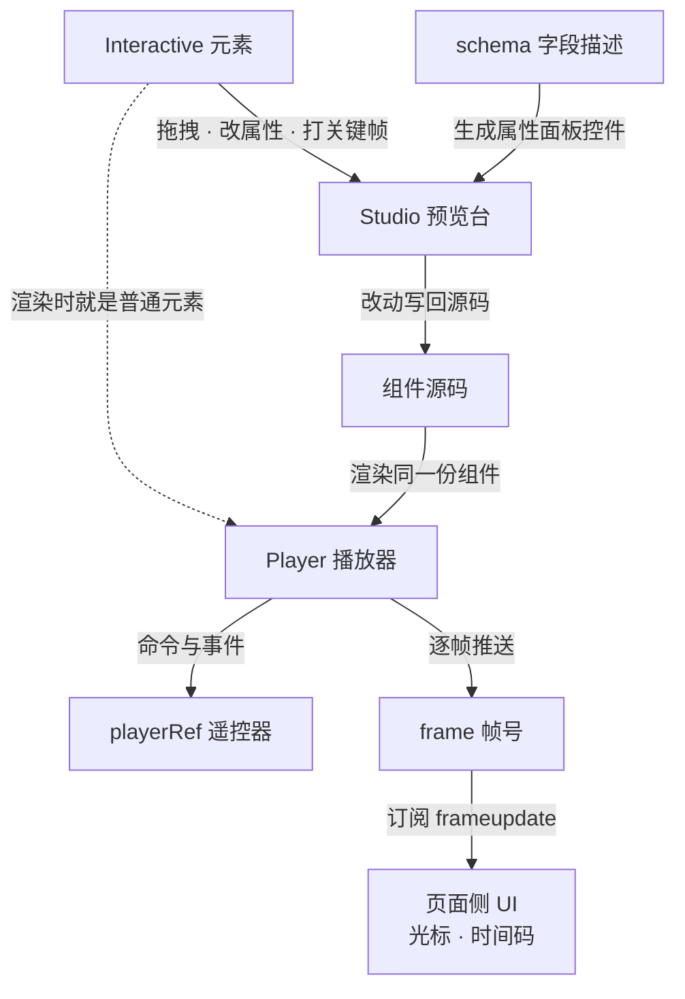

# 第十一章：交互与可视化编辑——playerRef、Interactive 与属性面板

> [!TIP] Part 4: 规模化与工程篇（图形、规模与工程）
> 三个出口解决的是「看」，本章解决「控」与「编」：网页侧用 `playerRef` 遥控 Player 并与帧号联动，Studio 里用 `Interactive` 把元素变成可拖拽可打关键帧的对象，再用 schema 给 props 装上可视化编辑面板。先修：4.4（Player 挂载方式）。

## 为什么要学交互与可视化编辑？

到第十章为止，Remotion 的边界是「渲染器」：代码进、mp4 出。本章把它推向两个新身份——**播放器 SDK**（网页里不仅嵌播放器，还能编程控制、逐帧联动）与**可视化编辑器**（Studio 里直接拖元素、改属性、打关键帧，改动写回源码）。这也是 Remotion 官方正在重点投入的方向。

**图 11-1｜本章模型：控与编的两条线**（节点为实体——源码渲染出 Player，遥控器与帧号喂页面 UI，Studio 把编辑写回源码；实线是常态流向，虚线是对照）：



<p class="figure-note">渲染语义一帧没变——变的只是「谁来操作画面」</p>

> [!WARNING] 先猜再读
> - 先猜一猜：把 `useCurrentFrame()` 写在渲染 `<Player>` 的网页组件里会怎样——正常工作、报错，还是疯狂 re-render？（答案见 11.2）
> - playerRef 的 `seeked`、`timeupdate`、`frameupdate` 三个事件都带帧号，差别是什么？（答案见 11.1）
> - 先猜一猜：`Interactive.Div` 渲染出来就是一个普通 div，画面完全一样——那它贵在哪？（答案见 11.3）

## 11.1 playerRef——Player 的遥控器

给 `<Player>` 挂一个 ref，就拿到一组命令式方法与事件：

```tsx
import { Player, PlayerRef } from "@remotion/player";
import { useEffect, useRef } from "react";

export const App: React.FC = () => {
  const playerRef = useRef<PlayerRef>(null);

  useEffect(() => {
    const player = playerRef.current;
    if (!player) return;                       // 挂载前 ref.current 为 null

    const onEnded = () => player.seekTo(0);
    player.addEventListener("ended", onEnded);
    return () => player.removeEventListener("ended", onEnded);
  }, []);

  return <Player ref={playerRef} /* …4.4 的其余 props */ />;
};
```

方法一张表：

| 方法 | 作用 |
| ---- | ---- |
| `play(event?)` / `pause()` / `toggle(event?)` | 播放、暂停、切换；用户手势调用时把事件对象传进去可绕过 autoplay 限制 |
| `seekTo(frame)` | 跳帧；播放中会短暂暂停再续播 |
| `getCurrentFrame()` / `isPlaying()` | 查询当前帧、播放状态 |
| `mute()` / `unmute()` / `setVolume(0~1)` | 静音与音量（推荐恢复声音时 unmute + setVolume(1) 一起调） |
| `requestFullscreen()` / `exitFullscreen()` | 全屏（需 `allowFullscreen`） |

事件系统是遥控器的另一半，三个「带帧号」的事件最容易混：

| 事件 | 触发时机 | 特点 |
| ---- | ---- | ---- |
| `seeked` | 用户拖进度条或 `seekTo()` | **只在 seek 时发**，seek 期间逐帧触发，量大 |
| `timeupdate` | 播放中的周期更新 | 节流到约 250ms 一次，会跳过帧 |
| `frameupdate` | 播放与 seek 都逐帧触发 | 要「每一帧都知道」就选它（11.2 的基石） |

回答「先猜再读」第二问：同一帧号的三种送达方式——`frameupdate` 全量逐帧、`timeupdate` 节流省渲染、`seeked` 只在 seek 时。另有 `play / pause / ended / error / waiting / resume / volumechange / fullscreenchange` 等状态事件，其中 `error` 由 error boundary 实现：**视频组件崩溃只会卸载播放器并触发事件，宿主网页不崩**——把 Remotion 嵌进产品时的安全网。

遥控器的数据流画出来更清楚——命令往上走，帧号往下走：

```text
网页上的按钮 ──play() / seekTo()──▶ playerRef ──▶ Player 内部时钟
                                                      │ frameupdate（逐帧）
                                                      ▼
                                          useCurrentPlayerFrame
                                                      │
                                                      ▼
                                          页面侧 UI（只有它重渲染）
```

遥控器最容易踩的三个坑，一张表收口：

| 症状 | 根因 | 处置 |
| ---- | ---- | ---- |
| `playerRef.current` 是 null | ref 在挂载完成前就有值 | 判空后再用，或把逻辑放进 `useEffect` |
| 组件卸载后仍在响应事件 | `addEventListener` 没配对移除 | `useEffect` 返回函数里 `removeEventListener` |
| 点播放没声音 | 浏览器 autoplay 策略 | 在用户手势的回调里把事件对象传给 `play(event)` |
| 反复播放越来越卡 | 每次渲染都挂一个新监听 | 依赖数组写对，或把监听移进 `useEffect` |

## 11.2 useCurrentPlayerFrame——页面 UI 与帧号联动

先回答「先猜再读」第一问：`useCurrentFrame()` **在组合外不工作**——它读的是「最近一层 Sequence 的局部帧」，而网页组件不在任何组合里；硬写在渲染 Player 的组件里，轻则拿不到值，重则若接了某种时间状态，整页 UI 每帧重渲染。正确姿势是官方给出的一个配方 hook：

```tsx
// use-current-player-frame.ts —— 官方配方（current-time 指南）
import { CallbackListener, PlayerRef } from "@remotion/player";
import { useCallback, useSyncExternalStore } from "react";

export const useCurrentPlayerFrame = (ref: React.RefObject<PlayerRef | null>) => {
  const subscribe = useCallback((onStoreChange: () => void) => {
    const { current } = ref;
    if (!current) return () => undefined;
    const updater: CallbackListener<"frameupdate"> = () => onStoreChange();
    current.addEventListener("frameupdate", updater);
    return () => current.removeEventListener("frameupdate", updater);
  }, [ref]);

  return useSyncExternalStore(
    subscribe,
    () => ref.current?.getCurrentFrame() ?? 0,
    () => 0
  );
};
```

架构原则比 hook 本身更重要：**时间敏感的 UI 拆到 Player 的相邻组件里**——

```tsx
export const App: React.FC = () => {
  const playerRef = useRef<PlayerRef>(null);
  return (
    <>
      <Player ref={playerRef} /* … */ />
      <TimelineCursor playerRef={playerRef} />   {/* 只有它每帧重渲染 */}
    </>
  );
};
```

`TimelineCursor` 内部用 `useCurrentPlayerFrame` 拿帧号，画自己的光标或时间码；Player 与 App 其余部分纹丝不动。贯穿示例的网页端可以这样补一条「当前句高亮进度」的侧栏，与视频内的卡拉OK字幕同帧联动——两边读的是同一份时间戳数据，天然同步。

这个配方里三个参数的分工值得拆开——它是 React 18 之后订阅「外部可变状态」的标准写法：

| 参数 | 作用 | 在这里对应什么 |
| ---- | ---- | ---- |
| `subscribe` | 订阅源，注册回调、返回取消订阅函数 | 监听 `frameupdate`，回调时通知 React |
| `getSnapshot` | 读取当前值 | `ref.current?.getCurrentFrame()` |
| `getServerSnapshot` | 服务端渲染时的取值 | 固定返回 0（无 DOM 环境没有播放器） |

React 拿到这三样就能自己决定何时重渲染：源的值变了就调 `onStoreChange`，而**只有真正读了这个值的组件会重渲染**。这正是「相邻组件原则」能成立的机制——不是靠约定，而是靠订阅粒度。

反例与正例对照一次：

```tsx
// 反例：帧号放在 App 里 —— 整个页面每帧重渲染
export const App: React.FC = () => {
  const playerRef = useRef<PlayerRef>(null);
  const frame = useCurrentPlayerFrame(playerRef);   // ← App 订阅了它
  return (
    <>
      <Player ref={playerRef} /* … */ />
      <div>当前第 {frame} 帧</div>
      <HeavySidebar />          {/* 每次都跟着重渲染，白白重算 */
    </>
  );
};

// 正例：帧号只在需要它的那一小块里
const TimelineCursor: React.FC<{ playerRef: React.RefObject<PlayerRef | null> }> = ({ playerRef }) => {
  const frame = useCurrentPlayerFrame(playerRef);
  return <div>当前第 {frame} 帧</div>;
};
```

## 11.3 Interactive——Studio 里可拖拽的组件

`Interactive`（4.0.475 起，随 4.0.545 可用）把 HTML/SVG 元素换成同名可编辑版本：

```tsx
import { Interactive } from "remotion";

export const TitleCard: React.FC = () => (
  <Interactive.Div
    from={30}
    durationInFrames={90}
    style={{ position: "absolute", top: 200, left: 120,
      padding: 24, backgroundColor: "#12203f", color: "#fff" }}
  >
    北京的冬天
  </Interactive.Div>
);
```

可用元素覆盖常用的 HTML 标签（`Div/H1/P/Section` 等）与 SVG 图形（`Svg/Rect/Text/Circle/Path` 等）。回答「先猜再读」第三问：**渲染产物就是一个普通 div，画面零差别；贵的是 Studio 里的身份**——它变成可选中、可拖拽、右侧面板可改属性、可打关键帧的对象，且修改**直接写回组件源码**（关键帧会被生成为 `interpolate()` 调用插进 JSX）。每个 Interactive 组件都内含一层 `<Sequence>`——`from`、`durationInFrames` 等时序字段直接写在元素上，第五章的时序语义原样延续。

写回源码的模式决定了三条最佳实践，做不到的值 Studio 改不了：

- **可编辑的值保持内联**（写在 JSX 的 style/props 上，别抽成变量）；
- **关键帧用硬编码的 `interpolate()` 数组**（Studio 生成的代码要能落到确定位置）；
- **动画一律走 `translate / scale / rotate / opacity`**，避免动画 `top/left` 或拼接 `transform` 字符串——前三者 Studio 有原生控制，后者无法被可视化编辑。

三条规则背后是同一个原因：**Studio 的写回是「往源码某个确定位置插一段代码」**。抽成变量的值，它插到哪儿？拼出来的 `transform` 字符串，它怎么知道该改哪一段？只有字面量上的数字与属性，机器才能算出「旧值是什么、新值是多少」并生成对应的 `interpolate()`。

写回生成的关键帧大致长这样——可编辑的值变成了一个硬编码的插值数组：

```tsx
// 美术在 Studio 里把标题从 24px 拖到 48px、又拖回 24px，源码变成这样
<Interactive.H1
  style={{
    fontSize: interpolate(frame, [0, 30, 60], [24, 48, 24], { extrapolateLeft: "clamp", extrapolateRight: "clamp" }),
  }}
>
  北京的冬天
</Interactive.H1>
```

看到这段代码就能明白「为什么关键帧必须硬编码」：Studio 写的是**一整段表达式**，它必须原样落在一个确定的位置上；如果 `fontSize` 来自一个变量或一个函数调用，这段表达式就没有落脚的锚点。

## 11.4 两套 schema——属性面板的两种写法

Remotion 现在有两条「让 Studio 提供编辑控件」的路径，用途不同：

**Zod schema**：挂在 `<Composition schema={...}>`（Player 侧同名 prop）。给 props 定义 zod 结构后，Studio 的属性面板变成可视化表单（配合 `@remotion/zod-types` 的 `zColor`、`zTextarea` 等控件），同时 TypeScript 类型自动推断。注意 Player 上的 schema **只用于类型推断，不做运行时校验**——校验与表单是 Studio 的职责。

```tsx
import { Composition } from "remotion";
import { z } from "zod";
import { zColor, zTextarea } from "@remotion/zod-types";

const schema = z.object({
  title: z.string(),             // 输入框
  accentColor: zColor(),         // 取色器
  note: zTextarea(),             // 多行文本
});

<Composition id="WinterVideo" schema={schema} /* … */ />
```

**InteractivitySchema**（4.0.479 起）：`Interactive.create()` 给自定义组件挂时间轴控件用的字段描述——它**不是 zod**，是一个轻量的对象字面量：

```ts
import type { InteractivitySchema } from "remotion";

export const titleCardSchema = {
  tint: { type: "color", default: "#ffffff", description: "色调" },
} as const satisfies InteractivitySchema;
```

字段类型按用途选：`number / boolean / color / string / enum / asset / font-family / scale / uv-coordinate / svg-path` 等；`number / color / scale / rotation` 等类型默认 **keyframable**——在 Studio 里可以像 After Effects 一样打关键帧，Studio 会把它写成 `interpolate()` 调用。`Interactive.create()` 用它包装自定义组件（总是内含 Sequence，`schema` 与 `componentName` 可选），替代已弃用的 `Interactive.withSchema()`。

```tsx
import { Interactive } from "remotion";

const TitleBox = Interactive.create(
  (props: { tint: string; radius: number }) => (
    <div style={{ background: props.tint, borderRadius: props.radius }}>北京的冬天</div>
  ),
  { schema: titleCardSchema, componentName: "TitleBox" },
);
```

`Interactive.create` 的第二个参数里，`schema` 描述「这个组件有哪些可编辑字段」，`componentName` 是它在 Studio 面板里显示的名字——给美术同学看的标签，别用 `TitleBox2` 这种名字。

| 维度 | Zod schema | InteractivitySchema |
| ---- | ---- | ---- |
| 挂载点 | `<Composition schema>` | `Interactive.create({ schema })` |
| 管什么 | props 的类型 + Studio 属性面板表单 | Studio 时间轴控件与关键帧 |
| 形态 | zod 对象（可复用 zod 生态） | 字段描述字面量（非 zod） |
| 版本 | 4.x 全程可用 | 4.0.479 起 |

选型一句话：改「输入数据」→ zod schema；改「画面元素与动画」→ Interactive + InteractivitySchema。

贯穿示例的挂钩：给 `WinterVideo` 的 Composition 补一个 zod schema（`title: z.string()`、`accentColor: zColor()`），Studio 里改标题与主题色就有了表单；把标题卡的文字容器换成 `Interactive.Div`，美术同学就能直接在预览里挪位置。

## 本章小结

- `playerRef` 是 Player 的命令式遥控器：play/seekTo/音量/全屏 + 事件监听；用户手势里 `play(event)` 可绕 autoplay；监听务必成对移除
- 三个带帧号的事件各司其职：`frameupdate` 全量逐帧、`timeupdate` 节流、`seeked` 只在 seek 期间
- `useCurrentFrame` 在组合外不工作；官方配方 `useCurrentPlayerFrame` 用 `useSyncExternalStore` 订阅 `frameupdate`（subscribe / getSnapshot / getServerSnapshot 三件套），且时间敏感 UI 必须与 Player 拆开
- `Interactive.*` 渲染产物与原元素无异，价值全在 Studio：选中、拖拽、属性面板、关键帧写回源码；三条 best practices（内联值、硬编码关键帧、transform/opacity 动画）都源于「写回要落在确定位置」
- 两套 schema 分工：zod 管 props 表单（Composition），InteractivitySchema 管时间轴控件与关键帧（Interactive.create），后者不是 zod

**下一章预告**：单条视频、单个项目都讲完了，最后一章收工程化的尾：多 Composition 的项目组织、CI 里无人值守渲染、测试思路（给 `getDurationInFrames` 这类规格函数上单元测试），以及版本对齐与 License 的合规细节——把贯穿项目收成可长期维护的仓库。

---
