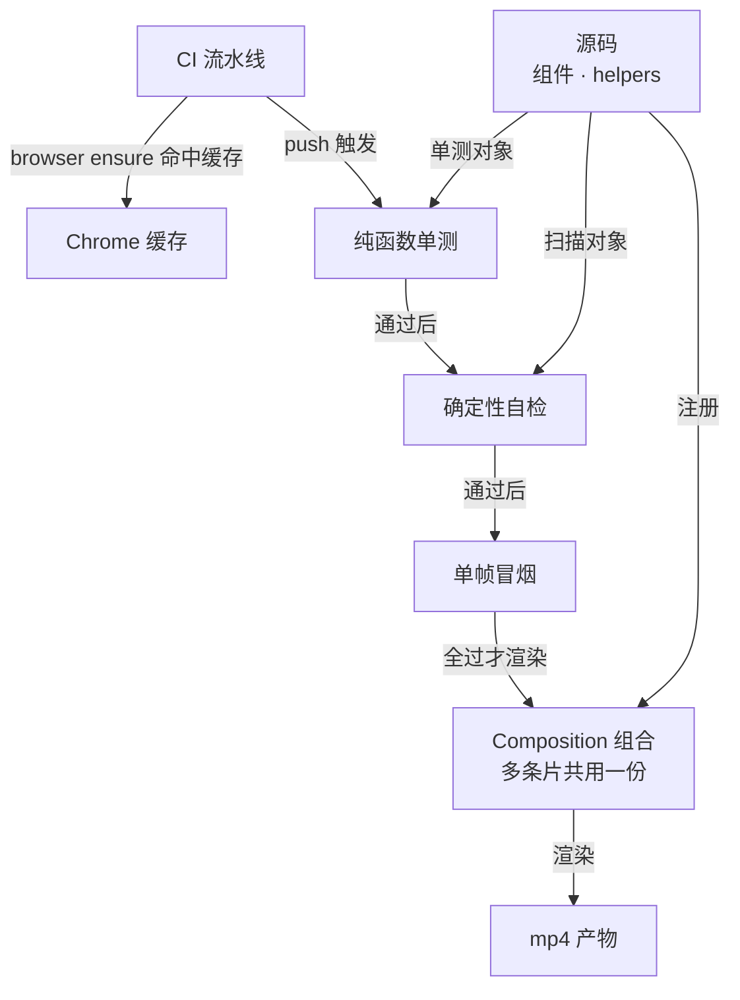

# 第十二章：工程化纵深——多组合、CI、测试与合规

> [!TIP] Part 4: 规模化与工程篇（图形、规模与工程）
> 全书最后一章收工程的尾：多 Composition 的项目组织、CI 里无人值守渲染、把确定性纪律变成断言的测试思路，以及版本对齐与 License 合规。读完这章，贯穿项目才算收成可长期维护的仓库。先修：[第 4 章 4.5 节](./ch04.md)（本地四条命令）、[第 4 章 4.6 节](./ch04.md)（授权口径）、[第 10 章 10.1 节](./ch10.md)（Node API）。

## 为什么要学工程化纵深？

前十一章解决了「能不能做」，本章解决「能不能长期做」：文案改了谁出片？回归了怎么发现？依赖升级会不会炸？——这些问题的答案都不涉及新 API，而是把前文的纪律组装成仓库的日常。

**图 12-1｜本章模型：长期维护的三层防线**（节点为实体——源码与组合是底座，CI 串起三层测试，全过才出片；实线是常态流向）：



<p class="figure-note">版本对齐与 License 合规横贯以上三块——升级与授权决定仓库能不能活</p>

> [!WARNING] 先猜再读
> - `npx remotion versions` 报告的是什么不一致？为什么生态包必须和主包同版本？（答案见 12.4）
> - 先猜一猜：CI 渲染总卡在下载浏览器这一步，官方推荐的省时动作是什么？（答案见 12.2）
> - 283 帧的成片，想自动化地「测画面有没有 bug」，最可行的手段是什么？（答案见 12.3）

## 12.1 多组合的项目组织——一个仓库多条片

[第 1 章 1.2 节](./ch01.md)提过一句「一个项目可注册多条组合」，规模上去后它就是仓库的组织原则：

```text
remotion/
├── index.ts              ← RemotionRoot：并列注册全部组合
├── helpers/
│   ├── duration.ts       ← getDurationInFrames（3.4 的单一来源）
│   └── scene-plan.ts     ← getScenePlan 场景边界
└── components/
    ├── WinterVideo.tsx    ← 组合一的入口组件
    ├── SummerVideo.tsx    ← 组合二的入口组件
    └── shared/            ← 两者共用的雪花、字幕、进度条
        ├── SnowField.tsx
        └── Karaoke.tsx
```

三条组织规则：

- **组合 = 组件 + 规格**：每条组合在 Root 里声明自己的 `id`、`defaultProps`、`calculateMetadata` 与 11.4 的 zod schema；组件只管画面，规格只管帧数宽高；
- **helpers 横切所有组合**：`getDurationInFrames` 写一份，Winter 与 Summer 都 import——哪条组合偷偷复制了一版取整逻辑，4.2 排错表里「进度条与成片时长对不上」就会复活；
- **shared 组件不感知组合**：雪花不关心自己在哪条片里，靠 props 拿参数——组合间的差异收敛到入口组件一层。

两条组合的差异该放在哪，一张表说清：

| 差异类型 | 放在哪 | 例子 |
| ---- | ---- | ---- |
| 只是数据不同 | `defaultProps` 与 `--props` | 同一模板，冬天版与夏天版只换文案 |
| 画面结构不同 | 各自的入口组件 | 字幕视频 vs 数据播报 |
| 规格不同 | `calculateMetadata` | 16:9 与 9:16，帧数算法相同、宽高不同 |

三条规则合起来，落到代码上长这样：

```tsx
// index.ts —— 两条组合并列注册，helpers 与 shared 组件都是共用的
export const RemotionRoot: React.FC = () => (
  <>
    <Composition
      id="WinterVideo"
      component={WinterVideo}
      durationInFrames={300}
      fps={30}
      width={1280}
      height={720}
      defaultProps={winterDefaults}
      calculateMetadata={({ props }) => ({ durationInFrames: getDurationInFrames(props) })}
    />
    <Composition
      id="SummerVideo"
      component={SummerVideo}
      durationInFrames={300}
      fps={30}
      width={1080}
      height={1920}          // 竖版：只有规格不同，helpers 照旧共用
      defaultProps={summerDefaults}
      calculateMetadata={({ props }) => ({ durationInFrames: getDurationInFrames(props) })}
    />
  </>
);
```

CLI 用 `id` 点名（1.2 立下的约定在此兑现）：`npx remotion render remotion/index.ts SummerVideo out/summer.mp4`。

## 12.2 CI 渲染——push 即出片

把[第 4 章 4.5 节](./ch04.md)的 `npm run video` 搬进 GitHub Actions，文案或画面一提交就自动出新片：

```yaml
# .github/workflows/render.yml
name: render
on:
  push:
    paths: ["remotion/**", "scripts/**", "public/**", "package.json", "package-lock.json"]
jobs:
  render:
    runs-on: ubuntu-latest
    steps:
      - uses: actions/checkout@v4
      - uses: actions/setup-node@v4
        with: { node-version: 20, cache: npm }
      - run: npm ci
      - uses: actions/cache@v4
        with:
          path: node_modules/.remotion
          key: chrome-${{ hashFiles('package-lock.json') }}
      - run: npx remotion browser ensure
      - run: npm run tts                       # 产出 out/audio.mp3 + out/timestamps.json
      - run: node scripts/sync-assets.mjs    # 同步到 public/，三个出口同源
      - run: npx remotion render remotion/index.ts WinterVideo out/video.mp4 --props=out/timestamps.json --log=error
      - uses: actions/upload-artifact@v4
        with: { name: video, path: out/video.mp4 }
```

回答「先猜再读」第二问：卡在下载浏览器是因为 CI 每次都是全新机器——`npx remotion browser ensure` 幂等地预下载 Chrome Headless Shell（1.5 说的那 100 MB），配合 `actions/cache` 按锁文件缓存 Remotion 的浏览器目录，之后每次构建直接命中。缓存目录以官方 CI 指南与所用 Remotion 版本为准，升级后记得同步缓存 key。

上面那份 workflow 的每一步各管什么、坏了怎么办，一张表收口：

| 步骤 | 作用 | 坏了的表现 | 处置 |
| ---- | ---- | ---- | ---- |
| `checkout` | 拿到代码 | 权限错误 | 私有库要配 `permissions` 与 token |
| `setup-node` + `npm ci` | 装依赖（走 lockfile） | 版本对不上 | 锁文件与 package.json 不同步 |
| `cache`（浏览器目录） | 复用 Chrome Headless Shell | 每次都重下 100 MB | key 要跟 `package-lock.json` 走 |
| `npm run tts` | 生成音频与时间戳 | `--props` 指向的文件不存在 | TTS 凭证要走 secrets |
| `browser ensure` | 幂等预下载浏览器 | 卡在这一步 | 检查缓存是否命中 |
| `remotion render` | 出片 | 渲染报错 | 按 4.2 的报错对照表查 |
| `upload-artifact` | 交付 mp4 | 找不到文件 | 确认输出路径与 `--log` 设置 |

缓存 key 的设计值得多说一句：上面那行 `key` 用的是锁文件的哈希（GitHub Actions 的 `hashFiles` 函数）——锁文件变了（升级了 Remotion）就是一份新缓存，浏览器版本也随之更新；锁文件没变就复用旧缓存，跳过下载。**升级 Remotion 后如果渲染行为变了却没换缓存**，就会出现「本地好的、CI 坏的」的怪事，所以 12.4 的升级清单里会再提一次「同步缓存 key」。

三条 CI 特有的注意：

- **密钥走 secrets**：TTS 凭证、10.4 的 `licenseKey` 一律 `secrets.XXX` 注入，不进仓库；
- **渲染超时要预留**：CI 机器比开发机慢，CLI 用 `--timeout=120000` 放宽渲染超时（Node API 对应 `timeoutInMilliseconds`，见 10.1 参数表），delayRender 的 30 秒默认值在慢机上可能不够；
- **产物用 artifact 交付**：mp4 传 artifact 而不是 commit 进仓库——二进制大文件进 git 会让每次文案改动都膨胀历史。

规模继续涨时，12.2 的 runner 就是 10.4 的前置判断：一次 push 出几十条片，轮到 Lambda 登场。

## 12.3 测试——把纪律变成断言

回答「先猜再读」第三问：逐帧比对新画面没有可行的 golden 体系，**测画面先测规格、再冒烟单帧**——三层由 cheap 到 expensive：

第一层，**纯函数单测**（最便宜、最值得）。全书反复强调的单一来源函数，正是测试价值最高的地方（断言的帧数来自[第 3 章 3.3 节](./ch03.md)的公式）：

```ts
import { expect, test } from "vitest";
import { getDurationInFrames } from "../remotion/helpers/duration";

test("8.81s 音频 + 0.6s 尾帧 = 283 帧", () => {
  expect(getDurationInFrames({ duration: 8.81 })).toBe(283);
});

test("极短音频也要至少 1 帧", () => {
  expect(getDurationInFrames({ duration: 0 })).toBeGreaterThan(0);
});
```

`getScenePlan` 的三个场景区间（0 / 157 / 263）、时间戳清洗（3.4 的 50ms 重叠）同理——这些函数错了，错的是整条视频的骨架。

第二层，**确定性自检自动化**。1.4 的清单里前三条可以变成 CI 步骤或 lint 规则：全仓库搜 `Math.random`、`Date.now`、`setTimeout` 零命中——违反纪律的代码在 code review 之前就被拦下。

```bash
# scripts/check-determinism.sh —— CI 里跑，命中即失败
set -e
for pattern in "Math.random" "Date.now" "setTimeout" "setInterval"; do
  if grep -rn "$pattern" remotion/ --include="*.ts" --include="*.tsx" --exclude="*.test.ts" --exclude="*.test.tsx"; then
    echo "✗ 命中 $pattern：违反确定性纪律（1.4）"; exit 1
  fi
done
echo "✓ 确定性自检通过"
```

注意排除测试文件——单元测试里常用 fake timer 与固定随机数做桩，不排除就会被这条规则误伤。

第三层，**单帧冒烟渲染**。用 10.1 的 Node API 渲染一帧最贵的画面（转场踩点帧 157）确认不崩、不超时：

```ts
await renderMedia({
  /* … */ frameRange: [157, 157],
  outputLocation: "out/smoke-157.mp4",
});
```

它不判断画面对不对，只判断「还能渲染」——依赖坏了、字体丢了、9.5 的 gl 没配，都在这里暴露。视觉回归交给 Studio 的逐帧检查（4.1 的「三查」），那是人擅长的部分。

三层测试的分工，一张表收口：

| 层 | 测什么 | 怎么测 | 放哪 | 耗时 |
| ---- | ---- | ---- | ---- | ---- |
| 一 · 纯函数单测 | 帧数、场景区间、时间戳清洗 | vitest 断言 | 每次 push | 秒级 |
| 二 · 确定性自检 | 禁用 API 零命中 | grep / lint | 每次 push | 秒级 |
| 三 · 单帧冒烟 | 渲染管线还活着 | `frameRange: [157,157]` | 每次 push | 十几秒 |

为什么不加第四层「画面快照比对」？因为画面是 283 张图，golden 文件体积巨大、字体与浏览器版本一变就全红——**把人力放在人擅长的地方**：机器守纪律，人守观感。

## 12.4 版本对齐与 License 合规

**版本对齐**回答两问的第一问：`npx remotion versions` 逐包报告 `@remotion/*` 生态包与 `remotion` 主包的版本差——不同版本意味着组件间共享的内部约定可能错位，症状千奇百怪（4.2 排错表的 ERESOLVE 只是其中一种）。它同时会检查 `zod`、`mediabunny` 这类附属包是否用了推荐版本，全部一致时最后一行是 `All packages have the correct version.`

`npx remotion upgrade` 一次升齐所有包，回答第三问——**为什么不建议随手跑**：Remotion 的 changelog 节奏很快，patch 版也可能改变渲染行为（9.4 的转场 `motionBlur` 要 4.0.545 才有；ch06 的媒体组件改名是方向性变更）。它还会把 `zod` 等附属包升到推荐版本，官方明确不建议用 `npm update` 代替——后者会把项目里所有依赖一起升级，容易顺手弄坏与视频无关的东西。

升级的正确姿势是一张七步清单：

| 步骤 | 做什么 | 为什么 |
| ---- | ---- | ---- |
| 1 锁版本 | 先 `npx remotion versions` 看现状 | 知道自己在从哪个版本出发 |
| 2 读 changelog | 对照自己用到的 API | 重点看渲染行为与组件改名 |
| 3 升级 | `npx remotion upgrade`（回退用 `--version`） | 一次升齐主包与生态包 |
| 4 跑单测 | 12.3 第一层 | 规格函数最先暴露问题 |
| 5 跑冒烟 | 12.3 第三层，单帧渲染 | 验证渲染管线没坏 |
| 6 同步 CI 缓存 key | 12.2 的缓存随锁文件走 | 避免旧浏览器带来怪问题 |
| 7 提交 | 版本号进 `package-lock.json` | 让别人复现同一环境 |

**License** 把 4.6 的授权口径落成合规自查三问：

- **团队多大？** 个人与 ≤3 人公司免费，更大团队需商业授权（Player、Studio、渲染都算在内）；
- **在哪渲染？** 本地与 CI 渲染走免费/商业授权即可；云端渲染（Lambda、Cloud Run）需要商业授权的团队须以 Automators 授权覆盖；
- **licenseKey 配了吗？** 4.0.409 起 `renderMedia` / `renderStill` / Lambda 支持 `licenseKey`：符合免费条款的传 `"free-license"`，需授权的团队传密钥上报用量，密钥进 secrets 不进仓库。

```ts
// 密钥永远来自环境变量，绝不写进仓库
await renderMedia({
  /* … */
  licenseKey: process.env.REMOTION_LICENSE_KEY ?? "free-license",
});
```

三问都在「是」之外有动作要做的团队，选型时（4.6 的甜区判断）就该把授权成本算进总账。

## 本章小结

- 多组合组织的三条规则：组合 = 组件 + 规格；helpers 横切所有组合；shared 组件不感知组合；差异按「数据 / 结构 / 规格」分别落在 defaultProps、入口组件、calculateMetadata
- CI 渲染 = checkout → npm ci → `browser ensure` + 浏览器缓存 → render → artifact；缓存 key 跟锁文件走，升级后要同步；密钥走 secrets，mp4 不进 git
- 测试三层：纯函数单测（规格与踩点公式）→ 确定性自检自动化（Math.random 零命中）→ 单帧冒烟渲染；画面本身不进 golden test
- `npx remotion versions` 查版本差（也查 zod/mediabunny 等附属包）、`npx remotion upgrade` 升齐但别用 `npm update` 代替；升级按七步清单走，全书钉住 4.0.545 的原因在此
- License 合规三问：团队规模、渲染位置、licenseKey 配置；云端渲染与 Automators 授权的边界要提前算账
- CI 的两处细节：缓存 key 跟锁文件走（升级后要同步），渲染超时按 CI 机器放宽

## 结束语

回到全书的第一性原理——**画面 = f(帧号)**。第一章建立这个心智，第二章给了映射工具，第三章把它接到真实数据流上，第四章交付成片；第五到八章把时序、媒体、字幕与转场补成全量工具箱，第九章引入图形资产与 3D，第十到十二章把一切装进可编程、可批量、可维护的仓库。

十二章其实只回答了一个问题：**给定帧号，画面应该是什么样？** 由此派生出三条纪律——同一帧必须同一画面（确定性）、数据只算一遍（单一来源）、外部时间一律换成 frame——你在任何 Remotion 项目里遇到的问题，几乎都能沿这三条纪律找到病因。把这个问题问清楚，视频就只是函数调用的副产品。

**下一站不是章节，而是你的第一个项目**：`npx create-video@latest` 建一个沙盒，把贯穿示例的流水线抄进去跑通，然后换上你自己的文案——改完 props 按 `npm run video`，第一条属于你的片就出来了。

---
